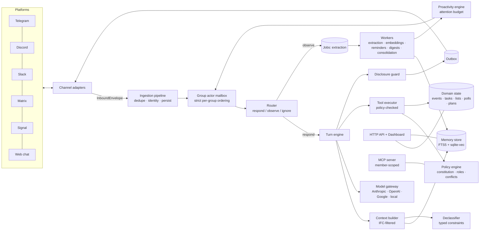
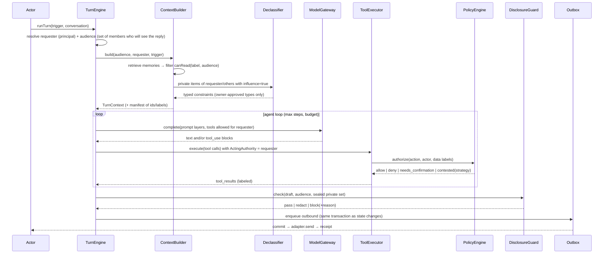

# 01 — System Architecture (the spine)

> Status: **normative**. All subsystem specs (`02`–`13`) elaborate this document and must not contradict it. If a subsystem spec needs to change a decision here, it records the change under its own "Proposed spine changes" section with rationale. Changes are merged here only through the review step in `14-milestones.md` §Plan maintenance.

---

## 1. Architecture at a glance

Village is a single long-running TypeScript service (the **server**) with these pieces:

- **Channel adapters** connect to chat platforms using outbound connections only (long-polling, WebSockets, Socket Mode). By default no inbound ports or public URLs are needed.
- An **ingestion pipeline** normalizes and persists everything.
- **Per-group actors** process each group's events strictly in order.
- A **turn engine** decides whether to speak and builds an audience-safe context. It runs a model with policy-checked tools and passes every outgoing message through a disclosure guard.
- **Background workers** handle extraction, embeddings, reminders, digests, consolidation and backups, all on a durable SQLite job queue.
- A **web dashboard and HTTP API** run on the same process.
- **SQLite**, one file and optionally encrypted at rest, holds all state. Blobs are stored on local disk.



### Architectural style
- **Hexagonal (ports and adapters).** `@village/core` is pure domain logic: no I/O, no clocks, no randomness. It is fully deterministic and therefore exhaustively testable. Every side effect sits behind a port interface defined in `core` and implemented in an adapter package.
- **Event-driven pipeline with per-group serialization.** All writes to one group's state happen inside that group's actor, one at a time. This removes whole classes of race conditions (double-assigning a chore, two members editing one plan).
- **Atomic effects plus turn journal.** better-sqlite3 transactions are synchronous and **must never span an `await`**, so a turn cannot hold one transaction across model calls. Instead:
  - Each tool call commits atomically. That transaction contains the state change, its `AuditEvent` and a `TurnEffect` journal row.
  - The final reply and its outbox rows commit atomically at turn end, in a transaction that also marks the turn `completed`.
  - If the process dies between effects and reply, boot-time recovery finds turns with effects but no completion. It sends a deterministic, template-rendered summary of the journaled effects (e.g. "I added *Recital — Fri 6 pm* to the calendar."), passed through the disclosure guard. Each effect is therefore always acknowledged exactly once.
  - Sending happens only after commit (transactional outbox).
- **Policy before power.** No tool can touch state without a `PolicyDecision` from the policy engine. No context can contain data without an `InformationFlow` check. These are enforced structurally: the tool executor and context builder are the *only* code paths with access to the repositories they need.

---

## 2. Technology decisions (ADRs)

Each ADR records its alternatives so later contributors understand the trade-off. Full ADR files are generated during M0 into `docs/adr/` from these summaries.

| # | Decision | Choice | Alternatives considered | Rationale |
|---|---|---|---|---|
| ADR-001 | Language/runtime | **TypeScript 5.x (strict), Node.js 26 LTS** (Active LTS since 2026-10-28) as the primary target for images and CI; **Node.js 24 (≥24.11, Maintenance LTS)** remains supported for native installs, with weaker plugin network isolation (see §14 A1). ESM only | Python, Go, Rust, Bun | Best chat-SDK ecosystem (grammY, discord.js, Bolt, matrix-bot-sdk). Official Anthropic/OpenAI/Google SDKs. One language for server and dashboard. GitHub's largest language community, so the most contributors. Node LTS is chosen over Bun for native-module compatibility (better-sqlite3, sqlite-vec, onnxruntime). We keep the code Bun-compatible where cheap. |
| ADR-002 | Monorepo | **pnpm workspaces + Turborepo**, TS project references, **tsdown** builds | Nx, Rush, plain tsc | Fast, simple, cache-friendly. tsdown is the maintained successor to tsup. |
| ADR-003 | Lint/format | **Biome** (format + lint) and **typescript-eslint** limited to type-aware rules (`no-floating-promises`, `no-misused-promises`, `switch-exhaustiveness-check`, `strict-boolean-expressions` in core) | ESLint-only, oxlint | Biome is fast. A handful of type-aware rules catch the async bugs that matter in an event-driven server. |
| ADR-004 | Testing | **Vitest** (unit/integration), **fast-check** (property-based, mandatory for policy/IFC/fairness), **Playwright** (dashboard e2e), **@village/evals** simulation harness | Jest, Mocha | Vitest is fast, ESM-native and has a good watch mode. Property tests are the only credible way to claim "no leaks". |
| ADR-005 | Storage | **SQLite** (WAL) via **better-sqlite3-multiple-ciphers** (SQLCipher-compatible encryption at rest), **Drizzle ORM** + drizzle-kit migrations, **FTS5** for keyword search, **sqlite-vec** for vectors | Postgres+pgvector, LanceDB, LibSQL | Zero-ops single file, ideal for self-hosting and the Pi. Fast enough for any realistic group size. Repositories live behind ports so Postgres can be added after 1.0. **M1 spike** verifies that Drizzle + multiple-ciphers + sqlite-vec work together. If the spike fails, fall back to plain better-sqlite3 with application-level envelope encryption of sensitive columns (documented in `02`). |
| ADR-006 | LLM access | Own **`ModelGateway`** port with native adapters: **Anthropic via official `@anthropic-ai/sdk`** (default and reference), OpenAI via `openai`, Google via `@google/genai`, and local OpenAI-compatible servers (Ollama, LM Studio, llama.cpp, vLLM) via `openai` with `baseURL` | Vercel AI SDK, LangChain | Native SDKs expose provider-specific power we rely on: Anthropic prompt caching, adaptive thinking + effort, structured outputs, server-side refusal fallbacks, Batches API, count_tokens. A thin port keeps the engine provider-neutral. No LangChain. |
| ADR-007 | Embeddings | **Local by default, in process**: `@huggingface/transformers` (transformers.js, ONNX) with a small multilingual model (default `multilingual-e5-small`, 384-d; evaluate `bge-m3` in M6). Pluggable: OpenAI, Voyage, Google, Ollama | Always-API embeddings | Privacy: embeddings of private memories never leave the host by default. It is cheap, and works offline and on the Pi. |
| ADR-008 | HTTP | **Hono** on `@hono/node-server`, **@hono/zod-openapi** for typed routes plus OpenAPI spec, SSE for live updates | Fastify, Express | Small, fast, typed end to end. The OpenAPI spec generates the dashboard client. |
| ADR-009 | Dashboard | **React 19 + Vite + TanStack Router + TanStack Query + Tailwind CSS v4 + shadcn/ui (Radix)**, served as static assets by the server | Next.js, SvelteKit | A pure SPA needs no Node SSR runtime and is easy to embed and theme. Large contributor pool. |
| ADR-010 | Validation & types | **zod v4** at every boundary (config, HTTP, tool I/O, LLM structured outputs, adapters). Branded ID types. Domain decisions return discriminated unions; only bugs and infrastructure failures throw | io-ts, valibot | One schema language end to end, and zod v4 is fast. |
| ADR-011 | Time | **Temporal API via `temporal-polyfill`** for all date/time/timezone logic. RFC 5545 recurrence via an RRULE library (`rrule-temporal` preferred, `rrule` fallback; decided in the M7 spike). Natural-language dates are parsed by LLM structured output and cross-checked with `chrono-node` | Luxon, date-fns-tz, moment | Correct timezone and DST semantics for families spread across timezones. `Date` is banned in `core` (lint rule). |
| ADR-012 | Jobs | **In-house durable job queue on SQLite** (leases, retries with backoff, idempotency keys, run_at, per-group partition key) + scheduler loop | BullMQ/Redis, graphile-worker | No extra infrastructure. Transactional with domain writes. Simple and auditable. |
| ADR-013 | Observability | **pino** structured logs, an optional **OpenTelemetry** exporter (GenAI semantic conventions), and internal **TurnTrace** records in the DB that power "Why did Village say this?" | — | Explainability is a product feature, not just ops. |
| ADR-014 | Configuration | `village.yaml` (non-secret, versioned) + environment / `.env` (secrets) + DB-persisted runtime settings edited from the dashboard. All validated with zod. Precedence: **env > DB settings > village.yaml > defaults**, except secrets, which are env/keyfile only | Pure env, pure DB | Hosts want a file they can version. Admins want UI editing. Secrets never live in the DB or YAML. |
| ADR-015 | Packaging | Multi-arch Docker image (amd64/arm64), `docker compose`, a thin npm CLI plus a public server-runtime package, a Home Assistant app (HA renamed "add-ons" to "apps"), Umbrel/CasaOS manifests. Single all-in-one process by default. **The npm name `village` is taken.** Throughout this plan, `npx village@latest init` is a placeholder for `npx <final-cli-name>@latest init`, with the final name chosen per `13` §A (see §14 A2) | k8s-first | Meet self-hosters where they already are. |
| ADR-016 | License & contributions | **Apache-2.0**, DCO sign-off, no CLA, Contributor Covenant 2.1 code of conduct | MIT, AGPL | Permissive, with an explicit patent grant; friendly to contributors and companies. |
| ADR-017 | Telemetry | **None.** No analytics and no phone-home. Update check is opt-in and fetches a static JSON release manifest only | Opt-in analytics | Trust is the product. |
| ADR-018 | i18n | Bot language is model-driven and follows each group's and member's locale. Dashboard strings use `i18next` from day one (English at launch, community translations later). Per-member timezone and locale | — | Groups are global. |
| ADR-019 | IDs | **TypeID** (`typeid-js`): type-prefixed, UUIDv7-based, sortable. Examples: `grp_01j…`, `mbr_01j…`, `mem_01j…`. Branded TS types per entity | ULID, auto-increment | Readable in logs, sortable by time, impossible to mix up entity types. |
| ADR-020 | Dependency boundaries | Enforced by **dependency-cruiser** in CI (rules in §4) | Convention only | The architecture stays true as contributors arrive. |
| ADR-021 | MCP | MCP spec **2026-07-28** + TypeScript SDK v2 (`@modelcontextprotocol/server`, `client`, `hono`); per-member bearer tokens in 1.0, OAuth in 1.1 | SDK v1 (`@modelcontextprotocol/sdk`, fixes only) | Current spec (stateless, `server/discover`). Details in `10`. |
| ADR-022 | Docs-site analytics | Self-hosted, cookieless **Umami** on the docs site only, with a public dashboard | None; Plausible | Measures docs reach without product telemetry (ADR-017 unchanged). Details in `13`. |
| ADR-023 | Tool catalog strategy | One stable, ordered catalog of built-ins plus group-enabled extension tools, keyed by `catalogHash` for prompt caching. Per-role/deferred loading is evaluated in experiment E-CAT (SP-5) | Per-role catalogs; deferred tool loading | Maximizes cache hits while policy gates execution. Details in `05` §3.6.7. |

### 2.1 Model usage defaults (Anthropic reference adapter)

These are the defaults for the **Best** preset. Hosts choose a preset in `village init`.

| Route | Purpose | Default model | Settings |
|---|---|---|---|
| `chat` | Replies in group and DM, tool use | `claude-opus-5-5` | Adaptive thinking (cannot be disabled on Opus 5.5). `output_config.effort`: `low` for simple Q&A, `medium` for planning or multi-tool turns (chosen by the router). Server-side refusal fallback on (`betas: ["server-side-fallback-2026-07-01"]`, `fallbacks: "default"`). Prompt caching on (see §6.3). |
| `route` | Should Village respond or interject? Intent classification | `claude-haiku-5-5` | Structured output (`output_config.format`), effort `low` |
| `extract` | Memory, commitment and event extraction | `claude-haiku-5-5` | Structured output, effort `low`; batched |
| `declassify` | Private items → typed constraints | `claude-haiku-5-5` | Structured output against a closed constraint schema, effort `low` |
| `guard` | Disclosure-guard judge (only when deterministic checks are inconclusive) | `claude-haiku-5-5` | Structured output, effort `low` |
| `consolidate` | Nightly group story and memory merge | `claude-sonnet-5-5` | Message Batches API (50% cost), effort `medium` |
| `embed` | Vectors | local transformers.js | — |
| `transcribe` | Voice notes | local whisper (whisper.cpp) or the configured API | — |

**Measured-cost caveat (from `05` §8):** the estimated cost for a typical family (5 members, ~200 messages/day) is about **$67/month on Best**, about **$36 on Balanced** and about **$3 on Economy**. Default budgets are therefore **per preset** (§14 A3), and the init wizard shows an estimated monthly cost before a preset is chosen.

Presets: **Best** (above). **Balanced** (`chat` = `claude-sonnet-5-5`). **Economy** (all text routes = `claude-haiku-5-5`). **Local** (an Ollama model for all routes, e.g. a Qwen/Gemma/Llama family model chosen in M2; structured outputs via JSON schema mode). **Custom** (mix providers per route).

**Non-negotiable Anthropic API rules** (verified against the bundled `claude-api` skill; re-verify at implementation time by loading that skill):
- Never send `temperature`, `top_p` or `top_k`. Since 2026-10-21 these are rejected on every model.
- Never use assistant prefill. It returns 400 on current models.
- Never use forced `tool_choice` (`any` or `tool`). It returns 400 on Opus 5.5 and Sonnet 5.5. Use `auto` with `strict: true` tools, or structured outputs via `output_config.format` / `messages.parse()`.
- Do not send `thinking: {type:"disabled"}` or `budget_tokens` to Opus 5.5. Control cost with `effort`.
- Always check `stop_reason` (`refusal`, `max_tokens`, `tool_use`, `pause_turn`) before reading content. `stop_details` is only populated on refusal.
- Tool-use loops must append `response.content` **unchanged**, thinking blocks included (append-only harness, for preserved thinking). Village builds a **fresh request per turn** from memory, so history is never edited across turns.
- Return all parallel `tool_result` blocks in a single user message. Errors use `is_error: true`.
- Parse tool inputs as JSON objects. Never string-match serialized inputs.
- Use typed SDK errors (`Anthropic.RateLimitError` etc.) and honor `retry-after`.

---

## 3. Repository layout

```
village/
├─ CLAUDE.md                      # agent working agreement (how to execute this plan)
├─ README.md                      # product README (written in M15; placeholder earlier)
├─ docs/
│  ├─ plan/                       # THIS PLAN (00–15)
│  ├─ adr/                        # ADR-001… generated in M0 from §2
│  └─ architecture/               # living architecture notes per package
├─ packages/
│  ├─ shared/                     # @village/shared — ids, errors, logger, config loader, time helpers, zod utils, Result helpers
│  ├─ core/                       # @village/core — PURE domain: entities, value objects, ports, policy engine,
│  │                              #   information-flow (labels, join, flow checks), constitution schema+compiler,
│  │                              #   fairness algorithms, proactivity scoring math. NO I/O.
│  ├─ storage/                    # @village/storage — drizzle schema, migrations, repositories (implement core ports),
│  │                              #   crypto (keys, envelope encryption), job queue, FTS/vector indexes, blob store
│  ├─ models/                     # @village/models — ModelGateway adapters (anthropic, openai, google, openai-compatible),
│  │                              #   embeddings providers, transcription providers, usage/cost accounting, fake model for tests
│  ├─ engine/                     # @village/engine — application services: ingestion, actors, router, turn orchestrator,
│  │                              #   context builder, declassifier, disclosure guard, memory services (extract/retrieve/
│  │                              #   consolidate), proactivity engine, scheduler, digests, onboarding/consent flows
│  ├─ tools/                      # @village/tools — built-in tools (calendar, reminders, tasks/chores, lists, polls, plans,
│  │                              #   decisions, memory, catch-up, settings, constitution, web-search[opt])
│  ├─ channels/
│  │  ├─ sdk/                     # @village/channel-sdk — adapter contract, capability model, rich-text AST + renderers, test kit
│  │  ├─ telegram/                # @village/channel-telegram (grammY)
│  │  ├─ discord/                 # @village/channel-discord (discord.js)
│  │  ├─ slack/                   # @village/channel-slack (@slack/bolt, Socket Mode)
│  │  ├─ matrix/                  # @village/channel-matrix (matrix-bot-sdk + rust crypto)
│  │  ├─ signal/                  # @village/channel-signal (signal-cli JSON-RPC)
│  │  ├─ web/                     # @village/channel-web (dashboard chat, SSE)
│  │  └─ simulator/               # @village/channel-simulator (in-memory, for tests/evals/demo)
│  ├─ plugin-sdk/                 # @village/plugin-sdk — public, semver-stable API for third-party tools/channels/skills
│  ├─ mcp/                        # @village/mcp — MCP server (member-scoped) + MCP client (gated external tools)
│  └─ evals/                      # @village/evals — simulation harness, persona agents, scenario DSL, red-team suites, metrics
├─ apps/
│  ├─ server/                     # composition root: DI wiring, HTTP API (Hono), worker loops, lifecycle
│  ├─ cli/                        # `village` CLI (init wizard, start, doctor, backup, restore, export, migrate, eval, keys)
│  ├─ dashboard/                  # React SPA
│  └─ docs/                       # Astro Starlight documentation site
├─ deploy/
│  ├─ docker/                     # Dockerfile(s), entrypoint, healthcheck
│  ├─ compose/                    # docker-compose.yml (+ variants: with Ollama, with signal-cli)
│  ├─ home-assistant/             # HA app (formerly "add-on"; published from a mirror repo per `12`)
│  ├─ umbrel/ casaos/             # app store manifests
│  └─ systemd/                    # unit file for bare-metal installs
├─ templates/constitutions/       # family.yaml, roommates.yaml, friends.yaml, trip.yaml, team.yaml, club.yaml, parents-class.yaml, oss-project.yaml
├─ fixtures/                      # recorded platform payloads, labeled chat corpora (synthetic, multilingual), eval scenarios
└─ .github/                       # workflows, issue/PR templates, CODEOWNERS, dependabot/renovate, security policy
```

---

## 4. Dependency rules (enforced by dependency-cruiser)

```
shared   → (nothing internal)
core     → shared
storage  → core, shared
models   → core, shared
channels/* → channels/sdk, core, shared        (never engine/storage)
tools    → core, shared, plugin-sdk            (tools get repositories via ToolContext ports, never import storage)
engine   → core, shared, tools (registry types only), channels/sdk (types only)
mcp      → core, shared, engine (public service interfaces only)
plugin-sdk → core (public types only), shared
evals    → everything (test-only)
apps/server → everything (composition root)
apps/cli  → shared, storage (migrations/backup), apps/server (start)
apps/dashboard → generated API client only
```
Additional rules:
- `core` must not import `node:*`, use `Date`, `Math.random` or `process`, or perform any I/O. Clock, ID generator and RNG are injected.
- Only `engine/context` may call `MemoryRepository.search*`. Only `engine/tools-executor` may call mutating repositories on behalf of the model. Both are enforced by an import-path rule plus code review.

---

## 5. Domain model (summary — full schema in `02-domain-model-and-storage.md`)

> This table is a summary of the original entities. The **authoritative** list is the entity → table map in `02` §3.3.13, which includes every entity added by the §14 amendments (A7).

| Entity | Key fields (abridged) | Notes |
|---|---|---|
| `Instance` | id, name, ownerPersonId (the host), settings | One per installation |
| `Person` | id, displayName, locale, timezone, linkedIdentities[] | A human across groups and platforms |
| `ChannelIdentity` | id, channel, platformUserId, personId, verifiedAt | Platform account ↔ Person (linking via one-time codes) |
| `Group` | id, name, archetype, constitutionVersionId, historyVisibility, createdAt | The social unit Village belongs to |
| `Member` | id, groupId, personId, role, status (`invited`/`active`/`left`), consent (`unknown`/`informed`/`memory_on`/`memory_off`), joinedAt | Person-in-group, the unit of authority |
| `Conversation` | id, groupId, channel, platformChatId, kind (`group`/`dm`), memberId? (for DMs) | Where messages flow; a group has ≥1 group conversation and 0..n DMs |
| `Message` | id, conversationId, senderMemberId?, platformMessageId, text, richText?, attachments[], replyToId?, untrusted (bool), label, receivedAt, retentionUntil | Raw record. Retention-limited (default 90 days) |
| `MemoryItem` | id, groupId, kind (`fact`/`preference`/`decision`/`commitment`/`note`/`profile`), subjectRefs[], content (structured+text), label, provenance, confidence, status (`proposed`/`active`/`superseded`/`retracted`), validFrom/validTo, supersedes? | Bitemporal-ish. Never hard-updated in place |
| `Event` | id, groupId, title, start/end (ZonedDateTime), rrule?, location?, attendees[], label, sourceRef, status | Calendar |
| `Reminder` | id, groupId, targetRef, audience, fireAt, status, idempotencyKey | Fired by scheduler |
| `Task` | id, groupId, title, assigneeMemberId?, effortPoints, dueAt?, recurrence?, rotationId?, status, label, createdBy | Tasks and chores |
| `Rotation` | id, groupId, taskTemplate, participants[], strategy, cursor | Fair rotation definition |
| `List` / `ListItem` | id, groupId, name / text, checked, addedBy | Shared lists |
| `Poll` / `Vote` | id, groupId, question, options, deadline, quorum, decisionRule / memberId, optionIds | Native-poll mapping where supported |
| `Plan` | id, groupId, title, steps[], owners[], status, linked events/tasks | Multi-step coordination (trips) |
| `Decision` | id, groupId, summary, rationale, decidedBy (rule + members), alternativesRejected[], sourceRefs, label | Also mirrored as `MemoryItem(kind=decision)` |
| `ConstitutionVersion` | id, groupId, version, yaml, charterText, compiled (JSON), adoptedVia (`template`/`amendment`), adoptedAt | Immutable versions |
| `Proposal` | id, groupId, kind (`amendment`/`contested_action`), payload, status, votes, deadline | Governance workflow |
| `PrivateConstraintPolicy` | memberId, allowedConstraintTypes[], sensitivityCeilings | Per-member declassification preferences |
| `Turn` | id, groupId, conversationId, triggerMessageIds[], requesterMemberId?, audience, status (`running`/`completed`/`failed`/`recovered`), startedAt, deadlineAt | Lifecycle row; recovery scans `running` turns past deadline |
| `TurnEffect` | id, turnId, seq, toolName, effectSummary (template key + params), entityRefs[], label, committedAt | Journal for crash recovery and "what did you just do?" |
| `TurnTrace` | id, turnId, groupId, conversationId, trigger, disposition, contextManifest (ids + labels, not content), modelCalls[], toolCalls[], policyDecisions[], guardResults[], cost, latency | Explainability and debugging |
| `AuditEvent` | id, groupId?, actor, action, target, decision, prevHash, hash, at | Append-only, hash-chained |
| `OutboxMessage` | id, conversationId, payload, audience, status, attempts, platformMessageId?, idempotencyKey | Transactional outbox |
| `Job` | id, kind, partitionKey (groupId), runAt, leaseUntil, attempts, payload, idempotencyKey, status | Durable queue |
| `UsageRecord` | id, groupId, route, provider, model, inputTokens, cachedReadTokens, cacheWriteTokens, outputTokens, costMicros, at | Budgets and costs |
| `Blob` | sha256, mime, size, path, label | Attachments, content-addressed |

---

## 6. Core runtime flows

### 6.1 Inbound message → disposition
1. **Adapter** receives a platform update and emits `InboundEnvelope` (§7.1) to `ingest()`. Adapters never call engine internals.
2. **Ingestion** (synchronous, target < 20 ms, no model calls):
   1. Deduplicate on `(channel, platformChatId, platformMessageId)`. Duplicates are acknowledged and dropped.
   2. Resolve the `Conversation`. An **unclaimed** platform chat has only a `chat_bindings` row and persists nothing else until a claim code binds it to a group (A27; `02` §3.3.1, `06` §3.20.1).
   3. Resolve the sender `ChannelIdentity` → `Person` → `Member`. Unknown senders in a bound group become `Member{status:'active', consent:'unknown'}` and trigger the consent notice flow (03 §Consent).
   4. Persist `Message`. Its label is computed from the conversation audience at receipt time. `untrusted=true` applies to forwarded content, quoted external content, emails, documents and link previews.
   5. Record attachment refs only. The `attachment.fetch` job downloads them into the blob store and then enqueues media jobs (transcribe, OCR or vision, PDF text), per A25.
   6. Enqueue an `ActorEvent` to the group's mailbox.
3. **Group actor** (strictly serial per `groupId`) handles events FIFO. If several trigger events are queued for the same conversation, they are **coalesced** into one turn so that two quick messages get one answer.
4. **Router** (03 and 05 specify details):
   - **Deterministic rules first.**
     - DM to Village → `respond`.
     - @mention, reply to a Village message or name invocation ("Village, …", configurable aliases) → `respond`.
     - Slash commands → the deterministic `command` disposition: a handler runs without a model call unless the command explicitly asks for one, such as `/catchup` (`05` §3.1, `07`).
     - **Button/reaction/poll interactions** (an `InteractionToken` per `06`) take the **fast path**: no model call. The bound tool is replayed under the *presser's* authority, still policy-checked, and confirmed with a template receipt (`05` §3.6, `07`).
     - Members with consent ∈ {`unknown`, `informed`, `memory_off`} → `observe` is skipped for their messages; they are never extracted (A16).
     - Everything else in group chats → `observe`.
   - **Optional interjection check** (constitution-gated; off for `club` and `parents-class` by default). A cheap `route` model call flags candidate interjections: an answerable factual question, a detected scheduling conflict, an unconfirmed commitment. Candidates go to the **proactivity engine** (07 §Proactivity), which may speak now, defer to a digest, or drop.
   - `observe` enqueues a **debounced extraction job** per conversation: N messages or T seconds of quiet, whichever comes first (defaults 12 messages / 90 s).

### 6.2 Turn (respond)


Key invariants (each has a property-based test in M5):
- **I1 No read-up.** Everything in the model's context for audience `A` satisfies `canRead(label, A)`.
- **I2 No write-down.** A tool write that makes data with label `L` visible to readers `R` requires `R ⊆ readers(L)` or a recorded declassification.
- **I3 Requester authority.** A tool runs only if `authorize(action, requester)` allows it. System-initiated actions use `SystemAuthority`, which may only perform actions the constitution pre-authorizes.
- **I4 Group isolation.** No datum with `groupId = g1` is ever readable in a context for `g2`, except member-owned profile items the member has explicitly marked portable.
- **I5 Guarded egress.** No message leaves without a `DisclosureGuard` pass record in the `TurnTrace`.
- **I6 Exactly-once intent.** Each outbound message has an idempotency key derived from `(turnId, index)`. Replays after a crash never produce a second logical send (best effort on platforms with no idempotency, using a recent-sent hash check).
- **I7 Acknowledged effects.** Every committed `TurnEffect` is eventually covered by a sent reply or by a recovery summary. Crash/chaos tests verify this.
- **C1 Writer isolation** (from `03` §1). For every `chat`-route request whose output is visible to audience A, the serialized request contains no bytes derived from a stored item x unless `canRead(label(x), A)` holds, or unless the bytes are the deterministic rendering of an active, owner-approved constraint derived from x. CI checks this with canary property tests on the exact requests captured by the fake model gateway.
- **I1-E Audience-scoped extraction** (from `04`). An extraction context contains only data readable by the source conversation's audience, so private data can never be copied into a wider-labeled memory.
- **Security invariants S1–S14** are defined in `08` §3 (e.g. the audience of a group message is the platform chat's actual roster, modeled with outsider seats per `03`; host-only settings are never changeable from the DB/dashboard).
- **Note on I6:** "exactly once" is guaranteed where the platform offers send idempotency or a reliable duplicate probe. Elsewhere, a send whose response was lost can produce at most one duplicate. Chaos gates are per `sendIdempotency` capability class (`11`).

### 6.3 Prompt layering and caching
The prompt is built in fixed order: tools → system → messages. Breakpoints (max 4) are:
1. **Global layer** (cached across all groups): Village behavior charter (identity, discretion rules, safety and disclaimer posture, style, quiet-by-default) and the **full, deterministically ordered tool catalog**. Tools the requester cannot use are still listed, so the cache is not invalidated, and are rejected by policy with a clear `is_error` result. The charter tells the model which capabilities the requester has. *Alternative evaluated in M2: per-role tool subsets with role-specific cache entries. Choose by measured cache hit rate.*
2. **Group layer** (cached per group, invalidated on change): constitution charter + compiled policy summary, group profile (members, roles, languages, timezones; no private data), long-term group story (IFC-filtered to "all current members").
3. **Turn layer** (not cached): turn instructions (audience, requester, channel rendering capabilities, current time in group timezone), retrieved memories and constraints with labels, recent message window (speaker-attributed, `untrusted` blocks fenced as data), then the trigger.

Per-turn operator instructions use **mid-conversation system messages** where the model supports them, so the cached prefix is preserved. Cache effectiveness is verified with `usage.cache_read_input_tokens` in tests and dashboards.

### 6.4 Background jobs

> Summary only. The **authoritative job catalog**, which includes every job kind added by subsystem specs (e.g. `attachment.fetch`, `memory.reembed`, `backup.verify`, `backup.offsite`), is `02` §3.10.1.
| Job kind | Trigger | Partition | Notes |
|---|---|---|---|
| `extract.conversation` | debounced observe | groupId | Structured extraction → MemoryService reconcile |
| `media.transcribe` / `media.vision` / `media.pdf` | attachment ingest | groupId | Result becomes an `untrusted` derived message |
| `embed.items` | memory create/update | groupId | Batched |
| `reminder.fire` | `Reminder.fireAt` | groupId | Idempotent; marks fired before enqueue to outbox in one transaction |
| `digest.morning` / `digest.weekly` | cron per member/group timezone | groupId | Respect quiet hours and budget |
| `proactive.evaluate` | events, deadlines, conflicts | groupId | Scores candidates; may enqueue interjection |
| `consolidate.nightly` | cron | groupId | Batches API when available |
| `retention.sweep` | daily | — | Deletes expired raw messages and blobs |
| `backup.snapshot` | daily | — | `VACUUM INTO` + key-wrapped archive, keep N |
| `email.poll` | every 2 min if configured | groupId | IMAP fetch → untrusted messages |

---

## 7. Key contracts (normative sketches — subsystem specs refine, never contradict)

### 7.1 Channel contract (`@village/channel-sdk`)
```ts
export type ChannelId = 'telegram' | 'discord' | 'slack' | 'matrix' | 'signal' | 'web' | 'simulator' | (string & {});

export interface ChannelCapabilities {
  threads: boolean; reactions: boolean; edits: boolean; deletes: boolean;
  nativePolls: boolean; buttons: boolean; typingIndicator: boolean;
  voiceNotes: boolean; images: boolean; files: boolean;
  maxMessageChars: number; markup: 'telegram-html' | 'discord-md' | 'slack-mrkdwn' | 'matrix-html' | 'plain' | 'web-md';
  mentionsByUserId: boolean; dmInitiation: 'any' | 'after-user-contact' | 'none';
  readsAllGroupMessages: 'yes' | 'requires-setup'; // e.g. Telegram privacy mode, Discord Message Content intent
}

export interface InboundEnvelope {
  channel: ChannelId;
  platformChatId: string; chatKind: 'group' | 'dm';
  platformMessageId: string; platformUserId: string; platformUserDisplayName: string;
  sentAt: string;                        // ISO-8601 instant
  text: string; richText?: RichText;     // normalized AST
  mentionsBot: boolean; replyToPlatformMessageId?: string;
  forwarded?: { fromName?: string; originalSentAt?: string };   // ⇒ untrusted
  attachments: InboundAttachment[];
  interaction?: { kind: 'button' | 'poll_vote' | 'reaction' | 'command'; payload: unknown };
  raw: unknown;                          // retained only in debug mode
}

export interface ChannelAdapter {
  readonly id: ChannelId;
  readonly capabilities: ChannelCapabilities;
  start(ctx: AdapterContext): Promise<void>;          // ctx.ingest(envelope), ctx.logger, ctx.config
  stop(): Promise<void>;
  send(msg: OutboundMessage): Promise<SendReceipt>;   // rich text rendered by sdk renderer for this markup
  edit?(ref: PlatformMessageRef, msg: OutboundMessage): Promise<void>;
  react?(ref: PlatformMessageRef, emoji: string): Promise<void>;
  createPoll?(spec: PollSpec): Promise<PlatformPollRef>;
  setTyping?(chat: PlatformChatRef, on: boolean): Promise<void>;
  fetchAttachment(ref: AttachmentRef): Promise<ReadableStream<Uint8Array>>;
  listMembers?(chat: PlatformChatRef): Promise<PlatformMember[]>;
}
```

### 7.2 Information flow (`@village/core/ifc`)
```ts
export type Audience =
  | { kind: 'members'; groupId: GroupId; memberIds: ReadonlySet<MemberId> } // concrete set of readers
  | { kind: 'group'; groupId: GroupId };                                      // all current members (resolved at check time)

export type Sensitivity = 'normal' | 'personal' | 'sensitive';  // sensitive: health, finances, relationships, legal, precise location, minors' data

export interface Label {
  groupId: GroupId;
  readers: Audience;                 // who may see it verbatim
  owner: MemberId | 'group';         // who controls declassification
  sensitivity: Sensitivity;
  influence: 'none' | 'constraints'; // may it shape group-facing behavior via typed constraints?
  untrusted: boolean;                // came from outside the group's members (emails, forwards, docs)
}

export interface InformationFlow {
  canRead(label: Label, audience: Audience, now: GroupSnapshot): boolean;
  join(labels: readonly Label[]): Label;               // derived data: readers = intersection; sensitivity = max; untrusted = any
  checkWrite(data: Label, target: Label): FlowDecision; // no write-down without declassification
}
```

### 7.3 Policy (`@village/core/policy`)
```ts
export type Capability =
  | 'chat.ask' | 'memory.read' | 'memory.write' | 'memory.forget.own' | 'memory.forget.any'
  | 'calendar.read' | 'calendar.write' | 'reminders.self' | 'reminders.others'
  | 'tasks.self' | 'tasks.assign' | 'tasks.manage_rotations'
  | 'lists.write' | 'polls.create' | 'plans.write' | 'decisions.record'
  | 'settings.read' | 'settings.write' | 'constitution.propose' | 'constitution.ratify'
  | 'members.manage' | 'export.group' | 'export.self' | 'traces.read.own' | 'traces.read.group'
  | `plugin:${string}`;

export interface ActionRequest {
  kind: string;                        // e.g. 'calendar.event.update'
  capability: Capability;
  target?: EntityRef;                  // existing entity being changed
  dataLabels: readonly Label[];        // labels of data flowing into the write
  provenance: { untrustedInContext: boolean; initiatedBy: 'member' | 'system' };
  risk: 'low' | 'medium' | 'high';
}

export type PolicyDecision =
  | { kind: 'allow'; notify?: MemberId[] }
  | { kind: 'deny'; reason: PolicyReason; userMessage: string }
  | { kind: 'needs_confirmation'; from: 'requester' | 'owner' | 'admin' | 'guardian'; reason: PolicyReason }
  | { kind: 'contested'; strategy: ConflictStrategy; proposalDraft: ProposalDraft };

export interface PolicyEngine {
  authorize(req: ActionRequest, actor: Principal, policy: CompiledPolicy, state: PolicyStateView): PolicyDecision; // PURE
}
```

### 7.4 Tools (`@village/plugin-sdk` public shape; built-ins use the same)
```ts
export interface ToolDefinition<I, O> {
  name: string;                         // snake_case, stable (part of the cached tool catalog)
  description: string;                  // model-facing; reviewed like UX copy
  input: z.ZodType<I>;                  // converted to strict JSON schema (additionalProperties:false)
  output: z.ZodType<O>;
  capability: Capability;
  effect: 'read' | 'write';
  risk: 'low' | 'medium' | 'high';
  action(input: I): ActionRequestDraft; // how to describe this call to the policy engine
  execute(input: I, ctx: ToolContext): Promise<ToolOutcome<O>>; // ctx: repositories scoped to group, actor, clock, labels helper
}
```

### 7.5 Model gateway (`@village/core/ports/model`)
```ts
export interface ModelGateway {
  run(req: ModelTurnRequest, signal: AbortSignal): Promise<ModelTurnResult>;           // one model call (tool loop driven by engine)
  structured<T>(req: StructuredRequest<T>, signal: AbortSignal): Promise<StructuredResult<T>>; // schema-constrained
  embed(texts: string[], purpose: 'query' | 'document'): Promise<Float32Array[]>;
  countTokens?(req: ModelTurnRequest): Promise<number>;
  submitBatch?(reqs: StructuredRequest<unknown>[]): Promise<BatchHandle>;              // Anthropic Batches
  routeInfo(route: ModelRoute): { provider: string; model: string; supports: ModelFeatureSet };
}
```
`ModelTurnRequest` is provider-neutral: layered system blocks with cache hints, messages with content parts (text, image, document, tool_use, tool_result, opaque provider blocks such as thinking that must be round-tripped unchanged), tool catalog, effort hint, and max output. Adapters map it to the native API and back.

---

## 8. Process, concurrency and reliability

- **Single process** by default: adapters, actors, workers, HTTP and scheduler. A flag `--role=web|worker|all` lets hosts split them later. All coordination goes through SQLite, so it is safe with one writer process. A multi-process setup must use exactly one worker process in 1.0.
- **Actors**: a `KeyedSerialExecutor` keyed by `groupId`, with a bounded mailbox and back-pressure that logs and coalesces. Global concurrency limits: model calls (default 4), media jobs (2) and embeddings (1, CPU-bound).
- **Timeouts and cancellation**: every turn has a deadline (default 60 s chat, 180 s planning). `AbortSignal` is plumbed through model calls and tools. On a timeout, the user gets a graceful "Still working on it…" message once, plus a continuation job.
- **Crash safety**: jobs use leases. Outbox rows are only marked `sent` with the platform receipt. On boot, the server recovers expired leases and resends `pending` outbox rows after a duplicate check.
- **Shutdown**: on SIGTERM it stops intake, drains actors with a deadline, flushes the outbox and closes the DB cleanly.
- **Back-pressure on cost**: a per-group budget guard (daily and monthly) degrades gracefully. It first switches the `chat` route to the economy model, then pauses proactivity, then replies with a short "budget reached" message to admins only.

---

## 9. Security architecture (summary — full threat model in `08-security-privacy.md`)

- **Trust boundaries**:
  - (1) Platform ↔ adapter: authenticated by platform tokens.
  - (2) Member ↔ engine: untrusted input. A member may be adversarial toward other members.
  - (3) External content (emails, forwards, docs, MCP tool output, web): untrusted data, never instructions.
  - (4) Engine ↔ model provider: data leaves the host unless the model is local.
  - (5) Host machine: fully trusted. Documented honestly: the host can read the DB with the key.
- **At rest**: SQLCipher database encryption (key in `data/keys/master.key` with 0600 permissions, or the OS keychain). Blobs are encrypted with per-blob data keys wrapped by the master key. Backups are encrypted.
- **Dashboard**:
  - Binds `127.0.0.1` by default.
  - Default login is **pairing**: the browser shows a code, the member sends it to the bot in a DM and taps Approve.
  - **Magic links** (token in the URL fragment, exchanged by POST, single use, 10-minute expiry, bound to person + instance) are allowed only on loopback, or with HTTPS when the host explicitly enables them.
  - Home Assistant ingress users are never trusted automatically; they are linked once via a bot code.
  - Details: `08` §3 (semantics), `09` §B (implementation).
  - HttpOnly, SameSite=Strict session cookies; CSRF tokens on mutations; rate limits.
  - Role views derive from the constitution. Admins cannot read other members' private memories or DMs; that is enforced by the IFC layer, not just the UI.
- **Supply chain**: pinned lockfile, `pnpm audit` and OSV scanning in CI, SBOM (CycloneDX) per release, npm provenance, cosign-signed Docker images, minimal base image, non-root container user.
- **Plugins and MCP**: least-privilege manifests and explicit host approval. Each plugin's tools run with the requester's authority. MCP servers run as separate processes with a minimal environment.

---

## 10. Configuration surface (abridged — full reference generated from zod schemas in M9)

```yaml
# village.yaml
instance:
  name: "Our Village"
  dataDir: ./data                 # db, blobs, keys, backups, logs
  publicUrl: null                 # optional (ICS feeds, dashboard links); otherwise LAN/localhost
models:
  preset: best                    # best | balanced | economy | local | custom
  routes: {}                      # per-route overrides: { chat: { provider: anthropic, model: claude-opus-5-5, effort: low } }
  local: { baseUrl: http://localhost:11434/v1, model: null }
embeddings: { provider: local, model: multilingual-e5-small }
transcription: { provider: local, model: whisper-base }   # or openai/groq/deepgram
channels:
  telegram: { enabled: true }     # token via env TELEGRAM_BOT_TOKEN
  discord:  { enabled: false }    # DISCORD_BOT_TOKEN
  slack:    { enabled: false }    # SLACK_BOT_TOKEN + SLACK_APP_TOKEN
  matrix:   { enabled: false, homeserverUrl: null }
  signal:   { enabled: false, cliUrl: http://localhost:8080 }
email: { enabled: false, imap: { host: null, port: 993, user: null } } # password via env VILLAGE_IMAP_PASSWORD (or _FILE)
dashboard: { bind: 127.0.0.1, port: 7777 }
privacy: { messageRetentionDays: 90, encryptAtRest: true }
budgets: { preset: auto }        # auto = per-preset defaults (§14 A3); or { monthlyUsd: N, dailyUsd: M }
backups: { enabled: true, keep: 14 }
traces: { retentionDays: 30 }    # 7–365; manifests only, never content
mcp: { server: { http: { enabled: false } } }  # serves /mcp on the dashboard listener (no separate port)
logging: { level: info, format: pretty }   # json in docker
observability:                   # off by default; a collector YOU run, never us (ADR-017)
  otel:    { enabled: false, endpoint: null, sampleRatio: 1.0 }
  metrics: { enabled: false, perGroupLabels: false }   # /metrics token via env COMVIVO_METRICS_TOKEN
```

---

## 11. Engineering standards (apply to every milestone)

1. **TypeScript strict** plus `noUncheckedIndexedAccess` and `exactOptionalPropertyTypes`. No `any` outside tests; use `unknown` and parse.
2. **Every boundary is validated with zod**: config, HTTP, adapters, tool I/O, LLM structured output, DB JSON columns.
3. **Exhaustive `switch`** over discriminated unions, with a `never` assertion.
4. **Pure core**: deterministic and side-effect-free. Clock, ID generator and RNG are injected.
5. **Tests with the code**:
   - Unit tests for every module.
   - Property tests for policy, IFC, fairness and time logic.
   - Contract tests for every adapter, using recorded fixtures.
   - Scenario tests through the simulator for every feature.
   - No feature is "done" without its eval scenarios (`11`).
6. **No silent catches.** Every caught error is handled, mapped to a typed error, or rethrown with context.
7. **Logs are structured and never contain message content or memory content above `debug` level.** Debug content logging requires an explicit `VILLAGE_DEBUG_CONTENT=1` and prints a warning banner.
8. **Docs with the code**: package README, an architecture note for non-trivial modules, and user docs for user-visible features.
9. **Conventional Commits**, Changesets for versioning, and small reviewable PRs. Each milestone ends green on CI (lint, typecheck, test, build, dependency rules, evals-smoke).
10. **Performance budgets** are checked in CI where measurable: ingestion < 20 ms p95, context build < 150 ms p95 with 50k memories, cold start < 3 s.
11. **Accessibility**: the dashboard meets WCAG 2.2 AA (axe checks in Playwright).
12. **Copy is product.** Bot message templates, tool descriptions and the behavior charter are reviewed like UI copy. They live in versioned files, not inline strings.

---

## 12. Milestone map (details in `14-milestones.md`)

| ID | Name | Exit criterion (summary) |
|---|---|---|
| M0 | Foundations | Monorepo, tooling, CI, ADRs, shared libs; `pnpm verify` green |
| M1 | Storage & domain core | Schema + migrations + repositories + encryption spike + job queue; property tests green |
| M2 | Model gateway | Anthropic adapter (caching, effort, structured output, fallbacks, usage), fake model, OpenAI/local adapters |
| M3 | Channel SDK, simulator, Telegram, ingestion, outbox | Village replies correctly in a real Telegram group; crash-safe outbox |
| M4 | Policy core | Constitution schema, templates, compiler, roles/capabilities, authorization, conflicts, proposals |
| M5 | Information-flow control & discretion | Labels, context builder, declassifier, disclosure guard, DM privacy; invariants I1–I6 property-tested |
| M6 | Memory v1 | Extraction, reconcile, hybrid retrieval, user controls, consolidation |
| M7 | Coordination tools | Calendar/reminders, tasks/chores+fairness, lists, polls, plans, decisions, catch-up |
| M8 | Proactivity & digests | Attention budget, quiet hours, interjections, morning brief, weekly recap → **0.1 alpha** |
| M9 | Dashboard, API, auth, CLI wizard | Pairing-code auth (plus magic links per A9), all dashboard views, `village init` end-to-end |
| M10 | More channels | Discord, Slack, Matrix (beta), Signal (experimental) |
| M11 | Multimodal & email | Voice, images, PDFs, IMAP ingestion |
| M12 | Extensibility | Plugin SDK, MCP server/client, skills → **0.5 beta** |
| M13 | Evals hardening, perf, cost | Red-team suites at targets, perf budgets, cost per preset published |
| M14 | Packaging & ops | Docker multi-arch, npx, HA app, Umbrel/CasaOS, backups/restore, upgrade tests |
| M15 | Docs, README, demo, launch | Docs site, in-browser demo, launch checklist → **1.0** |

---

## 13. Document map

| File | Owns |
|---|---|
| `00-vision-and-scope.md` | Why, who, scope, success criteria |
| `01-architecture.md` | This spine |
| `02-domain-model-and-storage.md` | Full schema, migrations, repositories, encryption, job queue, blobs, retention, backup format |
| `03-group-intelligence.md` | Constitution, roles, authority, conflicts, proposals, IFC, declassification, disclosure guard, consent, fairness, injection defense |
| `04-memory-system.md` | Memory types, extraction, reconcile, retrieval, consolidation, user controls |
| `05-agent-runtime.md` | Router, turn engine, prompts, model gateway adapters, tool runtime, budgets, caching, rendering |
| `06-channels.md` | Adapter SDK and each adapter, identity linking, onboarding in chat |
| `07-coordination-features.md` | Calendar, reminders, tasks/chores, lists, polls, plans, decisions, catch-up, digests, proactivity engine |
| `08-security-privacy.md` | Threat model, controls, crypto, secrets, supply chain, privacy posture, incident response |
| `09-dashboard-api-cli.md` | HTTP API, auth, dashboard information architecture and screens, CLI and init wizard |
| `10-extensibility.md` | Plugin SDK, MCP server/client, skills, marketplace conventions |
| `11-quality-evals-observability.md` | Test strategy, simulation harness, evals, red-team, CI, performance, observability |
| `12-packaging-release-ops.md` | Docker, npm, HA/Umbrel/CasaOS, backups, upgrades, release engineering |
| `13-docs-launch-community.md` | Docs site, README, demo, naming/trademark, launch plan, governance, community |
| `14-milestones.md` | Ordered execution plan with tasks, acceptance criteria and gates |
| `15-risks-and-open-questions.md` | Risk register, open questions, spikes |

---

## 14. Resolved amendments (spine v1.2, 2026-11-01)

The subsystem specs (`02`–`13`) proposed changes to this spine, each in its own §12 "Proposed spine changes". The resolutions below are **normative** and override any conflicting text above. Where a resolution names an owning document, that document is authoritative for the details.

| ID | Amendment | Source proposals | Owner |
|---|---|---|---|
| **A1** | **Runtime.** Node.js **26 LTS** is the primary target (images, CI, HA/Umbrel). Node 24 (≥24.11) is supported for native installs. On Node 24, plugin network egress cannot be enforced by the permission model (`--allow-net` requires ≥25), and this is documented as a residual risk. Base image is `node:26-trixie-slim`, pinned by digest; it falls back to `node:24-trixie-slim` only if the M14-T1 native-module matrix fails on 26. Corepack is not bundled in Node ≥25, so pnpm is pinned via `packageManager` and installed explicitly in CI. | 08 PSC-1, 10, 12 | 12 |
| **A2** | **Naming & distribution.** ~~The npm package `village` and the obvious GitHub orgs are taken, and several "Village" AI products exist. "Village" remains the **codename**, behind a single `BRAND` constant (`packages/shared/src/brand.ts`) with a rename check in `pnpm verify`. The final name is chosen by the project owner before the first public tag (hard deadline: M8 exit).~~ **Superseded 2026-11-01 (D-2, ADR-024): the product is `Comvivo`** (npm `comvivo`, scope `@comvivo`, CLI `comvivo`, config `comvivo.yaml`, env prefix `COMVIVO_`, image `ghcr.io/comvivo/comvivo`). The name was decided in **M0**, not at M8, because the repository was already public. `BRAND` remains the single runtime home of the name, and the AST guard, rename codemod and weekly rename drill (`13` §3.A.6) are still built as specified, so a forced change stays a one-command operation. `BRAND.legacy` carries `VILLAGE_` and `village.yaml` with a deprecation warning until 1.1. Throughout `02`–`13`, read `@village/<pkg>` as `@comvivo/<pkg>` and `village.yaml` as `comvivo.yaml`; package *directory* names are unchanged. Distribution is a **thin CLI package** (pure JS) plus a **public server-runtime package** that native mode installs on demand. | 12, 13 P1, 09 P-8 | 13 (name), 12 (packages) |
| **A3** | **Budgets per preset.** Defaults are Best $75/mo ($4/day), Balanced $40/mo ($2/day), Economy $5/mo ($0.30/day), Local $0 (tokens are free; CPU budget only). The init wizard shows the estimated monthly cost per preset (from `05` §8) before the host chooses. **Best stays pre-selected**, with the estimate shown and a one-key switch. The owner may revisit this in M13 when measured costs are published (see `15` D-1). | 05 Q1, 09 Q-1, 13 P7 | 05, 09 |
| **A4** | **New invariants.** C1 (writer isolation), I1-E (audience-scoped extraction) and security invariants S1–S14 (`08`) are added (§6.2). The I6 wording is refined by `sendIdempotency` capability class. | 03, 04, 08, 11 | 03, 04, 08, 11 |
| **A5** | **IFC/policy types.** `Audience` gains optional `seats` (per-conversation outsider seats for lurkers, foreign bots and removed-but-present users). `Label` gains optional `coOwners`. `ActionRequest` gains `targetLabel`, `digest`, `provenance.via` and `claims`. `PolicyDecision.allow` gains optional notice/declassification records. `SystemAuthority` gains `onBehalfOf` (delegated authority for subscriptions/plugins). §7.2–7.3 are sketches; **`03` §3.3–3.4 are the authoritative definitions.** | 03 P1–P10, 10 | 03 |
| **A6** | **Capability catalog.** `03` §3.1 holds the authoritative closed catalog, including the **Floor** rights that are not expressible in YAML. It must include the additions requested by `09` (`audit.read`, `usage.read`, `dashboard.access`) and `10` (`extensions.manage`, `mcp.connect`) and `07` (`participate`). | 03, 07, 09, 10 | 03 |
| **A7** | **Entities.** `02` is authoritative for the physical schema and must include every entity introduced by the subsystem specs:<br>• **03:** ConstraintRecord, Declassification, GuardianRelation, StandingApproval, ConfirmationRequest, LedgerEntry, `Member.ageBand`, `Conversation.primary`.<br>• **05:** Turn status/phase/parent; TurnEffect `idempotencyKey`/`status`; `Member.handle`; UsageRecord 5m/1h cache-write counts + served model.<br>• **07:** `Group.timezone`/`locale`/`primaryConversationId`; per-occurrence reminder schedule + **ReminderFiring** ledger; event all-day/overrides/attendees; ICS feed tokens.<br>• **09:** Session, LoginToken, PairingCode, ClaimCode, ControlToken.<br>• **10:** the full `10` §4.3 set: plugin installations/versions, group extensions, delegations, store entries, egress log, MCP tokens / access log / idempotency, MCP client servers and tool snapshots, and skill records.<br>• **06 (extra):** ReadMarker. **07 (extra):** `Task.category`; a `proposed` status on Task and Event.<br>• **11:** FeedbackItem.<br>• **06:** ClaimCode (shared with 09; a **single format** owned by `06` §C), LinkCode, InteractionToken (button/poll token rows; replaces any HMAC-encoded button scheme), ChatBinding/ChatAlias (platform chat ↔ conversation, including Telegram supergroup migration), DmContext (active group per platform DM), adapter cursors/update-id rings.<br>• **02:** `TurnEffect.ackOutboxId`, `OutboxMessage.guardRef`/`seq`/`messageClass`.<br>**Naming:** the confirmation entity is **`ConfirmationRequest`** everywhere (05's "PendingConfirmation" is renamed). | all | 02 |
| **A8** | **Storage specifics.**<br>• Repository ports are **synchronous** in 1.0 (better-sqlite3). An async `Store` variant is a post-1.0 Postgres concern.<br>• SQLCipher is configured explicitly (`cipher='sqlcipher', legacy=4`, raw 256-bit key derived by HKDF).<br>• Labels are **interned**: `labels` + `reader_sets` tables. Rows carry a `label_id`, and SQL filters on an "eligible label ids" set computed by core `canRead`. SQL never re-implements IFC.<br>• Blob identity is `(groupId, sha256)` with a keyed-hash filename and a per-blob wrapped DEK.<br>• Streaming encryption uses libsodium secretstream via **`libsodium-wrappers` (WASM) by default**, switching to `sodium-native` only if the M1 spike measures < 40 MB/s on a Raspberry Pi 5.<br>• Whether `VACUUM INTO` or the online backup API is used is decided by the M1 spike. | 02 P1–P6, 04, 08 PSC-4/5 | 02 (mechanics), 08 (crypto) |
| **A9** | **Dashboard auth.** Pairing-code login is the default. Magic links follow the rules in §9. HA ingress users are linked via a bot code, never trusted from headers alone. Sensitive actions need step-up confirmation in the member's DM. | 08 PSC-6, 09 P-6, 12 | 08 (semantics), 09 (impl) |
| **A10** | **Backups.** Archive format `VBK1` (`08`): the body is encrypted with secretstream, and the per-backup key is wrapped in slots for the derived backup key and the **printed recovery key**, plus an optional passphrase slot. Any backup is restorable with the recovery key alone. | 02, 08, 12 | 08 (format), 02 (impl), 12 (ops) |
| **A11** | **Layout & dependency rules.**<br>• New packages: `packages/plugin-host`, `packages/mcp-bridge`, `packages/plugins/*` (first-party), `packages/api-client` (generated), `templates/skills/`, and `packages/shared/src/brand.ts`.<br>• Rule changes:<br>&nbsp;&nbsp;– `plugin-sdk` may import `channels/sdk` types.<br>&nbsp;&nbsp;– `engine` may import `plugin-sdk` types.<br>&nbsp;&nbsp;– `apps/cli` may import channel/model **probe** entry points.<br>&nbsp;&nbsp;– Memory search may be called from **`engine/context` and `engine/readmodels`** only, and both must use the eligible-label filter.<br>&nbsp;&nbsp;– `net`/`http`, `crypto` and `child_process` imports are restricted to named modules (`08` PSC-8).<br>&nbsp;&nbsp;– **No `node:*` imports in `core`, `tools`, `channels/sdk` or `channels/simulator`**, which keeps the browser demo possible. | 08, 09, 10, 13 | 01 / 11 (enforcement) |
| **A12** | **MCP.** Target the MCP spec **2026-07-28** and the TypeScript SDK v2 packages (`@modelcontextprotocol/server`, `client`, `hono`, plus `@modelcontextprotocol/node` for stdio if the `10` M12 spike confirms it) per **ADR-021**.<br>• The MCP server is served at **`/mcp` on the main listener** (no separate port).<br>• Token format: `08`. Endpoint and tools: `10`.<br>• 1.0 uses per-member bearer tokens (scoped, expiring); OAuth arrives in 1.1.<br>• Writes from members' agents create **proposed** items that need one confirmation tap in the member's DM. | 10 | 10 |
| **A13** | **Prompt caching.**<br>• The cached tool layer is keyed by a **catalog hash**: built-ins plus group-enabled extension tools, in stable order.<br>• Requester capabilities, audience and time go in a per-turn mid-conversation system message, not in the charter, so the charter stays fully cacheable.<br>• §6.3 is otherwise unchanged. | 05 S11, 10 | 05 |
| **A14** | **Config precedence.** **Host-only keys** come from env or YAML only and ignore DB settings. They are: providers and API keys, egress allowlists, plugins, MCP servers, debug-content logging and the exposure mode. All other settings follow ADR-014. | 08 PSC-11 | 08, 09 |
| **A15** | **Server contracts.**<br>• Fixed health endpoints `/healthz` (liveness) and `/readyz` (readiness, which ignores chat-platform outages).<br>• A `DomainEventBus` port for post-commit events.<br>• `apps/server` exports `composeVillage(ports)` for the harness.<br>• A test-only `Crashpoints` port.<br>• Exit-code contract and `--role=web|worker|all|drill`. | 09, 11, 12 | 09, 11, 12 |
| **A16** | **Consent & extraction.** The router skips extraction for consent ∈ {`unknown`, `informed`, `memory_off`}. Members with memory off appear in extraction windows as content-free placeholders. | 03, 04 | 03, 04 |
| **A17** | **Evals packaging.** `@village/evals` is published so plugin authors can use the simulator kit. The CLI's `village eval` imports it dynamically as an optional dependency, while `replay` and `doctor` live in engine/server code. | 10, 11 | 11 |
| **A18** | **Embeddings.** The default model is chosen in the **M6 bake-off** (fixed pass rules in `04`). `multilingual-e5-small` is the baseline and is baked into the image; `granite-embedding-97m-multilingual-r2` is the challenger; `bge-m3` is opt-in only. The embedder loads lazily in a worker thread and unloads when idle (idle-RSS target). | 04, 12 | 04 |
| **A19** | **Transcription.** Uses the `whisper.cpp` `whisper-cli` **subprocess** plus a static decode-only FFmpeg in the image. Native mode requires these binaries on PATH or an API provider; the transformers.js Whisper fallback is evaluated in M11. | 12 | 05, 12 |
| **A20** | **Task IDs.** `14-milestones.md` is authoritative for task numbering and order. References to a subsystem spec's own task IDs use a doc prefix (e.g. `03:M5-T4`). | 11, all | 14 |
| **A21** | **Docs-site analytics** (not the product). Self-hosted, cookieless Umami with a public dashboard, per **ADR-022**. Product telemetry stays at zero (ADR-017). | 13 P6 | 13 |
| **A22** | **Success-metric method.** Time-to-first-value is measured with ≥ 40 fresh-user attempts and requires ≥ 95% success (replaces "3 fresh users" in `00` §7). "Unsolicited message" means any outbound message of class `proactive` (`07`). "Idle RSS" is measured 10 minutes after the last turn, with the embedder unloaded (`11`). | 07, 11, 13 P8 | 11 |
| **A23** | **Tool definition extras.** `ToolDefinition` gains optional `uses`, `confirm` and `grantsDelegation` fields. `TurnEffect.status` journals **external** side effects (e.g. Home Assistant actions) *before* execution, so I7 holds for effects outside the DB. | 10 | 05, 10 |
| **A24** | **Message classes.** Every outbound message carries a class: `reply`, `requested`, `digest`, `proactive` or `system`. Only `proactive` messages count against the attention budget, and `requested` messages have their own anti-harassment caps (`07`). | 07 | 07 |
| **A25** | **Ingestion stays fast.** Ingestion never downloads attachments inline, because that would break the 20 ms budget. It records attachment refs and enqueues an **`attachment.fetch`** job, which then triggers the media jobs. | 06 | 02, 06 |
| **A26** | **Channel contract extension.** `AdapterContext` gains **`ingestEvent(event)`**, covering edits, deletes, bot/member membership changes, chat migration (e.g. a Telegram group → supergroup id change) and poll tallies. Adapters acknowledge the platform only after the ingest ack. **`06` §A is authoritative for the full contract.** | 06 | 06 |
| **A27** | **Group binding & DMs.** A platform chat binds to a group **only** via a single-use claim code (30-minute TTL) created by the host or an admin. Unclaimed chats persist nothing, post one notice, and leave after an hour. One platform DM chat maps to **one conversation per group**, with an explicit *active group* (DM context switcher) for people who belong to several groups. During M3 the claim binds with a placeholder constitution; the template picker lands in M4. | 06, 09 | 06, 09 |
| **A28** | **Platform facts updated (2026-11-01).** Signal has native polls (signal-cli ≥ 0.13.23); `07` uses them once the M10 spike confirms the bot receives votes. Discord's privileged-intent review threshold is now 10,000 users, so self-hosted bots need no review. Slack internal single-workspace apps are exempt from the 2025 `conversations.history` limits. WhatsApp stays **out of 1.x**; the reconsideration conditions are in `06` §B and are re-checked quarterly. | 06, 07 | 06 |
| **A29** | **Appliance secrets.** On appliance installs (Home Assistant, Umbrel, CasaOS), editing env is impractical, so the host may enter secrets once through the **token-gated web setup page**. They are stored encrypted in `keys/secrets.enc` (format and key derivation per `08`) and **never in the DB**. They remain host-only keys (A14), and changing them requires the setup token or host step-up. Env and `*_FILE` still take precedence. | 12 §12-6, 09 D-29, 08 | 08 (format), 09 (UI), 12 (ops) |
| **A30** | **Extension secrets.** Host-entered plugin and MCP-client secrets (`village plugin secret set`, `village mcp client secret set`) live in the `08` vault. They are written through the Control API (`PUT /control/v1/vault/…`, `09`), never stored in the DB, and handed to extensions only as references usable for approved destinations (`10`). | 08, 09, 10 | 08 |
| **A31** | **Toolchain facts re-verified at implementation time (2026-11-01).** `CLAUDE.md` §6 requires this; the plan's facts were checked on 2026-11-01 and five of them moved. This row is normative and overrides the older text.<br>• **TypeScript is pinned to `6.0.3`, not 7.x.** `typescript-eslint@8.72.1` declares a required peer of `typescript >=4.8.4 <6.1.0`, and TS 7 support is closed `not_planned` upstream pending a stable TS 7 JavaScript API (TS 7.0.2 ships no `tsserver` and no `lib/typescript.js`). The four type-aware rules ADR-003 and §11.1/§11.3 make non-negotiable exist only there; Biome's equivalents are nursery-grade at `information` severity. ADR-001's "TypeScript 5.x" is read as **6.x (strict)**, with every strictness flag unchanged. See **ADR-025**.<br>• **Concrete runtime pins:** Node **26.13.0** ("Lithium", Active LTS since 2026-10-28) primary; Node **24.22.2** ("Krypton", Maintenance LTS) for the matrix leg. `.node-version` holds `26`. Node 25 is EOL *and* excluded by the `engines` fields of `tsdown`, `vitest`, `dependency-cruiser` and `@changesets/cli`.<br>• **`--allow-net` cannot implement the egress allowlist.** On every shipped Node it is boolean and all-or-nothing, with no host or port scoping (per-host scoping is proposal-only, nodejs/node#67115). A1's reading of it as *the* plugin network-isolation mechanism is corrected: invariant **I5 (guarded egress)** is enforced by `shared/net`'s `safeFetch` allowlist on **all** Node versions, and `--allow-net` is only a coarse second layer. A1's residual risk for Node 24 therefore narrows to "no kernel-level deny of unexpected sockets", not "no egress control".<br>• **pnpm settings live in `pnpm-workspace.yaml`.** pnpm 11 moved every setting except auth/registry/TLS/proxy out of `.npmrc`, and **removed** `onlyBuiltDependencies`, `neverBuiltDependencies`, `ignoredBuiltDependencies` and `ignoreDepScripts` in favour of the `allowBuilds` *map*. `strictDepBuilds` now defaults to `true`, so an unlisted install script hard-fails — which is what `08` §3.15 wanted. `minimumReleaseAge` is in **minutes** (4320 = 3 days) and already defaults to 1440. Corepack is absent from Node ≥ 25, and pnpm reads `devEngines.packageManager` itself, governed by `pmOnFail` (`download` \| `error` \| `warn` \| `ignore`); `managePackageManagerVersions` and `packageManagerStrict` no longer exist. Pinned version: **12.16.1**.<br>• **Vitest 5 uses `test.projects` in `vitest.config.ts`.** `vitest.workspace.ts` / `defineWorkspace` were removed in Vitest 4 and now fail **silently**. Also: `clearMocks` defaults to `true`; `VITEST_POOL_ID`/`VITEST_WORKER_ID` are 1-based (relevant to per-worker DB and port allocation in the C1 writer-isolation tests); the deep `vitest/*` entry points are gone; JSON/JUnit reporters write files by default under `.vitest/`; and per-glob coverage thresholds do **not** inherit `perFile`, which must be set on every glob or the per-package gates silently measure aggregates.<br>• **Upstream repo renames** to pin in CI: `errata-ai/vale` → `vale-cli/vale`; `woodruffw/zizmor` → `zizmorcore/zizmor`. | 14 (new), re-verification per CLAUDE.md §6 | 01 (this row), 11 (CI), 12 (pins) |
| **A32** | **GenAI semantic conventions: pinned, and denied by family (verified 2026-11-03).** `11` §3.10.2 is amended by the implementation in `M0-T9`. This row is normative.<br>• **The pin is a commit, because there is nothing else to pin to.** `open-telemetry/semantic-conventions-genai` has **0 tags** and no published artefact; the opentelemetry.io pages remain stubs. Names live in `packages/shared/src/observability/semconv-genai.ts` pinned to `95aff9cdf605bbc7d7e8f7c4745a693bd0c4eea8` (2026-11-03), and an upgrade is a PR whose diff shows the span shape changing.<br>• **The Opt-In content set is 15 attributes, not 6, and is denied by prefix family.** Nine were added to the registry in the two days between the plan being written (2026-11-01) and the task implementing it, including the four `_ref` variants and `gen_ai.memory.records`. An exact-match denylist against a Development-status registry falls behind in days, so the denylist is a list of families and the compile-time type refuses attributes that do not exist yet. The snapshot's only job is a test proving the families still cover every known name.<br>• **Two registry additions the plan predates.** `gen_ai.request.reasoning.level` is now the standard home for what §3.10.2 carried as the custom `<slug>.model.effort`; both are emitted, the standard one for portable tooling. `gen_ai.invoke_agent.internal` is now distinguished from `gen_ai.invoke_agent.client`, and the clarification confirms §3.10.2's choice: our agent runs in-process, so the span kind is **INTERNAL**.<br>• **Anthropic token accounting is normative, not stylistic.** `gen_ai.usage.input_tokens = input_tokens + cache_read_input_tokens + cache_creation_input_tokens`. Reading Anthropic's `input_tokens` alone under-reports input by the cache hit rate — about 60% on a warm conversation per `11` §8 — in the direction that looks reassuring on a cost dashboard.<br>• **The metric catalog is declarative** (`observability/metrics.ts`): name, type, labels, help and buckets for all 33 metrics in §3.10.3. Histogram bucket **edges carry the budget boundaries** from §11.10 and `00` (0.02 s, 4 s, 10 s), because `histogram_quantile` interpolates inside a bucket — a budget that is not an edge is reported as a guess whose error depends on bucket width. The §8 cardinality budget (~5,000 series) is met **only because `route`, `provider` and `model` are correlated**; treating them as independent gives ~15,600. One more independent label on the model family would exceed the budget on its own. | 14 (new), 11 §3.10.2–§3.10.3 | 01 (this row), 11, 05 (model telemetry) |
