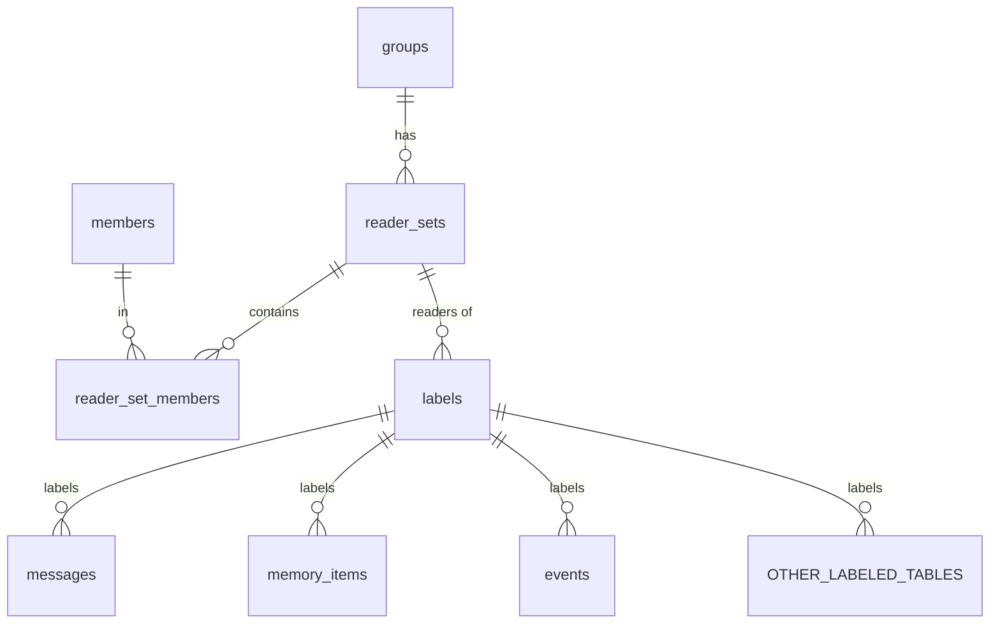
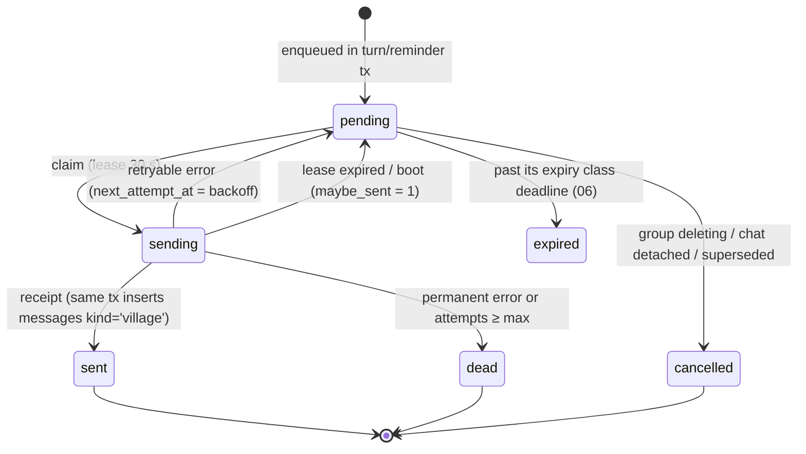
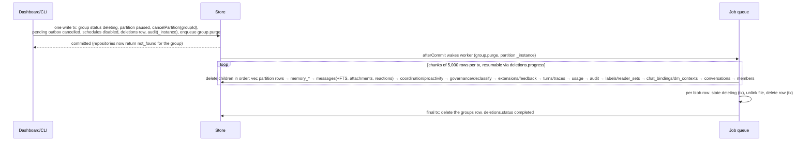

# 02 — Domain Model & Storage

> Status: **draft for review**. Elaborates `01-architecture.md` §1 ("Atomic effects plus turn journal"), §5 (domain model), §6.4 (jobs), §8 (reliability), ADR-005, ADR-007, ADR-011, ADR-012 and ADR-019. It must not contradict `00` or `01`. Suggested spine changes are listed in §12 only.
> Package: `@village/storage` (`packages/storage`). Ports live in `@village/core` (`packages/core/src/ports/storage/`). IDs and time helpers live in `@village/shared`.
> Milestones: **M1** (primary). Follow-ups in M3, M5, M6, M7, M8, M9, M12 and M14.
> Reconciled with spine v1.1 (`01` §14 A1–A28) and `15` §2. Per A7, **this document is authoritative for the physical schema of every entity in the plan**, including those introduced by `03`–`11`; the owning document stays authoritative for semantics. Crypto constructions (key tree, wrap algorithms, `VBK1`) are owned by `08` §3.7 (A8, A10); this document gives the storage mechanics.

---

## 1. Purpose & scope

This document specifies how Village persists state: correctly, privately, crash-safely and fast enough for a Raspberry Pi 5. It covers:

- The physical schema (Drizzle ORM, `sqlite-core`) for every entity in 01 §5, plus the supporting tables those entities need.
- How IFC labels (01 §7.2) are stored and filtered in SQL.
- FTS5 and sqlite-vec indexes.
- At-rest encryption (SQLCipher-compatible via `better-sqlite3-multiple-ciphers`), the M1 spike, and the fallback design.
- Repository ports and the synchronous unit-of-work.
- The turn journal and recovery queries, the transactional outbox, the durable job queue and scheduler, and the encrypted blob store.
- Migrations, retention and deletion mechanics, backup and export formats, and capacity planning.

**Not in scope** (owner in parentheses):

- Label semantics: what `canRead`/`join` mean, which data gets which label, and which deletions a departure or erasure triggers (03). This document gives 03 the mechanics: interned labels, eligible-label filtering, and deletion primitives.
- Memory kinds, extraction, ranking and packing (04). This document provides the candidate-retrieval primitives that 04 ranks.
- Turn orchestration, when recovery summaries are sent, and trace contents (05).
- Adapter send semantics and per-platform duplicate probes (06).
- Calendar, recurrence, chore, poll and digest semantics (07).
- Key-management *policy* (where the master key lives, rotation cadence, threat model) (08). This document gives the key *derivation and wrapping mechanics*.
- Auth/session semantics (09), claim/link/DM-context semantics (06), extension and MCP semantics (10), feedback semantics (11). Their **tables** are defined here (§3.3.11–§3.3.13) and land in the milestone of the owning feature.
- CLI UX for `backup`, `restore`, `export` and `migrate` (09/12). This document gives the library functions they call.

### 1.1 Verified third-party facts (as of 2026-11-01)

| Fact | Source |
|---|---|
| `better-sqlite3-multiple-ciphers@13.0.3` (latest; Node ≥ 22) bundles **SQLite 3.53.4** and **SQLite3 Multiple Ciphers 2.4.0**. Compile defines include `SQLITE_DEFAULT_FOREIGN_KEYS=1`, `SQLITE_DEFAULT_WAL_SYNCHRONOUS=1` (NORMAL), `SQLITE_ENABLE_FTS5`, `SQLITE_ENABLE_UPDATE_DELETE_LIMIT`, `SQLITE_ENABLE_STAT4`, `SQLITE_DQS=0`, `SQLITE_USE_URI=0`, `SQLITE_THREADSAFE=2` | npm tarball `deps/sqlite3/sqlite3.h` and `deps/defines.gypi` (inspected locally); https://github.com/m4heshd/better-sqlite3-multiple-ciphers |
| The default cipher is sqleet (ChaCha20-Poly1305). SQLCipher-compatible mode needs `PRAGMA cipher='sqlcipher'; PRAGMA legacy=4;` before `PRAGMA key` | https://github.com/m4heshd/better-sqlite3-multiple-ciphers |
| A raw 32-byte key can be given as `PRAGMA key = "x'<64 hex>'"`, which skips the KDF. `PRAGMA key` returns `ok` even for a wrong key, so the key must be verified with a read of `sqlite_master` | https://utelle.github.io/SQLite3MultipleCiphers/docs/configuration/config_sql_pragmas/ |
| Rekeying in WAL mode reuses the salt. Encrypting a plaintext DB requires a non-WAL journal mode first | same as above |
| better-sqlite3 `transaction()` throws `TypeError('Transaction function cannot return a promise')` when the callback returns a thenable. Nested transaction functions become savepoints. `.immediate()` and `.exclusive()` variants exist | `lib/methods/transaction.js` line 66 (inspected locally); https://github.com/WiseLibs/better-sqlite3/blob/master/docs/api.md |
| `sqlite-vec@0.1.9` is the latest stable (2026-03-31). `0.1.10-alpha.*` adds ANN indexes (rescore/IVF/DiskANN) and is pre-release. 0.1.7 added DELETE space reclamation and distance range constraints | https://github.com/asg017/sqlite-vec/releases ; `npm view sqlite-vec` |
| vec0 supports `partition key` columns (max 4, `TEXT`/`INTEGER`, `=` only, no `IN`), metadata columns (max 16; `=,!=,<,<=,>,>=`; `IN (...)` on INTEGER/TEXT only, SQLite ≥ 3.38; no NULL filtering) and `+aux` columns (not filterable) | https://alexgarcia.xyz/sqlite-vec/features/vec0.html ; https://alexgarcia.xyz/blog/2024/sqlite-vec-metadata-release/index.html |
| KNN syntax is `embedding MATCH ? AND k = ?`. `LIMIT` works on SQLite ≥ 3.41. `distance_metric=cosine` is per column; the default is L2. The `chunk_size=N` option must be divisible by 8, max 4096, default 1024. NEON paths exist for L2 and cosine when dims > 16 | https://alexgarcia.xyz/sqlite-vec/features/knn.html ; `sqlite-vec.c` on main |
| npm platform packages for sqlite-vec: linux-x64, linux-arm64, darwin-x64, darwin-arm64, windows-x64 (**no musl package**) | `npm view sqlite-vec optionalDependencies` |
| FTS5 `contentless_delete=1` (SQLite ≥ 3.43) supports `DELETE` by rowid without the original values. `trigram` supports `remove_diacritics 1` (disables indexed LIKE/GLOB) and needs ≥ 3-character query substrings. `unicode61 remove_diacritics 2` folds all Latin diacritics. The `detail=column` option is about 46% of `full` size in the docs example | https://www.sqlite.org/fts5.html |
| `sodium-native@5.2.0` exposes `crypto_secretstream_xchacha20poly1305_*`, `crypto_aead_xchacha20poly1305_ietf_*` and `crypto_pwhash` (Argon2id). It ships prebuilds for linux-x64/arm64 (glibc **and musl**), darwin and win32 | npm tarball (inspected locally) |
| `drizzle-orm@0.45.4` / `drizzle-kit@0.31.11` are `latest`. v1 is a release candidate on the `beta` tag (`1.0.0-beta.22`), with a folder-per-migration layout and no journal | `npm view`; https://orm.drizzle.team/docs/upgrade-v1 |
| `typeid-js@1.2.0`: `typeid(prefix)`, `TypeID.fromString(s, prefix?)`, `TypeID.fromUUIDBytes(prefix, bytes)`, `getType()`, `getSuffix()`, `toUUID()` | https://github.com/jetify-com/typeid-js |
| `temporal-polyfill@1.0.6`, `zod@4.6.7`, `fast-check@4.10.2` | `npm view` |
| Node exposes the tzdata version as `process.versions.tz` (e.g. `2026a`) | local `node -e` |

**Unverified; the M1 spike (M1-T2) must settle these:**

- (U1) whether `VACUUM INTO` output is encrypted with the main key under SQLite3MC;
- (U2) whether WAL frames are encrypted;
- (U3) whether vec0 supports `UPDATE` of metadata columns;
- (U4) whether `db.key(Buffer.from("x'…'"))` takes the raw-key path;
- (U5) whether the prebuilt sqlite-vec binaries enable NEON;
- (U6) whether a vec0 virtual table can be the target of DML inside a trigger;
- (U7) Pi 5 latencies in §3.16.

---

## 2. Key decisions

| # | Decision | Choice | Alternatives | Rationale |
|---|---|---|---|---|
| D1 | Primary keys | TypeID strings in `TEXT` columns (`grp_01j…`, 30–32 chars). Tables indexed by FTS/vec add `rid INTEGER PRIMARY KEY AUTOINCREMENT` + `id TEXT NOT NULL UNIQUE` | 16-byte UUID `BLOB`; integer PKs everywhere | Readable in logs and SQL. Lexicographic order equals time order (UUIDv7). Self-describing in polymorphic refs. FTS5/vec0 need stable integer rowids; `AUTOINCREMENT` prevents rowid reuse, so a stale index entry can never point at a new row. The extra bytes are irrelevant at our scale (§3.16) |
| D2 | Instants | `INTEGER` epoch **milliseconds** (UTC). Domain type is `Temporal.Instant`, truncated to ms by `Clock` | ISO-8601 `TEXT` | 6–8 bytes vs 24, fast range scans, no format drift. A `datetime(x/1000,'unixepoch')` view helper covers SQL debugging |
| D3 | Calendar times | `tz` (IANA) + `*_local` (`PlainDateTime`/`PlainDate` ISO `TEXT`) as source of truth, plus a derived `*_at` instant for indexing, plus the `tzdata_version` it was computed with | Instant only; local only | The wall clock is what people mean. If tzdb rules change, `*_at` is recomputed (§3.13.7). All-day events have no instant semantics |
| D4 | Label storage | **Interned labels.** `reader_sets` (+ `reader_set_members`) and `labels` tables. Every labeled row has one `label_id INTEGER`. Eligibility for an audience is computed **once per distinct label in pure core code (`canRead`)**, and SQL filters with `label_id IN (eligible)` | Per-row `label_readers` join table; JSON readers column; member bitmap | Exact semantics come from the single core implementation, never re-implemented in SQL. Distinct labels per group are O(hundreds), so eligibility costs microseconds. Works the same for B-tree indexes, FTS joins and vec0 metadata `IN`. A bitmap breaks above 63 members (clubs, parents-class). A join table makes 1M messages × N readers rows, and the superset check needs `GROUP BY … HAVING` per row |
| D5 | I4 in storage | `BEFORE INSERT/UPDATE` triggers on every labeled table abort if `labels.group_id ≠ row.group_id` (`I4_LABEL_GROUP_MISMATCH`) | Repository checks only | Structural defense in depth. Costs one PK lookup per write |
| D6 | FTS | FTS5 **contentless-delete** tables synced by **triggers**: `messages_fts` and `memory_fts` (`unicode61 remove_diacritics 2`), `memory_fts_tri` (`trigram remove_diacritics 1`), `entity_fts` (coordination entities). A per-group scope token sits in an indexed `scope` column | External-content tables; application-level sync; trigram everywhere | Contentless-delete avoids the "delete values must match" hazard of external content and stores no second copy of text. Triggers cannot be forgotten by a code path. unicode61 covers all space-delimited target languages. Trigram on memories only (small) adds CJK, Thai and compound/substring recall without tripling the 1M-message index |
| D7 | Vectors | sqlite-vec `vec0`, **one table per embedding space** (`vec_memory_<slug>`), `group_id TEXT PARTITION KEY`, metadata `label_id INTEGER`, `kind TEXT`, `state INTEGER` (04 retrieval state), `valid_to_ms INTEGER`. Vectors are unit-normalized; the default L2 metric gives the same ranking as cosine. `chunk_size=256`. **Memories only; raw messages are not embedded** | Message vectors; external ANN; cosine metric | Partitioning per group gives isolation (I4) and speed. Label `IN` pre-filters inside the scan. 1M message vectors would cost about 1.6 GB on a Pi; FTS covers raw messages |
| D8 | Encryption at rest | `better-sqlite3-multiple-ciphers` with `cipher='sqlcipher'`, `legacy=4`, a **raw 256-bit key** (`x'…'`) derived by HKDF from the root data key (§3.6.1, 08 key tree) | Default sqleet cipher; PBKDF2 passphrase; OS disk encryption only | Interoperable with standard SQLCipher tools (the host's "export everything" escape hatch). The raw key skips the 256k-iteration PBKDF2 at every open (cold start < 3 s on the Pi) |
| D9 | Encryption fallback | If the spike fails: plain `better-sqlite3@13.0.3`, XChaCha20-Poly1305 envelope encryption of content columns in mappers, a blind-token FTS index (HMAC tokens), and encrypted vectors searched by an in-process per-group flat index (§3.6.5) | Ship unencrypted; SQLCipher-only build | Keeps the "encrypted at rest" promise with a known, bounded loss (no phrase/prefix FTS, metadata visible) |
| D10 | Transactions | All repositories are **synchronous**. `store.write(fn)` = `BEGIN IMMEDIATE`; `store.read(fn)` = `BEGIN DEFERRED`. `fn` is typed `NotPromise<T>`, runtime-checked, and lint-banned from being `async` | Async repos with a tx spanning awaits | 01 §1 rule. better-sqlite3 is sync. IMMEDIATE avoids lock-upgrade `SQLITE_BUSY` against CLI/backup connections |
| D11 | Job queue | One `jobs` table. Claim = a single `UPDATE … WHERE id IN (fair selection) RETURNING *`. Leases carry a fencing `attempts` token. Equal-jitter exponential backoff. Idempotency keys and debounce keys use partial unique indexes. `serial` kinds run at most one per partition at a time. Partitions are served round-robin by `last_claimed_at`. Dead jobs stay in the table with `status='dead'` | BullMQ; separate dead-letter table | No extra infrastructure. Transactional with domain writes (`completeIn(uow)`) |
| D12 | Recurring jobs | `job_schedules` with cron/daily/weekly specs evaluated by a pure Temporal-based evaluator. Timezone is a fixed IANA id or a reference to a member/group (resolved at compute time). A per-fire idempotency key is `sched:<id>:<fireEpochMs>` | `croner` / `cron-parser` | Deterministic, DST-correct and injectable-clock testable. `Date` is banned in core |
| D13 | Blob crypto | libsodium secretstream XChaCha20-Poly1305 via **`libsodium-wrappers` (WASM) by default**, 64 KiB chunks, a per-blob random DEK wrapped by the blob KEK (wrap construction per 08 §3.7.10). `sodium-native@5.2.0` (wire-identical) replaces it **only if** the M1 spike (SP-2) measures < 40 MB/s on a Raspberry Pi 5 (`01` §14 A8) | `@noble/ciphers` (no secretstream; slower on the Pi) | Audited libsodium construction with truncation and reordering protection. WASM needs no native build; sodium-native has musl and arm64 prebuilds if needed |
| D14 | Blob identity | `(group_id, sha256(plaintext))` (`01` §14 A8). On disk the file name is `HMAC-SHA256(K_blobid, group_id ‖ 0x00 ‖ sha256)`, where `K_blobid` is 08's static blob-id key. The IFC label lives on the referencing attachment row, not on the blob | Global plaintext-hash CAS | No cross-group sharing (simple purge, strict I4). Filenames do not let anyone confirm a known file |
| D15 | Migrations | `drizzle-kit generate` (+ `--custom` for FTS/vec/triggers) and **our own forward-only runner**. It records sha256 checksums, toggles `foreign_keys` outside transactions, runs `foreign_key_check` before commit, supports TS data migrations, takes a pre-migration `VACUUM INTO` backup, and refuses with `SCHEMA_TOO_NEW` if the DB is newer than the binary | drizzle `migrate()` | drizzle's migrator cannot back up first, cannot run TS data steps, and wraps `PRAGMA foreign_keys` inside a transaction, where it is a no-op |
| D16 | ORM version | Pin `drizzle-orm@0.45.4` / `drizzle-kit@0.31.11` for M1. Re-evaluate v1 at M14 (§11 Q1) | v1 RC now | Stable docs. Our runner abstracts the migration folder layout |
| D17 | Retention | `retention_until` stamped on insert. A daily `retention.sweep` deletes in chunks of 1,000 rows per transaction. FTS and vec cleanup cascade through triggers. Blobs are unreferenced and then garbage-collected after a 24 h grace period. `secure_delete=ON` | Time-partitioned tables; soft delete | Simple, indexed and bounded per transaction. secure_delete zeroes deleted content before it is encrypted into free pages ("delete anything") |
| D18 | Group delete / erasure | Mark the group or person first (`status='deleting'` / `erased_at`) so access stops at once, then purge in a resumable chunked job. Leave a content-free tombstone in `deletions` | One giant cascade transaction | A 1M-row cascade would block the event loop for seconds. Resumable after a crash |
| D19 | Backup | A worker-thread snapshot (`VACUUM INTO` or the online backup API, chosen by the M1 spike, `01` §14 A8), then `quick_check`, then a tar stream encrypted with secretstream inside an 08 **`VBK1`** envelope. The per-backup key is wrapped in **key slots**: the derived backup key (`backup-kek`), the **printed recovery key**, and an optional passphrase slot (`01` §14 A10). Blob files live in a shared content-addressed backup store | `db.backup()`; plaintext tar + gpg | Consistent snapshot without blocking the main thread. **Restorable with the recovery key alone.** Blobs are not copied 14 times |
| D20 | Export | JSONL per entity per group plus `manifest.json`. Member exports filter rows with the same eligible-label mechanism as the context builder (audience = `{member}`) | SQL dump; one JSON blob | Streamable, diffable and re-importable. IFC is reused, not re-implemented |
| D21 | JSON columns | `TEXT` JSON via `jsonOf(schema)` custom type. zod validation on write **and** read. Failure raises `STORAGE_JSON_INVALID` | SQLite JSONB `BLOB`; validate on write only | 01 §11.2 says every boundary is validated. Read validation catches migration bugs early |
| D22 | Connections | One read/write connection on the main thread. Each heavy operation (backup, export, purge scans, perf seeding) opens its own connection in a `worker_threads` worker. A process lockfile guarantees a single server | Connection pool | better-sqlite3 is sync; extra main-thread connections add nothing. `THREADSAFE=2` means one connection per thread |

---

## 3. Detailed design

### 3.1 Conventions (apply to every table, including those added by other docs)

**Naming.** Tables use `snake_case` plural nouns. Columns use `snake_case`; the TS properties are `camelCase`. Indexes are named `<table>_<cols>_idx`, unique indexes `<table>_<cols>_uq`, checks `<table>_<what>_ck` and triggers `trg_<table>_<what>`.

**IDs (`@village/shared/src/ids.ts`).**
```ts
export const ID_PREFIX = {
  instance: 'inst', person: 'prs', channelIdentity: 'chid', group: 'grp', member: 'mbr', conversation: 'cnv',
  message: 'msg', attachment: 'att', memory: 'mem', embeddingSpace: 'emb', event: 'evt', reminder: 'rem',
  task: 'tsk', rotation: 'rot', ledgerEntry: 'lde', list: 'lst', listItem: 'lsti', poll: 'pol', plan: 'pln',
  planStep: 'plns', decision: 'dec', constitutionVersion: 'cnst', proposal: 'prp', declassification: 'dcl',
  consentEvent: 'cev', turn: 'trn', turnEffect: 'tfx', turnTrace: 'trc', audit: 'aud', outbox: 'obx',
  job: 'job', jobSchedule: 'jsch', usage: 'use', deletion: 'del', linkCode: 'lnk',
  // 03
  constraint: 'cst', standingApproval: 'sap', confirmation: 'cnf',
  // 04
  entity: 'ent',
  // 06
  chatBinding: 'chb', interactionToken: 'itk', claimCode: 'clm',
  // 07
  reminderFiring: 'rfr', calendarSubscription: 'csub', icsFeedToken: 'ift', taskSwap: 'swp', proactiveCandidate: 'pcd',
  // 09
  session: 'sess', loginToken: 'ltk', pairing: 'pair', inviteCode: 'inv', stepUp: 'stu', export: 'exp',
  // 10
  plugin: 'plg', pluginVersion: 'plv', groupExtension: 'gex', delegation: 'dlg', mcpToken: 'mtk', mcpServer: 'mcs', skill: 'skl',
  // 11
  feedback: 'fbk',
} as const;                                     // TypeID prefix rule: [a-z]([a-z_]{0,61}[a-z])?
export type IdPrefix = (typeof ID_PREFIX)[keyof typeof ID_PREFIX];
declare const idBrand: unique symbol;
export type Id<P extends IdPrefix> = `${P}_${string}` & { readonly [idBrand]: P };
export type GroupId = Id<'grp'>; export type MemberId = Id<'mbr'>; /* … one alias per prefix … */

const SUFFIX = /^[0-7][0-9a-hjkmnp-tv-z]{25}$/;  // 26-char Crockford base32; first char ≤ 7 (128-bit bound)
export function parseId<P extends IdPrefix>(prefix: P, s: string): Result<Id<P>, IdError>;  // pure
export const idSchema = <P extends IdPrefix>(p: P) =>
  z.string().refine((s) => s.startsWith(`${p}_`) && SUFFIX.test(s.slice(p.length + 1))) as unknown as z.ZodType<Id<P>>;

export interface IdGenerator { next<P extends IdPrefix>(prefix: P): Id<P> }      // port (core); injected
// impl: TypeID.fromUUIDBytes(prefix, uuidv7Bytes(clock.nowMs(), rng)).toString()
// Monotonic within the same ms (12-bit counter in rand_a, RFC 9562 §6.2 method 1) so ids sort by creation order.
```

**Time.** Every instant column is `INTEGER` epoch ms, mapped to `Temporal.Instant` by the `instantMs` custom type. `Clock.now()` truncates to ms. Calendar fields are stored as `tz` + `*_local` + derived `*_at` + `tzdata_version` (D3).

**Booleans** are `INTEGER` 0/1 with `{ mode: 'boolean' }` and a `CHECK (x IN (0,1))`.

**Enums** are `TEXT` with a Drizzle `enum` (types only) **and** a `CHECK (col IN (…))` (database enforcement). Adding an enum value is a migration.

**Foreign keys** (`foreign_keys` defaults ON in this build). ON DELETE policy:

| Relationship | ON DELETE | Why |
|---|---|---|
| `group_id → groups.id` on every group-scoped table | `CASCADE` | Safety net. Real purges are chunked (§3.13.4) |
| Composition parent → child (list → items, poll → votes, turn → effects, message → attachments, memory → subjects/sources, plan → steps, event series → overrides) | `CASCADE` | Children have no meaning alone |
| References to actors (`*_member_id`, `person_id`) | `NO ACTION` | Members/persons are never hard-deleted outside purge/erasure flows, which delete dependents first. NO ACTION is checked at statement end, so cascades from `groups` still succeed |
| References that may legitimately expire (sources, `supersedes_id`, `rotation_id`) | `SET NULL` | Memories outlive the raw messages they came from (01 §5) |
| `label_id → labels.id`, `reader_set_id → reader_sets.id` | `NO ACTION` | Labels are garbage-collected only when unreferenced |
| Polymorphic refs (`target_ref`, `source_ref`, `entity_refs`) | no FK; `CHECK` on the TypeID prefix | The prefix encodes the type |

**Optimistic concurrency.** Mutable aggregates carry `version INTEGER NOT NULL DEFAULT 1`. Updates use `WHERE id=? AND version=?` and set `version = version + 1`. A zero-row update returns `{ kind: 'conflict' }`. This stays relevant even under per-group actors, because the dashboard and API write outside the actor.

**Custom column types (`packages/storage/src/schema/_columns.ts`).**
```ts
import { customType, integer, text } from 'drizzle-orm/sqlite-core';
import { Temporal } from 'temporal-polyfill';

export const tid = <P extends IdPrefix>(prefix: P) => customType<{ data: Id<P>; driverData: string }>({
  dataType: () => 'text',
  toDriver: (v) => v,
  fromDriver: (v) => unwrapOrThrow(parseId(prefix, v), 'STORAGE_ID_INVALID'),
});
export const instantMs = customType<{ data: Temporal.Instant; driverData: number }>({
  dataType: () => 'integer',
  toDriver: (v) => v.epochMilliseconds,
  fromDriver: (v) => Temporal.Instant.fromEpochMilliseconds(v),
});
export const jsonOf = <S extends z.ZodType>(schema: S, tag: string) =>
  customType<{ data: z.output<S>; driverData: string }>({
    dataType: () => 'text',
    toDriver: (v) => JSON.stringify(parseOrThrow(schema, v, tag, 'write')),       // STORAGE_JSON_INVALID
    fromDriver: (raw) => parseOrThrow(schema, JSON.parse(raw), tag, 'read'),
  });
export const bool = (name: string) => integer(name, { mode: 'boolean' });
export const plainDateTimeText = customType<{ data: Temporal.PlainDateTime; driverData: string }>({ /* 'YYYY-MM-DDTHH:mm[:ss]' */ });
export const plainDateText = customType<{ data: Temporal.PlainDate; driverData: string }>({ /* 'YYYY-MM-DD' */ });
export const tzText = customType<{ data: TimeZoneId; driverData: string }>({ /* validated via Temporal on read */ });
export const labelRef = (name = 'label_id') => integer(name).$type<LabelId>().references(() => labels.id);
export const createdAt = () => instantMs('created_at').notNull();
export const updatedAt = () => instantMs('updated_at').notNull();
export const version = () => integer('version').notNull().default(1);
```

### 3.2 Label storage (D4)



- **`reader_sets`** interns an `Audience` (01 §7.2, with the optional outsider `seats` of `01` §14 A5 / 03 §3.4.2). There is one row per distinct `{kind:'group', seats}` or `{kind:'members', memberIds, seats}` per group. `canonical_key` is `('g' | 'm:' + hex(sha256(sorted memberIds joined by ','))) + '|s:' + hex(sha256(sorted seat conversationIds joined by ','))` (empty seat set ⇒ `'|s:'`). Members are in `reader_set_members`, seats in `reader_set_seats`.
- **`labels`** interns a full `Label`, including the optional `coOwners` (A5). `canonical_key` is `${readerSetId}|${owner ?? 'group'}|${sortedCoOwners.join(',')}|${sensitivity}|${influence}|${untrusted ? 1 : 0}`. Label rows are **immutable**. To relabel a datum, point it at another `label_id`.
- **Interning** (`LabelStore.intern(uow, label): LabelId`) is get-or-create inside the caller's write transaction:
  - `SELECT id … WHERE group_id=? AND canonical_key=?`, otherwise `INSERT`.
  - The in-memory caches (`Map<LabelId, Label>`, `Map<key, LabelId>`) are updated **only in `uow.afterCommit`**. A rolled-back insert would otherwise leave a cached id that `AUTOINCREMENT` never reissues; the rule still protects the cache if that assumption ever breaks.
- **Eligibility.**
  ```ts
  // core (pure): packages/core/src/ifc/eligible.ts
  declare const eligibleBrand: unique symbol;
  export type EligibleLabelSet = { readonly groupId: GroupId; readonly ids: readonly LabelId[]; readonly audienceKey: string;
                                   readonly epoch: string } & { readonly [eligibleBrand]: true };
  export function computeEligible(labels: ReadonlyMap<LabelId, Label>, audience: Audience, snap: GroupSnapshot,
                                  flow: InformationFlow): EligibleLabelSet {
    const ids = [...labels].filter(([, l]) => flow.canRead(l, audience, snap)).map(([id]) => id).sort((a, b) => a - b);
    return brand({ groupId: snap.groupId, ids, audienceKey: audienceKey(audience), epoch: `${snap.membershipEpoch}:${maxId(labels)}` });
  }
  ```
  - Storage read APIs that return labeled rows **require** an `EligibleLabelSet`. The brand stops callers from passing hand-built id lists.
  - `engine/context` caches sets per `(groupId, audienceKey, epoch)`.
  - `groups.membership_epoch` is incremented in the same transaction as any member status or role change.
  - **This is the only eligibility mechanism in the plan.** Any other document that describes per-row reader columns or SQL reader predicates (e.g. `readers_kind`, `item_readers`, "ReaderPrefilter") means this `label_id IN (eligible)` filter.
- **SQL usage.**
  - B-tree tables: `label_id IN (SELECT value FROM json_each(?))`, bound with `JSON.stringify(ids)`. This gives one prepared statement for any list length.
  - vec0: `label_id IN (?,?,…)` with the list padded to the next power of two (8…1024) using the sentinel `0` (no label has id 0). That bounds the number of distinct prepared statements at 8.
  - Lists longer than 1,024 are split, and the per-chunk top-k results are merged.
- **Expected cardinality.** Per group, roughly `1 group set + members (DM/private) + subgroup sets + derived intersections`. Labels are about reader sets × (≤ 3 sensitivities × 2 influence × 2 untrusted), realistically ≤ 500.
  - The `storage.labels.count` gauge warns above 2,000 per group.
  - `GroupLabelCount > 4,096` switches the B-tree path to a `TEMP` table `eligible_labels(id INTEGER PRIMARY KEY)`, filled and queried inside the same synchronous `read()`.
- **I4 triggers** (generated per labeled table in the custom migration):
  ```sql
  CREATE TRIGGER trg_messages_label_group_ins BEFORE INSERT ON messages
  WHEN NEW.label_id IS NOT NULL AND (SELECT group_id FROM labels WHERE id = NEW.label_id) IS NOT NEW.group_id
  BEGIN SELECT RAISE(ABORT, 'I4_LABEL_GROUP_MISMATCH'); END;
  -- + identical BEFORE UPDATE OF label_id, group_id trigger
  ```
- **Label GC** (monthly `maintenance.labels_gc`) deletes labels and reader sets that are no longer referenced by any labeled table, audience column or cache-pinned set. `labels_gc` runs inside the actor of the group it collects.

### 3.3 Physical schema

All schema files live in `packages/storage/src/schema/`. `index.ts` re-exports them for drizzle-kit (`drizzle.config.ts`: `dialect: 'sqlite'`, `schema: './src/schema/index.ts'`, `out: './migrations'`). Imports are omitted below. `sql`, `index`, `uniqueIndex`, `check`, `primaryKey`, `foreignKey`, `real`, `blob`, `text`, `integer` and `sqliteTable` come from `drizzle-orm/sqlite-core` / `drizzle-orm`.

#### 3.3.1 Instance, persons, identities, groups, members, conversations — `identity.ts`, `groups.ts`
```ts
export const instance = sqliteTable('instance', {
  id: tid('inst')('id').primaryKey(),
  singleton: integer('singleton').notNull().default(1).unique(),
  name: text('name').notNull(),
  ownerPersonId: tid('prs')('owner_person_id').references(() => persons.id),
  createdAt: createdAt(),
}, (t) => [check('instance_singleton_ck', sql`${t.singleton} = 1`)]);

export const persons = sqliteTable('persons', {
  id: tid('prs')('id').primaryKey(),
  displayName: text('display_name').notNull(),            // erased → 'Former member'
  displayNameSource: text('display_name_source', { enum: ['platform', 'member'] }).notNull().default('platform'), // 06
  locale: text('locale'),                                 // BCP 47; NULL = inherit group
  timezone: tzText('timezone'),                           // NULL = inherit group
  createdAt: createdAt(), updatedAt: updatedAt(),
  erasedAt: instantMs('erased_at'),
});

export const channelIdentities = sqliteTable('channel_identities', {
  id: tid('chid')('id').primaryKey(),
  channel: text('channel').notNull(),                     // ChannelId
  platformUserId: text('platform_user_id').notNull(),
  personId: tid('prs')('person_id').notNull().references(() => persons.id),
  displayNameSnapshot: text('display_name_snapshot').notNull(),   // 06 `platformDisplayName`
  platformUsername: text('platform_username'),                     // 06; never a Signal phone number
  isBot: bool('is_bot').notNull().default(false),
  dmReachable: bool('dm_reachable').notNull().default(false),     // 06 §3.18: bot may open a DM
  dmChatId: text('dm_chat_id'),                                   // platform DM chat with this identity, if known
  verifiedAt: instantMs('verified_at'),
  lastSeenAt: instantMs('last_seen_at'),
  createdAt: createdAt(),
}, (t) => [
  uniqueIndex('channel_identities_platform_uq').on(t.channel, t.platformUserId),   // Q-ING-3
  index('channel_identities_person_idx').on(t.personId),                           // Q-PRV-1 (erasure)
]);

export const groups = sqliteTable('groups', {
  id: tid('grp')('id').primaryKey(),
  name: text('name').notNull(),
  archetype: text('archetype', { enum: ARCHETYPES }).notNull(),   // 00 §5 list
  constitutionVersionId: tid('cnst')('constitution_version_id')
    .references((): AnySQLiteColumn => constitutionVersions.id),   // NULL only inside the creation tx
  historyVisibility: text('history_visibility', { enum: ['since_join', 'all'] }).notNull().default('since_join'),
  timezone: tzText('timezone').notNull(),                  // 07 SC-2
  locale: text('locale').notNull().default('en'),           // 07 SC-2
  primaryConversationId: tid('cnv')('primary_conversation_id'),   // 07 SC-2; the conversation with conversations.primary = 1
  weekStart: integer('week_start').notNull().default(1),    // 07; ISO weekday 1–7
  status: text('status', { enum: ['active', 'archived', 'deleting'] }).notNull().default('active'),
  membershipEpoch: integer('membership_epoch').notNull().default(0),
  extensionsVersion: integer('extensions_version').notNull().default(0),   // 10 `groupExtensionsVersion` (catalog cache key)
  createdAt: createdAt(), updatedAt: updatedAt(), version: version(),
}, (t) => [index('groups_status_idx').on(t.status)]);

export const members = sqliteTable('members', {
  id: tid('mbr')('id').primaryKey(),
  groupId: tid('grp')('group_id').notNull().references(() => groups.id, { onDelete: 'cascade' }),
  personId: tid('prs')('person_id').notNull().references(() => persons.id),
  role: text('role', { enum: ['admin', 'member', 'child', 'guest'] }).notNull(),   // 03 RoleId
  ageBand: text('age_band', { enum: ['adult', 'teen', 'child'] }).notNull().default('adult'),  // 03; role child ⇒ teen|child
  handle: text('handle').notNull(),                        // 05 S4: stable, unique per group (e.g. 'm3'); never reused
  status: text('status', { enum: ['invited', 'active', 'left'] }).notNull(),
  consent: text('consent', { enum: ['unknown', 'informed', 'memory_on', 'memory_off'] }).notNull().default('unknown'),
  nickname: text('nickname'),
  joinedAt: instantMs('joined_at').notNull(),
  leftAt: instantMs('left_at'),
  createdAt: createdAt(), updatedAt: updatedAt(), version: version(),
}, (t) => [
  uniqueIndex('members_group_person_uq').on(t.groupId, t.personId),   // Q-ING-4
  uniqueIndex('members_group_handle_uq').on(t.groupId, t.handle),
  check('members_ageband_ck', sql`(${t.role} = 'child') = (${t.ageBand} <> 'adult')`),
  index('members_person_idx').on(t.personId),                          // Q-PRV-1
  index('members_group_status_idx').on(t.groupId, t.status),           // Q-CTX-9 group snapshot
]);

export const guardianRelations = sqliteTable('guardian_relations', {       // 03 §3.1.1 GuardianRelation
  groupId: tid('grp')('group_id').notNull().references(() => groups.id, { onDelete: 'cascade' }),
  wardMemberId: tid('mbr')('ward_member_id').notNull().references(() => members.id),
  guardianMemberId: tid('mbr')('guardian_member_id').notNull().references(() => members.id),
  createdByMemberId: tid('mbr')('created_by_member_id').notNull().references(() => members.id),
  createdAt: createdAt(),
}, (t) => [primaryKey({ columns: [t.wardMemberId, t.guardianMemberId] }),
           index('guardian_relations_guardian_idx').on(t.guardianMemberId)]);

export const conversations = sqliteTable('conversations', {   // created only when a chat is bound (06 §3.20, 01 §14 A27)
  id: tid('cnv')('id').primaryKey(),
  groupId: tid('grp')('group_id').notNull().references(() => groups.id, { onDelete: 'cascade' }),
  channel: text('channel').notNull(),                   // ChannelId, incl. 'web', 'simulator', 'mcp' (10)
  platformChatId: text('platform_chat_id').notNull(),
  kind: text('kind', { enum: ['group', 'dm'] }).notNull(),
  memberId: tid('mbr')('member_id').references(() => members.id),                       // DM owner
  primary: bool('primary').notNull().default(false),    // 03 §3.4.4: membership is the whole group (01 §14 A7)
  title: text('title'),
  boundAt: instantMs('bound_at').notNull(),
  createdAt: createdAt(), updatedAt: updatedAt(),
}, (t) => [
  uniqueIndex('conversations_platform_uq').on(t.channel, t.platformChatId, t.groupId),  // Q-ING-2
  uniqueIndex('conversations_one_primary_uq').on(t.groupId).where(sql`${t.primary} = 1`),
  index('conversations_group_idx').on(t.groupId, t.kind),
  check('conversations_dm_ck', sql`(${t.kind} = 'dm') = (${t.memberId} IS NOT NULL)`),
  check('conversations_primary_ck', sql`${t.primary} = 0 OR ${t.kind} = 'group'`),
]);

export const chatBindings = sqliteTable('chat_bindings', {  // 06 ChatBinding; the ONLY row an unclaimed chat persists (A27)
  id: tid('chb')('id').primaryKey(),
  channel: text('channel').notNull(), platformChatId: text('platform_chat_id').notNull(),
  status: text('status', { enum: ['unclaimed', 'bound', 'detached'] }).notNull(),
  groupId: tid('grp')('group_id').references(() => groups.id, { onDelete: 'cascade' }),       // set when bound
  conversationId: tid('cnv')('conversation_id').references(() => conversations.id, { onDelete: 'set null' }),
  firstSeenAt: instantMs('first_seen_at').notNull(),
  unclaimedNoticeAt: instantMs('unclaimed_notice_at'), leaveAt: instantMs('leave_at'),     // leave 1 h after first contact
  detachedAt: instantMs('detached_at'),                                                    // resumable for 30 days (06 §3.20.2)
  claimFailures: jsonOf(ClaimFailureWindowSchema, 'chat_bindings.claim_failures')('claim_failures'),  // ≤ 5/h, then 1 h ignore
  lastProbe: jsonOf(ChatProbeSchema, 'chat_bindings.last_probe')('last_probe'),
  updatedAt: updatedAt(),
}, (t) => [uniqueIndex('chat_bindings_platform_uq').on(t.channel, t.platformChatId),
           index('chat_bindings_leave_idx').on(t.leaveAt).where(sql`${t.status} = 'unclaimed'`)]);

export const channelChatAliases = sqliteTable('channel_chat_aliases', {   // 06 §3.21.1 chat migration (e.g. Telegram supergroup)
  channel: text('channel').notNull(), oldPlatformChatId: text('old_platform_chat_id').notNull(),
  conversationId: tid('cnv')('conversation_id').notNull().references(() => conversations.id, { onDelete: 'cascade' }),
  createdAt: createdAt(),
}, (t) => [primaryKey({ columns: [t.channel, t.oldPlatformChatId] })]);

export const dmContexts = sqliteTable('dm_contexts', {     // 06 §3.4 DmContext: active group per platform DM chat (A27)
  channel: text('channel').notNull(), platformChatId: text('platform_chat_id').notNull(),
  personId: tid('prs')('person_id').notNull().references(() => persons.id),
  activeGroupId: tid('grp')('active_group_id').references(() => groups.id, { onDelete: 'set null' }),  // NULL = not chosen yet
  setAt: instantMs('set_at').notNull(),
}, (t) => [primaryKey({ columns: [t.channel, t.platformChatId] }), index('dm_contexts_person_idx').on(t.personId)]);
```
One platform DM chat maps to **one DM conversation per group** (`conversations_platform_uq` includes `group_id`), created lazily, with the active group in `dm_contexts` (`01` §14 A27). An unclaimed group chat persists only its `chat_bindings` row: no `conversations`, `messages` or `persons` rows (A27, 06 §12-6). A DM from someone in several groups with no active group chosen persists nothing (03 E20).

#### 3.3.2 IFC tables — `ifc.ts`
```ts
export const readerSets = sqliteTable('reader_sets', {
  id: integer('id').primaryKey({ autoIncrement: true }),
  groupId: tid('grp')('group_id').notNull().references(() => groups.id, { onDelete: 'cascade' }),
  kind: text('kind', { enum: ['group', 'members'] }).notNull(),
  canonicalKey: text('canonical_key').notNull(),
  memberCount: integer('member_count').notNull(),          // 0 when kind = 'group'
  createdAt: createdAt(),
}, (t) => [uniqueIndex('reader_sets_group_key_uq').on(t.groupId, t.canonicalKey)]);

export const readerSetMembers = sqliteTable('reader_set_members', {
  readerSetId: integer('reader_set_id').notNull().references(() => readerSets.id, { onDelete: 'cascade' }),
  memberId: tid('mbr')('member_id').notNull().references(() => members.id),
}, (t) => [primaryKey({ columns: [t.readerSetId, t.memberId] }),
           index('reader_set_members_member_idx').on(t.memberId, t.readerSetId)]);   // Q-PRV-2 sets containing m

export const readerSetSeats = sqliteTable('reader_set_seats', {   // outsider seats (03 §3.4.1, 01 §14 A5)
  readerSetId: integer('reader_set_id').notNull().references(() => readerSets.id, { onDelete: 'cascade' }),
  conversationId: tid('cnv')('conversation_id').notNull(),          // no FK: a seat outlives its conversation row
}, (t) => [primaryKey({ columns: [t.readerSetId, t.conversationId] })]);

export const labels = sqliteTable('labels', {
  id: integer('id').primaryKey({ autoIncrement: true }).$type<LabelId>(),
  groupId: tid('grp')('group_id').notNull().references(() => groups.id, { onDelete: 'cascade' }),
  readerSetId: integer('reader_set_id').notNull().references(() => readerSets.id),
  ownerMemberId: tid('mbr')('owner_member_id').references(() => members.id),        // NULL = 'group'
  coOwnerMemberIds: jsonOf(z.array(idSchema('mbr')).max(64), 'labels.co_owners')('co_owner_member_ids').notNull(), // sorted; excludes owner (A5)
  sensitivity: text('sensitivity', { enum: ['normal', 'personal', 'sensitive'] }).notNull(),
  influence: text('influence', { enum: ['none', 'constraints'] }).notNull(),
  untrusted: bool('untrusted').notNull(),
  canonicalKey: text('canonical_key').notNull(),
  createdAt: createdAt(),
}, (t) => [
  uniqueIndex('labels_group_key_uq').on(t.groupId, t.canonicalKey),   // Q-IFC-1 intern
  index('labels_group_idx').on(t.groupId, t.id),                     // Q-IFC-2 load all labels of a group
  index('labels_owner_idx').on(t.ownerMemberId),                      // Q-PRV-3 items owned by m
]);

export const declassifications = sqliteTable('declassifications', {   // I2 "recorded declassification" (semantics: 03 §3.4.2)
  id: tid('dcl')('id').primaryKey(),
  groupId: tid('grp')('group_id').notNull().references(() => groups.id, { onDelete: 'cascade' }),
  kind: text('kind', { enum: ['constraint', 'relay_text', 'readers_widen', 'implicit_instruction', 'policy_promotion',
                              'confirmation_disclosure', 'portable_profile'] }).notNull(),
  sourceLabelId: labelRef('source_label_id').notNull(), targetLabelId: labelRef('target_label_id').notNull(),
  approvedBy: jsonOf(DeclassApproverSchema, 'declassifications.approved_by')('approved_by').notNull(), // MemberId[] ⊇ owners, or 'policy:GS'
  contentDigest: blob('content_digest', { mode: 'buffer' }).notNull(),   // sha256 of the declassified value/text
  actionDigest: text('action_digest'),                                  // ActionDigest of the write it covers (03 §3.3.3)
  constraintId: tid('cst')('constraint_id'),                            // kind = 'constraint'
  subjectRefs: jsonOf(z.array(EntityRefSchema), 'declassifications.subject_refs')('subject_refs').notNull(),
  turnId: tid('trn')('turn_id'),
  at: instantMs('at').notNull(),
}, (t) => [index('declassifications_group_idx').on(t.groupId, t.at),
           index('declassifications_action_idx').on(t.groupId, t.actionDigest).where(sql`${t.actionDigest} IS NOT NULL`)]);
```

#### 3.3.3 Messages & attachments — `messages.ts`
```ts
> **`kind='assistant'`, not `kind='village'`** (decided 2026-11-03, M0 exit gate; STATUS → Plan
> changes). The enum value was named after the product. A column **value** named after the brand
> turns a rename into a data migration, which is precisely what ADR-024's `BRAND` indirection and
> the rename codemod exist to prevent — and the product has already been renamed once. Changed here
> rather than at use, because `M1-T5` writes this table's first migration and that is the last
> moment the change is free. Every later reference in this document and in `06` reads `village` for
> historical reasons; implement `assistant`.

export const messages = sqliteTable('messages', {
  rid: integer('rid').primaryKey({ autoIncrement: true }),
  id: tid('msg')('id').notNull().unique(),
  groupId: tid('grp')('group_id').notNull().references(() => groups.id, { onDelete: 'cascade' }),
  conversationId: tid('cnv')('conversation_id').notNull().references(() => conversations.id, { onDelete: 'cascade' }),
  kind: text('kind', { enum: ['member', 'assistant', 'system', 'derived', 'external'] }).notNull(),   // 06 `senderKind`; was 'village' — see note below
  senderMemberId: tid('mbr')('sender_member_id').references(() => members.id),
  senderIdentityId: tid('chid')('sender_identity_id').references(() => channelIdentities.id, { onDelete: 'set null' }),
  platformMessageId: text('platform_message_id'),
  platformThreadId: text('platform_thread_id'),
  dedupeKey: blob('dedupe_key', { mode: 'buffer' }),   // first 16 B of sha256(channel ‖ 0 ‖ chatId ‖ 0 ‖ platformMessageId)
  text: text('text').notNull().default(''),
  richText: jsonOf(RichTextSchema, 'messages.rich_text')('rich_text'),
  replyToMessageId: tid('msg')('reply_to_message_id'),  // soft ref: the target may have been swept
  derivedFromMessageId: tid('msg')('derived_from_message_id'),
  forwarded: jsonOf(ForwardInfoSchema, 'messages.forwarded')('forwarded'),
  untrusted: bool('untrusted').notNull().default(false),
  labelId: labelRef().notNull(),
  sentAt: instantMs('sent_at').notNull(),
  receivedAt: instantMs('received_at').notNull(),
  deliveredLate: bool('delivered_late').notNull().default(false),   // 06: backfilled after an outage
  truncated: bool('truncated').notNull().default(false),
  editedAt: instantMs('edited_at'), editCount: integer('edit_count').notNull().default(0),   // 06 §3.24: prior text not kept
  deletedAt: instantMs('deleted_at'),                    // platform delete ⇒ tombstone (text '' + redacted_at)
  redactedAt: instantMs('redacted_at'),                  // platform delete / erasure: text set to ''
  turnId: tid('trn')('turn_id'),                         // village messages: the turn that produced it (09)
  clientMessageId: text('client_message_id'),            // web chat client id (09); unique per conversation
  retentionUntil: instantMs('retention_until'),          // NULL = exempt (constitution pin, 03)
}, (t) => [
  uniqueIndex('messages_dedupe_uq').on(t.dedupeKey).where(sql`${t.dedupeKey} IS NOT NULL`),       // Q-ING-1
  uniqueIndex('messages_conv_platform_uq').on(t.conversationId, t.platformMessageId)
    .where(sql`${t.platformMessageId} IS NOT NULL`),                                               // Q-ING-5 reply/edit lookup
  index('messages_conv_rid_idx').on(t.conversationId, t.rid),                                     // Q-CTX-1 window
  index('messages_group_sender_idx').on(t.groupId, t.senderMemberId, t.rid),                      // Q-CAT-1, Q-PRV-4
  index('messages_retention_idx').on(t.retentionUntil).where(sql`${t.retentionUntil} IS NOT NULL`), // Q-RET-1
  uniqueIndex('messages_client_id_uq').on(t.conversationId, t.clientMessageId).where(sql`${t.clientMessageId} IS NOT NULL`),
]);

export const messageAttachments = sqliteTable('message_attachments', {
  id: tid('att')('id').primaryKey(),
  messageId: tid('msg')('message_id').notNull().references(() => messages.id, { onDelete: 'cascade' }),
  groupId: tid('grp')('group_id').notNull().references(() => groups.id, { onDelete: 'cascade' }),
  kind: text('kind', { enum: ['image', 'voice', 'audio', 'video', 'document', 'file', 'sticker'] }).notNull(),
  fileName: text('file_name'), mime: text('mime').notNull(), sizeBytes: integer('size_bytes'),
  blobSha256: text('blob_sha256'),                         // hex; NULL until stored
  status: text('status', { enum: ['pending', 'stored', 'too_large', 'quota_exceeded', 'forbidden', 'unsupported', 'failed', 'expired'] }).notNull(),
  platformRef: jsonOf(AttachmentRefSchema, 'message_attachments.platform_ref')('platform_ref').notNull(),   // encrypted with the DB (Matrix keys, 06)
  fetchJobId: tid('job')('fetch_job_id'),                   // the `attachment.fetch` job (01 §14 A25)
  derivedMessageId: tid('msg')('derived_message_id'),       // transcript / OCR / PDF text result
  labelId: labelRef(),                                      // equals the message's label
  createdAt: createdAt(),
}, (t) => [
  index('attachments_message_idx').on(t.messageId),
  index('attachments_blob_idx').on(t.groupId, t.blobSha256).where(sql`${t.blobSha256} IS NOT NULL`),  // Q-BLOB-1 GC
  foreignKey({ columns: [t.groupId, t.blobSha256], foreignColumns: [blobs.groupId, blobs.sha256] }),
]);

export const messageReactions = sqliteTable('message_reactions', {   // 04 §3.3.3 extraction windows; written by ingestion from 06 events
  messageRid: integer('message_rid').notNull().references(() => messages.rid, { onDelete: 'cascade' }),
  memberId: tid('mbr')('member_id').notNull().references(() => members.id),
  emoji: text('emoji').notNull(),                         // normalized by 06
  groupId: tid('grp')('group_id').notNull(),
  at: instantMs('at').notNull(),
}, (t) => [primaryKey({ columns: [t.messageRid, t.memberId, t.emoji] })]);
```
**Ingestion never downloads attachments inline** (`01` §14 A25): it inserts `message_attachments(status='pending')` with the platform ref and enqueues one `attachment.fetch` job per attachment in the same transaction. That job streams the file into the blob store (§3.11), sets `status`/`blob_sha256`, and then enqueues the `media.*` job. Every message belongs to a bound group (A27); there are no group-less messages. Reactions inherit the target message's label; rows from members whose consent forbids extraction are kept for confirmations but never rendered into extraction windows (04 §3.3.5).

#### 3.3.4 Memory — `memory.ts` (semantics: 04)
```ts
export const memoryItems = sqliteTable('memory_items', {
  rid: integer('rid').primaryKey({ autoIncrement: true }),
  id: tid('mem')('id').notNull().unique(),
  groupId: tid('grp')('group_id').notNull().references(() => groups.id, { onDelete: 'cascade' }),
  kind: text('kind', { enum: ['fact', 'preference', 'decision', 'commitment', 'note', 'profile'] }).notNull(),
  content: jsonOf(MemoryContentSchema, 'memory_items.content')('content').notNull(),        // 04 §3.2.2
  statement: text('statement').notNull(),                     // 04 canonical statement, ≤ 2,000 chars; FTS `statement` column
  searchTerms: jsonOf(z.array(z.string().max(60)).max(8), 'memory_items.search_terms')('search_terms').notNull(),  // FTS `terms`
  language: text('language').notNull(),                       // BCP-47 of the source
  fingerprint: blob('fingerprint', { mode: 'buffer' }).notNull(),   // 04 §3.3.11 step 12 (exact-dup check)
  labelId: labelRef().notNull(),                              // may only be re-pointed to a NARROWER label (03 D17, 04 D2)
  provenance: jsonOf(MemoryProvenanceSchema, 'memory_items.provenance')('provenance').notNull(),
  confidence: real('confidence').notNull(),
  status: text('status', { enum: ['proposed', 'active', 'superseded', 'retracted'] }).notNull(),
  validFrom: instantMs('valid_from').notNull(),
  validTo: instantMs('valid_to'),
  supersedesId: tid('mem')('supersedes_id').references((): AnySQLiteColumn => memoryItems.id, { onDelete: 'set null' }),
  supersededById: tid('mem')('superseded_by_id'),
  contradicts: jsonOf(z.array(idSchema('mem')).max(20), 'memory_items.contradicts')('contradicts').notNull(),
  links: jsonOf(z.array(EntityRefSchema).max(20), 'memory_items.links')('links').notNull(),   // 07 entities (04 §3.4.6)
  retrievalState: integer('retrieval_state').notNull(),      // 04 R5: 0 active-current, 1 proposed, 2 archived, 3 history
  pinned: bool('pinned').notNull().default(false), pinnedAt: instantMs('pinned_at'),
  archivedAt: instantMs('archived_at'), lastConfirmedAt: instantMs('last_confirmed_at'),
  retractReason: text('retract_reason'),                     // 'rejected' | 'expired' | 'source_deleted' | 'source_edited' | 'input_changed' | …
  portable: bool('portable').notNull().default(false),        // I4 exception (member-owned profile only; 03)
  embeddingState: text('embedding_state', { enum: ['pending', 'done', 'failed', 'skipped'] }).notNull().default('pending'),
  createdAt: createdAt(), updatedAt: updatedAt(), version: version(),
}, (t) => [
  index('memory_group_status_updated_idx').on(t.groupId, t.status, t.updatedAt),   // Q-CTX-5 recency, Q-DASH-1
  index('memory_supersedes_idx').on(t.supersedesId).where(sql`${t.supersedesId} IS NOT NULL`),  // Q-MEM-1 chain
  index('memory_label_idx').on(t.labelId),                                           // Q-PRV-3, label GC
  index('memory_embed_pending_idx').on(t.groupId, t.rid)
    .where(sql`${t.embeddingState} = 'pending' AND ${t.status} <> 'retracted'`),    // Q-JOB-6 embed backlog
  index('memory_fingerprint_idx').on(t.groupId, t.fingerprint),                    // Q-MEM-2 exact dedupe
  index('memory_pinned_idx').on(t.groupId).where(sql`${t.pinned} = 1`),            // Q-MEM-3 group-layer core
  check('memory_confidence_ck', sql`${t.confidence} BETWEEN 0 AND 1`),
  check('memory_state_ck', sql`${t.retrievalState} BETWEEN 0 AND 3`),
  check('memory_valid_ck', sql`${t.validTo} IS NULL OR ${t.validTo} >= ${t.validFrom}`),
]);
// Content immutability (01 §5 "never hard-updated in place"):
// CREATE TRIGGER trg_memory_items_immutable BEFORE UPDATE OF content, statement, search_terms, kind, group_id, provenance ON memory_items
// BEGIN SELECT RAISE(ABORT, 'MEMORY_CONTENT_IMMUTABLE'); END;

export const memorySubjects = sqliteTable('memory_subjects', {
  memoryRid: integer('memory_rid').notNull().references(() => memoryItems.rid, { onDelete: 'cascade' }),
  groupId: tid('grp')('group_id').notNull(),
  subjectRef: text('subject_ref').notNull(),   // TypeID (mbr_/evt_/tsk_/pln_/lst_) or 'ent:<nfkc-lower name>'
  role: text('role', { enum: ['about', 'by', 'for', 'mentions'] }).notNull().default('about'),
}, (t) => [primaryKey({ columns: [t.memoryRid, t.subjectRef] }),
           index('memory_subjects_lookup_idx').on(t.groupId, t.subjectRef, t.memoryRid)]);   // Q-CTX-4 entity match

export const memorySources = sqliteTable('memory_sources', {   // 04 R13: append-only provenance sources
  memoryRid: integer('memory_rid').notNull().references(() => memoryItems.rid, { onDelete: 'cascade' }),
  sourceRef: text('source_ref').notNull(),             // stable id copy; survives message expiry
  messageId: tid('msg')('message_id').references(() => messages.id, { onDelete: 'set null' }),
  windowKey: text('window_key'),
  span: jsonOf(SourceSpanSchema, 'memory_sources.span')('span'),
  addedAt: instantMs('added_at').notNull(),
}, (t) => [primaryKey({ columns: [t.memoryRid, t.sourceRef] }),
           index('memory_sources_message_idx').on(t.messageId).where(sql`${t.messageId} IS NOT NULL`)]);  // Q-PRV-5

export const embeddingSpaces = sqliteTable('embedding_spaces', {
  id: tid('emb')('id').primaryKey(),
  provider: text('provider').notNull(), model: text('model').notNull(),
  dims: integer('dims').notNull(),
  tableName: text('table_name').notNull().unique(),          // vec_memory_<slug>, slug = [a-z0-9_]{1,40}
  status: text('status', { enum: ['building', 'ready', 'active', 'retired', 'failed'] }).notNull(),   // 04 §3.8.6
  backfillCursorRid: integer('backfill_cursor_rid').notNull().default(0),
  createdAt: createdAt(), activatedAt: instantMs('activated_at'), retiredAt: instantMs('retired_at'),
}, (t) => [uniqueIndex('embedding_spaces_one_active_uq').on(t.status).where(sql`${t.status} = 'active'`)]);

// ── 04 §3.2.6 R6–R13 ──
export const memoryEntities = sqliteTable('memory_entities', {      // ExternalEntity: names only (04 §3.2.3)
  id: tid('ent')('id').primaryKey(),
  groupId: tid('grp')('group_id').notNull().references(() => groups.id, { onDelete: 'cascade' }),
  entityType: text('entity_type', { enum: ['person', 'place', 'organization', 'pet', 'thing'] }).notNull(),
  relation: jsonOf(EntityRelationSchema, 'memory_entities.relation')('relation'),   // { toMemberId, kind } | null
  isMinor: bool('is_minor'),
  possibleSameAs: jsonOf(z.array(idSchema('ent')).max(8), 'memory_entities.possible_same_as')('possible_same_as').notNull(),
  createdAt: createdAt(),
}, (t) => [index('memory_entities_group_idx').on(t.groupId)]);
export const memoryEntityAliases = sqliteTable('memory_entity_aliases', {
  entityId: tid('ent')('entity_id').notNull().references(() => memoryEntities.id, { onDelete: 'cascade' }),
  groupId: tid('grp')('group_id').notNull(),
  aliasNorm: text('alias_norm').notNull(), aliasDisplay: text('alias_display').notNull(),
  labelId: labelRef().notNull(),                        // label of the item that introduced the alias
}, (t) => [primaryKey({ columns: [t.entityId, t.aliasNorm, t.labelId] }),
           index('memory_aliases_lookup_idx').on(t.groupId, t.aliasNorm, t.labelId)]);       // Q-CTX-8 alias lookup
export const memoryItemEntities = sqliteTable('memory_item_entities', {
  memoryRid: integer('memory_rid').notNull().references(() => memoryItems.rid, { onDelete: 'cascade' }),
  entityId: tid('ent')('entity_id').notNull().references(() => memoryEntities.id, { onDelete: 'cascade' }),
}, (t) => [primaryKey({ columns: [t.memoryRid, t.entityId] }), index('memory_item_entities_entity_idx').on(t.entityId, t.memoryRid)]);

export const extractionCursors = sqliteTable('extraction_cursors', {   // 04 R7
  conversationId: tid('cnv')('conversation_id').primaryKey().references(() => conversations.id, { onDelete: 'cascade' }),
  lastRid: integer('last_rid').notNull().default(0),     // 04's "last_seq"
  extractorVersion: text('extractor_version').notNull(), updatedAt: updatedAt(),
});
export const memoryOpsApplied = sqliteTable('memory_ops_applied', {   // 04 R8 reconcile idempotency
  windowKey: text('window_key').notNull(), opIndex: integer('op_index').notNull(), appliedAt: instantMs('applied_at').notNull(),
}, (t) => [primaryKey({ columns: [t.windowKey, t.opIndex] })]);
export const memoryTombstones = sqliteTable('memory_tombstones', {     // 04 R9; content-free
  memoryId: tid('mem')('memory_id').primaryKey(), groupId: tid('grp')('group_id').notNull(),
  forgottenAt: instantMs('forgotten_at').notNull(), reason: text('reason').notNull(),
});
export const forgetFingerprints = sqliteTable('forget_fingerprints', {
  groupId: tid('grp')('group_id').notNull(), fpHmac: blob('fp_hmac', { mode: 'buffer' }).notNull(), createdAt: createdAt(),
}, (t) => [primaryKey({ columns: [t.groupId, t.fpHmac] })]);
export const forgetSourceBlocks = sqliteTable('forget_source_blocks', {
  groupId: tid('grp')('group_id').notNull(), messageIdHmac: blob('message_id_hmac', { mode: 'buffer' }).notNull(),
  kind: text('kind').notNull(), subjectHash: blob('subject_hash', { mode: 'buffer' }).notNull(),
  expiresAt: instantMs('expires_at').notNull(),          // = source message retention
}, (t) => [primaryKey({ columns: [t.groupId, t.messageIdHmac, t.kind, t.subjectHash] }),
           index('forget_source_blocks_expiry_idx').on(t.expiresAt)]);
export const memoryEvents = sqliteTable('memory_events', {             // 04 R10 lifecycle audit (ids only)
  seq: integer('seq').primaryKey({ autoIncrement: true }),
  groupId: tid('grp')('group_id').notNull().references(() => groups.id, { onDelete: 'cascade' }),
  memoryId: tid('mem')('memory_id').notNull(),
  type: text('type').notNull(),                          // created|activated|superseded|retracted|forgotten|pinned|…
  actor: jsonOf(AuditActorSchema, 'memory_events.actor')('actor').notNull(), at: instantMs('at').notNull(),
}, (t) => [index('memory_events_group_seq_idx').on(t.groupId, t.seq)]);
export const memoryConsolidationState = sqliteTable('memory_consolidation_state', {   // 04 §3.7.1
  groupId: tid('grp')('group_id').primaryKey().references(() => groups.id, { onDelete: 'cascade' }),
  watermarkSeq: integer('watermark_seq').notNull().default(0),
  sectionHashes: jsonOf(z.record(z.string(), z.string()), 'memory_consolidation_state.section_hashes')('section_hashes').notNull(),
  updatedAt: updatedAt(),
});
export const memoryAccessStats = sqliteTable('memory_access_stats', {   // 04 R13; flushed by consolidation maintenance
  memoryRid: integer('memory_rid').primaryKey().references(() => memoryItems.rid, { onDelete: 'cascade' }),
  retrievedCount: integer('retrieved_count').notNull().default(0), lastRetrievedAt: instantMs('last_retrieved_at'),
});
```
- `memory_items.retrieval_state` is maintained by the memory repository on every lifecycle transition (`status`, `archived_at`) and by 04's nightly maintenance; it is the `state` column of every vec0 space (§3.5).
- Message order for 04 ("seq") is `messages.rid`; the extraction cursor is `extraction_cursors.last_rid`.

#### 3.3.5 Coordination — `calendar.ts`, `reminders.ts`, `tasks.ts`, `lists.ts`, `polls.ts`, `plans.ts`, `decisions.ts`, `proactivity.ts` (semantics: 07; ledger semantics: 03)
Field names follow 07 §3; `*_utc`/`*_at` are the derived instants of D3.
```ts
export const events = sqliteTable('events', {
  rid: integer('rid').primaryKey({ autoIncrement: true }),
  id: tid('evt')('id').notNull().unique(),
  groupId: tid('grp')('group_id').notNull().references(() => groups.id, { onDelete: 'cascade' }),
  seriesId: tid('evt')('series_id').notNull(),            // 07: root id (= id for roots and one-offs)
  splitFromEventId: tid('evt')('split_from_event_id'),    // "this and following" splits
  title: text('title').notNull(), notes: text('notes'), url: text('url'),
  location: jsonOf(LocationSchema, 'events.location')('location'),
  allDay: bool('all_day').notNull().default(false),
  tz: tzText('tz').notNull(),
  startLocal: text('start_local').notNull(),             // PlainDateTime | PlainDate (all-day)
  endLocal: text('end_local'),                           // exclusive (all-day: endDateExclusive); NULL = no stated end
  startAt: instantMs('start_at').notNull(),              // derived `startUtc` (all-day: 00:00 in tz)
  endAt: instantMs('end_at'),
  rrule: text('rrule'), rruleInvalid: bool('rrule_invalid').notNull().default(false),   // normalized RFC 5545, no DTSTART
  rdates: jsonOf(z.array(z.string()).max(500), 'events.rdates')('rdates').notNull(),
  exdates: jsonOf(z.array(z.string()).max(500), 'events.exdates')('exdates').notNull(),
  recurrenceUntilAt: instantMs('recurrence_until_at'),   // derived `seriesEndUtc`; NULL = unbounded
  status: text('status', { enum: ['proposed', 'tentative', 'confirmed', 'cancelled'] }).notNull().default('confirmed'),  // proposed: 03 §3.10.2 taint
  busy: bool('busy').notNull(),                          // 07: all-day defaults false
  attendeesMode: text('attendees_mode', { enum: ['none', 'rsvp'] }).notNull().default('none'),
  leadTimes: jsonOf(z.array(DurationSchema).max(5).nullable(), 'events.lead_times')('lead_times'),  // NULL = group default
  source: jsonOf(EventSourceSchema, 'events.source')('source').notNull(),   // native | subscription{…} | import{blobSha}
  subscriptionId: tid('csub')('subscription_id'), sourceUid: text('source_uid'), sourceRecurrenceId: text('source_recurrence_id'),
  contentHash: blob('content_hash', { mode: 'buffer' }),  // subscription upsert diff
  planId: tid('pln')('plan_id'),
  labelId: labelRef().notNull(),
  createdByMemberId: tid('mbr')('created_by_member_id').references(() => members.id),
  updatedByMemberId: tid('mbr')('updated_by_member_id').references(() => members.id),
  icsUid: text('ics_uid').notNull().unique(), icsSequence: integer('ics_sequence').notNull().default(0),
  tzdataVersion: text('tzdata_version').notNull(),
  createdAt: createdAt(), updatedAt: updatedAt(), version: version(),
}, (t) => [
  index('events_group_start_idx').on(t.groupId, t.startAt),                                    // Q-CTX-6
  index('events_group_recurring_idx').on(t.groupId, t.recurrenceUntilAt).where(sql`${t.rrule} IS NOT NULL`), // Q-CTX-6b
  index('events_series_idx').on(t.seriesId),
  uniqueIndex('events_subscription_src_uq').on(t.subscriptionId, t.sourceUid, sql`coalesce(${t.sourceRecurrenceId}, '')`)
    .where(sql`${t.subscriptionId} IS NOT NULL`),                                              // Q-COO-6 feed diff
]);
export const eventOverrides = sqliteTable('event_overrides', {   // 07 EventOverride (A7)
  eventId: tid('evt')('event_id').notNull().references(() => events.id, { onDelete: 'cascade' }),
  recurrenceId: text('recurrence_id').notNull(),          // original wall-clock start (PlainDateTime | PlainDate)
  patch: jsonOf(EventPatchSchema, 'event_overrides.patch')('patch').notNull(),   // {title?, startLocal?, endLocal?, location?, notes?}
  cancelled: bool('cancelled').notNull().default(false), // ⇒ EXDATE on export
  startAt: instantMs('start_at'),                         // derived for the moved occurrence
  version: version(),
}, (t) => [primaryKey({ columns: [t.eventId, t.recurrenceId] })]);
export const eventAttendees = sqliteTable('event_attendees', {
  eventId: tid('evt')('event_id').notNull().references(() => events.id, { onDelete: 'cascade' }),
  memberId: tid('mbr')('member_id').notNull().references(() => members.id),
  rsvp: text('rsvp', { enum: ['needs_action', 'accepted', 'declined', 'tentative'] }).notNull().default('needs_action'),
  note: text('note'), noteLabelId: labelRef('note_label_id'),   // 07 calendar_rsvp note ≤ 200 chars
  respondedAt: instantMs('responded_at'), updatedAt: updatedAt(),
}, (t) => [primaryKey({ columns: [t.eventId, t.memberId] }), index('event_attendees_member_idx').on(t.memberId)]);
export const eventAttendeeOverrides = sqliteTable('event_attendee_overrides', {   // per-occurrence RSVP
  eventId: tid('evt')('event_id').notNull().references(() => events.id, { onDelete: 'cascade' }),
  memberId: tid('mbr')('member_id').notNull().references(() => members.id),
  recurrenceId: text('recurrence_id').notNull(),
  rsvp: text('rsvp', { enum: ['needs_action', 'accepted', 'declined', 'tentative'] }).notNull(),
}, (t) => [primaryKey({ columns: [t.eventId, t.memberId, t.recurrenceId] })]);
export const calendarSubscriptions = sqliteTable('calendar_subscriptions', {   // 07 §3.1.6
  id: tid('csub')('id').primaryKey(),
  groupId: tid('grp')('group_id').notNull().references(() => groups.id, { onDelete: 'cascade' }),
  name: text('name').notNull(),
  urlCiphertext: blob('url_ciphertext', { mode: 'buffer' }).notNull(),   // URLs embed secrets; vault/field key per 08
  urlHost: text('url_host').notNull(),
  ownerMemberId: tid('mbr')('owner_member_id').notNull().references(() => members.id),
  labelId: labelRef().notNull(),                          // untrusted = true; audience chosen at subscribe
  refreshInterval: text('refresh_interval').notNull().default('PT6H'),
  status: text('status', { enum: ['active', 'paused', 'failing', 'removed'] }).notNull().default('active'),
  etag: text('etag'), lastModified: text('last_modified'),
  lastFetchAt: instantMs('last_fetch_at'), lastSuccessAt: instantMs('last_success_at'),
  failureCount: integer('failure_count').notNull().default(0), lastError: jsonOf(ErrorInfoSchema, 'calendar_subscriptions.last_error')('last_error'),
  eventCount: integer('event_count').notNull().default(0), color: text('color'),
  leadTimes: jsonOf(z.array(DurationSchema).max(5), 'calendar_subscriptions.lead_times')('lead_times').notNull(),
  createdAt: createdAt(), updatedAt: updatedAt(), version: version(),
}, (t) => [index('calendar_subscriptions_group_idx').on(t.groupId, t.status)]);
export const icsFeedTokens = sqliteTable('ics_feed_tokens', {   // 07 §3.1.1 FeedToken ≡ 09 ics_feed_tokens (one table; 07 owns semantics: per-member 256-bit `vics_` token, revoked on leave, DM-only delivery)
  id: tid('ift')('id').primaryKey(),
  groupId: tid('grp')('group_id').notNull().references(() => groups.id, { onDelete: 'cascade' }),
  memberId: tid('mbr')('member_id').notNull().references(() => members.id),
  tokenHash: blob('token_hash', { mode: 'buffer' }).notNull().unique(),   // sha256(token); token never stored
  scope: text('scope', { enum: ['group', 'member'] }).notNull(),
  detail: text('detail', { enum: ['full', 'busy'] }).notNull().default('full'),   // 09 uses `scope`/`detail` directly (its former `includePrivate` = scope 'member')
  createdAt: createdAt(), lastUsedAt: instantMs('last_used_at'), revokedAt: instantMs('revoked_at'),
}, (t) => [index('ics_feed_tokens_member_idx').on(t.memberId)]);

export const reminders = sqliteTable('reminders', {   // 07 §3.2.1 (per-occurrence schedule, 01 §14 A7)
  id: tid('rem')('id').primaryKey(),
  groupId: tid('grp')('group_id').notNull().references(() => groups.id, { onDelete: 'cascade' }),
  kind: text('kind', { enum: ['self', 'others', 'group', 'event_lead', 'task_due', 'list'] }).notNull(),
  text: text('text'),                                      // ≤ 500
  recipients: jsonOf(ReminderRecipientsSchema, 'reminders.recipients')('recipients').notNull(),
  delivery: text('delivery', { enum: ['dm', 'group', 'auto'] }).notNull(),
  schedule: jsonOf(ReminderScheduleSchema, 'reminders.schedule')('schedule').notNull(),   // once | rrule | interval | lead | task_due
  anchor: text('anchor', { enum: ['fixed_zone', 'member_local'] }).notNull(),
  aboutRef: text('about_ref'),                             // evt_/tsk_/lst_/plns_
  audienceReaderSetId: integer('audience_reader_set_id').notNull().references(() => readerSets.id),
  labelId: labelRef().notNull(),
  createdByMemberId: tid('mbr')('created_by_member_id').references(() => members.id),   // deferred-intent principal (03 §3.3.11)
  nextFireAt: instantMs('next_fire_at'),                   // derived; the spine's `fireAt`
  status: text('status', { enum: ['scheduled', 'snoozed', 'done', 'cancelled', 'completed_series'] }).notNull().default('scheduled'),
  snoozedUntil: instantMs('snoozed_until'), staleAfter: text('stale_after'),
  tzdataVersion: text('tzdata_version').notNull(),
  createdAt: createdAt(), updatedAt: updatedAt(), version: version(),
}, (t) => [index('reminders_due_idx').on(t.groupId, t.nextFireAt).where(sql`${t.status} IN ('scheduled','snoozed')`), // Q-COO-1
           index('reminders_about_idx').on(t.aboutRef).where(sql`${t.aboutRef} IS NOT NULL`)]);                     // Q-COO-2
export const reminderFirings = sqliteTable('reminder_firings', {   // 07 ReminderFiring ledger; inserted with the outbox rows (KD-8)
  id: tid('rfr')('id').primaryKey(),
  reminderId: tid('rem')('reminder_id').notNull().references(() => reminders.id, { onDelete: 'cascade' }),
  groupId: tid('grp')('group_id').notNull(),
  occurrenceKey: text('occurrence_key').notNull(),         // o:<instant> | r:<wallclock> | i:<n> | l:<evt>:<recId>:<before>:<ver> | s:<k>
  scheduledFor: instantMs('scheduled_for').notNull(), firedAt: instantMs('fired_at').notNull(),
  outcome: text('outcome', { enum: ['sent', 'sent_late', 'missed', 'skipped_entity_gone'] }).notNull(),
  outboxIds: jsonOf(z.array(idSchema('obx')).max(50), 'reminder_firings.outbox_ids')('outbox_ids').notNull(),
  ackedByMemberId: tid('mbr')('acked_by_member_id'), ackAt: instantMs('ack_at'),
}, (t) => [uniqueIndex('reminder_firings_occurrence_uq').on(t.reminderId, t.occurrenceKey)]);   // never fire an occurrence twice

export const rotations = sqliteTable('rotations', {
  id: tid('rot')('id').primaryKey(),
  groupId: tid('grp')('group_id').notNull().references(() => groups.id, { onDelete: 'cascade' }),
  name: text('name').notNull(),
  taskTemplate: jsonOf(TaskTemplateSchema, 'rotations.task_template')('task_template').notNull(),   // {title, effortPoints, notes, proofPolicy, category}
  strategy: text('strategy', { enum: ['round_robin', 'least_loaded', 'fixed'] }).notNull(),        // 03 §3.9.3 names; 07 uses them verbatim
  assignmentMode: text('assignment_mode', { enum: ['direct', 'request'] }).notNull().default('direct'),
  announce: text('announce', { enum: ['dm', 'group', 'none'] }).notNull().default('dm'),
  cursor: jsonOf(RotationCursorSchema, 'rotations.cursor')('cursor').notNull(),
  schedule: jsonOf(RecurringScheduleSchema, 'rotations.schedule')('schedule'),
  horizon: text('horizon'), pausedUntil: instantMs('paused_until'),
  status: text('status', { enum: ['active', 'paused', 'archived'] }).notNull().default('active'),
  labelId: labelRef().notNull(),
  createdAt: createdAt(), updatedAt: updatedAt(), version: version(),
});
export const rotationParticipants = sqliteTable('rotation_participants', {
  rotationId: tid('rot')('rotation_id').notNull().references(() => rotations.id, { onDelete: 'cascade' }),
  memberId: tid('mbr')('member_id').notNull().references(() => members.id),
  position: integer('position').notNull(), weight: real('weight').notNull().default(1),
  active: bool('active').notNull().default(true), owedSlots: integer('owed_slots').notNull().default(0),   // 03 §3.9.3 (≤ 1)
}, (t) => [primaryKey({ columns: [t.rotationId, t.memberId] }), index('rotation_participants_member_idx').on(t.memberId)]);

export const tasks = sqliteTable('tasks', {
  rid: integer('rid').primaryKey({ autoIncrement: true }),
  id: tid('tsk')('id').notNull().unique(),
  groupId: tid('grp')('group_id').notNull().references(() => groups.id, { onDelete: 'cascade' }),
  kind: text('kind', { enum: ['task', 'chore'] }).notNull().default('task'),
  title: text('title').notNull(), notes: text('notes'),
  category: text('category'),                              // 07 chore catalog id; used by 03 fairness and tasks.do_not_assign
  assigneeMemberId: tid('mbr')('assignee_member_id').references(() => members.id),
  assignmentState: text('assignment_state', { enum: ['unassigned', 'requested', 'accepted', 'declined', 'direct'] }).notNull().default('unassigned'),
  requestedByMemberId: tid('mbr')('requested_by_member_id').references(() => members.id),
  effortPoints: integer('effort_points').notNull().default(1),
  due: jsonOf(TaskDueSchema, 'tasks.due')('due').notNull(),          // {kind:'none'} | {kind:'at', zdt} | {kind:'by_day', date, zone}
  dueAt: instantMs('due_at'), dueTz: tzText('due_tz'), dueLocal: text('due_local'),   // derived from `due`
  recurrence: jsonOf(RecurringScheduleSchema, 'tasks.recurrence')('recurrence'),     // non-rotating recurring tasks
  rotationId: tid('rot')('rotation_id').references(() => rotations.id, { onDelete: 'set null' }),
  occurrenceKey: text('occurrence_key'),                   // e.g. '2026-W45'; idempotent rotation generation
  proofPolicy: text('proof_policy', { enum: ['off', 'optional', 'required'] }).notNull().default('off'),
  proofBlobSha256: text('proof_blob_sha256'),              // deleted after tasks.proofRetentionDays (07)
  status: text('status', { enum: ['proposed', 'open', 'done', 'skipped', 'cancelled'] }).notNull().default('open'),  // proposed: 03 §3.10.2
  completedAt: instantMs('completed_at'), completedByMemberId: tid('mbr')('completed_by_member_id').references(() => members.id),
  verifiedByMemberId: tid('mbr')('verified_by_member_id').references(() => members.id),
  nudgeCount: integer('nudge_count').notNull().default(0),
  planId: tid('pln')('plan_id'), planStepId: tid('plns')('plan_step_id'),
  labelId: labelRef().notNull(), sourceRef: text('source_ref'),
  createdByMemberId: tid('mbr')('created_by_member_id').references(() => members.id),
  createdAt: createdAt(), updatedAt: updatedAt(), version: version(),
}, (t) => [
  index('tasks_open_due_idx').on(t.groupId, t.dueAt).where(sql`${t.status} = 'open'`),           // Q-CTX-7
  index('tasks_assignee_idx').on(t.groupId, t.assigneeMemberId, t.status),                       // Q-CTX-7b, Q-FAIR-1
  uniqueIndex('tasks_rotation_occurrence_uq').on(t.rotationId, t.occurrenceKey)
    .where(sql`${t.rotationId} IS NOT NULL AND ${t.occurrenceKey} IS NOT NULL`),
  check('tasks_effort_ck', sql`${t.effortPoints} BETWEEN 0 AND 100`),
]);
export const taskSwaps = sqliteTable('task_swaps', {   // 07 TaskSwap
  id: tid('swp')('id').primaryKey(),
  groupId: tid('grp')('group_id').notNull().references(() => groups.id, { onDelete: 'cascade' }),
  kind: text('kind', { enum: ['swap', 'give_away', 'trade'] }).notNull(),
  fromMemberId: tid('mbr')('from_member_id').notNull().references(() => members.id),
  toMemberId: tid('mbr')('to_member_id').references(() => members.id),
  offeredTaskId: tid('tsk')('offered_task_id').notNull().references(() => tasks.id, { onDelete: 'cascade' }),
  requestedTaskId: tid('tsk')('requested_task_id').references(() => tasks.id, { onDelete: 'cascade' }),
  status: text('status', { enum: ['open', 'accepted', 'declined', 'expired', 'cancelled'] }).notNull().default('open'),
  expiresAt: instantMs('expires_at').notNull(), resolvedByMemberId: tid('mbr')('resolved_by_member_id'),
  labelId: labelRef().notNull(), createdAt: createdAt(),
}, (t) => [index('task_swaps_open_idx').on(t.groupId, t.expiresAt).where(sql`${t.status} = 'open'`)]);
export const ledgerEntries = sqliteTable('ledger_entries', {   // 03 LedgerEntry ≡ 07 LoadLedgerEntry; append-only
  id: tid('lde')('id').primaryKey(),
  groupId: tid('grp')('group_id').notNull().references(() => groups.id, { onDelete: 'cascade' }),
  memberId: tid('mbr')('member_id').notNull().references(() => members.id),
  kind: text('kind', { enum: ['task_assigned', 'task_done', 'coordination', 'baseline_adjust', 'self_logged',
                              'skipped_unavailable', 'declined', 'reassigned_in', 'reassigned_out', 'reversal'] }).notNull(),
  category: text('category'), points: real('points').notNull(),
  taskId: tid('tsk')('task_id').references(() => tasks.id, { onDelete: 'set null' }),
  rotationId: tid('rot')('rotation_id').references(() => rotations.id, { onDelete: 'set null' }),
  sourceRef: text('source_ref'), reversesId: tid('lde')('reverses_id'),
  labelId: labelRef().notNull(),                           // per ledgerVisibility (03 §3.4.4)
  at: instantMs('at').notNull(),
}, (t) => [index('ledger_group_member_at_idx').on(t.groupId, t.memberId, t.at)]);              // Q-FAIR-2

export const lists = sqliteTable('lists', {
  id: tid('lst')('id').primaryKey(),
  groupId: tid('grp')('group_id').notNull().references(() => groups.id, { onDelete: 'cascade' }),
  name: text('name').notNull(),
  kind: text('kind', { enum: ['grocery', 'packing', 'to_buy', 'generic'] }).notNull().default('generic'),   // 07
  isDefault: bool('is_default').notNull().default(false), categoriesEnabled: bool('categories_enabled').notNull().default(true),
  planId: tid('pln')('plan_id'),
  labelId: labelRef().notNull(),
  createdByMemberId: tid('mbr')('created_by_member_id').references(() => members.id),
  archivedAt: instantMs('archived_at'),
  createdAt: createdAt(), updatedAt: updatedAt(), version: version(),
}, (t) => [uniqueIndex('lists_group_name_uq').on(t.groupId, sql`lower(${t.name})`).where(sql`${t.archivedAt} IS NULL`),
           uniqueIndex('lists_default_kind_uq').on(t.groupId, t.kind).where(sql`${t.isDefault} = 1 AND ${t.archivedAt} IS NULL`)]);
export const listItems = sqliteTable('list_items', {
  rid: integer('rid').primaryKey({ autoIncrement: true }),
  id: tid('lsti')('id').notNull().unique(),
  listId: tid('lst')('list_id').notNull().references(() => lists.id, { onDelete: 'cascade' }),
  groupId: tid('grp')('group_id').notNull().references(() => groups.id, { onDelete: 'cascade' }),
  text: text('text').notNull(), normalizedKey: text('normalized_key').notNull(), quantity: text('quantity'),
  category: text('category'), note: text('note'),
  checked: bool('checked').notNull().default(false),
  checkedByMemberId: tid('mbr')('checked_by_member_id').references(() => members.id), checkedAt: instantMs('checked_at'),
  addedByMemberId: tid('mbr')('added_by_member_id').references(() => members.id),
  addedVia: text('added_via', { enum: ['explicit', 'auto_capture', 'button'] }).notNull().default('explicit'),
  sourceMessageId: tid('msg')('source_message_id'),
  position: text('position').notNull(),                  // fractional index (base-62 string)
  labelId: labelRef().notNull(),
  createdAt: createdAt(), updatedAt: updatedAt(), version: version(),
}, (t) => [index('list_items_list_idx').on(t.listId, t.checked, t.position),                   // Q-COO-3
           index('list_items_key_idx').on(t.listId, t.normalizedKey)]);
export const listCategoryOverrides = sqliteTable('list_category_overrides', {   // 07
  groupId: tid('grp')('group_id').notNull().references(() => groups.id, { onDelete: 'cascade' }),
  listKind: text('list_kind').notNull(), normalizedKey: text('normalized_key').notNull(), category: text('category').notNull(),
}, (t) => [primaryKey({ columns: [t.groupId, t.listKind, t.normalizedKey] })]);

export const polls = sqliteTable('polls', {   // 07 §3.5
  rid: integer('rid').primaryKey({ autoIncrement: true }),
  id: tid('pol')('id').notNull().unique(),
  groupId: tid('grp')('group_id').notNull().references(() => groups.id, { onDelete: 'cascade' }),
  conversationId: tid('cnv')('conversation_id').notNull().references(() => conversations.id),
  purpose: text('purpose', { enum: ['opinion', 'decision', 'proposal'] }).notNull(),
  proposalId: tid('prp')('proposal_id'),                   // purpose 'proposal' ⇒ 03 governance ballot
  question: text('question').notNull(),
  options: jsonOf(PollOptionsSchema, 'polls.options')('options').notNull(),   // [{id, text, position}] 2..10
  allowMultiple: bool('allow_multiple').notNull().default(false),
  rule: text('rule', { enum: ['plurality', 'majority', 'supermajority_2_3', 'approval', 'consensus', 'none'] }).notNull(),
  quorum: jsonOf(PollQuorumSchema, 'polls.quorum')('quorum').notNull(),
  eligibleMemberIds: jsonOf(z.array(idSchema('mbr')).max(1000), 'polls.eligible')('eligible_member_ids').notNull(),  // snapshot
  anonymous: bool('anonymous').notNull().default(false),
  resultsVisibility: text('results_visibility', { enum: ['live', 'after_close'] }).notNull().default('live'),
  mode: text('mode', { enum: ['native', 'buttons', 'numbered', 'dm_ballot'] }).notNull(),
  deadlineAt: instantMs('deadline_at'),
  status: text('status', { enum: ['open', 'closed', 'cancelled'] }).notNull().default('open'),
  outcome: jsonOf(PollOutcomeSchema, 'polls.outcome')('outcome'),
  platformPollRef: jsonOf(PlatformPollRefSchema, 'polls.platform_poll_ref')('platform_poll_ref'),
  decisionId: tid('dec')('decision_id'), planStepId: tid('plns')('plan_step_id'),
  labelId: labelRef().notNull(),
  createdByMemberId: tid('mbr')('created_by_member_id').references(() => members.id),
  createdAt: createdAt(), closedAt: instantMs('closed_at'), version: version(),
}, (t) => [index('polls_open_deadline_idx').on(t.groupId, t.deadlineAt).where(sql`${t.status} = 'open'`)]);  // Q-COO-4
export const pollVotes = sqliteTable('poll_votes', {
  pollId: tid('pol')('poll_id').notNull().references(() => polls.id, { onDelete: 'cascade' }),
  memberId: tid('mbr')('member_id').notNull().references(() => members.id),   // anonymous native polls use poll_counts instead
  optionIds: jsonOf(z.array(z.string()).min(1), 'poll_votes.option_ids')('option_ids').notNull(),
  source: text('source', { enum: ['native', 'button', 'text', 'ballot', 'dashboard'] }).notNull(),
  labelId: labelRef().notNull(),                           // anonymous ⇒ readers {voter}
  castAt: instantMs('cast_at').notNull(),
}, (t) => [primaryKey({ columns: [t.pollId, t.memberId] }), index('poll_votes_member_idx').on(t.memberId)]);
export const pollCounts = sqliteTable('poll_counts', {   // 07: anonymous native polls (count-only)
  pollId: tid('pol')('poll_id').primaryKey().references(() => polls.id, { onDelete: 'cascade' }),
  counts: jsonOf(z.record(z.string(), z.int().min(0)), 'poll_counts.counts')('counts').notNull(),
  voterCount: integer('voter_count').notNull(), observedAt: instantMs('observed_at').notNull(),
});

export const plans = sqliteTable('plans', {
  rid: integer('rid').primaryKey({ autoIncrement: true }),
  id: tid('pln')('id').notNull().unique(),
  groupId: tid('grp')('group_id').notNull().references(() => groups.id, { onDelete: 'cascade' }),
  kind: text('kind', { enum: ['trip', 'party', 'move', 'project', 'generic'] }).notNull().default('generic'),
  title: text('title').notNull(), description: text('description'),
  ownerMemberIds: jsonOf(z.array(idSchema('mbr')).max(20), 'plans.owner_member_ids')('owner_member_ids').notNull(),
  status: text('status', { enum: ['draft', 'active', 'done', 'cancelled', 'archived'] }).notNull().default('draft'),
  secrecy: jsonOf(PlanSecrecySchema, 'plans.secrecy')('secrecy'),          // {excluded, sealedTerms}; sealed for the guard (03)
  tz: tzText('tz'), startsOn: text('starts_on'), endsOn: text('ends_on'),
  budgetNotes: jsonOf(PlanBudgetNotesSchema, 'plans.budget_notes')('budget_notes').notNull(),
  assumptions: jsonOf(z.array(z.string().max(200)).max(50), 'plans.assumptions')('assumptions').notNull(),
  labelId: labelRef().notNull(),
  createdByMemberId: tid('mbr')('created_by_member_id').references(() => members.id),
  createdAt: createdAt(), updatedAt: updatedAt(), version: version(),
}, (t) => [index('plans_group_status_idx').on(t.groupId, t.status)]);
export const planSteps = sqliteTable('plan_steps', {
  id: tid('plns')('id').primaryKey(),
  planId: tid('pln')('plan_id').notNull().references(() => plans.id, { onDelete: 'cascade' }),
  groupId: tid('grp')('group_id').notNull(),
  position: text('position').notNull(), title: text('title').notNull(),
  ownerMemberIds: jsonOf(z.array(idSchema('mbr')).max(10), 'plan_steps.owner_member_ids')('owner_member_ids').notNull(),
  status: text('status', { enum: ['todo', 'doing', 'done', 'blocked', 'skipped'] }).notNull().default('todo'),
  confirmState: text('confirm_state', { enum: ['proposed', 'confirmed'] }).notNull().default('confirmed'),
  due: jsonOf(StepDueSchema, 'plan_steps.due')('due'), dueAt: instantMs('due_at'),
  dependsOn: jsonOf(z.array(idSchema('plns')).max(20), 'plan_steps.depends_on')('depends_on').notNull(),
  links: jsonOf(PlanStepLinksSchema, 'plan_steps.links')('links').notNull(),     // {eventId?, taskId?, listId?, pollId?}
  lastActivityAt: instantMs('last_activity_at').notNull(),
  createdAt: createdAt(), updatedAt: updatedAt(), version: version(),
}, (t) => [index('plan_steps_plan_idx').on(t.planId, t.position)]);

export const decisions = sqliteTable('decisions', {
  rid: integer('rid').primaryKey({ autoIncrement: true }),
  id: tid('dec')('id').notNull().unique(),
  groupId: tid('grp')('group_id').notNull().references(() => groups.id, { onDelete: 'cascade' }),
  summary: text('summary').notNull(), rationale: text('rationale'),
  topicTags: jsonOf(z.array(z.string().max(40)).max(10), 'decisions.topic_tags')('topic_tags').notNull(),
  decidedBy: jsonOf(DecidedBySchema, 'decisions.decided_by')('decided_by').notNull(),   // { rule, memberIds, pollId? }
  alternativesRejected: jsonOf(DecisionAlternativesSchema, 'decisions.alternatives_rejected')('alternatives_rejected').notNull(),
  sourceRefs: jsonOf(DecisionSourceRefsSchema, 'decisions.source_refs')('source_refs').notNull(),
  origin: text('origin', { enum: ['explicit', 'poll', 'proposal', 'extracted'] }).notNull(),
  status: text('status', { enum: ['active', 'superseded', 'retracted'] }).notNull().default('active'),
  supersedesId: tid('dec')('supersedes_id'), supersededById: tid('dec')('superseded_by_id'),
  labelId: labelRef().notNull(),
  memoryItemId: tid('mem')('memory_item_id').references(() => memoryItems.id, { onDelete: 'set null' }),
  proposalId: tid('prp')('proposal_id').references(() => proposals.id, { onDelete: 'set null' }),
  decidedAt: instantMs('decided_at').notNull(), decidedTz: tzText('decided_tz').notNull(),
  createdAt: createdAt(), version: version(),
}, (t) => [index('decisions_group_decided_idx').on(t.groupId, t.decidedAt),                    // Q-COO-5
           uniqueIndex('decisions_memory_uq').on(t.memoryItemId).where(sql`${t.memoryItemId} IS NOT NULL`)]);  // idempotent mirror (04 §3.4.6)

export const proactiveCandidates = sqliteTable('proactive_candidates', {   // 07 §3.10.1
  id: tid('pcd')('id').primaryKey(),
  groupId: tid('grp')('group_id').notNull().references(() => groups.id, { onDelete: 'cascade' }),
  type: text('type').notNull(),                            // answerable_question | conflict_detected | … (07 enum)
  topicKey: text('topic_key').notNull(),
  target: jsonOf(CandidateTargetSchema, 'proactive_candidates.target')('target').notNull(),
  value: real('value').notNull(), confidence: real('confidence').notNull(),
  urgencyInputs: jsonOf(UrgencyInputsSchema, 'proactive_candidates.urgency')('urgency_inputs').notNull(),
  payload: jsonOf(CandidatePayloadSchema, 'proactive_candidates.payload')('payload').notNull(),
  labelId: labelRef().notNull(),
  status: text('status', { enum: ['pending', 'delivered', 'deferred_quiet', 'deferred_digest', 'dropped', 'expired'] }).notNull(),
  decision: jsonOf(ScoreBreakdownSchema, 'proactive_candidates.decision')('decision'),
  deliverAfter: instantMs('deliver_after'), deliveredOutboxId: tid('obx')('delivered_outbox_id'),
  createdAt: createdAt(), expiresAt: instantMs('expires_at').notNull(),
}, (t) => [index('proactive_candidates_pending_idx').on(t.groupId, t.status, t.deliverAfter),
           index('proactive_candidates_topic_idx').on(t.groupId, t.topicKey)]);
export const proactivityFeedback = sqliteTable('proactivity_feedback', {   // 07 §3.10.6; weights recomputed, never stored
  id: integer('id').primaryKey({ autoIncrement: true }),
  groupId: tid('grp')('group_id').notNull().references(() => groups.id, { onDelete: 'cascade' }),
  type: text('type').notNull(), memberId: tid('mbr')('member_id'),
  scope: text('scope', { enum: ['group', 'member'] }).notNull(),
  signal: text('signal').notNull(),                        // incl. 'mute' | 'unmute' | 'reset' markers and /village pause
  weight: real('weight').notNull(), outboxId: tid('obx')('outbox_id'), at: instantMs('at').notNull(),
}, (t) => [index('proactivity_feedback_group_idx').on(t.groupId, t.type, t.at)]);
export const catchupCursors = sqliteTable('catchup_cursors', {   // 07 §3.8.1
  memberId: tid('mbr')('member_id').notNull().references(() => members.id, { onDelete: 'cascade' }),
  conversationId: text('conversation_id').notNull(),       // cnv_… | 'all'
  explicitMarkerRid: integer('explicit_marker_rid'), readReceiptRid: integer('read_receipt_rid'),
  lastOwnMessageAt: instantMs('last_own_message_at'), lastInteractionAt: instantMs('last_interaction_at'),
  lastCatchupAt: instantMs('last_catchup_at'),
}, (t) => [primaryKey({ columns: [t.memberId, t.conversationId] })]);   // 06 `read_marker` events update read_receipt_rid; no separate read_markers table
```
- **Attention ledger.** There is no separate table: 07 counts `outbox_messages` rows with `message_class = 'proactive'` (`01` §14 A24) per group/recipient/day (Q-OBX-5).
- **Member and group coordination preferences** (morning brief, waking hours, reminder delivery, proactive-DM level, mutes) live in `settings` with scope `member:<memberId>` or the group id (§3.3.8).
- **Post-1.0:** 07 §3.1.9 `external_event_links` follows these conventions when it lands.

#### 3.3.6 Governance — `governance.ts`, `declassify.ts` (semantics: 03)
```ts
export const constitutionVersions = sqliteTable('constitution_versions', {   // 03 §3.2.6
  id: tid('cnst')('id').primaryKey(),
  groupId: tid('grp')('group_id').notNull().references(() => groups.id, { onDelete: 'cascade' }),
  version: integer('version').notNull(),
  parentVersionId: tid('cnst')('parent_version_id'),
  yaml: text('yaml').notNull(), yamlSha256: text('yaml_sha256').notNull(),   // canonical YAML (03 `yamlHash`)
  charterText: text('charter_text').notNull(),
  compiled: jsonOf(CompiledPolicySchema, 'constitution_versions.compiled')('compiled').notNull(),
  compilerVersion: text('compiler_version').notNull(),
  adoptedVia: text('adopted_via', { enum: ['template', 'setup', 'amendment', 'migration', 'placeholder'] }).notNull(),  // placeholder: M3 claim (A27)
  adoptedBy: jsonOf(AdoptedBySchema, 'constitution_versions.adopted_by')('adopted_by').notNull(),   // MemberId[] | 'system'
  proposalId: tid('prp')('proposal_id'),
  adoptedAt: instantMs('adopted_at').notNull(),
}, (t) => [uniqueIndex('constitution_versions_group_version_uq').on(t.groupId, t.version)]);
// trg_constitution_versions_immutable: BEFORE UPDATE → RAISE(ABORT,'CONSTITUTION_VERSION_IMMUTABLE')

export const proposals = sqliteTable('proposals', {   // 03 §3.3.6
  id: tid('prp')('id').primaryKey(),
  groupId: tid('grp')('group_id').notNull().references(() => groups.id, { onDelete: 'cascade' }),
  kind: text('kind', { enum: ['amendment', 'contested_action'] }).notNull(),
  payload: jsonOf(ProposalPayloadSchema, 'proposals.payload')('payload').notNull(),
  actionDigest: text('action_digest'),                     // contested_action: binds execution (03 §3.3.3)
  rule: jsonOf(ProposalRuleSchema, 'proposals.rule')('rule').notNull(),
  electorate: jsonOf(z.array(idSchema('mbr')).max(1000), 'proposals.electorate')('electorate').notNull(),   // FROZEN at open
  status: text('status', { enum: ['open', 'passed', 'rejected', 'expired', 'withdrawn', 'cancelled', 'superseded',
                                  'executed', 'execution_failed'] }).notNull(),
  proposerMemberId: tid('mbr')('proposer_member_id').notNull().references(() => members.id),
  ballotRefs: jsonOf(z.array(BallotRefSchema).max(1000), 'proposals.ballot_refs')('ballot_refs').notNull(),
  supersededById: tid('prp')('superseded_by_id'), canonicalDiffHash: text('canonical_diff_hash'),   // cooldown (03 §3.3.8)
  deadlineAt: instantMs('deadline_at'), minOpenUntil: instantMs('min_open_until'),
  openedAt: instantMs('opened_at').notNull(), closedAt: instantMs('closed_at'),
  outcome: jsonOf(ProposalOutcomeSchema, 'proposals.outcome')('outcome'),
  labelId: labelRef().notNull(),
  version: version(),
}, (t) => [index('proposals_open_idx').on(t.groupId, t.deadlineAt).where(sql`${t.status} = 'open'`),
           index('proposals_diff_idx').on(t.groupId, t.canonicalDiffHash).where(sql`${t.canonicalDiffHash} IS NOT NULL`)]);
export const proposalVotes = sqliteTable('proposal_votes', {
  proposalId: tid('prp')('proposal_id').notNull().references(() => proposals.id, { onDelete: 'cascade' }),
  memberId: tid('mbr')('member_id').notNull().references(() => members.id),
  choice: text('choice', { enum: ['yes', 'no', 'abstain'] }).notNull(),     // last vote wins until close
  via: text('via', { enum: ['native_poll', 'button', 'reaction', 'text', 'dashboard'] }).notNull(),
  labelId: labelRef().notNull(),                           // secret ballot ⇒ readers {voter}
  castAt: instantMs('cast_at').notNull(),
}, (t) => [primaryKey({ columns: [t.proposalId, t.memberId] })]);

export const privateConstraintPolicies = sqliteTable('private_constraint_policies', {   // 03 §3.5.3
  memberId: tid('mbr')('member_id').primaryKey().references(() => members.id, { onDelete: 'cascade' }),
  groupId: tid('grp')('group_id').notNull().references(() => groups.id, { onDelete: 'cascade' }),
  policy: jsonOf(PrivateConstraintPolicySchema, 'pcp.policy')('policy').notNull(),   // kinds{mode,maxSourceSensitivity,…}, paused, …
  labelId: labelRef().notNull(),                           // readers {member}
  updatedAt: updatedAt(), version: version(),
});
export const consentEvents = sqliteTable('consent_events', {          // append-only history (03 lifecycle)
  id: tid('cev')('id').primaryKey(),
  memberId: tid('mbr')('member_id').notNull().references(() => members.id),
  groupId: tid('grp')('group_id').notNull().references(() => groups.id, { onDelete: 'cascade' }),
  fromState: text('from_state').notNull(), toState: text('to_state').notNull(),
  via: text('via', { enum: ['chat', 'dashboard', 'admin', 'guardian', 'system'] }).notNull(), at: instantMs('at').notNull(),
}, (t) => [index('consent_events_member_idx').on(t.memberId, t.at)]);

export const constraintRecords = sqliteTable('constraint_records', {   // 03 §3.5.4 ConstraintRecord
  id: tid('cst')('id').primaryKey(),
  groupId: tid('grp')('group_id').notNull().references(() => groups.id, { onDelete: 'cascade' }),
  kind: text('kind').notNull(), catalogVersion: text('catalog_version').notNull(),   // CONSTRAINT_KINDS_V1
  value: jsonOf(ConstraintValueSchema, 'constraint_records.value')('value').notNull(),   // closed schema, no free text (DC2)
  subjectMemberId: tid('mbr')('subject_member_id').notNull().references(() => members.id),
  ownerMemberIds: jsonOf(z.array(idSchema('mbr')).min(1).max(16), 'constraint_records.owners')('owner_member_ids').notNull(),
  attribution: text('attribution', { enum: ['named', 'unattributed', 'aggregate_only'] }).notNull(),
  reasonDisclosure: text('reason_disclosure', { enum: ['none', 'personal', 'work', 'travel', 'family', 'medical'] }).notNull().default('none'),
  scope: jsonOf(ConstraintScopeSchema, 'constraint_records.scope')('scope').notNull(),
  validFrom: instantMs('valid_from').notNull(), validTo: instantMs('valid_to'),
  status: text('status', { enum: ['pending_owner', 'active', 'suspended', 'expired', 'revoked', 'superseded', 'discarded'] }).notNull(),
  approvedBy: jsonOf(z.array(idSchema('mbr')).max(16), 'constraint_records.approved_by')('approved_by').notNull(),
  approvalMode: text('approval_mode', { enum: ['per_item', 'standing'] }),
  labelId: labelRef().notNull(),                           // the public (declassified) label
  sealedSourceRefs: jsonOf(z.array(EntityRefSchema).max(50), 'constraint_records.sealed_sources')('sealed_source_refs').notNull(),
  sealedLabelId: labelRef('sealed_label_id').notNull(),   // owner-only label covering sealedSourceRefs
  supersedesId: tid('cst')('supersedes_id'),
  createdAt: createdAt(), updatedAt: updatedAt(), version: version(),
}, (t) => [index('constraints_active_idx').on(t.groupId, t.kind, t.validFrom).where(sql`${t.status} = 'active'`),   // Q-GOV-1 forTurn
           index('constraints_subject_idx').on(t.subjectMemberId, t.status)]);
export const standingApprovals = sqliteTable('standing_approvals', {   // 03 §3.3.9
  id: tid('sap')('id').primaryKey(),
  groupId: tid('grp')('group_id').notNull().references(() => groups.id, { onDelete: 'cascade' }),
  guardianMemberId: tid('mbr')('guardian_member_id').notNull().references(() => members.id),
  wardMemberId: tid('mbr')('ward_member_id').notNull().references(() => members.id),
  actionPatterns: jsonOf(z.array(z.string().max(64)).min(1).max(20), 'standing_approvals.patterns')('action_patterns').notNull(),
  expiresAt: instantMs('expires_at').notNull(), revokedAt: instantMs('revoked_at'), createdAt: createdAt(),
}, (t) => [index('standing_approvals_ward_idx').on(t.wardMemberId, t.expiresAt).where(sql`${t.revokedAt} IS NULL`)]);
export const confirmationRequests = sqliteTable('confirmation_requests', {   // ConfirmationRequest (01 §14 A7; 03 §3.3.12 + 05 §3.6.6)
  id: tid('cnf')('id').primaryKey(),
  groupId: tid('grp')('group_id').notNull().references(() => groups.id, { onDelete: 'cascade' }),
  turnId: tid('trn')('turn_id'), conversationId: tid('cnv')('conversation_id'), proposalId: tid('prp')('proposal_id'),
  capacity: text('capacity', { enum: ['requester', 'owner', 'admin', 'guardian'] }).notNull(),   // 05 `from`
  requesterMemberId: tid('mbr')('requester_member_id').notNull().references(() => members.id),
  eligibleMemberIds: jsonOf(z.array(idSchema('mbr')).min(1).max(64), 'confirmation_requests.eligible')('eligible_member_ids').notNull(),
  quorum: text('quorum', { enum: ['any', 'all'] }).notNull(),
  reasons: jsonOf(z.array(PolicyReasonSchema).max(8), 'confirmation_requests.reasons')('reasons').notNull(),
  actionDigest: text('action_digest').notNull(),
  toolName: text('tool_name'), input: blob('input_ciphertext', { mode: 'buffer' }),          // 05: encrypted tool input for resume
  actionRequest: jsonOf(ActionRequestSnapshotSchema, 'confirmation_requests.action')('action_request'),
  targetVersion: integer('target_version'),
  summary: jsonOf(CopyRefSchema, 'confirmation_requests.summary')('summary').notNull(),   // template key + params, never model text
  summaryLabelId: labelRef('summary_label_id').notNull(),
  delivery: text('delivery', { enum: ['inline', 'dm', 'dm_deeplink'] }).notNull(),
  options: jsonOf(z.array(z.enum(['approve', 'reject', 'approve_always', 'edit'])).min(1), 'confirmation_requests.options')('options').notNull(),
  nonce: text('nonce').notNull(),                          // 05: 8 base32 chars, constant-time compare; buttons use 03 HMAC tokens
  promptOutboxIds: jsonOf(z.array(idSchema('obx')).max(10), 'confirmation_requests.prompts')('prompt_outbox_ids').notNull(),
  responses: jsonOf(z.array(ConfirmationResponseSchema).max(64), 'confirmation_requests.responses')('responses').notNull(),
  status: text('status', { enum: ['pending', 'approved', 'rejected', 'expired', 'superseded', 'cancelled'] }).notNull(),
  expiresAt: instantMs('expires_at').notNull(), onExpire: text('on_expire', { enum: ['drop', 'apply', 'escalate_admin'] }).notNull(),
  decidedByMemberId: tid('mbr')('decided_by_member_id'), decidedAt: instantMs('decided_at'),
  labelId: labelRef().notNull(),
  createdAt: createdAt(), version: version(),               // decisions are CAS: WHERE status='pending' AND version=?
}, (t) => [index('confirmations_pending_idx').on(t.groupId, t.expiresAt).where(sql`${t.status} = 'pending'`),   // Q-GOV-2
           index('confirmations_pair_idx').on(t.requesterMemberId, t.status)]);                                     // 03 rate limits
```

#### 3.3.7 Runtime — `runtime.ts`
```ts
export const turns = sqliteTable('turns', {
  id: tid('trn')('id').primaryKey(),
  groupId: tid('grp')('group_id').notNull().references(() => groups.id, { onDelete: 'cascade' }),
  conversationId: tid('cnv')('conversation_id').notNull().references(() => conversations.id, { onDelete: 'cascade' }),
  kind: text('kind', { enum: ['respond', 'interject', 'interaction', 'command', 'confirmation_resume', 'continuation',
                              'digest', 'reminder', 'system', 'recovery'] }).notNull(),   // 05 §3.3.1, 07 §3.0.3
  triggerMessageIds: jsonOf(z.array(idSchema('msg')).max(50), 'turns.trigger_message_ids')('trigger_message_ids').notNull(),
  requesterMemberId: tid('mbr')('requester_member_id').references(() => members.id),   // NULL = SystemAuthority
  audienceReaderSetId: integer('audience_reader_set_id').notNull().references(() => readerSets.id),   // 05 `audienceSnapshotId` (frozen audience incl. seats)
  status: text('status', { enum: ['queued', 'running', 'completed', 'failed', 'timed_out', 'cancelled', 'recovered'] }).notNull(),  // 05 S1
  phase: text('phase', { enum: ['building_context', 'model_step', 'tools', 'guarding', 'committing'] }),   // NULL when not running
  phaseStep: integer('phase_step'),
  effort: text('effort', { enum: ['low', 'medium', 'high'] }),
  bootId: text('boot_id').notNull(),                       // process incarnation that started it
  rootTurnId: tid('trn')('root_turn_id').notNull(),        // = id for root turns (05 S1)
  parentTurnId: tid('trn')('parent_turn_id'), retryOfTurnId: tid('trn')('retry_of_turn_id'),
  restarts: integer('restarts').notNull().default(0), recoveryDone: bool('recovery_done').notNull().default(false),
  startedAt: instantMs('started_at').notNull(), deadlineAt: instantMs('deadline_at').notNull(),
  timedOutAt: instantMs('timed_out_at'), completedAt: instantMs('completed_at'),
  failure: jsonOf(TurnFailureSchema, 'turns.failure')('failure'),
}, (t) => [index('turns_running_idx').on(t.startedAt).where(sql`${t.status} = 'running'`),    // Q-TRN-1
           index('turns_timeout_idx').on(t.deadlineAt).where(sql`${t.status} IN ('queued','running')`),
           index('turns_root_idx').on(t.rootTurnId),
           index('turns_conv_started_idx').on(t.conversationId, t.startedAt)]);              // Q-TRN-3

export const turnEffects = sqliteTable('turn_effects', {
  id: tid('tfx')('id').primaryKey(),
  turnId: tid('trn')('turn_id').notNull().references(() => turns.id, { onDelete: 'cascade' }),
  rootTurnId: tid('trn')('root_turn_id').notNull(),
  groupId: tid('grp')('group_id').notNull(),
  seq: integer('seq').notNull(),
  toolName: text('tool_name').notNull(),
  idempotencyKey: text('idempotency_key').notNull().unique(),   // 05 S2: sha256(rootTurnId ‖ toolName ‖ canonicalJson(input))
  status: text('status', { enum: ['intent', 'committed', 'failed'] }).notNull(),   // A23: external effects journaled as intent BEFORE execution
  resultCiphertext: blob('result_ciphertext', { mode: 'buffer' }),   // 05 `resultJson`, field-encrypted
  summaryKey: text('summary_key').notNull(),               // template key in versioned copy files (05)
  summaryParams: jsonOf(EffectSummaryParamsSchema, 'turn_effects.summary_params')('summary_params').notNull(),
  entityRefs: jsonOf(z.array(EntityRefSchema).max(50), 'turn_effects.entity_refs')('entity_refs').notNull(),
  labelId: labelRef().notNull(),
  committedAt: instantMs('committed_at'),                  // NULL while status = 'intent'
  ackOutboxId: tid('obx')('ack_outbox_id'),               // 05 `acknowledgedBy`; set when a reply/recovery summary covering it is enqueued
}, (t) => [uniqueIndex('turn_effects_turn_seq_uq').on(t.turnId, t.seq),                       // Q-TRN-2
           index('turn_effects_root_idx').on(t.rootTurnId),
           index('turn_effects_intent_idx').on(t.turnId).where(sql`${t.status} = 'intent'`),
           index('turn_effects_unacked_idx').on(t.turnId).where(sql`${t.ackOutboxId} IS NULL`)]);  // Q-TRN-2b

export const turnTraces = sqliteTable('turn_traces', {
  id: tid('trc')('id').primaryKey(),
  turnId: tid('trn')('turn_id').notNull().unique().references(() => turns.id, { onDelete: 'cascade' }),
  groupId: tid('grp')('group_id').notNull(), conversationId: tid('cnv')('conversation_id').notNull(),
  labelId: labelRef().notNull(),                           // who may read this trace (03/09)
  trigger: jsonOf(TraceTriggerSchema, 'turn_traces.trigger')('trigger').notNull(),
  disposition: text('disposition').notNull(),
  contextManifest: jsonOf(ContextManifestSchema, 'turn_traces.context_manifest')('context_manifest').notNull(),
  modelCalls: jsonOf(z.array(ModelCallTraceSchema), 'turn_traces.model_calls')('model_calls').notNull(),
  toolCalls: jsonOf(z.array(ToolCallTraceSchema), 'turn_traces.tool_calls')('tool_calls').notNull(),
  policyDecisions: jsonOf(z.array(PolicyDecisionTraceSchema), 'turn_traces.policy')('policy_decisions').notNull(),
  guardResults: jsonOf(z.array(GuardResultTraceSchema), 'turn_traces.guard')('guard_results').notNull(),
  costMicros: integer('cost_micros').notNull().default(0),
  latency: jsonOf(LatencyTraceSchema, 'turn_traces.latency')('latency').notNull(),
  replay: jsonOf(TraceReplayMetaSchema, 'turn_traces.replay')('replay').notNull(),   // 11 §12-1: contextHash, promptVersion, toolCatalogHash,
                                                          // constitutionVersionId, codeVersion, otelTraceId (modelCalls[].requestHash in modelCalls)
  createdAt: createdAt(), expiresAt: instantMs('expires_at').notNull(),
}, (t) => [index('turn_traces_group_created_idx').on(t.groupId, t.createdAt),                 // Q-DASH-2
           index('turn_traces_expires_idx').on(t.expiresAt)]);                                // Q-RET-2
export const turnTraceDebug = sqliteTable('turn_trace_debug', {   // 05 §3.10.1: only with VILLAGE_DEBUG_CONTENT=1; host-only; never exported
  turnId: tid('trn')('turn_id').primaryKey().references(() => turns.id, { onDelete: 'cascade' }),
  ciphertext: blob('ciphertext', { mode: 'buffer' }).notNull(),     // rendered requests/responses, field-encrypted
  expiresAt: instantMs('expires_at').notNull(),                      // 24 h (11 captured model I/O: configurable 1–30 d)
}, (t) => [index('turn_trace_debug_expires_idx').on(t.expiresAt)]);

export const auditEvents = sqliteTable('audit_events', {
  id: tid('aud')('id').primaryKey(),
  chainKey: text('chain_key').notNull(),                   // groupId | '_instance'
  seq: integer('seq').notNull(),
  groupId: tid('grp')('group_id').references(() => groups.id, { onDelete: 'cascade' }),
  actor: jsonOf(AuditActorSchema, 'audit_events.actor')('actor').notNull(),     // {kind:'member',memberId}|{kind:'system'}|{kind:'host'}
  action: text('action').notNull(),
  target: text('target'),                                  // EntityRef string
  decision: jsonOf(AuditDecisionSchema, 'audit_events.decision')('decision').notNull(),
  details: jsonOf(AuditDetailsSchema, 'audit_events.details')('details').notNull(),  // ids/enums only, NEVER content
  prevHash: blob('prev_hash', { mode: 'buffer' }).notNull(),   // 32 B; zeros for seq 1
  hash: blob('hash', { mode: 'buffer' }).notNull(),            // sha256(prevHash ‖ JCS(event without hashes))
  at: instantMs('at').notNull(),
}, (t) => [uniqueIndex('audit_chain_seq_uq').on(t.chainKey, t.seq),                           // Q-AUD-1 head
           index('audit_group_at_idx').on(t.groupId, t.at)]);                                 // Q-DASH-3
// trg_audit_events_append_only: BEFORE UPDATE → RAISE(ABORT,'AUDIT_APPEND_ONLY')

export const outboxMessages = sqliteTable('outbox_messages', {
  id: tid('obx')('id').primaryKey(),
  groupId: tid('grp')('group_id').references(() => groups.id, { onDelete: 'cascade' }),
  conversationId: tid('cnv')('conversation_id').notNull().references(() => conversations.id, { onDelete: 'cascade' }),
  turnId: tid('trn')('turn_id'),
  seq: integer('seq').notNull(),                           // monotonically assigned per conversation (FIFO)
  idempotencyKey: text('idempotency_key').notNull().unique(),  // '<turnId>:<index>' | '<turnId>:ph' | 'rem:<id>:<occurrenceKey>' | …
  messageClass: text('message_class', { enum: ['reply', 'requested', 'digest', 'proactive', 'system'] }).notNull(),   // A24
  priority: text('priority', { enum: ['interactive', 'scheduled', 'background'] }).notNull().default('interactive'),  // 06
  expiryClass: text('expiry_class', { enum: ['must_deliver', 'timely', 'best_effort'] }).notNull().default('timely'),   // 06
  payload: jsonOf(OutboundPayloadSchema, 'outbox_messages.payload')('payload').notNull(),
  parts: jsonOf(OutboxPartsSchema, 'outbox_messages.parts')('parts_json').notNull(),   // 06: [{index, platformMessageId, sentAt, possibleDuplicate?}]
  contentHash: blob('content_hash', { mode: 'buffer' }).notNull(),   // sha256 of normalized rendered text
  audienceReaderSetId: integer('audience_reader_set_id').notNull().references(() => readerSets.id),
  labelId: labelRef(),
  guardRef: text('guard_ref').notNull(),                  // I5: id of the DisclosureGuard pass record in the trace (05 `guardRecordId`)
  manifestLabelIds: jsonOf(z.array(z.int()).max(500), 'outbox_messages.manifest_labels')('manifest_label_ids').notNull(),  // 03 §3.4.7 send-time re-check
  status: text('status', { enum: ['pending', 'sending', 'sent', 'dead', 'cancelled', 'expired'] }).notNull().default('pending'),  // 06 `in_flight` = sending
  maybeSent: bool('maybe_sent').notNull().default(false),   // 06 `possibleDuplicate`
  inFlightSince: instantMs('in_flight_since'),              // 06: set on claim (status 'sending' = 06 `in_flight`)
  attempts: integer('attempts').notNull().default(0),
  nextAttemptAt: instantMs('next_attempt_at').notNull(),
  leaseUntil: instantMs('lease_until'),
  platformMessageId: text('platform_message_id'),
  lastError: jsonOf(ErrorInfoSchema, 'outbox_messages.last_error')('last_error'),
  createdAt: createdAt(), sentAt: instantMs('sent_at'),
}, (t) => [
  index('outbox_dispatch_idx').on(t.nextAttemptAt).where(sql`${t.status} = 'pending'`),         // Q-OBX-1
  index('outbox_conv_seq_idx').on(t.conversationId, t.seq).where(sql`${t.status} IN ('pending','sending')`), // Q-OBX-2 FIFO
  index('outbox_recent_sent_idx').on(t.conversationId, t.contentHash, t.sentAt).where(sql`${t.status} = 'sent'`), // Q-OBX-3
  index('outbox_sending_idx').on(t.leaseUntil).where(sql`${t.status} = 'sending'`),            // Q-OBX-4 crash recovery
  index('outbox_class_idx').on(t.groupId, t.messageClass, t.sentAt).where(sql`${t.status} = 'sent'`),  // Q-OBX-5 attention budget (07)
  check('outbox_guard_ck', sql`length(${t.guardRef}) > 0`),
]);

export const usageRecords = sqliteTable('usage_records', {
  id: tid('use')('id').primaryKey(),
  groupId: tid('grp')('group_id').references(() => groups.id, { onDelete: 'cascade' }),   // NULL = instance-level
  turnId: tid('trn')('turn_id'), jobId: tid('job')('job_id'),
  route: text('route').notNull(), provider: text('provider').notNull(), model: text('model').notNull(),
  servedModel: text('served_model').notNull(),            // 05 S9: model that actually answered (refusal fallback)
  purpose: text('purpose').notNull(),                     // 05/04/07: e.g. 'chat' | 'memory.extract' | 'feature:<name>'
  via: text('via', { enum: ['chat', 'dashboard', 'mcp', 'job'] }).notNull().default('chat'),   // 10
  effort: text('effort'), kind: text('kind', { enum: ['message', 'fallback_message'] }).notNull().default('message'),
  inputTokens: integer('input_tokens').notNull(), cachedReadTokens: integer('cached_read_tokens').notNull(),
  cacheWrite5mTokens: integer('cache_write_5m_tokens').notNull(), cacheWrite1hTokens: integer('cache_write_1h_tokens').notNull(),
  outputTokens: integer('output_tokens').notNull(),
  costMicros: integer('cost_micros').notNull(), priceTableVersion: text('price_table_version').notNull(),
  batch: bool('batch').notNull().default(false),
  at: instantMs('at').notNull(),
}, (t) => [index('usage_group_at_idx').on(t.groupId, t.at)]);                                  // Q-USE-2 reports
export const usageDaily = sqliteTable('usage_daily', {   // rollup maintained in the same tx as usage_records insert
  groupKey: text('group_key').notNull(),                  // groupId | '_instance'
  dayLocal: text('day_local').notNull(),                  // 'YYYY-MM-DD' in the group's timezone
  route: text('route').notNull(),
  calls: integer('calls').notNull(), costMicros: integer('cost_micros').notNull(),
  inputTokens: integer('input_tokens').notNull(), outputTokens: integer('output_tokens').notNull(),
  cachedReadTokens: integer('cached_read_tokens').notNull(),
}, (t) => [primaryKey({ columns: [t.groupKey, t.dayLocal, t.route] })]);                       // Q-USE-1 budget guard
```

#### 3.3.8 Jobs, blobs, settings, tombstones — `jobs.ts`, `blobs.ts`, `system.ts`
```ts
export const jobs = sqliteTable('jobs', {
  id: tid('job')('id').primaryKey(),
  kind: text('kind').notNull(),                           // JobKind registry key, e.g. 'extract.conversation'
  partitionKey: text('partition_key').notNull(),          // groupId | '_instance'
  serial: bool('serial').notNull(),                       // ≤ 1 leased job per partition for serial kinds
  payload: text('payload').notNull(),                     // JSON; validated by JobKind.payload schema
  status: text('status', { enum: ['queued', 'leased', 'succeeded', 'dead', 'cancelled'] }).notNull(),
  priority: integer('priority').notNull().default(0),     // higher first; −10..10
  runAt: instantMs('run_at').notNull(),
  idempotencyKey: text('idempotency_key'),
  debounceKey: text('debounce_key'), debounceDeadlineAt: instantMs('debounce_deadline_at'),
  attempts: integer('attempts').notNull().default(0),     // also the fencing token
  maxAttempts: integer('max_attempts').notNull(),
  leaseOwner: text('lease_owner'), leaseUntil: instantMs('lease_until'),
  lastError: jsonOf(ErrorInfoSchema, 'jobs.last_error')('last_error'),
  enqueuedBy: text('enqueued_by'),                        // trn_/jsch_/job_/'boot'/'cli'
  traceId: text('trace_id'),                              // OTel trace id if enabled
  createdAt: createdAt(), startedAt: instantMs('started_at'), finishedAt: instantMs('finished_at'),
  durationMs: integer('duration_ms'),
}, (t) => [
  index('jobs_queued_due_idx').on(t.runAt, t.priority).where(sql`${t.status} = 'queued'`),        // Q-JOB-1 claim
  index('jobs_leased_until_idx').on(t.leaseUntil).where(sql`${t.status} = 'leased'`),             // Q-JOB-2 expiry
  index('jobs_leased_partition_idx').on(t.partitionKey).where(sql`${t.status} = 'leased' AND ${t.serial} = 1`), // Q-JOB-1b
  uniqueIndex('jobs_idempotency_uq').on(t.idempotencyKey).where(sql`${t.idempotencyKey} IS NOT NULL`),  // Q-JOB-3
  uniqueIndex('jobs_debounce_uq').on(t.debounceKey).where(sql`${t.debounceKey} IS NOT NULL AND ${t.status} = 'queued'`), // Q-JOB-4
  index('jobs_terminal_finished_idx').on(t.status, t.finishedAt)
    .where(sql`${t.status} IN ('succeeded','dead','cancelled')`),                                  // Q-RET-3
  index('jobs_partition_status_idx').on(t.partitionKey, t.status),                                 // Q-JOB-5 purge/cancel
]);
export const jobPartitions = sqliteTable('job_partitions', {
  partitionKey: text('partition_key').primaryKey(),
  lastClaimedAt: instantMs('last_claimed_at').notNull(),
  paused: bool('paused').notNull().default(false),        // group deleting / budget pause (05)
});
export const jobSchedules = sqliteTable('job_schedules', {
  id: tid('jsch')('id').primaryKey(),
  kind: text('kind').notNull(), partitionKey: text('partition_key').notNull(),
  spec: jsonOf(ScheduleSpecSchema, 'job_schedules.spec')('spec').notNull(),
  payload: text('payload').notNull(),
  misfire: text('misfire', { enum: ['run_once', 'skip'] }).notNull(),
  misfireGraceMs: integer('misfire_grace_ms').notNull(),
  enabled: bool('enabled').notNull().default(true),
  nextRunAt: instantMs('next_run_at'), lastFiredAt: instantMs('last_fired_at'),
  ownerRef: text('owner_ref').notNull(),                  // e.g. 'mbr_…:digest.morning'; unique per purpose
  createdAt: createdAt(), updatedAt: updatedAt(),
}, (t) => [index('job_schedules_due_idx').on(t.nextRunAt).where(sql`${t.enabled} = 1`),         // Q-SCH-1
           uniqueIndex('job_schedules_owner_uq').on(t.ownerRef)]);

export const blobs = sqliteTable('blobs', {
  groupId: tid('grp')('group_id').notNull().references(() => groups.id, { onDelete: 'cascade' }),
  sha256: text('sha256').notNull(),                       // hex of plaintext
  sizeBytes: integer('size_bytes').notNull(), mime: text('mime').notNull(),
  storageAddr: text('storage_addr').notNull().unique(),   // hex HMAC address = file name
  wrappedDek: blob('wrapped_dek', { mode: 'buffer' }).notNull(),   // 08 `dekWrapped`: 32 B DEK + 16 B GCM tag; deleting it crypto-shreds the blob
  wrapNonce: blob('wrap_nonce', { mode: 'buffer' }).notNull(),     // 12 B (AES-256-GCM)
  kekVersion: integer('kek_version').notNull(),             // 08 `kekGen` (keyring generation)
  state: text('state', { enum: ['stored', 'deleting'] }).notNull().default('stored'),
  createdAt: createdAt(), unreferencedSince: instantMs('unreferenced_since'),
}, (t) => [primaryKey({ columns: [t.groupId, t.sha256] }),
           index('blobs_unref_idx').on(t.unreferencedSince).where(sql`${t.unreferencedSince} IS NOT NULL`)]);  // Q-BLOB-2

export const settings = sqliteTable('settings', {          // ADR-014 DB-persisted runtime settings (never host-only keys, A14)
  scope: text('scope').notNull(),                         // '_instance' | groupId | 'member:<memberId>' | 'person:<personId>'
  key: text('key').notNull(),
  value: text('value').notNull(),                         // JSON; validated by the settings registry (09)
  updatedAt: updatedAt(), updatedBy: text('updated_by'),
}, (t) => [primaryKey({ columns: [t.scope, t.key] })]);

export const appMeta = sqliteTable('app_meta', {           // 'tzdata_version', 'instance_salt_check', 'created_by_version'…
  key: text('key').primaryKey(), value: text('value').notNull(), updatedAt: updatedAt(),
});

export const deletions = sqliteTable('deletions', {        // content-free tombstones
  id: tid('del')('id').primaryKey(),
  scope: text('scope', { enum: ['group', 'person', 'member_departure', 'memory', 'conversation'] }).notNull(),
  subjectRef: text('subject_ref').notNull(),              // the deleted id (opaque)
  groupId: text('group_id'),                              // no FK: survives group deletion
  requestedBy: jsonOf(AuditActorSchema, 'deletions.requested_by')('requested_by').notNull(),
  status: text('status', { enum: ['pending', 'running', 'completed'] }).notNull(),
  progress: jsonOf(DeletionProgressSchema, 'deletions.progress')('progress').notNull(),  // step + cursor
  requestedAt: instantMs('requested_at').notNull(), completedAt: instantMs('completed_at'),
}, (t) => [index('deletions_status_idx').on(t.status)]);

```
Tables for 06 onboarding, 09 auth, 10 extensions and 11 feedback are in §3.3.11–§3.3.12; §3.3.13 maps every `01` §14 A7 entity to its table.

#### 3.3.9 JSON column catalog

| Column | Schema (exported from) | Owner | Max size (enforced by schema) |
|---|---|---|---|
| `messages.rich_text` | `RichTextSchema` (`@village/core/domain/rich-text`, §12 P1) | 06 | 64 KiB |
| `messages.forwarded` | `ForwardInfoSchema` (core) | 06 | 1 KiB |
| `message_attachments.platform_ref` | `AttachmentRefSchema` (core) | 06 | 2 KiB |
| `memory_items.content` / `.provenance` | `MemoryContentSchema` / `MemoryProvenanceSchema` (core/memory) | 04 | 8 KiB / 4 KiB |
| `memory_sources.span` | `SourceSpanSchema` `{start,end}` | 04 | — |
| `events.location`, `events.exdates` | `LocationSchema` / `string[] ≤ 500` | 07 | 2 KiB |
| `rotations.*`, `tasks.recurrence` | `TaskTemplateSchema`, `RotationCursorSchema`, `RecurringScheduleSchema` (core/coordination) | 07 | 4 KiB |
| `polls.*` | `PollOptionsSchema` (2–10 options), `PollResultSchema`, `PlatformPollRefSchema` | 07/06 | 4 KiB |
| `decisions.decided_by` | `DecidedBySchema` `{ rule: ConflictStrategy \| 'informal'; memberIds }` | 03/07 | 2 KiB |
| `constitution_versions.compiled` | `CompiledPolicySchema` (core/policy) | 03 | 256 KiB |
| `proposals.payload` / `.outcome` | `ProposalPayloadSchema` / `ProposalOutcomeSchema` | 03 | 64 KiB |
| `private_constraint_policies.*` | `ConstraintTypeSchema[]`, `SensitivityCeilingsSchema` | 03 | 4 KiB |
| `turns.trigger_message_ids` / `.failure` | `MessageId[] ≤ 50` / `TurnFailureSchema` | 05 | — |
| `turn_effects.summary_params` / `.entity_refs` | `EffectSummaryParamsSchema` (`Record<string, string \| number \| boolean>`, ≤ 20 keys) / `EntityRef[] ≤ 50` | 05 | 4 KiB |
| `turn_traces.*` | `TraceTriggerSchema`, `ContextManifestSchema` (ids + label ids only), `ModelCallTraceSchema`, `ToolCallTraceSchema`, `PolicyDecisionTraceSchema`, `GuardResultTraceSchema`, `LatencyTraceSchema` | 05 | 512 KiB total |
| `audit_events.actor` / `.decision` / `.details` | `AuditActorSchema`, `AuditDecisionSchema`, `AuditDetailsSchema` (no free text) | 03 | 4 KiB |
| `outbox_messages.payload` | `OutboundPayloadSchema` (`@village/core/domain/outbound`, §12 P1) | 05/06 | 64 KiB |
| `jobs.payload` | per-kind `JobKindDef.payload` (§3.10.1) | each kind's owner | 64 KiB |
| `job_schedules.spec` | `ScheduleSpecSchema` (§3.10.5) | 02 | — |
| `*.last_error` | `ErrorInfoSchema` `{ code, message ≤ 500, retryable, at }`; never contains content | 02 | — |
| `deletions.progress` | `DeletionProgressSchema` `{ step, cursor, counts }` | 02 | — |
| `memory_items.search_terms` / `.contradicts` / `.links`, `memory_entities.*`, `memory_consolidation_state.section_hashes` | 04 schemas (core/memory) | 04 | 4 KiB |
| `events.source` / `.rdates` / `.lead_times`, `event_overrides.patch`, `reminders.recipients` / `.schedule`, `tasks.due`, `polls.quorum` / `.outcome`, `plans.*`, `plan_steps.*`, `decisions.*`, `proactive_candidates.*` | 07 schemas (core/coordination) | 07 | 8 KiB each |
| `constraint_records.value` / `.scope`, `private_constraint_policies.policy`, `proposals.rule`, `confirmation_requests.*`, `declassifications.approved_by` | 03 schemas (core/declassify, core/policy, core/governance) | 03 | 16 KiB |
| `chat_bindings.*`, `interaction_tokens.*`, `channel_state.value_json` | 06 schemas | 06 | 64 KiB |
| `pairings.client_info`, `domain_events.ids`, `outbox_messages.parts_json` | 09 / 06 schemas | 09 / 06 | 4 KiB |
| `group_extensions.*`, `plugin_delegations.capabilities`, `mcp_tokens.scopes`, `feedback_items.scores` | 10 / 11 schemas | 10 / 11 | 64 KiB |

#### 3.3.10 Named query catalog (every index above is justified here)

| ID | Query | Index | Owner/caller |
|---|---|---|---|
| Q-ING-1 | Dedupe inbound by `(channel, chatId, platformMessageId)` | `messages_dedupe_uq` | ingestion |
| Q-ING-2 | Resolve binding by `(channel, chatId)`, then conversation by `(channel, chatId, group)`; DMs use `dm_contexts` for the group | `chat_bindings_platform_uq`, `conversations_platform_uq`, `dm_contexts` PK | ingestion |
| Q-ING-3 | Resolve identity by `(channel, platformUserId)` | `channel_identities_platform_uq` | ingestion |
| Q-ING-4 | Member by `(groupId, personId)` | `members_group_person_uq` | ingestion |
| Q-ING-5 | Message by `(conversation, platformMessageId)`, for replies to Village and edits | `messages_conv_platform_uq` | router/ingestion |
| Q-CTX-1 | Last N eligible messages in a conversation | `messages_conv_rid_idx` (backward range scan) | context |
| Q-CTX-2 | Memory FTS (word / trigram) | `memory_fts`, `memory_fts_tri` + `memory_items.rid` PK | context (04) |
| Q-CTX-3 | Memory kNN | `vec_memory_<slug>` partition + metadata | context (04) |
| Q-CTX-4 | Memories by subject entity | `memory_subjects_lookup_idx` | context (04) |
| Q-CTX-5 | Recent active memories | `memory_group_status_updated_idx` | context (04) |
| Q-CTX-6 / 6b | Upcoming one-off events / active recurring series | `events_group_start_idx` / `events_group_recurring_idx` | context, ICS (07) |
| Q-CTX-7 / 7b | Open tasks by due date / by assignee | `tasks_open_due_idx` / `tasks_assignee_idx` | context, fairness |
| Q-CTX-9 | Group snapshot (active members, roles) | `members_group_status_idx` | IFC, policy |
| Q-IFC-1 / 2 | Intern label / load all labels of a group | `labels_group_key_uq` / `labels_group_idx` | LabelStore |
| Q-CAT-1 | Messages by sender (catch-up, "what did X say") | `messages_group_sender_idx` | catch-up (07) |
| Q-COO-1..5 | Reminders by status/fire; by target; list items; open polls by deadline; decisions log | see indexes | 07 |
| Q-FAIR-1 / 2 | Load per member over a window | `tasks_assignee_idx` / `ledger_group_member_at_idx` | fairness (03/07) |
| Q-TRN-1 / 2 / 2b / 3 | Running turns; effects of a turn; unacked effects; turns per conversation | partial indexes in §3.3.7 | recovery (05) |
| Q-OBX-1..4 | Due pending; per-conversation FIFO head; recent-sent hash; stuck `sending` | partial indexes in §3.3.7 | outbox dispatcher |
| Q-OBX-5 | Proactive messages sent per group/day (attention budget, A24) | `outbox_class_idx` | proactivity (07) |
| Q-GOV-1 / 2 | Active constraints for a turn; pending confirmations by expiry / per requester | `constraints_active_idx` / `confirmations_pending_idx`, `confirmations_pair_idx` | 03 |
| Q-COO-6 | Subscription feed diff by `(subscription, UID, RECURRENCE-ID)` | `events_subscription_src_uq` | 07 |
| Q-CTX-8 | Readable entity aliases by normalized alias | `memory_aliases_lookup_idx` | context (04) |
| Q-MEM-2 / 3 | Exact-dup fingerprint; pinned items | `memory_fingerprint_idx` / `memory_pinned_idx` | 04 |
| Q-JOB-1..6 | Claim; lease expiry; serial-partition busy; idempotency; debounce; per-partition cancel; embed backlog | §3.3.8 | job queue |
| Q-SCH-1 | Due schedules | `job_schedules_due_idx` | scheduler |
| Q-USE-1 / 2 | Budget check (today, this month) / cost reports | `usage_daily` PK / `usage_group_at_idx` | cost guard (05), dashboard |
| Q-AUD-1 | Chain head `(chainKey, max(seq))` | `audit_chain_seq_uq` | audit append |
| Q-RET-1..3 | Expired messages; expired traces; old terminal jobs | `messages_retention_idx`, `turn_traces_expires_idx`, `jobs_terminal_finished_idx` | retention |
| Q-BLOB-1 / 2 | References to a blob; unreferenced blobs | `attachments_blob_idx` / `blobs_unref_idx` | GC |
| Q-PRV-1..5 | Identities/memberships of a person; reader sets containing m; labels owned by m; messages by sender; memory sources of a message | `channel_identities_person_idx`, `members_person_idx`, `reader_set_members_member_idx`, `labels_owner_idx`, `messages_group_sender_idx`, `memory_sources_message_idx` | erasure / departure |
| Q-DASH-1..3 | Memory explorer; traces list; audit log | listed indexes | dashboard (09) |

#### 3.3.11 Channel onboarding, identity linking and dashboard auth — `onboarding.ts`, `auth.ts` (semantics: 06, 09, 08)
Secrets (codes, tokens, session ids) are **never stored**: only `sha256` (or HMAC) digests, compared in constant time. TTLs and limits below are the owners' defaults; the owning doc is authoritative for them.
```ts
export const claimCodes = sqliteTable('claim_codes', {      // 06 §3.20.1 ≡ 09 claim_codes; single use, 30 min TTL (01 §14 A27)
  id: tid('clm')('id').primaryKey(),
  kind: text('kind', { enum: ['host', 'group'] }).notNull(),         // host: first claim of the instance; group: admin adds a chat
  codeHash: blob('code_hash', { mode: 'buffer' }).notNull().unique(), linkTokenHash: blob('link_token_hash', { mode: 'buffer' }),
  channel: text('channel'), groupId: tid('grp')('group_id').references(() => groups.id, { onDelete: 'cascade' }),
  template: text('template'),                                        // archetype template, e.g. 'family@1'
  createdByPersonId: tid('prs')('created_by_person_id').references(() => persons.id),
  createdAt: createdAt(), expiresAt: instantMs('expires_at').notNull(),
  failedAttempts: integer('failed_attempts').notNull().default(0),   // burned after 10 (09)
  usedAt: instantMs('used_at'), usedInChat: text('used_in_chat'), usedByPersonId: tid('prs')('used_by_person_id'),
});
export const linkCodes = sqliteTable('link_codes', {        // 06 §3.18.1 identity linking (replaces identity_link_codes)
  id: tid('lnk')('id').primaryKey(),
  codeHash: blob('code_hash', { mode: 'buffer' }).notNull().unique(), tokenHash: blob('token_hash', { mode: 'buffer' }).notNull().unique(),
  issuerPersonId: tid('prs')('issuer_person_id').notNull().references(() => persons.id),
  issuerChannelIdentityId: tid('chid')('issuer_channel_identity_id').notNull().references(() => channelIdentities.id, { onDelete: 'cascade' }),
  state: text('state', { enum: ['issued', 'redeemed', 'confirmed', 'cancelled'] }).notNull(),
  redeemedByIdentityId: tid('chid')('redeemed_by_identity_id'),
  createdAt: createdAt(), expiresAt: instantMs('expires_at').notNull(),          // 10 min
}, (t) => [index('link_codes_issuer_idx').on(t.issuerPersonId, t.state)]);
export const inviteCodes = sqliteTable('invite_codes', {     // 09 §4.6
  id: tid('inv')('id').primaryKey(), codeHash: blob('code_hash', { mode: 'buffer' }).notNull().unique(),
  groupId: tid('grp')('group_id').references(() => groups.id, { onDelete: 'cascade' }), personId: tid('prs')('person_id'),
  role: text('role'), createdAt: createdAt(), expiresAt: instantMs('expires_at').notNull(), usedAt: instantMs('used_at'),
});
export const interactionTokens = sqliteTable('interaction_tokens', {   // 06 §3.7 button/callback tokens
  id: tid('itk')('id').primaryKey(),
  tokenHash: blob('token_hash', { mode: 'buffer' }).notNull().unique(),
  groupId: tid('grp')('group_id').notNull().references(() => groups.id, { onDelete: 'cascade' }),
  conversationId: tid('cnv')('conversation_id').notNull(), outboxMessageId: tid('obx')('outbox_message_id'),
  action: jsonOf(InteractionActionSchema, 'interaction_tokens.action')('action').notNull(),   // {kind, params}
  allowedClickers: jsonOf(AllowedClickersSchema, 'interaction_tokens.allowed')('allowed_clickers').notNull(),  // 'any_member' | MemberId[]
  singleUse: bool('single_use').notNull(), expiresAt: instantMs('expires_at').notNull(),           // default 7 d
  usedAt: instantMs('used_at'), usedByMemberId: tid('mbr')('used_by_member_id'), createdByTurnId: tid('trn')('created_by_turn_id'),
}, (t) => [index('interaction_tokens_expiry_idx').on(t.expiresAt)]);
export const channelState = sqliteTable('channel_state', {  // 06 §4.2 durable adapter KV (update-id rings, sync tokens, cursors)
  channel: text('channel').notNull(), key: text('key').notNull(),
  value: text('value_json').notNull(),                       // ≤ 64 KiB, validated by the adapter
  expiresAt: instantMs('expires_at'), updatedAt: updatedAt(),
}, (t) => [primaryKey({ columns: [t.channel, t.key] }), index('channel_state_expiry_idx').on(t.expiresAt).where(sql`${t.expiresAt} IS NOT NULL`)]);
export const rateLimits = sqliteTable('rate_limits', {      // failure/issue counters that must survive restarts (06 claim/link limits, 09)
  scopeKey: text('scope_key').primaryKey(),                  // e.g. 'claim_fail:<channel>:<chatId>', 'link_fail:<chid>'
  windowStart: instantMs('window_start').notNull(), count: integer('count').notNull(), lockedUntil: instantMs('locked_until'),
});

export const sessions = sqliteTable('sessions', {          // 08 §3.7.12 + 09 §B: `vs1_` cookie, idle 12 h, absolute 7 d, rotated every 24 h
  id: tid('sess')('id').primaryKey(),
  tokenHash: blob('token_hash', { mode: 'buffer' }).notNull().unique(),
  personId: tid('prs')('person_id').notNull().references(() => persons.id),
  via: text('via', { enum: ['magic_link', 'pairing', 'claim', 'cli', 'ha_ingress', 'invite'] }).notNull(),
  haUserKey: text('ha_user_key'),                            // 'ha:<haUserId>' header sessions (no cookie)
  // no stored CSRF secret: the X-Village-CSRF value is derived as HMAC(token_mac_e, sessionId ‖ "csrf") (08 §3.7.12, 09 D-15)
  epoch: integer('epoch').notNull(), elevatedUntil: instantMs('elevated_until'),   // 08: session epoch, step-up window
  userAgentSummary: text('user_agent_summary'), ipPrefix: text('ip_prefix'),
  createdAt: createdAt(), authTime: instantMs('auth_time').notNull(), lastSeenAt: instantMs('last_seen_at').notNull(),
  rotatedAt: instantMs('rotated_at'), previousTokenHash: blob('previous_token_hash', { mode: 'buffer' }),   // 60 s grace
  idleExpiresAt: instantMs('idle_expires_at').notNull(), absoluteExpiresAt: instantMs('absolute_expires_at').notNull(),
  revokedAt: instantMs('revoked_at'), revokedReason: text('revoked_reason'),
}, (t) => [index('sessions_person_idx').on(t.personId), index('sessions_expiry_idx').on(t.absoluteExpiresAt)]);
export const loginTokens = sqliteTable('login_tokens', {    // 08 §3.7.12 magic links: HMAC-signed `vml1` payload, row keyed by its jti
  jti: text('jti').primaryKey(),                              // 128-bit id from the signed payload; the link itself is never stored
  // single use: UPDATE login_tokens SET consumed_at=:now WHERE jti=? AND consumed_at IS NULL AND expires_at > :now
  personId: tid('prs')('person_id').notNull().references(() => persons.id),
  purpose: text('purpose').notNull(), requestedVia: text('requested_via').notNull(),
  createdAt: createdAt(), expiresAt: instantMs('expires_at').notNull(), consumedAt: instantMs('consumed_at'),
});
export const pairings = sqliteTable('pairings', {            // 09 pairing-code login (default, 01 §14 A9)
  id: tid('pair')('id').primaryKey(),
  codeHash: blob('code_hash', { mode: 'buffer' }).notNull(), browserSecretHash: blob('browser_secret_hash', { mode: 'buffer' }).notNull(),
  status: text('status', { enum: ['pending', 'approved', 'denied', 'expired', 'consumed'] }).notNull(),
  personId: tid('prs')('person_id'), clientInfo: jsonOf(ClientInfoSchema, 'pairings.client_info')('client_info').notNull(),
  linkHaUserId: text('link_ha_user_id'),
  createdAt: createdAt(), expiresAt: instantMs('expires_at').notNull(), decidedAt: instantMs('decided_at'),
}, (t) => [uniqueIndex('pairings_active_code_uq').on(t.codeHash).where(sql`${t.status} = 'pending'`)]);
export const stepUpChallenges = sqliteTable('step_up_challenges', {   // 09/08 step-up in the member's DM (A9)
  id: tid('stu')('id').primaryKey(), sessionId: tid('sess')('session_id').notNull().references(() => sessions.id, { onDelete: 'cascade' }),
  action: text('action').notNull(), codeHash: blob('code_hash', { mode: 'buffer' }).notNull(),
  attempts: integer('attempts').notNull().default(0),
  status: text('status', { enum: ['pending', 'passed', 'failed', 'expired'] }).notNull(), expiresAt: instantMs('expires_at').notNull(),
});
export const idempotencyKeys = sqliteTable('idempotency_keys', {   // 09 API idempotency (24 h)
  sessionId: tid('sess')('session_id').notNull(), key: text('key').notNull(),
  method: text('method').notNull(), path: text('path').notNull(), status: integer('status').notNull(),
  responseBody: text('response_body'),                       // ≤ 64 KiB, already IFC-filtered for this session
  createdAt: createdAt(),
}, (t) => [primaryKey({ columns: [t.sessionId, t.key] })]);
export const haLinks = sqliteTable('ha_links', {             // 09/12: HA ingress user linked once via a bot code
  haUserId: text('ha_user_id').primaryKey(), personId: tid('prs')('person_id').notNull().references(() => persons.id),
  createdAt: createdAt(), lastSeenAt: instantMs('last_seen_at'),
});
export const domainEvents = sqliteTable('domain_events', {   // 09 SSE replay buffer (1 h); written by the DomainEventBus (A15)
  seq: integer('seq').primaryKey({ autoIncrement: true }), at: instantMs('at').notNull(),
  groupId: tid('grp')('group_id'), resource: text('resource').notNull(), kind: text('kind').notNull(),
  ids: jsonOf(z.array(z.string()).max(50), 'domain_events.ids')('ids').notNull(), labelId: labelRef(),   // ids + label only, never content
}, (t) => [index('domain_events_at_idx').on(t.at)]);
export const exports = sqliteTable('exports', {              // §3.15 / 09 export jobs
  id: tid('exp')('id').primaryKey(), scope: text('scope', { enum: ['group', 'member'] }).notNull(),
  groupId: tid('grp')('group_id').notNull(), memberId: tid('mbr')('member_id'),
  requestedByPersonId: tid('prs')('requested_by_person_id').notNull(), jobId: tid('job')('job_id'),
  status: text('status', { enum: ['queued', 'running', 'ready', 'failed', 'expired'] }).notNull(),
  fileName: text('file_name'), sizeBytes: integer('size_bytes'),
  createdAt: createdAt(), readyAt: instantMs('ready_at'), expiresAt: instantMs('expires_at').notNull(),   // files deleted after 7 d
});
```
**ControlToken** (09) is file-backed (`dataDir/keys/control.token`, 0600, 256-bit) and has **no table**; it is listed in §3.3.13 for completeness. CSRF tokens are derived (`HMAC(csrfSecret, "csrf")`), not stored.

#### 3.3.12 Extensions, MCP and feedback — `extensions.ts`, `feedback.ts` (semantics: 10, 11)
```ts
export const pluginInstallations = sqliteTable('plugin_installations', {   // 10 §4.3
  id: tid('plg')('id').primaryKey(), providerId: text('provider_id').notNull().unique(), package: text('package').notNull(),
  version: text('version').notNull(),
  status: text('status', { enum: ['installed', 'preinstalled', 'suspended', 'removed'] }).notNull(),
  source: text('source', { enum: ['npm', 'tarball', 'link'] }).notNull(),
  approvedPermissionsHash: text('approved_permissions_hash').notNull(),       // 08 §3.14: any change ⇒ disabled until re-approved
  approvedBy: text('approved_by').notNull(), approvedAt: instantMs('approved_at').notNull(),
  removedAt: instantMs('removed_at'),                                        // store/secrets kept 30 d unless --purge
});
export const pluginVersions = sqliteTable('plugin_versions', {
  id: tid('plv')('id').primaryKey(),
  installationId: tid('plg')('installation_id').notNull().references(() => pluginInstallations.id, { onDelete: 'cascade' }),
  version: text('version').notNull(), manifestJson: text('manifest_json').notNull(), definitionsJson: text('definitions_json').notNull(),
  definitionHash: text('definition_hash').notNull(), treeHash: text('tree_hash').notNull(), integrity: text('integrity').notNull(),
  provenance: bool('provenance').notNull(), installedAt: instantMs('installed_at').notNull(),
}, (t) => [uniqueIndex('plugin_versions_uq').on(t.installationId, t.version)]);
export const groupExtensions = sqliteTable('group_extensions', {   // 10 §3.3.5; each change bumps groups.extensions_version
  id: tid('gex')('id').primaryKey(),
  groupId: tid('grp')('group_id').notNull().references(() => groups.id, { onDelete: 'cascade' }),
  providerKind: text('provider_kind', { enum: ['plugin', 'mcp', 'skill'] }).notNull(), providerId: text('provider_id').notNull(),
  enabled: bool('enabled').notNull(), enabledByMemberId: tid('mbr')('enabled_by_member_id'), enabledAt: instantMs('enabled_at'),
  groupSettings: text('group_settings_json').notNull(),       // validated by the provider's settingsSchema.group
  toolOverrides: jsonOf(ToolOverridesSchema, 'group_extensions.tool_overrides')('tool_overrides_json').notNull(),
  version: version(),
}, (t) => [uniqueIndex('group_extensions_uq').on(t.groupId, t.providerKind, t.providerId)]);
export const pluginDelegations = sqliteTable('plugin_delegations', {   // 10 §3.2.6; basis of SystemAuthority.onBehalfOf for plugin.job
  id: tid('dlg')('id').primaryKey(),
  groupId: tid('grp')('group_id').notNull().references(() => groups.id, { onDelete: 'cascade' }),
  providerId: text('provider_id').notNull(), job: text('job').notNull(),
  grantorMemberId: tid('mbr')('grantor_member_id').notNull().references(() => members.id),
  capabilities: jsonOf(z.array(CapabilitySchema).max(32), 'plugin_delegations.capabilities')('capabilities').notNull(),
  purpose: text('purpose').notNull(), createdAt: createdAt(), revokedAt: instantMs('revoked_at'), revokedReason: text('revoked_reason'),
}, (t) => [index('plugin_delegations_live_idx').on(t.groupId, t.providerId).where(sql`${t.revokedAt} IS NULL`)]);
export const pluginStoreEntries = sqliteTable('plugin_store_entries', {   // 10 §3.2.4: ≤ 64 KiB/value, ≤ 5 MiB per plugin per scope
  providerId: text('provider_id').notNull(), scope: text('scope').notNull(),   // '_instance' | groupId
  key: text('key').notNull(), value: text('value_json').notNull(), updatedAt: updatedAt(),
}, (t) => [primaryKey({ columns: [t.providerId, t.scope, t.key] })]);
export const pluginEgressLog = sqliteTable('plugin_egress_log', {   // 10 §3.4.6, 30 d; never URLs with queries or bodies
  id: integer('id').primaryKey({ autoIncrement: true }),
  providerId: text('provider_id').notNull(), groupId: tid('grp')('group_id'), invocationId: text('invocation_id').notNull(),
  host: text('host').notNull(), method: text('method').notNull(), status: integer('status'), bytes: integer('bytes'), ms: integer('ms'),
  at: instantMs('at').notNull(),
}, (t) => [index('plugin_egress_at_idx').on(t.at)]);
export const mcpTokens = sqliteTable('mcp_tokens', {        // 10 §3.7.3 per-member bearer tokens (A12)
  id: tid('mtk')('id').primaryKey(),
  memberId: tid('mbr')('member_id').notNull().references(() => members.id, { onDelete: 'cascade' }),
  groupId: tid('grp')('group_id').notNull().references(() => groups.id, { onDelete: 'cascade' }),
  name: text('name').notNull(),
  scopes: jsonOf(z.array(z.enum(['read', 'ask', 'write', 'sensitive'])).min(1), 'mcp_tokens.scopes')('scopes').notNull(),
  secretHash: blob('secret_hash', { mode: 'buffer' }).notNull(),             // sha256(secret); lookup by embedded id
  createdVia: text('created_via', { enum: ['dm', 'dashboard', 'cli'] }).notNull(),
  createdAt: createdAt(), expiresAt: instantMs('expires_at').notNull(), lastUsedAt: instantMs('last_used_at'),
  lastClientInfo: jsonOf(ClientInfoSchema, 'mcp_tokens.client')('last_client_info'), revokedAt: instantMs('revoked_at'),
}, (t) => [index('mcp_tokens_member_idx').on(t.memberId)]);
export const mcpAccessLog = sqliteTable('mcp_access_log', {   // 10 §3.7.7, 30 d
  id: integer('id').primaryKey({ autoIncrement: true }),
  tokenId: tid('mtk')('token_id').notNull(), op: text('op').notNull(), name: text('name').notNull(),
  resultCount: integer('result_count'), bytes: integer('bytes'), ms: integer('ms'), at: instantMs('at').notNull(),
}, (t) => [index('mcp_access_at_idx').on(t.at)]);
export const mcpIdempotency = sqliteTable('mcp_idempotency', {   // 10, 24 h
  tokenId: tid('mtk')('token_id').notNull(), key: text('key').notNull(),   // ≤ 64 chars
  result: text('result_json').notNull(), at: instantMs('at').notNull(),
}, (t) => [primaryKey({ columns: [t.tokenId, t.key] })]);
export const mcpClientServers = sqliteTable('mcp_client_servers', {   // 10 §3.9
  id: tid('mcs')('id').primaryKey(), providerId: text('provider_id').notNull().unique(),
  transport: text('transport', { enum: ['stdio', 'http'] }).notNull(),
  command: text('command_json'), url: text('url'),
  headersSecretRefs: text('headers_secret_refs_json').notNull(),           // references into 08's vault, never secrets
  allowPrivate: bool('allow_private').notNull().default(false), status: text('status').notNull(),
  currentSnapshotVersion: integer('current_snapshot_version'),
});
export const mcpToolSnapshots = sqliteTable('mcp_tool_snapshots', {   // pinned MCP tool definitions (A7, 08 §3.14)
  serverId: tid('mcs')('server_id').notNull().references(() => mcpClientServers.id, { onDelete: 'cascade' }),
  version: integer('version').notNull(), tools: text('tools_json').notNull(), snapshotHash: text('snapshot_hash').notNull(),
  pendingTools: text('pending_tools_json').notNull(), approvedBy: text('approved_by'), approvedAt: instantMs('approved_at'),
}, (t) => [primaryKey({ columns: [t.serverId, t.version] })]);
export const skillRecords = sqliteTable('skill_records', {   // 10 §3.10
  id: tid('skl')('id').primaryKey(), source: text('source').notNull(), name: text('name').notNull(), providerId: text('provider_id'),
  path: text('path').notNull(), contentHash: text('content_hash').notNull(), frontmatter: text('frontmatter_json').notNull(),
  approvedHash: text('approved_hash'), status: text('status', { enum: ['active', 'pending', 'disabled', 'invalid'] }).notNull(),
});
export const feedbackItems = sqliteTable('feedback_items', {   // 11 §3.13.2 FeedbackItem
  id: tid('fbk')('id').primaryKey(),
  groupId: tid('grp')('group_id').notNull().references(() => groups.id, { onDelete: 'cascade' }),
  memberId: tid('mbr')('member_id').notNull().references(() => members.id),
  kind: text('kind', { enum: ['freeform', 'survey', 'reaction'] }).notNull(),
  text: text('text'), scores: jsonOf(FeedbackScoresSchema, 'feedback_items.scores')('scores'),
  shareable: text('shareable', { enum: ['no', 'yes', 'anonymized'] }).notNull().default('no'),
  labelId: labelRef().notNull(),                             // owner = author
  createdAt: createdAt(),
}, (t) => [index('feedback_group_created_idx').on(t.groupId, t.createdAt)]);
```

#### 3.3.13 Entity → table checklist (`01` §14 A7)
`scripts/schema-doc.ts` (M1-T26) fails CI if an entity below has no table (or explicit "no table" row).

| Entity (source) | Table(s) |
|---|---|
| ConstraintRecord, Declassification, GuardianRelation, StandingApproval, ConfirmationRequest, LedgerEntry (03) | `constraint_records`, `declassifications`, `guardian_relations`, `standing_approvals`, `confirmation_requests`, `ledger_entries` |
| `Member.ageBand`, `Conversation.primary` (03) | `members.age_band`, `conversations.primary` |
| Turn status/phase/parent; TurnEffect `idempotencyKey`/`status`; `Member.handle`; UsageRecord 5m/1h cache writes + served model (05) | `turns`, `turn_effects`, `members.handle`, `usage_records` |
| PendingConfirmation (05) | renamed **ConfirmationRequest** → `confirmation_requests` |
| `Group.timezone`/`locale`/`primaryConversationId`; per-occurrence reminder schedule + ReminderFiring; event all-day/overrides/attendees; ICS feed tokens (07) | `groups.*`, `reminders.schedule`, `reminder_firings`, `events.all_day`, `event_overrides`, `event_attendees`, `event_attendee_overrides`, `ics_feed_tokens` |
| Other 07 entities | `calendar_subscriptions`, `task_swaps`, `list_category_overrides`, `poll_counts`, `proactive_candidates`, `proactivity_feedback`, `catchup_cursors` |
| Session, LoginToken, PairingCode, ClaimCode, ControlToken (09) | `sessions`, `login_tokens`, `pairings`, `claim_codes`; ControlToken: **file, no table** (§3.3.11) |
| Other 09 tables | `invite_codes`, `step_up_challenges`, `idempotency_keys`, `ha_links`, `domain_events`, `exports` |
| Claim codes, link codes, interaction/button tokens, chat bindings/aliases, DM context, adapter state (06) | `claim_codes`, `link_codes`, `interaction_tokens`, `chat_bindings`, `channel_chat_aliases`, `dm_contexts`, `channel_state`, `rate_limits` |
| Plugin installs/approvals, MCP tokens, pinned MCP tool definitions (10) | `plugin_installations`, `plugin_versions`, `group_extensions`, `plugin_delegations`, `plugin_store_entries`, `plugin_egress_log`, `mcp_tokens`, `mcp_access_log`, `mcp_idempotency`, `mcp_client_servers`, `mcp_tool_snapshots`, `skill_records` |
| FeedbackItem (11) | `feedback_items` |
| `TurnEffect.ackOutboxId`, `OutboxMessage.guardRef`/`seq`/`messageClass` (02) | `turn_effects.ack_outbox_id`, `outbox_messages.{guard_ref, seq, message_class}` |
| Memory R1–R13 (04) | §3.3.4 |

### 3.4 Full-text search (FTS5)

**Tables.** These are created in a custom migration (`migrations/<ts>_search/` via `drizzle-kit generate --custom`). Drizzle cannot express virtual tables, so they are declared as raw SQL constants in `src/schema/search.sql.ts` and also used by the schema-equivalence test.
```sql
CREATE VIRTUAL TABLE messages_fts USING fts5(body, scope, content='', contentless_delete=1,
  tokenize="unicode61 remove_diacritics 2", detail=full);
CREATE VIRTUAL TABLE memory_fts USING fts5(statement, terms, scope, content='', contentless_delete=1,   -- 04 R4
  tokenize="unicode61 remove_diacritics 2", detail=full);
CREATE VIRTUAL TABLE memory_fts_tri USING fts5(body, content='', contentless_delete=1,
  tokenize="trigram remove_diacritics 1", detail=full);
CREATE VIRTUAL TABLE entity_fts USING fts5(body, scope, content='', contentless_delete=1,
  tokenize="unicode61 remove_diacritics 2", detail=full);
-- real deletion ("delete anything"): remove tokens immediately instead of at the next merge (SQLite ≥ 3.44)
INSERT INTO messages_fts(messages_fts, rank) VALUES('secure-delete', 1);   -- likewise for memory_fts, memory_fts_tri, entity_fts
```

**Tokenizer choice.**

| Option | Strengths | Weaknesses | Used for |
|---|---|---|---|
| `unicode61 remove_diacritics 2` | Correct word boundaries for EN/ES/PT/DE/FR/HI-Latin/AR. Folds "José"→"jose" and "Müller"→"muller". Index about 1–1.5× text size | No segmentation for CJK/Thai. No German compound splitting. No stemming | `messages_fts`, `memory_fts`, `entity_fts` |
| `trigram remove_diacritics 1` | Language-agnostic substring matches (CJK, compounds, typos-in-middle). Needs ≥ 3 characters | About 3× larger. Weaker relevance | `memory_fts_tri` only (≤ 50k rows) |
| `porter unicode61` | English stemming | Mangles non-English tokens | not used. Morphology is covered by vector search |

**Scope token.** The `scope` column holds `'g' || substr(group_id, 5)`, a single alphanumeric token such as `g01jd8…`. Queries always include `scope : "<token>"`, so the FTS index intersects with the group's doclist instead of scanning other groups' matches. The scope column's `bm25()` weight is `0.0`, so scope never affects ranking. `memory_fts_tri` has no scope column; trigram-tokenizing the token would be wasteful, so a join on `memory_items.group_id` filters by group instead.

**Sync triggers.** These are the authoritative sync path. The `messages` triggers are shown; `memory_items` and the entity tables are analogous.
```sql
CREATE TRIGGER trg_messages_fts_ai AFTER INSERT ON messages
WHEN NEW.group_id IS NOT NULL AND NEW.redacted_at IS NULL AND length(NEW.text) > 0
BEGIN INSERT INTO messages_fts(rowid, body, scope) VALUES (NEW.rid, NEW.text, 'g' || substr(NEW.group_id, 5)); END;

CREATE TRIGGER trg_messages_fts_ad AFTER DELETE ON messages
BEGIN DELETE FROM messages_fts WHERE rowid = OLD.rid; END;

CREATE TRIGGER trg_messages_fts_au AFTER UPDATE OF text, redacted_at, group_id ON messages
BEGIN
  DELETE FROM messages_fts WHERE rowid = OLD.rid;
  INSERT INTO messages_fts(rowid, body, scope)
    SELECT NEW.rid, NEW.text, 'g' || substr(NEW.group_id, 5)
    WHERE NEW.group_id IS NOT NULL AND NEW.redacted_at IS NULL AND length(NEW.text) > 0;
END;
```
- `memory_items`: rows are indexed while `status <> 'retracted'` (retrieval states 0–3; 04 filters state on the joined row). Columns: `statement` ← `statement`, `terms` ← `(SELECT group_concat(value, ' ') FROM json_each(NEW.search_terms))`. The update trigger fires on `status` and removes the row on retraction (content is immutable). Both `memory_fts` and `memory_fts_tri` (`statement ‖ ' ' ‖ terms`) are maintained.
- `entity_fts` rowid = `rid * 8 + typeCode`:
  | typeCode | Table | Indexed text |
  |---|---|---|
  | 1 | `events` | `title ‖ ' ' ‖ coalesce(description,'') ‖ ' ' ‖ coalesce(json_extract(location,'$.text'),'')` |
  | 2 | `tasks` | `title ‖ notes` |
  | 3 | `list_items` | `text` |
  | 4 | `decisions` | `summary ‖ rationale` |
  | 5 | `plans` | `title ‖ description` |
  | 6 | `polls` | `question` |

**Query builder (`src/search/fts-query.ts`).** User text is **never** passed raw to `MATCH`; doing so is a syntax-injection and crash vector.
```ts
export function buildFtsQuery(input: string, opts: { scopeToken?: string; mode: 'any' | 'all'; prefixLast: boolean; maxTerms: 16 }): string | null {
  const terms = tokenizeForFts(input)            // Intl.Segmenter('und',{granularity:'word'}), isWordLike only,
    .map(normalizeTerm)                          // NFKC, lowercase; drop stopwords only for 'any' mode
    .filter((t) => t.length >= 2).slice(0, opts.maxTerms);
  if (terms.length === 0) return null;
  const q = terms.map((t, i) => `body : "${t.replaceAll('"', '""')}"${opts.prefixLast && i === terms.length - 1 ? ' *' : ''}`)
                 .join(opts.mode === 'all' ? ' AND ' : ' OR ');
  return opts.scopeToken ? `scope : "${opts.scopeToken}" AND (${q})` : q;
}
```

**Canonical query (Q-CTX-2, word mode).**
```sql
SELECT m.rid, m.id, bm25(memory_fts, 1.0, 0.8, 0.0) AS score      -- statement, terms, scope
FROM memory_fts JOIN memory_items m ON m.rid = memory_fts.rowid
WHERE memory_fts MATCH :q
  AND m.group_id = :groupId AND m.retrieval_state <= :maxState     -- 04 R5 states; default 1
  AND m.label_id IN (SELECT value FROM json_each(:eligible))
ORDER BY score LIMIT :limit;          -- bm25: lower is better
```
In trigram mode, the same statement runs against `memory_fts_tri`, with the query built from the raw normalized string. Substrings shorter than 3 characters are rejected. 04 decides when to use trigram mode; the suggested default is when the query contains Han, Hiragana, Katakana, Hangul or Thai script, or when word mode returns fewer than 3 hits.

**Maintenance.**
- `automerge` stays at its default (4).
- The weekly `maintenance.fts_optimize` job runs `INSERT INTO <t>(<t>, rank) VALUES('merge', 500)` in loops. Each loop is its own transaction and yields between iterations, and the job stops when a loop is a no-op.
- `search.verify` (nightly, sampled) checks `count(*)` parity between each base table's indexable rows and the FTS table (a rowid scan of the contentless table; the spike confirms that full scans work on contentless-delete tables). On mismatch it logs `STORAGE_FTS_DRIFT` and rebuilds that table from base rows in chunks.

### 3.5 Vector search (sqlite-vec)

**Embedding spaces.** `EmbeddingSpaceManager` (`src/search/embedding-spaces.ts`) creates one vec0 table per `(provider, model, dims)`. It runs at runtime, not as a drizzle migration, because the model is configuration (`embeddings.model`).
```sql
CREATE VIRTUAL TABLE vec_memory_e5s384_v1 USING vec0(
  rid INTEGER PRIMARY KEY,
  group_id TEXT PARTITION KEY,
  embedding FLOAT[384],          -- unit-normalized; default L2 metric ⇒ same ranking as cosine
  label_id INTEGER,
  kind TEXT,
  state INTEGER,                 -- memory_items.retrieval_state (04 R5): 0 active, 1 proposed, 2 archived, 3 history
  valid_to_ms INTEGER,           -- 8640000000000000 sentinel = open-ended (NULL is not filterable)
  chunk_size=256
);
CREATE TRIGGER trg_memory_items_vec_e5s384_v1_ad AFTER DELETE ON memory_items
BEGIN DELETE FROM vec_memory_e5s384_v1 WHERE rid = OLD.rid; END;
CREATE TRIGGER trg_memory_items_vec_e5s384_v1_au AFTER UPDATE OF status, label_id, valid_to, retrieval_state ON memory_items
WHEN NEW.status = 'retracted' OR NEW.label_id <> OLD.label_id OR NEW.valid_to IS NOT OLD.valid_to
     OR NEW.retrieval_state <> OLD.retrieval_state
BEGIN DELETE FROM vec_memory_e5s384_v1 WHERE rid = OLD.rid; END;   -- the repository re-inserts (below); retracted rows stay out
```
The update trigger deletes rather than updates. This avoids depending on vec0 `UPDATE` semantics (U3). When a non-retracted memory's `label_id`, `valid_to` or `retrieval_state` changes, the repository's write transaction does three steps:
1. `SELECT embedding FROM vec_… WHERE rid=?`.
2. Update the base row; the trigger deletes the vec row.
3. Re-insert the vec row with the saved vector and the new metadata.

This costs a lookup, not a re-embed. If step 1 finds no row, the repository sets `embedding_state='pending'` instead.

| Parameter | Value | Why |
|---|---|---|
| Dimensions | From the model: `multilingual-e5-small` = 384; `bge-m3` = 1024 (M6 evaluation) | ADR-007 |
| Metric | L2 on unit vectors | Same ordering as cosine. The L2 NEON path has been verified in source; benchmark both in the spike (U5) |
| `similarity` | `1 − d²/2` (cosine similarity), exposed to 04 | |
| Partition key | `group_id` | I4 isolation and speed. Realistic groups hold hundreds to tens of thousands of memories |
| `chunk_size` | 256 | The default of 1,024 × 1.5 KB preallocates 1.5 MB per partition. 256 → 384 KB. Must be divisible by 8 |
| Max k | 200 | 04 asks for ≤ 64. The cap protects latency |

**Insert path.** The `embed.items` job (payload per 04 §3.8.3: the listed memory ids, else the Q-JOB-6 backlog) processes ≤ 64 non-retracted memories with `embedding_state='pending'`. It embeds outside any transaction (CPU work, in the embedding worker), then in one `store.write`:
1. Re-check that each row is still non-retracted with the same `label_id`.
2. `INSERT INTO vec_… (rid, group_id, embedding, label_id, kind, state, valid_to_ms) VALUES (?,?,?,?,?,?,?)`, with the embedding bound as a little-endian `Float32Array` buffer.
3. `UPDATE memory_items SET embedding_state='done'`.

**KNN (Q-CTX-3).**
```sql
SELECT rid, distance
FROM vec_memory_e5s384_v1
WHERE embedding MATCH :q AND k = :k
  AND group_id = :groupId
  AND label_id IN (?,?,?,?,?,?,?,?)       -- eligible ids, padded to a power of two with 0
  AND state <= :maxState                  -- 04: 1 default, 2 with archived, 3 with history
  AND valid_to_ms > :nowMs                -- omitted when 04 asks for history
ORDER BY distance;
```
A second statement then hydrates `memory_items` by `rid IN json_each(?)`. For safety it re-applies the state and label filters (a stale vec row can never leak). Each hydrated item also goes through core `canRead` in the context builder (I1). Storage filtering exists for performance, not for correctness.

**Re-embedding (model change).** See §3.12.5.

### 3.6 Database connection, encryption, spike and fallback

#### 3.6.1 Key derivation (mechanics; the key tree is owned by 08 §3.7.2)
```
unlock slots (keyring.json, 08 format "village-keyring/1", 0600):
  MK (master key: data/keys/master.key | OS keychain | env)  ─┐
  RK (printed recovery key "VRK1-…", never stored on host)    ─┼─ each wraps RDK_g (root data key of generation g)
  optional passphrase (scrypt N=2^17, r=8, p=1)               ─┘
derive(purpose)  = HKDF-SHA256(ikm=RDK_g, salt=UTF-8(instanceId), info="village/v1/" + purpose, L=32)   // node:crypto.hkdfSync
  db_key         = derive("db")
  blob_kek_g     = derive("blob-kek")             // blobs.kek_version stores g
  backup_kek     = derive("backup-kek")           // VBK1 backup-kek slot (§3.14)
  vault_key      = derive("vault"); token_mac_e = derive("token-mac/epoch=" + e)   // 08/09 uses
  field_key      = derive("field")                // fallback mode only (§3.6.5)
  fts_token_key  = derive("fts-token")            // fallback mode only; label registered in 08 §3.7.2
K_blobid         = random static key, wrapped by RDK in keyring.json `static.blobId`; stable across generations (D14)
```
MK and RDK live in buffers that are zeroed after derivation (`sodium_memzero`; `sodium_malloc` guard pages exist only if the sodium-native fallback is active, D13). Derived keys used repeatedly (blob KEK and `K_blobid`) are kept in memory for the process lifetime. The DB key's hex string necessarily passes through a JS string (a V8 limitation, documented in 08).

#### 3.6.2 `openDatabase()` (`src/db/open.ts`)
```ts
export interface OpenOptions { path: string; key: Buffer | null; readonly?: boolean; role: 'main' | 'worker' | 'cli';
                               cipher: 'sqlcipher' | 'chacha20'; busyTimeoutMs: number; cacheSizeKiB: number }
export function openDatabase(o: OpenOptions): Database {
  const db = new Database(o.path, { readonly: o.readonly ?? false, fileMustExist: o.role !== 'main' });
  if (o.key) {
    if (o.cipher === 'sqlcipher') { db.pragma(`cipher='sqlcipher'`); db.pragma('legacy=4'); }
    else db.pragma(`cipher='chacha20'`);
    db.pragma(`key="x'${o.key.toString('hex')}'"`);           // raw key ⇒ no PBKDF2 (U4 checks the db.key() variant)
  }
  try { db.prepare('SELECT count(*) FROM sqlite_master').get(); }   // PRAGMA key always returns ok
  catch (e) { db.close(); throw new StorageError('STORAGE_KEY_INVALID', { cause: e }); }
  for (const p of [
    'journal_mode = WAL', 'synchronous = NORMAL', 'foreign_keys = ON', `busy_timeout = ${o.busyTimeoutMs}`,
    'temp_store = MEMORY', `cache_size = -${o.cacheSizeKiB}`, 'secure_delete = ON', 'wal_autocheckpoint = 1000',
    'journal_size_limit = 67108864', 'cell_size_check = ON',
  ]) db.pragma(p);
  sqliteVec.load(db);                                          // db.loadExtension(getLoadablePath())
  assertVersions(db);                                          // sqlite_version() ≥ 3.45, vec_version() ≥ v0.1.9
  return db;
}
```
- `auto_vacuum = INCREMENTAL` is set once, on creation (before the first table), by `initDatabase()`. After large purges, `PRAGMA incremental_vacuum(4096)` runs in chunks.
- `mmap_size` stays 0, because memory-mapped I/O bypasses the codec.
- `trusted_schema` stays at its default (ON). `OFF` would be good hardening, but with `OFF` SQLite allows a virtual table inside triggers only if it is marked `SQLITE_VTAB_INNOCUOUS`, and vec0 may not be marked that way (unverified). The spike tests FTS and vec triggers under `trusted_schema=OFF` (U6) and turns it on only if every trigger still works.
- **WAL interplay.** WAL frames are expected to be encrypted (U2; the spike greps for canaries).
  - Rotating the data key (`village keys rotate-data`, semantics in 08 §3.7; CLI per 09 §C) re-derives `db_key` from the new RDK generation and, offline with the server stopped, runs `journal_mode=DELETE`, `PRAGMA rekey="x'…'"`, then `journal_mode=WAL`. This also gives a fresh salt.
  - Converting a plaintext DB to encrypted (`encryptAtRest` flipped to true) uses the same procedure with `PRAGMA rekey` on a non-WAL DB.
  - After erasure flows and backups, run `PRAGMA wal_checkpoint(TRUNCATE)` so deleted content does not linger in the WAL.
- **Process lock** (`src/db/lock.ts`). `data/village.lock` is created with `O_EXCL` and holds `{pid, bootId, startedAt, role}`.
  - A stale lock (the pid is not alive) is replaced.
  - A live lock means the CLI commands that need exclusivity (`restore`, `migrate`, offline `keys rotate-data`) exit with `STORAGE_LOCKED`.
  - Read-only CLI commands (`backup`, `export`) open their own connection with `busy_timeout`.
- **Worker connections.** `openWorkerConnection(workerData)` re-derives `db_key` inside the worker from a `MessagePort`-transferred copy of the derived key. The copy is zeroed after open.

#### 3.6.3 M1 encryption spike (M1-T2): procedure and pass criteria

Run on **Node 26 (primary) and Node 24 ≥ 24.11** (`01` §14 A1) × darwin-arm64, linux-x64 (glibc), linux-arm64 (Pi 5, Raspberry Pi OS 64-bit) and the Docker base image chosen by 12 (`node:26-trixie-slim`). Steps:

1. Pin `better-sqlite3-multiple-ciphers@13.0.3`, `sqlite-vec@0.1.9`, `drizzle-orm@0.45.4`, `drizzle-kit@0.31.11`, `libsodium-wrappers` (exact version pinned in M1-T1) and, for the SP-2 comparison only, `sodium-native@5.2.0`. Record `sqlite_version()`, `sqlite3mc_version()` and `vec_version()`.
2. Open via `openDatabase()` with a random raw key. Time 100 opens; the p50 must be < 20 ms. A larger number means the KDF is running, which fails U4 for that variant.
3. Insert 10k rows containing the canary `VILLAGE-CANARY-7f3a` into a normal table, FTS5 (both tokenizers) and vec0. Verify that the canary does not appear in `village.db`, `-wal` or `-shm` (grep for raw bytes, UTF-16 and lowercase forms). Verify the file header is not `SQLite format 3\0`. (U2)
4. vec0:
   - partition key + metadata `IN` + `valid_to_ms` range KNN;
   - DELETE, including inside a trigger (U6);
   - `UPDATE` of a metadata column (U3; outcome recorded, not required);
   - `chunk_size=256` accepted.
5. FTS5: contentless-delete `DELETE` by rowid; trigram `remove_diacritics 1` accepted; `SELECT count(*)` / rowid scan on a contentless-delete table; all FTS and vec triggers still fire with `trusted_schema=OFF` (U6).
6. Drizzle:
   - `drizzle({ client: db })` typechecks against `better-sqlite3-multiple-ciphers` types (a cast to `BetterSqlite3.Database` is acceptable);
   - `db.transaction(fn, { behavior: 'immediate' })`;
   - `customType` mappers;
   - `drizzle-kit generate` produces the expected SQL for partial indexes, expression indexes and checks.
7. `VACUUM INTO 'snap.db'`: check whether the snapshot is encrypted, whether it opens with the same key, and whether it opens with no key (U1).
8. `kill -9` during a 100k-row write loop (child process), 20 iterations: on reopen, `PRAGMA integrity_check` = `ok`, and no committed row is lost.
9. Worker-thread connection: open, load the extension and read concurrently with main-thread writes.
10. Benchmarks (Pi 5): insert throughput for encrypted vs plain; KNN at 10k/50k vectors (L2 vs cosine); FTS query on 135k messages; **libsodium-wrappers secretstream MB/s (SP-2, gate ≥ 40 MB/s)**. Record them in `docs/architecture/storage-benchmarks.md`.

**Decision matrix:**

| Outcome | Action |
|---|---|
| All pass | Ship D8 |
| 3 fails (plaintext leaks in WAL) | Block. Fall back to D9 for the DB (blobs unaffected) |
| 4 fails, but vec loads | Keep SQLCipher. Use the trigger-free vec deletes path (repository-level deletes plus nightly reconcile) |
| vec cannot load into multiple-ciphers | Keep SQLCipher. Vectors use the §3.6.5 in-process index (encrypted at rest inside the DB) |
| 7: snapshot plaintext (SP-3) | Use the online backup API (`db.backup()`) in the worker instead of `VACUUM INTO` (`01` §14 A8, `15` SP-3); the snapshot goes to `data/backups/.tmp` (0600), is stream-encrypted into the `VBK1` archive immediately (§3.14) and unlinked; the window is documented in 08 |
| 10: secretstream < 40 MB/s on Pi 5 (SP-2) | Switch the `SecretStream` implementation to `sodium-native@5.2.0` (D13); wire format unchanged |
| Native install fails on a target | Block that target (12 decides), no fallback build |

#### 3.6.4 Cipher choice: SQLCipher v4 vs ChaCha20 (sqleet)
The default is `sqlcipher` (AES-256-CBC + HMAC-SHA512 per page), so standard SQLCipher tools can open the file with the raw `db_key` if 08 ever exposes it (no such CLI exists in 09's table; 08 owns that decision). The Pi 5's Cortex-A76 has ARMv8 crypto extensions. `storage.cipher: chacha20` is offered for hosts that prefer it; `village doctor` reports the active cipher.

#### 3.6.5 Fallback design (D9), used only if the spike blocks D8
- Driver: plain `better-sqlite3@13.0.3`. Schema, triggers, FTS and vec DDL are unchanged except as listed below.
- **Field encryption** happens in repository mappers, not in custom column types, because AD needs the row id. The format is `'v1:' + base64url(nonce24 ‖ XChaCha20-Poly1305(field_key, nonce, plaintext, AD = table ‖ '.' ‖ column ‖ ':' ‖ id))`. Encrypted columns:

  | Table | Columns |
  |---|---|
  | `messages` | `text`, `rich_text` |
  | `memory_items` | `content`, `statement`, `search_terms` |
  | `events` | `title`, `description`, `location` |
  | `tasks` | `title`, `notes` |
  | `list_items` | `text` |
  | `decisions` | `summary`, `rationale` |
  | `plans`, `plan_steps` | titles and descriptions |
  | `polls` | `question`, `options` |
  | `proposals` | `payload` |
  | `turn_traces` | all JSON |
  | `outbox_messages` | `payload` |
  | `persons` | `display_name` |
  | `channel_identities` | `display_name_snapshot` |
  | `constitution_versions` | `yaml`, `charter_text` |

- **Blind FTS.** Tokens are produced in JS (`Intl.Segmenter`, NFKD with combining marks stripped, lowercase). Each token becomes `'t' + base32(HMAC-SHA256(fts_token_key, groupId ‖ 0 ‖ token)[0..10])` and is inserted space-separated into the same contentless-delete tables. Because the trigger cannot compute HMACs, the repository writes the FTS row; this path is application-level sync. Phrase, prefix and trigram queries are unavailable (`memory_fts_tri` is dropped).
- **Vectors.** `memory_embeddings(rid PK, space_id, ciphertext BLOB)` holds vectors encrypted like fields. `InMemoryVectorIndex` loads a group's vectors lazily into a `Float32Array` (≤ 64 MiB total, LRU by group) and runs a brute-force dot product with label and validity filters in JS (about 3 ms per 10k × 384 on a Pi 5, estimated).
- Metadata that stays plaintext (documented in 08): ids, timestamps, enums, label ids, sizes and FTS doclist structure.

### 3.7 Repositories, unit of work and read models

#### 3.7.1 Ports (`packages/core/src/ports/storage/`)
```ts
// store.ts
export type NotPromise<T> = T extends PromiseLike<unknown> ? never : T;
export interface Store {
  /** BEGIN IMMEDIATE … COMMIT. `fn` MUST be synchronous: no await, no I/O other than repositories. */
  write<T>(fn: (uow: UnitOfWork) => NotPromise<T>, meta?: { op: string }): T;
  /** BEGIN DEFERRED snapshot for multi-statement consistent reads. */
  read<T>(fn: (r: ReadScope) => NotPromise<T>, meta?: { op: string }): T;
}
export interface ReadScope {
  readonly groups: GroupReader; readonly members: MemberReader; readonly persons: PersonReader;
  readonly conversations: ConversationReader; readonly messages: MessageReader; readonly memories: MemoryReader;
  readonly calendar: CalendarReader; readonly reminders: ReminderReader; readonly tasks: TaskReader;
  readonly lists: ListReader; readonly polls: PollReader; readonly plans: PlanReader; readonly decisions: DecisionReader;
  readonly constitution: ConstitutionReader; readonly proposals: ProposalReader; readonly labels: LabelReader;
  readonly turns: TurnJournalReader; readonly traces: TraceReader; readonly audit: AuditReader;
  readonly usage: UsageReader; readonly settings: SettingsReader;
}
export interface UnitOfWork extends ReadScope {
  readonly groupsW: GroupRepository; readonly membersW: MemberRepository; /* … one *W per aggregate … */
  readonly labelsW: LabelStore; readonly journal: TurnJournal; readonly auditW: AuditLog;
  readonly outbox: OutboxRepository; readonly jobs: JobQueueTx; readonly usageW: UsageRepository;
  readonly deletions: DeletionPrimitives;
  afterCommit(cb: () => void): void;      // runs synchronously after COMMIT, in registration order; errors logged, never thrown
  readonly now: Instant;                  // tx-stable clock reading
}
```
Repository method conventions:
- Reads return domain objects (`Group`, `MemoryItem`, …) or `undefined`.
- Labeled reads require an `EligibleLabelSet`, or are explicitly named `…Unfiltered` and import-restricted to `engine/tools-executor`, `engine/retention` and `storage` internals (dependency-cruiser rule).
- Writes return discriminated unions: `{ kind: 'ok', value } | { kind: 'conflict' } | { kind: 'not_found' } | { kind: 'duplicate', existingId }`.
- Infrastructure failures throw `StorageError` (§4.3).

Example port:
```ts
export interface MemoryRepository {
  insert(uow: TxToken, item: NewMemoryItem): WriteResult<MemoryItem>;                 // interns label
  setStatus(uow: TxToken, id: MemoryItemId, expectVersion: number, status: MemoryStatus, validTo?: Instant): WriteResult<MemoryItem>;
  supersede(uow: TxToken, oldId: MemoryItemId, next: NewMemoryItem, expectVersion: number): WriteResult<MemoryItem>;
  delete(uow: TxToken, id: MemoryItemId, reason: DeletionReason): WriteResult<void>;
}
export interface MemorySearchPort {           // only engine/context and engine/readmodels may import (01 §14 A11)
  text(q: { groupId: GroupId; query: string; mode: 'word' | 'trigram'; limit: number; kinds?: MemoryKind[]; maxState: 0 | 1 | 2 | 3;
            eligible: EligibleLabelSet }): ScoredRef<MemoryItemId>[];
  vector(q: { groupId: GroupId; vector: Float32Array; k: number; kinds?: MemoryKind[]; maxState: 0 | 1 | 2 | 3;
              validAt: Instant | null /* null = include history */; eligible: EligibleLabelSet }): ScoredRef<MemoryItemId>[];
  byEntities(q: { groupId: GroupId; entityIds: EntityId[]; limit: number; maxState: 0 | 1 | 2 | 3;
                  eligible: EligibleLabelSet }): ScoredRef<MemoryItemId>[];
  aliases(q: { groupId: GroupId; aliasNorms: string[]; eligible: EligibleLabelSet }): { entityId: EntityId; aliasNorm: string }[];
  bySubjects(q: { groupId: GroupId; subjectRefs: SubjectRef[]; limit: number; eligible: EligibleLabelSet }): MemoryItem[];
  recent(q: { groupId: GroupId; limit: number; since?: Instant; eligible: EligibleLabelSet }): MemoryItem[];
  hydrate(ids: readonly MemoryItemId[], eligible: EligibleLabelSet): MemoryItem[];
}
```
`TxToken` is the `UnitOfWork` itself; passing it in makes "this call needs a transaction" visible in signatures.

#### 3.7.2 Implementation (`packages/storage/src/db/tx.ts`)
```ts
export class SqliteStore implements Store {
  #depth = 0; #readDepth = 0; #hooks: Array<() => void> = [];   // read() increments #readDepth around BEGIN DEFERRED … COMMIT
  write<T>(fn: (uow: UnitOfWork) => NotPromise<T>, meta?: { op: string }): T {
    if (this.#readDepth > 0) throw new StorageError('STORAGE_WRITE_IN_READ');
    const outer = this.#depth === 0;
    if (outer) this.#hooks = [];                  // nested writes append to the outermost list
    const mark = this.#hooks.length;              // savepoint rollback truncates hooks back to here (F12)
    const t0 = performance.now();
    const run = this.#db.transaction(() => {
      this.#depth++;
      try {
        const r = fn(this.#uow(this.#hooks));
        if (isThenable(r)) throw new StorageError('STORAGE_TX_ASYNC_CALLBACK', { op: meta?.op });   // defense in depth
        return r;
      } finally { this.#depth--; }
    });
    let result: T;
    try { result = outer ? run.immediate() : run(); }                 // nested ⇒ SAVEPOINT (better-sqlite3)
    catch (e) { if (outer) this.#hooks = []; else this.#hooks.length = mark; throw mapSqliteError(e); }  // rolled back ⇒ hooks discarded
    if (outer) { this.#warnIfSlow(meta?.op, performance.now() - t0); const hs = this.#hooks; this.#hooks = []; for (const h of hs) safeRun(h); }
    return result;
  }
}
```
- **Static guards.**
  - (1) The `NotPromise<T>` return type turns `async` callbacks into compile errors.
  - (2) A typescript-eslint `no-restricted-syntax` rule in `eslint.config.js`:
    `{ selector: "CallExpression[callee.property.name=/^(write|read|transaction)$/] > :function[async=true]", message: "Transaction callbacks must be synchronous (01 §1)." }`
  - (3) `@typescript-eslint/no-floating-promises` catches un-awaited promises created inside callbacks.
  - (4) A unit test asserts that an async callback throws `STORAGE_TX_ASYNC_CALLBACK` and that nothing is committed.
- **Slow transactions.** `storage.slowTxMs` (default 50) logs `STORAGE_SLOW_TX` with `op` and duration (never parameters). A Pi-specific bench gate fails CI if any repository method takes > 50 ms at p99 on the 50k/1M fixture (§9.6).
- **Drizzle usage.** Repositories use the Drizzle query builder with sync terminal methods (`.all()`, `.get()`, `.run()`). Hot paths (ingestion, claim, KNN, window) use statements prepared once per repository instance (`.prepare()`). Relational queries (`db.query.*`) are not used.

#### 3.7.3 Read models for the context builder (`src/readmodels/context.ts`)
```ts
export interface ContextReadModel {                // engine/context only
  groupSnapshot(groupId: GroupId): GroupSnapshot;  // active members, roles, tz, membershipEpoch (Q-CTX-9)
  groupLabels(groupId: GroupId): ReadonlyMap<LabelId, Label>;          // cached; Q-IFC-2
  recentMessages(q: { conversationId: ConversationId; limit: number; beforeRid?: number;
                      eligible: EligibleLabelSet }): MessageView[];    // Q-CTX-1
  upcomingEvents(q: { groupId; from: Instant; to: Instant; eligible }): { oneOff: EventView[]; series: EventSeriesView[] }; // expansion by 07
  openTasks(q: { groupId; assignee?: MemberId; dueBefore?: Instant; limit; eligible }): TaskView[];
  activeLists(q: { groupId; eligible; itemLimit: number }): ListView[];
  openPolls(q: { groupId; eligible }): PollView[];
  openProposals(q: { groupId; eligible }): ProposalView[];
  searchEntities(q: { groupId; query: string; types?: EntityType[]; limit; eligible }): ScoredRef<EntityRef>[]; // entity_fts
}
export interface MessageView { id: MessageId; rid: number; senderMemberId?: MemberId; kind: MessageKind; text: string;
  untrusted: boolean; label: Label; sentAt: Instant; replyToMessageId?: MessageId; attachments: AttachmentView[] }
```
Q-CTX-1 SQL:
```sql
SELECT … FROM messages
WHERE conversation_id = :c AND rid < :beforeRid AND redacted_at IS NULL
  AND label_id IN (SELECT value FROM json_each(:eligible))
ORDER BY rid DESC LIMIT :limit;
```
Results are reversed in JS. There is no `sent_at` sort, so no temp B-tree is needed.

### 3.8 Turn journal & recovery (mechanics; policy in 05)

| Moment | Transaction contents |
|---|---|
| Turn start | `INSERT turns(status='running', boot_id=:bootId, deadline_at)` |
| Each tool effect | State change + `audit_events` append + `INSERT turn_effects(seq = max+1, ack_outbox_id NULL)` |
| Turn end (reply) | `INSERT outbox_messages …` (each with `guard_ref`) + `UPDATE turn_effects SET ack_outbox_id = :firstOutboxId WHERE turn_id=? AND ack_outbox_id IS NULL` + `UPDATE turns SET status='completed', completed_at` + `INSERT turn_traces` |
| Turn end (no reply, e.g. observe) | `UPDATE turns SET status='completed'`. Effects must be zero; otherwise the engine must send an acknowledgement (I7) |
| Failure | `UPDATE turns SET status='failed', failure=…`. Unacked effects remain, and recovery covers them |

**Boot-time recovery queries** (`TurnJournalReader`):
```sql
-- Q-TRN-1 orphaned turns: any running turn from a previous incarnation, or past its deadline
SELECT * FROM turns WHERE status = 'running' AND (boot_id <> :bootId OR deadline_at < :now) ORDER BY started_at;
-- failed turns with unacknowledged effects
SELECT DISTINCT t.* FROM turns t JOIN turn_effects e ON e.turn_id = t.id
WHERE t.status = 'failed' AND e.ack_outbox_id IS NULL;
-- Q-TRN-2b effects to acknowledge
SELECT * FROM turn_effects WHERE turn_id = :turnId AND ack_outbox_id IS NULL ORDER BY seq;
-- I7 audit query (chaos tests, `village doctor`): effects covered only by dead outbox rows
SELECT e.* FROM turn_effects e JOIN outbox_messages o ON o.id = e.ack_outbox_id WHERE o.status = 'dead';
```
`TurnJournal.recover(uow, turnId, summaryOutbox: NewOutbox)` inserts the recovery outbox row, acks the effects, and sets `status='recovered'` in one transaction. 05 renders the template summary and runs the guard before calling it. Turns with zero effects are marked `failed` with `failure.code='ORPHANED_NO_EFFECTS'`, and nothing is sent.

### 3.9 Transactional outbox


- **Claim** (dispatcher, M3). This selects the FIFO head per conversation, so a multi-part reply stays ordered:
  ```sql
  UPDATE outbox_messages SET status='sending', attempts=attempts+1, lease_until=:now+30000
  WHERE id IN (
    SELECT o.id FROM outbox_messages o
    WHERE o.status='pending' AND o.next_attempt_at <= :now
      AND o.seq = (SELECT min(seq) FROM outbox_messages h WHERE h.conversation_id=o.conversation_id
                   AND h.status IN ('pending','sending'))
    ORDER BY o.next_attempt_at LIMIT :n)
  RETURNING *;
  ```
- **Receipt.** `markSent(uow, id, attempts, platformMessageId)` runs `WHERE id=? AND status='sending' AND attempts=?` (fencing). In the same transaction it inserts the Village message into `messages` (`kind='village'`, the outbox `label_id`, a dedupe key derived from the receipt). The router can then detect "reply to a Village message" (Q-ING-5).
- **Seq.** `seq = coalesce((SELECT max(seq) FROM outbox_messages WHERE conversation_id=?), 0) + 1`, computed inside the write transaction.
- **Duplicate defense.**
  - (a) `idempotency_key UNIQUE` (I6). Enqueue uses `INSERT … ON CONFLICT(idempotency_key) DO NOTHING RETURNING id`; a missing row means it was already enqueued.
  - (b) A recent-sent check (Q-OBX-3): before sending, if a row with the same `(conversation_id, content_hash)` was sent within `outbox.dedupeWindowMs` (default 10 min), the row is marked `cancelled` with `last_error.code='DUPLICATE_CONTENT'`.
  - (c) `maybe_sent` rows go to the adapter's optional duplicate probe (06). Absent a probe, the policy in 05/06 applies; the storage default is to resend.
- **Backoff.** Equal jitter (§3.10.3). Defaults: `base=2 s`, `cap=10 min`, `maxAttempts=10`. A platform `retry-after` overrides the next attempt.
- **Retention.** `sent` and `cancelled` rows are deleted after `outbox.retainDays` (default 14). `dead` rows stay until the dashboard acknowledges them, or 90 days.

### 3.10 Durable job queue (ADR-012)

#### 3.10.1 Job kinds registry (`packages/storage/src/queue/kinds.ts`; handlers are registered by engine/apps)
```ts
export interface JobKindDef<P> {
  kind: JobKind;                       // e.g. 'extract.conversation'
  payload: z.ZodType<P>;               // validated on enqueue AND claim (JOB_PAYLOAD_INVALID ⇒ dead)
  serial: boolean;                     // true for kinds that mutate group state
  singleFlightByKey?: boolean;         // ≤ 1 leased job per debounce_key (04 R11), e.g. extract.conversation
  concurrency: number;                 // per-process worker slots for this kind
  pool: 'model' | 'media' | 'embed' | 'io' | 'maintenance';  // global limits: model 4, media 2, embed 1 (01 §8)
  leaseMs: number;                     // default 60_000; handler must heartbeat for longer work
  timeoutMs: number;                   // AbortSignal fires at timeout; ≤ leaseMs * 0.8
  maxAttempts: number;                 // default 8
  backoff: { baseMs: number; capMs: number };   // default 5 s / 1 h
  priority: number;                    // default 0; reminder.fire = 10, digest = 5, maintenance = −5
}
```
**Job-kind catalog (authoritative; every kind proposed anywhere in the plan).** Partition `G` = `groupId`, `I` = `'_instance'`. Pools as above. Owners define payload schemas and handlers; a kind not in this table must not be enqueued (registry assertion at boot).

| Kind | Owner | Partition | Pool | Trigger / notes |
|---|---|---|---|---|
| `extract.conversation` | 04 | G | model | Debounced per conversation (`enqueueDebounced`, `singleFlightByKey`); also `mode:'revisit'` on edits |
| `attachment.fetch` | 06 | G | media | Enqueued by ingestion per attachment (`01` §14 A25); streams to the blob store, then enqueues `media.*` |
| `media.transcribe` / `media.vision` / `media.pdf` | 05/06/11 | G | media | After `attachment.fetch`; result is an `untrusted` derived message |
| `embed.items` | 04 | G | embed | Memory create/update; debounced `embed:<groupId>` |
| `memory.reembed` | 04 | I, serial | embed | Embedding-space migration backfill (§3.12.5) |
| `consolidate.nightly` / `consolidate.section` / `consolidate.poll` | 04 (poll: 05 gateway) | G / G / I | model / model / io | Nightly schedule; section regen; Batches polling every 5 min |
| `memory.forget` / `memory.proposals.ask` | 04 | G | io / io | Large forgets in chunks; proposal asks |
| `declassify.item` | 03 | G | model | Private item with `influence=constraints` created/updated |
| `proposal.deadline` / `confirmation.expire` / `consent.grace` / `constraint.expire` | 03 (confirmation also 05) | G | io | Durable governance timers |
| `fairness.ledger.rollup` | 03 | G | maintenance | Nightly |
| `privacy.debug_banner` | 03 | I | io | At boot and every 24 h while `VILLAGE_DEBUG_CONTENT=1` (03 §3.11) |
| `route.interjection` | 05 | G | model | Debounced per conversation (8 s quiet / 6 msgs) |
| `turn.continue` | 05 | G, serial | model | Continuation of a timed-out turn (≤ 1 per root turn) |
| `notify.members` | 05 | G | io | After commit of an `allow{notify}` decision |
| `reminder.fire` | 07 | G | io (priority 10) | `reminders.next_fire_at`; key `rem:<reminderId>:<occurrenceKey>` |
| `calendar.subscription.refresh` | 07 | G | io | Interval per subscription; backoff 1 h…24 h |
| `chores.materialize` | 07 | G, serial | io | Daily 00:05 group tz, or rotation change |
| `task.request_expiry` / `swap.expire` / `poll.close` | 07 | G | io | Timers |
| `digest.morning` / `digest.weekly` | 07 | G | model (priority 5) | Member/group wall-clock schedules |
| `proactive.evaluate` / `proactive.sweep` | 07 | G | model / io | Candidate submit (+5 min bundling) / every 15 min per active group |
| `time.tzdata_changed` | 07 (storage step: 02 §3.13.7) | I, serial | maintenance | At boot when `process.versions.tz` changed |
| `chat.unclaimed.leave` / `chat.reprobe` / `channel.auth_check` | 06 | I | io | Leave unclaimed chats after 1 h (A27); re-probe bound chats every 6 h; adapter auth every 15 min |
| `email.poll` | 06/11 | G | io | Every 2 min if configured |
| `plugin.job` | 10 | G | io | Plugin schedule; needs a live `plugin_delegations` row |
| `feedback.survey` | 11 | G | io | Weekly opt-in survey DM |
| `export.build` / `export.cleanup` | 02/09 | G / I | maintenance | Export request; daily deletion of files older than 7 d |
| `retention.sweep` | 02 | I, serial | maintenance | Daily (§3.13.2) |
| `group.purge` / `privacy.erase_person` | 02 (policy 03) | I, serial | maintenance | §3.13.4 / §3.13.5 |
| `blob.gc` / `blob.rewrap` | 02 | I, serial | maintenance | Daily / after KEK rotation (08) |
| `search.verify` / `maintenance.fts_optimize` / `maintenance.labels_gc` / `maintenance.vec_reconcile` / `maintenance.vec_drop_retired` | 02 | I | maintenance | Nightly / weekly / monthly / nightly / after space retirement |
| `backup.snapshot` / `backup.verify` / `backup.offsite` | 02 (ops: 12) | I, serial | maintenance | Daily 03:30 / weekly / after each snapshot (900 s timeout) |

Unnamed timers in other docs map to these kinds or to job-less timers explicitly: 06's link-code abandonment and 07's proof-photo deletion run inside `retention.sweep`; 09 session/token pruning runs inside `retention.sweep`; MCP client tool re-listing (10) is an in-process timer, not a job.

#### 3.10.2 Operations (`JobQueue` port)
```ts
export interface JobQueueTx {        // inside a write tx
  enqueue<P>(def: JobKindDef<P>, p: { partitionKey: PartitionKey; payload: P; runAt?: Instant; idempotencyKey?: string;
               priority?: number; enqueuedBy?: string }): { kind: 'enqueued'; id: JobId } | { kind: 'duplicate'; id: JobId };
  enqueueDebounced<P>(def: JobKindDef<P>, p: { partitionKey; debounceKey: string; payload: P; quietMs: number;
               maxWaitMs: number; merge: (prev: P, next: P) => P }): { id: JobId };
  completeIn(job: ClaimedJob, result?: { note?: string }): 'ok' | 'lease_lost';   // atomic with handler's writes
  cancelPartition(partitionKey: PartitionKey, kinds?: JobKind[]): number;
}
export interface JobQueue {          // outside tx (worker loop)
  claim(workerId: string, kinds: readonly JobKind[], max: number): ClaimedJob[];
  heartbeat(job: ClaimedJob, extendMs: number): 'ok' | 'lease_lost';
  fail(job: ClaimedJob, err: ErrorInfo, opts: { retryable: boolean; retryAfterMs?: number }): 'requeued' | 'dead' | 'lease_lost';
  recoverExpiredLeases(): number;    // every 5 s and at boot
  retryDead(id: JobId): 'requeued' | 'not_found';      // CLI/dashboard
}
```

**Enqueue SQL:**
```sql
INSERT INTO jobs (id, kind, partition_key, serial, payload, status, priority, run_at, idempotency_key, max_attempts, enqueued_by, created_at)
VALUES (?,?,?,?,?,'queued',?,?,?,?,?,?)
ON CONFLICT(idempotency_key) WHERE idempotency_key IS NOT NULL DO NOTHING
RETURNING id;
```
No row returned means a `SELECT id … WHERE idempotency_key=?` follows, and the result is `duplicate`. Keys stay unique until the row is swept (succeeded rows: 7 days), so a key must name a logical unit that cannot recur inside that window, e.g. `reminder.fire:rem_…:1762450200000`.

**Debounce** (01 §6.1: 12 messages / 90 s). If a queued row with `debounce_key` exists:
- set `run_at = min(debounce_deadline_at, now + quietMs)` and `payload = merge(prev, next)`;
- if `payload.count ≥ threshold`, the caller passes `quietMs = 0`, so `run_at = now`.

Otherwise insert with `debounce_deadline_at = now + maxWaitMs`.

#### 3.10.3 Claim with lease and fairness
```sql
-- one statement; runs inside BEGIN IMMEDIATE together with the job_partitions upsert
UPDATE jobs
SET status='leased', lease_owner=:owner, lease_until=:now + :leaseMs, attempts=attempts+1, started_at=:now
WHERE id IN (
  SELECT d.id FROM (
    SELECT c.*, row_number() OVER (PARTITION BY c.partition_key ORDER BY c.priority DESC, c.run_at, c.id) AS rn
    FROM (SELECT j.id, j.partition_key, j.priority, j.run_at, j.serial
          FROM jobs j
          WHERE j.status='queued' AND j.run_at <= :now
            AND j.kind IN (SELECT value FROM json_each(:kinds))
          ORDER BY j.run_at LIMIT 2000) c           -- bound window work under huge backlogs (approximate fairness)
  ) d
  LEFT JOIN job_partitions p ON p.partition_key = d.partition_key
  WHERE d.rn = 1 AND coalesce(p.paused, 0) = 0
    AND (d.serial = 0 OR NOT EXISTS (SELECT 1 FROM jobs l WHERE l.partition_key = d.partition_key
                                     AND l.status='leased' AND l.serial=1 AND l.lease_until > :now))
  ORDER BY d.priority DESC, coalesce(p.last_claimed_at, 0) ASC, d.run_at ASC
  LIMIT :max)
RETURNING *;
-- then: INSERT INTO job_partitions(partition_key,last_claimed_at) VALUES … ON CONFLICT DO UPDATE SET last_claimed_at=:now
```
- **Single-flight by key.** For kinds with `singleFlightByKey`, the inner selection adds `AND NOT EXISTS (SELECT 1 FROM jobs l WHERE l.debounce_key = j.debounce_key AND l.status='leased' AND l.lease_until > :now)`.
- `:leaseMs` is bound per claim call. The worker loop claims per pool, and every kind in a pool shares the pool's `leaseMs`; a kind needing a longer lease heartbeats.
- **Fairness.** At most one job per partition per claim round (`rn = 1`), and partitions are ordered by least-recently-served. A group with 10,000 backlogged extraction jobs and a group with 1 job each get one slot per round. The test `queue.fairness` (§9) pins this down.
- **Lease owner** = `${bootId}:${pool}:${slot}`. **Fencing:** complete, heartbeat and fail all include `AND lease_owner=:owner AND attempts=:attempts AND status='leased'`. A zero-row update returns `lease_lost`, and the handler's transaction rolls back (`completeIn` throws `JobLeaseLostError` inside the transaction).
- **Expired leases:**
  ```sql
  UPDATE jobs SET status = CASE WHEN attempts >= max_attempts THEN 'dead' ELSE 'queued' END,
    lease_owner=NULL, lease_until=NULL, run_at=:now, finished_at = CASE WHEN attempts >= max_attempts THEN :now END,
    last_error=json_object('code','LEASE_EXPIRED','retryable',1,'at',:now)
  WHERE status='leased' AND (lease_until < :now OR lease_owner NOT LIKE :bootId || ':%');
  ```
- **Backoff (equal jitter).** `d = min(cap, base · 2^(attempts−1))`, `delay = d/2 + rng() · d/2`. The `rng` is injected, so tests are deterministic. `retryAfterMs` overrides it when larger.
- **Dead letter.** `status='dead'` keeps `last_error` and is visible in the dashboard (09) and in `village doctor --check jobs`. `retryDead` sets `queued`, `attempts=0`, `run_at=now`.

#### 3.10.4 Worker loop (`src/queue/worker.ts`)
```
loop per pool:
  wait until (wakeEvent | nextDueAt | 1000 ms)          // wakeEvent: afterCommit hook of any enqueue
  free = pool.limit - inFlight; if free == 0: continue
  jobs = queue.claim(owner, pool.kinds, free)
  for job in jobs: inFlight++; run(job).finally(() => { inFlight--; wake() })
run(job):
  payload = def.payload.parse(JSON.parse(job.payload))   // invalid ⇒ fail(non-retryable)
  ac = new AbortController(); timer = setTimeout(abort, def.timeoutMs); hb = setInterval(heartbeat, leaseMs/3)
  try { await handler(payload, { job, signal, store, completeIn }) ; if (!job.completed) queue.complete(job) }
  catch (e) { queue.fail(job, toErrorInfo(e), { retryable: isRetryable(e), retryAfterMs: e.retryAfterMs }) }
  finally { clearTimeout(timer); clearInterval(hb) }
```
Handlers that mutate group state must run their final write inside the group actor (`actors.run(groupId, () => store.write(uow => { …; uow.jobs.completeIn(job) }))`). This keeps 01 §1's "all writes to one group's state happen inside that group's actor". The queue's `serial` flag only guarantees that two such jobs never run concurrently.

**Observability.**
- Gauges: `jobs_queued{kind}`, `jobs_due_oldest_age_ms{kind}`, `jobs_leased{pool}`, `jobs_dead_total{kind}`.
- Histograms: `job_duration_ms{kind}`, `job_wait_ms{kind}` (`started_at − run_at`).
- Counters: lease expirations and `lease_lost`.

The data comes from the columns `started_at`, `finished_at`, `duration_ms`, `attempts`, `last_error`, `enqueued_by` and `trace_id`. Logs carry job id, kind and partition, never the payload.

#### 3.10.5 Scheduler and recurring jobs
```ts
export const ScheduleSpecSchema = z.discriminatedUnion('kind', [
  z.object({ kind: z.literal('daily'), at: z.string().regex(/^\d{2}:\d{2}$/), tz: TzRefSchema }),
  z.object({ kind: z.literal('weekly'), weekdays: z.array(z.number().int().min(1).max(7)).min(1), at: HHmm, tz: TzRefSchema }),
  z.object({ kind: z.literal('cron'), expr: CronExprSchema /* 5-field, no seconds */, tz: TzRefSchema }),
  z.object({ kind: z.literal('interval'), everyMs: z.number().int().min(60_000) }),
]);
export const TzRefSchema = z.union([
  z.object({ fixed: TimeZoneIdSchema }),                 // e.g. instance backups
  z.object({ member: idSchema('mbr') }),                 // resolved: person.timezone ?? group.timezone
  z.object({ group: idSchema('grp') }),
]);
// pure, in @village/shared/src/time/schedule.ts (core may import)
export function nextFireAfter(spec: ScheduleSpec, after: Temporal.Instant, tz: string): Temporal.Instant;
```
**Evaluation algorithm** (cron and daily/weekly compile to the same field matcher):
```
z = after.toZonedDateTimeISO(tz).add({minutes:1}).round({smallestUnit:'minute', roundingMode:'floor'})
for i in 0..(366*5 days of iterations, bounded):
  find smallest wall-clock candidate c ≥ z.toPlainDateTime() matching month/day/dow/hour/minute fields
     (field-wise increment: bump the first non-matching field, reset lower fields to their min)
  inst = c.toZonedDateTime(tz, { disambiguation: 'compatible' }).toInstant()
     // gap (spring forward, e.g. 02:30 missing) ⇒ shifted forward by the gap (fires 03:30 once)
     // overlap (fall back, 01:30 twice) ⇒ earlier instant (fires once)
  if inst > after: return inst
  z = c + 1 minute (as zoned)               // overlap edge: candidate resolved ≤ after
throw ScheduleError('SCHEDULE_NO_NEXT')     // e.g. Feb 30
```
Guarantees (property-tested): the result is `> after`, it matches the spec in wall-clock terms (after gap adjustment), it never fires twice for one wall-clock occurrence, and it never skips a calendar day for daily specs. This holds even for tz transitions that skip a whole day (Pacific/Apia, 2011-12-30); in that case the next existing day fires.

**Scheduler tick** (every `jobs.scheduler.tickMs` = 1000, plus wake on schedule upsert):
```sql
SELECT * FROM job_schedules WHERE enabled = 1 AND next_run_at <= :now ORDER BY next_run_at LIMIT 100;
```
For each due schedule, in one transaction:
- `fire = next_run_at`.
- If `now − fire > misfire_grace_ms` and `misfire = 'skip'`, do not enqueue.
- Otherwise `enqueue(kind, payload, runAt=now, idempotencyKey='sched:'+id+':'+fire.epochMs)`.
- `next_run_at = nextFireAfter(spec, max(fire, now − 1 ms), resolveTz(spec.tz))`. This catches up at most once. `last_fired_at = fire`.

**Timezone changes.** Updating `persons.timezone` or `groups.timezone` recomputes `next_run_at` for schedules whose `TzRef` points at them, in the same transaction (`JobSchedules.recomputeFor(ref)`).

Defaults: morning digest `misfire='skip', grace=2 h`; weekly recap `skip, 6 h`; backups `run_once`; consolidation `run_once, 12 h`.

### 3.11 Blob store

**Layout.** `data/blobs/<addr[0:2]>/<addr[2:4]>/<addr>.vblob`, where `addr = hex(HMAC-SHA256(K_blobid, groupId ‖ 0x00 ‖ sha256_bytes))` (D14). Temporary files go to `data/blobs/.tmp/<random>.part`. Directories are 0700 and files 0600.

**File format v1:**
```
offset  size  field
0       4     magic "VBL1" (08 §3.7.10)
4       1     format version = 1
5       3     reserved (0)
8       24    secretstream header
32      …     chunks: each = secretstream_push(plaintext ≤ 65,536 B) ⇒ len + 17 B
              chunk 0 AD = bytes[0..8) (magic ‖ version ‖ reserved); other chunks AD empty; last chunk TAG_FINAL
```
**Binding.** The file cannot carry its own plaintext hash in AD, because the hash is only known at EOF and secretstream must be pushed in order. Identity binding comes from two things instead:
- **Per-blob DEK.** The DEK is wrapped per 08 §3.7.10 (AES-256-GCM, `AAD = "village/blob-dek/v1|" ‖ addr ‖ "|gen=" ‖ g`); `addr` already binds `groupId` and `sha256`, so a file swapped between rows fails to unwrap.
- **EOF check.** The reader verifies `sha256(plaintext) == row.sha256` at EOF.

Header tampering fails the chunk-0 AD.

**Write path** (`BlobStore.put`, async, **never inside a transaction**):
```
1. quota check (read): SELECT coalesce(sum(size_bytes),0) FROM blobs WHERE group_id=? ; reject if + declaredSize > quota
2. dek = sodium.randombytes_buf(32) in a secure buffer; header = init_push(state, dek); open tmp (0600); write prefix + header
3. for await piece of source: total += len; if total > maxBytes ⇒ abort, unlink tmp, BLOB_TOO_LARGE
      hash.update(piece); accumulate into a 64 KiB buffer; when full ⇒ push(TAG_MESSAGE) and write
   at EOF ⇒ push(remaining or empty, TAG_FINAL)
4. fsync(file); sha256 = hash.digest(); addr = HMAC-SHA256(K_blobid, groupId ‖ 0x00 ‖ sha256)
   ── steps 5–7 run under an in-process async mutex keyed by addr (single writer process, 01 §8) ──
5. store.read: if row (group, sha256) exists ⇒ dedupe: unlink tmp, zero dek, return {deduped:true}
6. rename(tmp → final path)   // overwrites only an orphan file left by a crash (no row) — never a live blob
   fsync(dir)
7. store.write: INSERT blobs(..., wrapped_dek = AES-256-GCM(blob_kek_g, nonce,
                AAD="village/blob-dek/v1|" ‖ addr ‖ "|gen=" ‖ g, dek), kek_version = g); zero dek   // 08 §3.7.10
```
- A crash before step 6 leaves a `.tmp` file, removed after 24 h.
- A crash between steps 6 and 7 leaves an orphan file at its final path with no row. It is overwritten by the next `put` of the same content, or removed by orphan GC after 24 h.
- A row therefore never exists without its file, except after external deletion. That case surfaces as `BLOB_MISSING_FILE` on read and in `blob.gc`'s existence sample.

**Read path:** `open(groupId, sha256) → ReadableStream<Uint8Array>`. It unwraps the DEK (AD as above), checks the prefix, runs `init_pull`, and streams decrypted chunks. It errors with `BLOB_INTEGRITY` on a bad tag, a missing `TAG_FINAL` (truncation) or a hash mismatch at EOF. Consumers must treat the content as unconfirmed until the stream closes successfully.

**Limits.**

| Key | Default |
|---|---|
| `blobs.maxBytes` | 52,428,800 (50 MiB) |
| `blobs.groupQuotaBytes` | 2 GiB |
| `blobs.instanceQuotaBytes` | 0 = unlimited. A disk-free check refuses writes when free space < `blobs.minFreeBytes` = 1 GiB (`BLOB_DISK_LOW`) |

**Garbage collection** (`blob.gc`, daily, partition `_instance`):
1. Mark: `UPDATE blobs SET unreferenced_since=:now WHERE unreferenced_since IS NULL AND NOT EXISTS (SELECT 1 FROM message_attachments a WHERE a.group_id=blobs.group_id AND a.blob_sha256=blobs.sha256)`.
2. Unmark any that are referenced again.
3. Sweep rows with `unreferenced_since < now − gcGraceHours` (24): set `state='deleting'` (tx), unlink the file, delete the row (tx). Each sweep step holds the same per-addr mutex as `put`. `put` dedupes only against `state='stored'` rows, so it cannot attach to a blob that is being deleted.
4. Sweep orphan files (no row) older than 24 h.

**KEK rotation** (part of `village keys rotate-data`, 08 §3.7; `--reencrypt-blobs` additionally rewrites files): the `blob.rewrap` job re-wraps all `wrapped_dek` values with the new generation's `blob_kek_g` in chunks of 1,000 per transaction and sets `kek_version = g`. Files are not rewritten.

### 3.12 Migrations

#### 3.12.1 Authoring
- **Schema changes:** edit `src/schema/*.ts`, then run `pnpm --filter @village/storage db:generate --name <slug>` (`drizzle-kit generate`).
- **Virtual tables, triggers and partial-index fixes:** run `drizzle-kit generate --custom --name <slug>` and write the SQL by hand.
- **Data migrations:** add `src/migrate/data/<migrationId>.ts`, exporting `{ id, run(db: SyncDb, ctx: DataMigrationCtx): void }`. The function is synchronous, chunked internally, and idempotent. A data migration runs **after** the SQL migration with the same id, if one exists.
- Generated SQL is committed and **never edited after release**. CI enforces this: `migrations.lock.json` holds a sha256 of every released migration, and the checksum test fails on drift.
- The migration id is the drizzle-kit folder or file name: `0000_init` in 0.31 (journal layout), or `20261101120000_init` in the v1 layout. `MigrationSource` (`src/migrate/source.ts`) reads either layout and yields `{ id, sql: string[] (split on '--> statement-breakpoint'), checksum, dataMigration? }` in order.

#### 3.12.2 Runner (`src/migrate/runner.ts`)
```
migrate(db, source, opts: { appVersion, backupDir, keepPreMigration = 3, allowChecksumDrift = false }):
  ensure table _village_migrations(id TEXT PK, checksum TEXT, applied_at INT, app_version TEXT, duration_ms INT, kind TEXT)
  applied = SELECT * ordered; known = source.list()
  if applied has an id not in known            ⇒ throw SCHEMA_TOO_NEW { dbIds, binaryVersion }   // older binary vs newer DB
  for each applied: if checksum ≠ known.checksum ⇒ throw MIGRATION_CHECKSUM_MISMATCH (unless allowChecksumDrift && dev)
  pending = known − applied; if empty ⇒ return { applied: 0 }
  if db non-empty: preMigrationBackup()       // §3.12.4
  for m in pending:
    db.pragma('foreign_keys = OFF')           // must be outside a transaction (no-op inside one)
    db.transaction(() => {
      for stmt in m.sql: if stmt is 'PRAGMA foreign_keys=…' ⇒ skip (handled here) else db.exec(stmt)
      m.dataMigration?.run(db, ctx)
      violations = db.pragma('foreign_key_check')
      if violations.length ⇒ throw MIGRATION_FK_VIOLATION { sample: violations.slice(0, 10) }   // rolls back
      INSERT INTO _village_migrations …
    }).immediate()
    db.pragma('foreign_keys = ON')
  db.pragma('optimize')
```
- Each migration commits on its own. If migration *k* fails, earlier ones stay applied (forward-only), the error names *k*, and the pre-migration backup is the rollback path (`village restore pre-migrate:latest`, 09 §C).
- Before starting, the runner checks free disk space: it needs at least 2× the DB file size, or it throws `STORAGE_DISK_SPACE_LOW`.
- At boot, `apps/server` calls `migrate()` before opening for traffic (role `main` only). `village migrate status` (09 §C) lists pending ids and does not modify anything.

#### 3.12.3 Forward-only rules for contributors (in `packages/storage/MIGRATIONS.md`)
1. Never rename or drop a column in the same release that stops writing it. Use expand, then contract, across two releases.
2. Adding a `NOT NULL` column requires a default or a data migration.
3. Table rebuilds (drizzle-kit's `__new_<table>` pattern) must recreate triggers and FTS/vec links in the same migration. The schema-equivalence test catches omissions.
4. Enum additions update the `CHECK` constraint, which in SQLite means a table rebuild. Plan for that.
5. Long data migrations must be chunked and must be safe to run more than once, so a crash mid-way can resume.

#### 3.12.4 Pre-migration backup
`VACUUM INTO '<backupDir>/pre-migrate/<fromLastId>__<toLastId>__<ts>.db'`. The output is encrypted with the same key, pending U1; otherwise the §3.14 encrypted path is used. Then `quick_check` runs on the copy. Only the newest `keepPreMigration` copies are kept. The CLI prints the path.

#### 3.12.5 Re-embedding migration (embedding model change)
When the configured `(provider, model, dims)` differs from the `active` embedding space at boot:
1. `EmbeddingSpaceManager.create(spec)`: insert `embedding_spaces(status='building')`, then `CREATE VIRTUAL TABLE vec_memory_<slug>` plus triggers, all in one transaction.
2. Enqueue `memory.reembed` jobs (partition `_instance`, serial). Each claims 64 rows: `SELECT rid FROM memory_items WHERE status='active' AND rid > :cursor ORDER BY rid LIMIT 64`. It embeds them, inserts the vectors, and advances `backfill_cursor_rid`.
3. While a space is `building`, `embed.items` **dual-writes** to both the active space and the building space. Retrieval keeps using the active space.
4. When the cursor is ≥ `max(rid)` and the building space's count matches active memories, one transaction sets the old space to `retired`, sets the new one to `active`, and bumps `app_meta('embedding_epoch')`.
5. `maintenance.vec_drop_retired` (7 days after the switch, 04 §3.8.6) drops the old table and its triggers.

Progress is shown by `village doctor` and in the dashboard. Rough Pi 5 throughput is ~25 texts/s with e5-small (unverified, U7), so 50k memories take about 35 minutes.

#### 3.12.6 Migration tests
- `migrations.fresh-equals-migrated`:
  - Apply all migrations to an empty DB. Separately, build the DB that drizzle-kit `push` would generate from the schema plus the custom SQL.
  - Normalize `sqlite_schema` (sorted, whitespace-collapsed, excluding `vec_memory_%` and `trg_memory_items_vec_%`, which are runtime-managed) and assert equality.
- `migrations.upgrade-from-<version>`:
  - For every released version *v*, `fixtures/db/v<v>.db.gz` holds a DB created by that release's `pnpm fixtures:release-db` (seed profile `release-small`, unencrypted, deterministic).
  - The test migrates it to HEAD and asserts: `integrity_check='ok'`, empty `foreign_key_check`, schema equal to fresh, row counts preserved per table (except tables a data migration documents), and every data migration's own assertions.
  - M14-T4 adds the release step that produces the fixture.
- `migrations.checksums-locked`: released ids in `migrations.lock.json` must match the files on disk.
- `migrations.crash-resume`: kill the runner (child process) during a 3-migration upgrade. On restart it completes, and the result equals a clean run.

### 3.13 Retention and deletion mechanics (policy in 03)

#### 3.13.1 Retention defaults

| Data | Default | Config | Mechanism |
|---|---|---|---|
| Raw messages (+ attachments, FTS rows) | 90 days from `received_at` | `privacy.messageRetentionDays` (spine), per-group override in constitution (03) | `retention_until` stamped at insert. Recomputed in chunks when the setting changes |
| Unclaimed chats (`chat_bindings` rows only; no messages are stored, A27) | until the bot leaves (1 h) + 30 days, then deleted | — | `retention.sweep` |
| Messages of members whose consent forbids extraction | `consent.memoryOffRawRetentionDays` (03, default 7) | constitution | `retention_until` stamped at insert from the sender's consent |
| Auth/onboarding secrets (`login_tokens`, `pairings`, `claim_codes`, `link_codes`, `invite_codes`, `step_up_challenges`, `idempotency_keys`, `interaction_tokens`) | 24 h after expiry (claim/invite codes: 30 days) | 09 | `retention.sweep` |
| `sessions` | 30 days after expiry or revocation | 09 | `retention.sweep` |
| `domain_events` | 1 hour | 09 | `retention.sweep` |
| `plugin_egress_log`, `mcp_access_log` / `mcp_idempotency` | 30 days / 24 h | 10 | `retention.sweep` |
| `memory_ops_applied` | 30 days | 04 | `retention.sweep` |
| `turn_trace_debug` | 24 h (11: 1–30 d when captured I/O is on) | 05/11 | `expires_at` |
| Memories, events, tasks, lists, decisions, plans, polls | persist | — | Deleted only by user, policy or erasure actions |
| Turn traces (manifests only, never content) | 30 days | `traces.retentionDays` (7–365; owned by 11 §5, 08 §3.16.2) | `expires_at` |
| Turns + effects | 30 days after completion | follows traces | cascade from `turns` |
| Usage records | 400 days (`usage_daily`: forever, aggregate only) | `privacy.usageRetentionDays` | sweep by `at` |
| Jobs | succeeded/cancelled 7 days; dead 30 days | `jobs.retainSucceededDays`, `jobs.retainDeadDays` | Q-RET-3 |
| Outbox | sent/cancelled 14 days; dead 90 days | `outbox.retainDays` | sweep |
| Audit events | forever (deleted only with the group) | — | append-only |
| Blobs | until unreferenced + 24 h | `blobs.gcGraceHours` | §3.11 GC |
| Backups | `backups.keep` = 14 daily | spine | §3.14 rotation |

#### 3.13.2 `retention.sweep` (daily, partition `_instance`, serial)
```
for table in [messages, turn_traces, turns(completed & older), usage_records, jobs(terminal), outbox(terminal)]:
  loop:
    n = store.write(uow => uow.deletions.sweepChunk(table, now, 1000))   // DELETE … WHERE rid IN (SELECT rid … LIMIT 1000)
    if n == 0: break
    await setImmediate()                                                   // yield the event loop between chunks
then: PRAGMA incremental_vacuum(2048); PRAGMA wal_checkpoint(TRUNCATE)
```
- Message deletion cascades to `message_attachments` (FK), to the FTS rows (trigger), and to `memory_sources.message_id`, which is set NULL while `source_ref` is kept. Blobs become unreferenced and are collected by GC.
- **Interaction with turns.** Config validation enforces a minimum retention of 1 day. Turn deadlines are ≤ 180 s and recovery needs only the conversation id and the journaled effects, not trigger message content. The sweep therefore never races a running turn and needs no `NOT EXISTS` check against `turns`.
- **Interaction with extraction.** If `extraction_cursors.last_rid` < the rid of a message about to be swept (extraction was down for longer than the retention period), the sweep logs `RETENTION_UNEXTRACTED` with the count and deletes anyway. Retention wins over memory (03 privacy posture).

#### 3.13.3 Deletion primitives (`DeletionPrimitives`, used by 03/04 services and dashboards)

| Primitive | Effect | Cascades |
|---|---|---|
| `deleteMemory(uow, id)` | Hard-delete the row | subjects, sources (FK); `memory_fts*` (trigger); vec row (trigger); `decisions.memory_item_id` → NULL |
| `redactMessage(uow, id, reason)` | `text=''`, `rich_text=NULL`, `redacted_at=now` | FTS row removed (trigger); attachments deleted → blobs unreferenced; `messages.derived_from` children redacted too |
| `deleteConversation(uow, id)` | Chunked delete of messages, then the conversation row | as above |
| `deleteByLabelOwner(groupId, memberId, filter)` | Chunked delete across all labeled tables of rows whose label has `owner_member_id = m` and matches the filter (e.g. `readers ⊆ {m}`), using Q-PRV-3 | per table above |
| `purgeGroup(groupId)` | Job; §3.13.4 | everything |
| `erasePerson(personId)` | Job; §3.13.5 | everything about the person |

#### 3.13.4 Group deletion

- Vector rows: `DELETE FROM vec_memory_<slug> WHERE group_id = ?` per space (a partition-key delete; chunk it if > 5,000).
- After completion, run `incremental_vacuum` and `wal_checkpoint(TRUNCATE)`. Backups still contain the group until they rotate out (documented in 08). `village backup prune --before <date>` exists for the impatient.

#### 3.13.5 Right to be forgotten (`privacy.erase_person`)
The steps run in order. Each step is chunked and idempotent, and the cursor lives in `deletions.progress`. Which data counts as "about" the person is 03's policy; the defaults below are the mechanics 03 parameterizes.
1. In one transaction:
   - `persons.erased_at = now`, `display_name = 'Former member'`, `locale/timezone = NULL`;
   - every `members` row → `status='left'`, `left_at=now`;
   - delete `channel_identities`, `link_codes`, `dm_contexts`, `sessions`, `login_tokens`, `pairings`, `ha_links` and `mcp_tokens` of the person;
   - disable and delete `job_schedules` with the member's `ownerRef`;
   - cancel `outbox` rows to the person's DM conversations.
2. For each membership: `deleteByLabelOwner(group, member, all)`, covering private memories, constraint policies and DM-only data.
3. Delete DM conversations (`conversations.member_id = m`) with their messages.
4. Redact group messages sent by the member (Q-PRV-4) per 03 policy: `redact` (default) or `keep`.
5. Delete `memory_subjects` rows that reference `mbr_…`, and the memories whose only subject is the member, per 03 policy.
6. Delete `turn_traces` for turns where the member was requester, `consent_events`, `private_constraint_policies`, `poll_votes` and `proposal_votes` (votes keep their aggregate effect in `polls.result`).
7. `event_attendees`, `event_attendee_overrides`, `rotation_participants`, `guardian_relations`, `standing_approvals`, `catchup_cursors`, `feedback_items`, `message_reactions` and the member's pending `confirmation_requests` → delete. `tasks.assignee_member_id` → NULL for open tasks.
8. Kept (pseudonymous ids, no content): `audit_events`, `ledger_entries`, `usage_records`, and `labels` and `reader_sets` that still reference the member id. Ids carry no personal data once `persons` is erased.
9. `wal_checkpoint(TRUNCATE)`, then `incremental_vacuum`. `deletions.status='completed'` and an audit event.

**Canary verification** (test helper `assertNoCanary(db, blobsDir, canary)`): scans every text/blob column of every table, the FTS doclists (`MATCH` on canary tokens), the vec rows of erased rids, the decrypted blobs, and the raw DB/WAL files after checkpoint.

#### 3.13.6 Member leaves a group
Mechanics: `members.status='left'`, `membership_epoch++`, `rotation_participants.active=0`, and cancellation of their schedules. 03 decides the data policy (`onLeave: keep | delete_private | delete_all`) and invokes `deleteByLabelOwner` accordingly. Reader sets are never rewritten. A left member drops out of `kind='group'` audiences automatically because of epoch-based eligibility. `kind='members'` sets that contain them still exist, but a left member cannot be a requester or an audience member (enforced in 03).

#### 3.13.7 tzdata changes
At boot, if `process.versions.tz ≠ app_meta('tzdata_version')`, enqueue `time.tzdata_changed`. It recomputes `events.start_at/end_at/recurrence_until_at`, `reminders.fire_at` (from `fire_local` + `fire_tz`, only for `scheduled`), `tasks.due_at` and `job_schedules.next_run_at` in chunks, then updates `app_meta` and each row's `tzdata_version`. A reminder whose instant moves gets its `reminder.fire` job rescheduled (idempotency key includes the new ms).

### 3.14 Backup archives (`VBK1`, file extension `.vbak`) and restore

The envelope, header fields, slot constructions and recovery-key format are **owned by 08 §3.7.11** (`01` §14 A10); this section is the storage pipeline that produces and consumes it. Where the two differ, 08 wins.

#### 3.14.1 Snapshot pipeline (`backup.snapshot` job, worker thread)
1. In a worker thread, open a connection with the derived DB key. Snapshot with `VACUUM INTO '<backups>/.tmp/snap-<ts>.db'` or, if SP-3 showed plaintext output, the online backup API (§3.6.3). Both read a consistent WAL snapshot and do not block the main-thread writer beyond normal WAL semantics.
2. Run `PRAGMA quick_check` on the snapshot; anything other than `ok` → `BACKUP_INTEGRITY` and abort.
3. Build `manifest.json` (below) with per-table row counts and the sha256 of the snapshot file.
4. Shared blob store: for each `blobs` row, copy-if-absent `data/blobs/<path>` → `<backups>/blobstore/<addr>.vblob`. Use a hardlink when on the same filesystem. Files are already encrypted and immutable.
5. Generate a random per-backup DEK; stream `tar(manifest.json, db/village.db)` → secretstream(DEK) inside the `VBK1` envelope → `<backups>/village-<instanceId>-<YYYYMMDDTHHmmssZ>.vbak.part`. Then fsync, rename and unlink the tmp snapshot. No key material is inside the body; the header's `keyringSnapshot` carries the wrapped RDK (below).
6. Rotation: keep the newest `backups.keep` (14) archives. Remove `blobstore/` files not listed in any retained manifest's `blobs.jsonl`.

The `--portable` flag (CLI) also embeds the referenced blob files under `blobs/` in the tar, giving a single file for off-site copies.

#### 3.14.2 Container layout (summary of 08 §3.7.11)
```
"VBK1" | u32 BE headerLen | header (canonical JSON, plaintext) | secretstream header | chunks (64 KiB plaintext, last TAG_FINAL)
header = { format, instanceId, createdAt, dataGen,
           slots: [ {kind:"backup-kek", gen, nonce, ct},          // DEK wrapped with backup_kek (§3.6.1)
                    {kind:"recovery", rkId, nonce, ct},           // DEK wrapped with the printed recovery key's slot key
                    {kind:"passphrase", kdf:"scrypt", N, r, p, salt, nonce, ct}? ],   // optional (backups.passphraseSlot)
           keyringSnapshot: { generations: [ { gen, slots: [master, recovery] } ], static: { blobId } },  // wraps RDK_g
           body: { chunkSize: 65536 } }
first-chunk AD = SHA-256(header bytes)
```
- **Restore with the recovery key alone** (the A10 guarantee): RK unwraps the DEK (recovery slot) → decrypts the body; RK also unwraps `RDK_g` from `keyringSnapshot` → derives `db_key`, `blob_kek_g` and unwraps `K_blobid`. With MK the same works through the `backup-kek` slot and the master slots.
- `village backup rewrap` (08) rewrites only the header (e.g. after recovery-key rotation).
- `keyringSnapshot.static.blobId` is required so a restored instance keeps stable blob addresses (08 §3.7.11 defines it in the `VBK1` header).

#### 3.14.3 Manifest
```ts
export const BackupManifestSchema = z.object({
  format: z.literal('village-backup'), formatVersion: z.literal(1),
  createdAt: z.string(), instanceId: idSchema('inst'),
  app: z.object({ version: z.string(), node: z.string(), sqlite: z.string(), sqlite3mc: z.string(), sqliteVec: z.string() }),
  schema: z.object({ lastMigrationId: z.string(), migrationCount: z.number().int() }),
  db: z.object({ path: z.literal('db/village.db'), bytes: z.number().int(), sha256: z.string().length(64),
                 encrypted: z.boolean(), quickCheck: z.literal('ok') }),
  tables: z.record(z.string(), z.number().int()),                  // row counts
  embeddingSpaces: z.array(z.object({ id: z.string(), model: z.string(), dims: z.number().int(), status: z.string() })),
  blobs: z.object({ mode: z.enum(['shared', 'embedded']), count: z.number().int(), bytes: z.number().int(),
                    index: z.literal('blobs.jsonl') }),             // lines: { addr, sizeEnc, groupId, sha256 }
  tzdataVersion: z.string(),
});
```

#### 3.14.4 Restore (`restoreBackup(archive, opts)`; CLI `village restore`, 09/12)
1. Require that the server is not running (lockfile), else `RESTORE_SERVER_RUNNING`.
2. Read the header and unwrap the DEK with the current keyring (backup-kek slot), or with the **recovery key** (prompted), or the optional passphrase. Unwrap `RDK_g` from `keyringSnapshot` the same way. Failure → `BACKUP_KEY_MISMATCH`.
3. Stream-decrypt into `data/.restore-<ts>/` (0700). A missing `TAG_FINAL` or a bad tag → `BACKUP_INTEGRITY`, and the directory is deleted.
4. Verify the manifest: snapshot sha256, then open the DB with `db_key` derived from the unwrapped `RDK_g`, `quick_check`, and row counts equal to the manifest.
5. Verify blobs: every `blobs.jsonl` entry exists in `--blobs-from` (default `<backups>/blobstore`) or under `blobs/` in a portable archive, with matching size. A missing blob is a warning (`BLOB_MISSING_FILE`) unless `--strict`.
6. If `manifest.schema` is newer than the binary → `SCHEMA_TOO_NEW` (upgrade first). If older → migrations run at next start.
7. Swap atomically:
   - rename `data/village.db*` → `data/pre-restore-<ts>/`;
   - move the restored DB in;
   - copy or link blobs into `data/blobs/`;
   - write `keyring.json`. If the archive's `RDK_g`/`instanceId` differ from the current keyring, the restored DB is **rekeyed** to the current `db_key` (offline `PRAGMA rekey` in DELETE journal mode), and blob DEKs are re-wrapped (`blob.rewrap`). Otherwise the archive's keyring generations are imported. On a fresh host restored with RK only, the user sets a new MK slot (08).
8. Write `app_meta('restored_from')` and an `_instance` audit event at next boot.

`village backup verify <file>` runs steps 2–5 into a temp directory and deletes it. The `backup.verify` job (weekly) runs this against the newest archive (M14).

### 3.15 Export format (JSONL)

```
village-export-<groupId|memberId>-<YYYYMMDDTHHmmssZ>/
  manifest.json            { exportFormatVersion: 1, scope: 'group'|'member', groupId, memberId?, audience: {...},
                             generatedAt, appVersion, files: [{ name, records, sha256 }], filters: {...} }
  group.json               group profile + current constitution YAML/charter
  members.jsonl            { $type:'member', $v:1, id, displayName, role, status, joinedAt, leftAt }
  conversations.jsonl  messages.jsonl  attachments.jsonl  files/<sha256>.<ext>   (decrypted; optional --no-files)
  memories.jsonl (records = 04 §3.9.5 `MemoryExportRecordV1`)  events.jsonl  reminders.jsonl  tasks.jsonl  rotations.jsonl  lists.jsonl (items nested)
  polls.jsonl (votes nested per 03 visibility)  plans.jsonl (steps nested)  decisions.jsonl
  constitution_versions.jsonl  proposals.jsonl  audit_events.jsonl (group scope + capability only)
  me/                      (member scope only) person.json, identities.jsonl, consent_events.jsonl,
                           private_constraint_policy.json, my_votes.jsonl
```
- **One JSON object per line.** Records are **domain objects** (camelCase, ISO-8601 instants, labels rendered as `{ readers: { kind, memberIds? }, owner, sensitivity, influence, untrusted }`), not raw rows. Every record has `$type` and `$v`. The zod schemas `ExportRecordSchemas` in `src/export/schemas.ts` are the published contract (docs in 13).
- **Filtering.** Group export uses audience `{kind:'group'}`, so it contains only data every current member may read. Admins therefore cannot export others' private data (01 §9). Member export uses `{kind:'members', memberIds:{m}}`, plus the `me/` section. Both compute `EligibleLabelSet` through core `computeEligible`, and every labeled table is read through the same `label_id IN eligible` predicate. 03 may add exclusions through an `ExportPolicy` hook (`(record) => 'include' | 'exclude' | 'redact'`).
- **Streaming.** A worker-thread connection reads in `rid`/`id` order with chunks of 1,000. Output is written to `<dataDir>/exports/` with 0600 permissions, then `tar.gz` (Node `zlib` + `tar-stream`). The dashboard download link (09) expires after 24 h, and `export.cleanup` deletes the files after 7 days.
- **Re-import** (post-1.0) is out of scope. The format is designed for it: stable ids and `$v`.

### 3.16 Capacity planning

#### 3.16.1 Profiles

| Profile | Members | Msgs/day | New memories/day | Turns/day | Attachments/day |
|---|---|---|---|---|---|
| Family (00 §7 cost target) | 5 | 200 | 5 | 30 | 8 × 250 KB |
| Busy (parents-class / club) | 60 | 1,500 | 25 | 150 | 40 × 250 KB |

#### 3.16.2 Per-row size estimates (SQLCipher page overhead included; to be validated by `dbstat` in M1-T25)

| Item | Row + indexes | Index structures | Total |
|---|---|---|---|
| Message (avg text 90 B) | ~350 B row + ~220 B indexes (id, dedupe, conv/rid, sender, retention) | FTS ~130 B | **≈ 0.7 KB** |
| Active memory | ~0.8 KB row + 0.3 KB subjects/sources + 0.2 KB indexes | FTS 0.15 KB + trigram 0.5 KB + vector 1.6 KB (384 × 4 + metadata) | **≈ 3.6 KB** |
| Superseded memory (no FTS/vec) | | | ≈ 1.3 KB |
| Turn trace | | | ≈ 8 KB |
| Audit event | | | ≈ 0.4 KB |
| Usage record | | | ≈ 0.2 KB |
| Job (retained 7 d) | | | ≈ 0.6 KB |

#### 3.16.3 DB size (excluding blobs)

| | Family 1 y | Family 3 y | Busy 1 y | Busy 3 y |
|---|---|---|---|---|
| Messages (90-day window) | 13 MB | 13 MB | 95 MB | 95 MB |
| Memories (≈ 2/3 active, 1/3 superseded) | 6 MB | 17 MB | 27 MB | 80 MB |
| Traces (30 d) | 7 MB | 7 MB | 36 MB | 36 MB |
| Audit | 4 MB | 13 MB | 44 MB | 132 MB |
| Usage (400 d) | 6 MB | 7 MB | 29 MB | 32 MB |
| Coordination + other | 2 MB | 6 MB | 8 MB | 24 MB |
| **Total** | **≈ 40 MB** | **≈ 65 MB** | **≈ 240 MB** | **≈ 400 MB** |
| Blobs (90-day window) | 180 MB | 180 MB | 900 MB | 900 MB |

Audit growth dominates long-run size in busy groups. If it exceeds 25% of the DB, 03 can opt into `audit.compactAfterDays` (fold old events into signed checkpoints); that is not in v1. Stress fixture: 1M messages + 50k memories ≈ 0.7 GB + 0.18 GB ≈ **0.9 GB**.

#### 3.16.4 Expected latencies on Raspberry Pi 5 (8 GB, NVMe; all **estimates, U7**, to be replaced by M1-T25 measurements)

| Operation | Data size | p50 | p95 | Budget |
|---|---|---|---|---|
| Ingestion transaction (dedupe + identity + insert + FTS trigger + enqueue) | any | 0.6 ms | 2 ms | ≤ 3 ms of the 20 ms spine budget |
| Recent window, 50 msgs (Q-CTX-1) | 1M msgs | 0.5 ms | 2 ms | 5 ms |
| Memory FTS (Q-CTX-2), word mode | 50k memories | 2 ms | 8 ms | 20 ms |
| Memory FTS, trigram mode | 50k | 5 ms | 20 ms | 30 ms |
| Message FTS, group-scoped | 1M msgs (600k in group) | 8 ms | 30 ms | 50 ms (catch-up only) |
| KNN k=64, 384-d | 27k vectors in partition | 12 ms | 25 ms | 60 ms |
| KNN k=64, 384-d | 50k in one partition | 22 ms | 45 ms | 60 ms |
| Hydrate 200 memories (zod-validated) | — | 4 ms | 8 ms | 15 ms |
| **Storage share of context build** | 50k memories | ~45 ms | ~90 ms | ≤ 150 ms total (01 §11.10) |
| Job claim (1 round) | 10k queued | 0.5 ms | 3 ms | 5 ms |
| Retention chunk (1,000 messages + FTS + attachments) | — | 25 ms | 45 ms | 50 ms (`slowTxMs`) |
| Cold open + key check + migration check | 400 MB DB | 40 ms | 120 ms | 300 ms of the 3 s cold start |

#### 3.16.5 Perf fixture generator (`packages/storage/src/perf/seed.ts`)
```ts
export interface SeedProfile {
  name: 'release-small' | 'family-1y' | 'busy-3y' | 'stress-50k-1m';
  seed: number;                               // default 42; xoshiro128** seeded via splitmix32
  groups: Array<{ members: number; days: number; msgsPerDay: number; memoriesTotal: number;
                  dmShare: number; privateMemoryShare: number; subgroupShare: number; attachmentsPerDay: number }>;
  languages: Array<{ code: 'en' | 'es' | 'de' | 'fr' | 'pt' | 'hi-Latn' | 'ar' | 'ja'; weight: number }>;
  embedding: { dims: 384; clustersPerGroup: 64; noiseSigma: 0.35 };
  encrypt: boolean;                           // generate with a fixed test key
}
// stress-50k-1m: 5 groups; group 0 = 600k msgs / 30k memories / 150 members; others 100k msgs / 5k memories
```
- **Text:** a Zipf(s=1.1) sample over `fixtures/perf/vocab/<lang>.txt` (5k synthetic lemmas per language, generated, no copyrighted corpora). Message length is lognormal (median 8 tokens, σ = 0.8). 2% of messages contain planted query terms (`perfneedle<n>`) so recall can be verified.
- **Time:** spread over `days` with a diurnal weight curve (peaks at 08:00 and 20:00 local). Senders follow Zipf over members (one "organizer" carrying about 30%).
- **Labels:** 85% group, 10% DM `{m}`, 4% private-owner `{m}`, 1% subgroup sets. Sensitivity is 90/8/2.
- **Vectors:** `normalize(centroid_c + N(0, σ))` with 64 random unit centroids per group. Uniform random vectors in high dimensions are nearly equidistant, which would make KNN timing and recall unrealistic.
- **Write path:** raw prepared statements in 10k-row transactions with triggers enabled (so FTS is realistic) and vec inserts batched. It reports rows per second. Target: stress profile generated in ≤ 4 min on a GitHub `ubuntu-latest` runner and ≤ 15 min on a Pi 5 (estimates).
- **Caching:** output goes to `.cache/perf-fixtures/<profile>-<hash(params, schemaLastId)>.db` (gitignored) and is reused across runs.
- **CLI:** `pnpm --filter @village/storage seed --profile stress-50k-1m [--out path] [--seed 42]`.

---

## 4. Interfaces

### 4.1 Exposed

| Interface | Defined in | Implemented in | Consumers | Spine reference |
|---|---|---|---|---|
| `Store`, `UnitOfWork`, `ReadScope`, `NotPromise` | `core/ports/storage/store.ts` | `storage/db/tx.ts` | engine services, tools (via `ToolContext`), apps | 01 §1 atomic effects, §4 |
| Aggregate repositories (`GroupRepository`, `MemberRepository`, `ConversationRepository`, `ChatBindingRepository`, `MessageRepository`, `MemoryRepository`, `EntityRepository`, `ExtractionCursorRepository`, `CalendarRepository`, `ReminderRepository`, `TaskRepository`, `RotationRepository`, `LedgerRepository`, `ListRepository`, `PollRepository`, `PlanRepository`, `DecisionRepository`, `ProactivityRepository`, `ConstitutionRepository`, `ProposalRepository`, `ConstraintPolicyRepository`, `ConstraintRepository`, `DeclassificationRepository`, `GuardianRepository`, `StandingApprovalRepository`, `ConfirmationRequestRepository`, `ConsentRepository`, `SettingsRepository`, `AuthRepository` (09 tables), `ExtensionRepository` (10 tables), `FeedbackRepository`) | `core/ports/storage/repos/*.ts` | `storage/repos/*.ts` | engine, tools-executor, apps/server (via engine services) | 01 §5, §14 A7 |
| `LabelStore` (intern, `groupLabels`), `computeEligible` (pure; core) | `core/ports/storage/labels.ts`, `core/ifc/eligible.ts` | `storage/ifc/label-store.ts` | context builder, tools-executor, export | 01 §7.2 |
| `MemorySearchPort`, `ContextReadModel` | `core/ports/storage/search.ts` | `storage/readmodels/*` | **`engine/context` and `engine/readmodels` only** (dependency-cruiser); both pass an `EligibleLabelSet` | 01 §14 A11 |
| `TurnJournal`, `TurnJournalReader`, `TraceRepository` | `core/ports/storage/turns.ts` | `storage/repos/turns.ts` | turn engine, recovery (05) | 01 §1, §5, I7 |
| `AuditLog` (`append` in tx, `verifyChain`) | `core/ports/storage/audit.ts` | `storage/repos/audit.ts` | tools-executor, policy flows, CLI | 01 §5 |
| `OutboxRepository` (`enqueue`, `claim`, `markSent`, `markFailed`, `recoverSending`) | `core/ports/storage/outbox.ts` | `storage/outbox/*` | turn engine, reminders, dispatcher (05/06) | 01 §6.2, I5, I6 |
| `JobQueue`, `JobQueueTx`, `JobKindDef`, `JobSchedules` | `core/ports/storage/jobs.ts` | `storage/queue/*` | engine workers, scheduler, apps/server | ADR-012, 01 §6.4 |
| `BlobStorePort` (`put`, `open`, `stat`) | `core/ports/storage/blobs.ts` | `storage/blobs/*` | the `attachment.fetch` job and `media.*` jobs (06/11; never the ingest transaction, A25), export | 01 §5 Blob, §9 |
| `UsageRepository` (`record` + rollup, `spend(groupKey, window)`) | `core/ports/storage/usage.ts` | `storage/repos/usage.ts` | cost guard (05), dashboard | 01 §8 |
| `DeletionPrimitives`, `purgeGroup`, `erasePerson` | `core/ports/storage/deletion.ts` | `storage/retention/*` | 03 policy services, 09 API | 00 §3.5 |
| `migrate`, `MigrationSource`, `openDatabase`, `initDatabase`, `Keyring` | `storage` (not ports; infra) | `storage/migrate`, `storage/db`, `storage/crypto` | apps/server, apps/cli | ADR-005 |
| `createBackup`, `restoreBackup`, `verifyBackup`, `exportGroup`, `exportMember` | `storage/backup`, `storage/export` | same | apps/cli, `backup.snapshot` job, 09 API | 01 §6.4 |
| `seed(profile)` | `storage/perf/seed.ts` | same | evals, benches, 11 | 01 §11.10 |
| `createTestDb({ encrypted?, seed? })`, `createTmpDbFile()`, `exportDomainState(groupId)` (canonical JSON of every domain table, for replay/chaos equality) | `@village/storage/testing` (`src/testing/*`) | same | 11 harness, every package's tests | 01 §11.5 |
| In-memory repositories for the browser demo (M12-T70) | `@village/storage/memory` (browser-safe; no `node:*`) | same | 13 browser demo, 06 simulator in the browser | 01 §14 A11 |

### 4.2 Consumed

| Interface | From | Use |
|---|---|---|
| `Clock`, `IdGenerator`, `Rng` | `core` ports, `shared` impls | Timestamps, ids, jitter, debounce |
| `InformationFlow.canRead`, `Label`, `Audience`, `GroupSnapshot` | 03 via `core/ifc` | Eligible-label computation (never re-implemented in SQL) |
| Domain zod schemas (`MemoryContentSchema`, `CompiledPolicySchema`, `ProposalPayloadSchema`, `RichTextSchema`, `OutboundPayloadSchema`, trace schemas…) | core (owned by 03/04/05/06/07) | JSON column validation |
| Key material (master key source, rotation commands) | 08 policy, `storage/crypto/keyring.ts` mechanics | DB key, KEKs |
| `KeyedSerialExecutor` (group actors) | engine (05) | Job handlers' final writes run inside the actor |
| Embedding provider (`ModelGateway.embed`) | models (ADR-007) | `embed.items`, `memory.reembed` |

### 4.3 Error codes (`StorageErrorCode`, in `@village/shared/errors`)
```ts
export type StorageErrorCode =
  | 'STORAGE_KEY_MISSING' | 'STORAGE_KEY_INVALID' | 'STORAGE_EXTENSION_LOAD_FAILED' | 'STORAGE_VERSION_UNSUPPORTED'
  | 'STORAGE_LOCKED' | 'STORAGE_BUSY' | 'STORAGE_CORRUPT' | 'STORAGE_DISK_SPACE_LOW' | 'STORAGE_IO'
  | 'STORAGE_TX_ASYNC_CALLBACK' | 'STORAGE_WRITE_IN_READ' | 'STORAGE_JSON_INVALID' | 'STORAGE_ID_INVALID'
  | 'STORAGE_CONSTRAINT' | 'I4_LABEL_GROUP_MISMATCH' | 'MEMORY_CONTENT_IMMUTABLE' | 'AUDIT_APPEND_ONLY'
  | 'SCHEMA_TOO_NEW' | 'MIGRATION_FAILED' | 'MIGRATION_CHECKSUM_MISMATCH' | 'MIGRATION_FK_VIOLATION'
  | 'JOB_PAYLOAD_INVALID' | 'JOB_LEASE_LOST' | 'SCHEDULE_NO_NEXT'
  | 'BLOB_TOO_LARGE' | 'BLOB_QUOTA_EXCEEDED' | 'BLOB_DISK_LOW' | 'BLOB_INTEGRITY' | 'BLOB_MISSING_FILE'
  | 'BACKUP_INTEGRITY' | 'BACKUP_KEY_MISMATCH' | 'RESTORE_SERVER_RUNNING' | 'EXPORT_SCOPE_DENIED';
```
SQLite errors are mapped in a single place, `src/db/errors.ts`: `SQLITE_CONSTRAINT_*` becomes `STORAGE_CONSTRAINT` with `{constraint}`, `SQLITE_BUSY` becomes `STORAGE_BUSY`, `SQLITE_CORRUPT`/`SQLITE_NOTADB` become `STORAGE_CORRUPT`/`STORAGE_KEY_INVALID`, and `RAISE(ABORT,'<CODE>')` messages become the matching code. Expected uniqueness conflicts (dedupe, idempotency) are returned as `duplicate` results, not thrown.

---

## 5. Configuration

The spine keys (01 §10) are unchanged. New keys sit under `storage`, `jobs`, `outbox`, `blobs`, and extensions of `privacy` and `backups`. **Bootstrap keys** are marked ⓑ: they are read before the DB opens, so they come from YAML/env only and never from DB settings (ADR-014).

| Key | Default | Validation | Notes |
|---|---|---|---|
| `instance.dataDir` ⓑ | `./data` | writable dir; 0700 enforced | spine |
| `privacy.encryptAtRest` ⓑ | `true` | bool | spine; `false` ⇒ plain DB **and** plain blobs; `doctor` warns |
| `storage.cipher` ⓑ | `sqlcipher` | `sqlcipher \| chacha20` | §3.6.4 |
| `storage.busyTimeoutMs` ⓑ | 5000 | 100–60000 | |
| `storage.cacheSizeMiB` ⓑ | 32 | 4–512 | `cache_size=-KiB` |
| `storage.secureDelete` ⓑ | `on` | `on \| fast` | D17 |
| `storage.slowTxMs` | 50 | 5–1000 | `STORAGE_SLOW_TX` warning |
| `storage.vec.chunkSize` ⓑ | 256 | multiple of 8, 8–4096 | applied when a space is created |
| `storage.fts.trigramMemories` ⓑ | `true` | bool | `false` drops `memory_fts_tri` (migration-guarded) |
| `privacy.messageRetentionDays` | 90 | 1–3650 | spine; per-group override in constitution |
| `traces.retentionDays` | 30 | 7–365 | Owned by 11 §5 (key name and range); traces are content-free manifests (08 §3.16.2) |
| `privacy.usageRetentionDays` | 400 | 30–3650 | |
| `jobs.pollIntervalMs` | 1000 | 50–10000 | upper bound of idle wait |
| `jobs.defaultLeaseMs` | 60000 | 5000–3600000 | |
| `jobs.defaultMaxAttempts` | 8 | 1–50 | |
| `jobs.backoff.baseMs` / `capMs` | 5000 / 3600000 | base ≤ cap | |
| `jobs.retainSucceededDays` / `retainDeadDays` | 7 / 30 | 1–365 | |
| `jobs.pools` | `{ model: 4, media: 2, embed: 1, io: 4, maintenance: 1 }` | 1–32 each | spine §8 limits |
| `jobs.scheduler.tickMs` | 1000 | 100–60000 | |
| `outbox.maxAttempts` | 10 | 1–50 | |
| `outbox.dedupeWindowMs` | 600000 | 0–86400000 | Q-OBX-3 |
| `outbox.retainDays` | 14 | 1–365 | |
| `blobs.maxBytes` | 52428800 | 1 MiB–2 GiB | |
| `blobs.groupQuotaBytes` | 2147483648 | ≥ maxBytes | |
| `blobs.minFreeBytes` | 1073741824 | ≥ 0 | |
| `blobs.gcGraceHours` | 24 | 1–720 | |
| `backups.enabled` / `backups.keep` | `true` / 14 | keep 1–365 | spine |
| `backups.dir` ⓑ | `${dataDir}/backups` | writable | may be a mounted external disk |
| `backups.schedule` | `{ kind: daily, at: '03:30', tz: { fixed: <instance tz> } }` | `ScheduleSpecSchema` | |
| `backups.blobMode` | `shared` | `shared \| embedded \| none` | `none` = DB only |
| `backups.passphraseSlot` | `false` | bool | the passphrase is entered via CLI/env `VILLAGE_BACKUP_PASSPHRASE`, never stored |
| `backups.preMigrationKeep` | 3 | 0–20 | |

All keys are defined in `packages/shared/src/config/storage.ts` as zod schemas with `.describe()` text; the generated config reference (M9) uses them. Validation errors abort startup with the key path and the reason.

---

## 6. Failure modes & edge cases

| # | Failure / edge case | Detection | Handling |
|---|---|---|---|
| F1 | Wrong or missing master key | `STORAGE_KEY_INVALID` on the verify read; `STORAGE_KEY_MISSING` | Abort startup with guidance (`village doctor --check keys`; `village keys status`). Never create a new DB over an existing file |
| F2 | sqlite-vec fails to load (unsupported platform, e.g. musl) | `STORAGE_EXTENSION_LOAD_FAILED` | Abort with a platform message. Hosts can set `VILLAGE_VECTOR_FALLBACK=memory` to use the §3.6.5 in-memory index (degraded mode logged and shown in the dashboard) |
| F3 | Disk full mid-transaction | `SQLITE_FULL` → `STORAGE_IO` | The transaction rolls back. Ingestion acks the platform update but marks the conversation `degraded`. Proactive jobs pause, and an admin alert is sent once per hour. Blob writes check `minFreeBytes` first |
| F4 | `kill -9` mid-transaction | — | WAL guarantees atomicity. Boot: lease recovery, `sending` → `pending maybe_sent`, orphan-turn recovery (§3.8) |
| F5 | Crash between blob file write and DB row | GC | Orphan `.tmp` and final-path files are swept after 24 h. Rows are inserted only after the file is in place, so a row never points at a missing file (§3.11) |
| F6 | Two server processes against one DB | Lockfile | Second process exits `STORAGE_LOCKED`. CLI read-only operations allowed |
| F7 | Async callback passed to `store.write` | type error, lint, runtime check | Runtime throws `STORAGE_TX_ASYNC_CALLBACK`; nothing committed |
| F8 | Long sync transaction blocks the event loop | `STORAGE_SLOW_TX` log + bench gate | Chunk the work, or move it to a worker connection |
| F9 | JSON column fails validation on read (migration bug, manual edit) | `STORAGE_JSON_INVALID` with table/column/id | The row is excluded from context (logged at error). Dashboard shows "corrupt record". `village doctor --deep` lists such rows |
| F10 | FTS drift (trigger bug, manual SQL) | nightly `search.verify` | Chunked rebuild of the affected table |
| F11 | vec row survives a deleted/relabeled memory | hydrate re-filter + nightly `maintenance.vec_reconcile` | Never surfaced (hydrate filters). Reconcile deletes orphans |
| F12 | Label cache stale after rollback | design: cache updates only in `afterCommit` | Property test F12-label-cache |
| F13 | Interned labels explode (> 2,000 per group) | gauge | Warn. Above 4,096, switch to the TEMP-table path (§3.2) |
| F14 | Job handler exceeds lease without heartbeat | lease expiry | Re-queued. The old worker's `completeIn` fails with `lease_lost` and its transaction rolls back (fencing) |
| F15 | Poison job (always throws) | attempts ≥ max | `dead` with `last_error`. Visible in dashboard/CLI. Never blocks its partition, because dead rows are not leased |
| F16 | Serial partition stuck behind a long job | `jobs_due_oldest_age_ms{kind}` | Each kind sets `timeoutMs`, and the lease bounds the stall |
| F17 | Clock jumps backwards (NTP) | `Clock` monotonic guard: `now = max(lastNow, systemNow)` within the process | Schedules and leases are never computed from a regressed time. A large forward jump fires misfire policy |
| F18 | DST gap/overlap for schedules and reminders | evaluator rules (§3.10.5) | Fire once, shifted forward on gaps |
| F19 | tzdata update changes future instants | `process.versions.tz` vs `app_meta` | `time.tzdata_changed` (§3.13.7) |
| F20 | Older binary started on a newer DB | `SCHEMA_TOO_NEW` | Abort with instructions (upgrade or restore the pre-migration backup) |
| F21 | Migration fails mid-way | transaction rollback per migration | Abort startup. Earlier migrations stay applied. Pre-migration backup path printed |
| F22 | Released migration file edited | checksum mismatch | Abort (`MIGRATION_CHECKSUM_MISMATCH`). CI blocks such PRs |
| F23 | Backup taken during heavy writes | `VACUUM INTO` snapshot isolation | Consistent snapshot. The WAL may grow temporarily (`journal_size_limit` trims it after checkpoint) |
| F24 | Restore of an archive from another instance or key | slot unwrap fails or instanceId differs | Recovery-key slot (always present), optional passphrase slot, or `--force-instance`. Data rekeyed to the current `db_key` |
| F25 | Retention shortens (90 → 7 days) | settings change | Recompute `retention_until` in chunks, then the sweep deletes. A confirmation dialog in 09 warns that this is irreversible |
| F26 | Platform redelivers a message after retention deleted it | dedupe key gone | Re-ingested as new and swept again by the same rule. Harmless. Extraction deduplicates by content hash (04) |
| F27 | Same platform DM chat used for two groups | `conversations_platform_uq` includes group; `dm_contexts` holds the active group (A27) | One DM conversation per group; 06 routes by the active group. A DM with no active group persists nothing |
| F28 | Member erased while their turn is running | erasure step 1 commits first | Turn's later writes fail authorization (member `left`). Recovery summary goes through the guard with the audience recomputed |
| F29 | Group deleted while jobs are leased | `job_partitions.paused` + `cancelPartition` | Leased jobs finish or fail. `completeIn` writes against a `deleting` group are rejected by repositories (`not_found`) |
| F30 | Outbox receipt lost (crash after platform send) | `maybe_sent` | Adapter probe (06), else resend per policy. Logged as `OUTBOX_POSSIBLE_DUPLICATE` |
| F31 | Blob tampered or truncated on disk | secretstream tag / missing `TAG_FINAL` / sha256 mismatch | `BLOB_INTEGRITY`. Attachment marked `failed`. Admin alert |
| F32 | `VACUUM INTO` writes a plaintext snapshot (U1) | spike / backup self-check (header bytes) | Snapshot goes to `.tmp` (0600), is immediately stream-encrypted and unlinked |
| F33 | Erasure requested while backups contain the data | — | Documented. `village backup prune --before` offered. `deletions` row records `backupsMayContain: true` |
| F34 | 1M-row group purge | chunked job | Group inaccessible immediately. Purge resumable. Progress visible |

---

## 7. Security & privacy considerations

- **At rest.**
  - The DB is encrypted page by page (SQLCipher v4) under an HKDF-derived raw key.
  - Blobs use secretstream with per-blob DEKs. Their file names are HMAC addresses, so they do not reveal content hashes.
  - Backups are encrypted end to end with key slots.
  - What stays plaintext on disk: `keyring.json` (salt and versions only), the lockfile, logs (no content per 01 §11.7), and SQLite's `-shm` index (no row data).
- **Key hygiene.**
  - The master key and RDK are zeroed after derivation (§3.6.1).
  - Derived keys never touch logs. The DB key hex string is unavoidably a JS string, which is documented.
  - Backups carry no plaintext keys: the RDK travels only wrapped (MK/recovery slots) in the `VBK1` header.
  - There is no CLI that prints the raw DB key; SQLCipher-tool access is an 08 decision (`village backup decrypt` gives offline access to a backup's contents).
- **Deletion is real.**
  - `secure_delete=ON` zeroes freed content.
  - `wal_checkpoint(TRUNCATE)` runs after erasure and purges.
  - Contentless FTS holds no text copy. Its tokens are deleted with the row.
  - vec rows are deleted by trigger and reconciled nightly.
  - Remaining exposure is limited to backups within the rotation window, which is disclosed.
- **IFC enforcement in storage.** Storage filtering is defense in depth, not the security boundary; the boundary is core `canRead` in the context builder (I1). Storage still adds:
  - **I4 triggers.** A label from another group can never be attached to a row.
  - **Branded `EligibleLabelSet`.** Callers cannot pass ad-hoc id lists.
  - **Import restrictions on `…Unfiltered`.** Only approved modules can use these reads.
  - **Group-partitioned vec and group-scoped FTS.** Searches never run across groups.
- **Audit integrity.** Each group has its own hash chain over RFC 8785 canonical JSON. `village doctor --check audit` (09 §C) recomputes it. The chain is tamper-evident against non-host actors, but the host can rewrite it; 08 documents this.
- **SQL injection.**
  - All values are bound parameters.
  - FTS queries are built by `buildFtsQuery`, never from raw input.
  - Dynamic identifiers (vec table names) come only from `embedding_spaces.table_name`, validated against `^vec_memory_[a-z0-9_]{1,40}$`.
- **`trusted_schema=OFF`** is enabled if the spike shows FTS and vec triggers still work under it (U6). It stops a tampered schema from calling functions through views and triggers. Tampering already requires the DB key.
- **Least data in traces.** `ContextManifestSchema` holds ids and label ids, not content. Tool-call inputs in traces are redacted per 05.
- **Exports are plaintext by design.** Files are 0600 under `dataDir/exports`, links expire, files are cleaned after 7 days, and member exports go through IFC.
- **Multi-tenant boundary.** Each group's data is isolated by `group_id` FKs, triggers, partitioned indexes and per-group blob addressing. There is no cross-group dedupe.

---

## 8. Performance & cost considerations

| Budget (from 01 §11.10) | Storage share | How it is enforced |
|---|---|---|
| Ingestion < 20 ms p95 | ≤ 3 ms | `bench/ingest.bench.ts` on the stress fixture. CI fails if p95 > 3 ms on x64 (and > 6 ms on the Pi nightly) |
| Context build < 150 ms p95 with 50k memories | ≤ 90 ms | `bench/context-read.bench.ts`: window + FTS + trigram + KNN + hydrate |
| Cold start < 3 s | ≤ 300 ms | `bench/open.bench.ts`: open + key verify + migration check on a 400 MB DB |
| Idle RSS ≤ 300 MB | SQLite cache 32 MiB + label caches < 5 MiB | `storage.cacheSizeMiB` |

- **Complexity.**
  - Label eligibility costs O(L) per (group, audience, epoch) with L ≤ ~500 labels, and is cached.
  - KNN is O(n_partition × d) brute force. At > 100k memories per group, 04 can evaluate sqlite-vec ANN (`0.1.10+` DiskANN, once stable) or int8 quantization (§11 Q7).
  - FTS cost is proportional to the matched doclist intersected with the group token.
- **Write amplification on SD cards.** WAL + `synchronous=NORMAL` gives one fsync per checkpoint, not per commit. `secure_delete=ON` adds page writes on delete-heavy sweeps; this is measured in M1-T25, and `fast` is the fallback. Hosts are advised to use NVMe/SSD on the Pi (docs, 12).
- **Encryption overhead.** SQLCipher costs an expected 5–15% CPU on page I/O (estimate; measured in the spike). Blob encryption with libsodium-wrappers (WASM) must reach ≥ 40 MB/s on a Pi 5 (SP-2); below that, sodium-native is used (D13). Either way it is small next to network download.
- **Model cost.** Storage triggers no model calls. Embedding is local by default (ADR-007). Re-embedding cost is CPU time only, unless the host configures an API embedding provider; `village doctor` then prints the estimated token cost before `memory.reembed` starts (the token count of `statement` sums).
- **Measurements** are recorded in `docs/architecture/storage-benchmarks.md`: device, SQLite/vec versions, fixture hash, and p50/p95/p99 for every row of §3.16.4.

---

## 9. Testing & evals

All tests use Vitest. Property tests use fast-check 4 with `numRuns` 200 locally and 1,000 nightly. DB tests run against a fresh encrypted temp DB (`testDb()` helper, random key) unless noted.

### 9.1 Unit
- `ids.parse.test.ts`: prefix and suffix validation, first-char ≤ 7, monotonic generation within the same ms.
- `columns.instant.test.ts`: ms truncation, negative epochs rejected; `columns.json.test.ts`: write rejects invalid, read raises `STORAGE_JSON_INVALID` with the tag.
- `fts-query.build.test.ts`: quotes, FTS operators in input (`AND`, `NEAR`, `*`, `"`, `:`) are neutralized; CJK input yields trigram-eligible terms; empty → `null`.
- `backoff.test.ts`: equal-jitter bounds for attempts 1..20; `retryAfter` override.
- `schedule.next.test.ts` named cases:
  - `America/New_York` daily 02:30 on 2026-03-08 → fires 03:30 EDT;
  - daily 01:30 on 2026-11-01 → fires once at 01:30 EDT;
  - `Europe/London` weekly Sun 01:30 across 2026-10-25;
  - `Australia/Lord_Howe` (30-min DST) daily 02:15;
  - `Asia/Kathmandu` (+05:45);
  - `Pacific/Apia` daily 09:00 across 2011-12-29 → 2011-12-31 (skipped day);
  - cron `0 9 30 2 *` → `SCHEDULE_NO_NEXT`.
- `blob.format.test.ts`: header layout, chunk boundaries at 0, 1, 65,535, 65,536, 65,537 and 3 × 65,536 bytes.
- `errors.map.test.ts`: every SQLite code maps to the documented `StorageErrorCode`.

### 9.2 Property-based (fast-check)
- `labels.eligibility-equivalence.property`:
  - Generate groups, members (status changes), labels (random reader sets, owners, sensitivities), labeled rows of 4 types, and audiences.
  - Assert: rows returned by every `…(eligible)` read API == the in-memory filter `rows.filter(r => flow.canRead(label(r), audience, snap))`, using the real core `InformationFlow`.
  - **This is the storage half of I1.**
- `labels.intern-idempotent.property`: interning the same `Label` twice → same id. Different labels → different ids. A rollback after an intern never leaves a cached id (F12).
- `labels.i4-trigger.property`: any attempt to attach a label from group A to a row in group B aborts, for every labeled table.
- `fts.trigger-sync.property`: random sequences of insert/update/status-change/redact/delete over messages and memories. After each step, `MATCH` on each row's unique token returns exactly the rows the model says are indexable.
- `vec.knn-equivalence.property`: random clustered vectors, labels and validity. sqlite-vec KNN with filters == JS brute-force KNN over eligible rows (ties broken by rid).
- `queue.no-double-lease.property`: a model-based test (fast-check `commands`) over enqueue, claim (N workers), complete, fail, heartbeat, clock advance and lease expiry. Invariants:
  - at no instant do two owners hold valid leases on a job;
  - for serial partitions, ≤ 1 leased job per partition;
  - every job eventually reaches a terminal state under fair scheduling;
  - attempts ≤ maxAttempts.
- `queue.idempotency.property`: concurrent enqueues with the same key → exactly one row.
- `schedule.next.property`: for random specs, zones (from `Intl.supportedValuesOf('timeZone')`) and instants (2000–2040):
  - `next > after`;
  - `next` matches the spec in wall-clock terms after gap adjustment;
  - no matching wall-clock minute exists strictly between `after` and `next` (checked by minute stepping over ≤ 2-day windows for daily specs).
- `outbox.fifo.property`: per conversation, `sent` order == `seq` order under random failures/retries.
- `export.member-scope.property`: every exported record satisfies `canRead(label, {member})`, and every readable record is exported (completeness).

### 9.3 Contract / integration
- `store.tx-async-guard.test`: an `async` callback throws `STORAGE_TX_ASYNC_CALLBACK`, nothing is committed, and `afterCommit` hooks do not run.
- `store.nested-savepoint.test`: an inner failure rolls back only the inner work when caught.
- `repos.<aggregate>.contract.test` (one per repository): CRUD, optimistic-concurrency conflict, `not_found`, and label interning. These contract tests are reusable later by a Postgres implementation (`describeRepositoryContract(factory)`).
- `turn-journal.recovery.test`: effects without completion → recovery query finds them → `recover()` acks all → I7 query empty.
- `outbox.crash.test` (child process `kill -9` at 5 injected points: after enqueue, after claim, after send-before-receipt, after receipt) → no logical duplicate and no loss across 50 iterations.
- `migrations.*` (§3.12.6).
- `encryption.at-rest.canary.test`: the canary is absent from `village.db`, `-wal`, `-shm`, blob files and `.vbak` (raw bytes, UTF-16 and lowercase forms).
- `backup.roundtrip.test`: seed (`release-small` + blobs), `createBackup`, `restoreBackup` into a new dataDir, then a logical dump (all tables as sorted JSONL, excluding `app_meta.restored_from`) equals the original. A **recovery-key-only** restore into an empty dataDir succeeds (A10); a passphrase-slot restore succeeds when the slot exists.
- `backup.tamper.test`: flip one byte in each region (header, chunk 0, middle, last) → `BACKUP_INTEGRITY` or `BACKUP_KEY_MISMATCH`. Truncation is detected.
- `blob.tamper.test`, `blob.gc.test` (unreference → grace → deleted; orphan file swept), `blob.quota.test`.
- `retention.cascade.test`: after a sweep, there are no FTS rows, attachments or blob references for swept messages, `memory_sources.message_id` is NULL, and `source_ref` is kept.
- `erasure.person.test`: seed canary content across every table plus blobs, run `erasePerson`, then `assertNoCanary` passes, kept pseudonymous tables contain only ids, and the job is resumable (killed at each step and restarted).
- `group.purge.test`: zero rows with the group id in any table (an introspection loop over `sqlite_schema`), zero vec rows in the partition, and blob files gone after GC.
- `spike.*` (M1-T2): the scripted spike from §3.6.3 kept as a regression suite, run on every platform in the CI matrix.

### 9.4 Scenario (simulator, with 11)
- `scenario.reliability.kill9-during-turn`: kill during tool effects → exactly one recovery summary, and no duplicate reply (I6/I7).
- `scenario.reminder.dst-boundary`: a reminder set for 02:30 on a spring-forward day fires once at 03:30.
- `scenario.privacy.leave-and-forget`: a member leaves and requests erasure; later catch-ups never mention their DM content.

### 9.5 Chaos (nightly, with 11)
Random `kill -9` every 0.5–5 s for 10 minutes under a simulated 5-group load. Afterwards: `integrity_check='ok'`, I6/I7 queries empty, no job permanently `leased`, and no `.tmp` blobs older than the grace period remain after GC.

### 9.6 Benchmarks (vitest `bench`, CI x64 per PR on the `busy-3y` fixture; Pi 5 nightly on `stress-50k-1m`)
`bench/ingest`, `bench/context-read`, `bench/knn`, `bench/fts`, `bench/claim`, `bench/retention-chunk`, `bench/open`, `bench/backup` (MB/s). Thresholds come from §3.16.4. A PR fails if p95 regresses > 20% against the `main` baseline stored in `bench/baseline.json`.

---

## 10. Implementation tasks

### M1 — Storage & domain core (primary)

| ID | Task | Files | Acceptance criteria | Deps |
|---|---|---|---|---|
| M1-T1 | Scaffold `@village/storage`. Pin deps exactly (`better-sqlite3-multiple-ciphers@13.0.3`, `sqlite-vec@0.1.9`, `drizzle-orm@0.45.4`, `drizzle-kit@0.31.11`, `libsodium-wrappers` (exact version), `tar-stream`, `temporal-polyfill@1.0.6`; `sodium-native@5.2.0` only if SP-2 fails, D13). Add dependency-cruiser rules (storage → core, shared only; `…Unfiltered` import restrictions; `MemorySearchPort` only from `engine/context` and `engine/readmodels`, `01` §14 A11) | `packages/storage/package.json`, `tsconfig.json`, `drizzle.config.ts`, `.dependency-cruiser.cjs` | `pnpm -F @village/storage build test lint` green; depcruise rules fail on a planted violation | M0 |
| M1-T2 | **Encryption/extension spike** per §3.6.3 on darwin-arm64, linux-x64, linux-arm64 (Pi 5) and the Docker base. Record outcomes U1–U7 and pick the D8/D9 branch | `packages/storage/spike/*.test.ts`, `docs/architecture/storage-spike.md` | Written report with a decision-matrix outcome. Spike tests kept as the regression suite `spike.*`. ADR-005 addendum drafted | M1-T1 |
| M1-T3 | IDs, clock and canonical JSON in shared: TypeID branded types, prefix registry, `parseId`, `idSchema`, monotonic `IdGenerator`, ms `Clock` with monotonic guard, RFC 8785 `canonicalJson` | `packages/shared/src/ids.ts`, `time/clock.ts`, `json/canonical.ts` | Unit + property tests (sortability, round-trip, JCS test vectors from RFC 8785 Appendix) | M0 |
| M1-T4 | Keyring and crypto mechanics per 08 §3.7: keyring.json slots (MK, recovery key, optional scrypt passphrase) unwrapping RDK, HKDF derivations (§3.6.1), AES-256-GCM wraps, secretstream stream wrappers (Node `Transform`) over a `SecretStream` interface with `libsodium-wrappers` and `sodium-native` implementations | `src/crypto/{keyring,hkdf,aead,secretstream,passphrase}.ts` | Known-answer tests (libsodium vectors; RFC 5869). Both secretstream implementations produce identical bytes. Buffer zeroing verified. SP-2 throughput bench recorded (≥ 40 MB/s on Pi 5 or the sodium-native switch is filed) | M1-T1 |
| M1-T5 | `openDatabase` / `initDatabase` / process lock / worker connections / version asserts / error mapping | `src/db/{open,init,lock,worker-connection,errors}.ts` | Wrong key → `STORAGE_KEY_INVALID`. A second process → `STORAGE_LOCKED`. The worker reads while main writes. All pragmas asserted by test | M1-T2, M1-T4 |
| M1-T6 | Column helpers and custom types (`tid`, `instantMs`, `jsonOf`, `bool`, `plainDate*`, `tzText`, `labelRef`) | `src/schema/_columns.ts` | Unit tests §9.1 | M1-T3 |
| M1-T7 | Schema part A: identity, groups, members (incl. `age_band`, `handle`), `guardian_relations`, conversations (incl. `primary`), IFC tables (incl. `reader_set_seats`, label `co_owner_member_ids`), messages, attachments, `message_reactions`, blobs, settings, app_meta, deletions | `src/schema/{identity,groups,ifc,messages,blobs,system}.ts` | `drizzle-kit generate` output reviewed. CHECK/partial/expression indexes present in SQL | M1-T6 |
| M1-T8 | Schema part B: memory (incl. 04 R6–R13 tables), embedding spaces, coordination (core 07 tables; 07 extras land in M7-T-S2), governance (incl. `constraint_records`, `standing_approvals`, `confirmation_requests`), runtime (incl. `turn_trace_debug`, outbox `message_class`), jobs | `src/schema/{memory,calendar,tasks,lists,polls,plans,decisions,governance,runtime,jobs}.ts` | As T7. The JSON column catalog matches §3.3.9 (test iterates `jsonOf` tags) | M1-T7 |
| M1-T9 | Custom SQL migration: FTS5 tables, sync triggers, I4 label triggers (generated per labeled table by a script), immutability/append-only triggers | `migrations/*_search_and_guards/`, `scripts/gen-guard-triggers.ts` | `fts.trigger-sync.property` and `labels.i4-trigger.property` green | M1-T8 |
| M1-T10 | Migration runner + `MigrationSource` (both layouts) + checksums lock + pre-migration backup + `SCHEMA_TOO_NEW` + FK handling + data-migration hooks | `src/migrate/*`, `migrations.lock.json` | `migrations.fresh-equals-migrated`, `checksums-locked`, `crash-resume` green | M1-T9, M1-T5 |
| M1-T11 | `SqliteStore` (write/read/savepoints/afterCommit/slow-tx), `NotPromise`, ESLint rule | `src/db/tx.ts`, `core/ports/storage/store.ts`, `eslint.config.js` | `store.tx-async-guard`, `store.nested-savepoint` green. The lint rule fails on a fixture file | M1-T5 |
| M1-T12 | `LabelStore` (intern, caches with afterCommit), `computeEligible` (core, pure; consumes the 03 `InformationFlow` interface; stub implementation until M5), `EligibleLabelSet` brand | `src/ifc/label-store.ts`, `core/ifc/eligible.ts` | `labels.intern-idempotent.property` green, including the rollback case | M1-T11 |
| M1-T13 | Repository ports in core + implementations: groups, persons, identities, members, conversations, messages (ingestion fast path), settings | `core/ports/storage/repos/*`, `src/repos/*` | Contract tests per repo. Ingestion transaction p95 ≤ 3 ms on x64 bench | M1-T12 |
| M1-T14 | Repositories: memory (+ subjects/sources, supersede, immutability), `MemorySearchPort` (FTS word/trigram, KNN, subjects, recent, hydrate), `EmbeddingSpaceManager` (create space + triggers) | `src/repos/memory.ts`, `src/search/*` | `vec.knn-equivalence.property`, FTS tests, `labels.eligibility-equivalence.property` (memory + messages) green | M1-T13 |
| M1-T15 | Repositories: coordination (events, attendees, reminders, rotations, tasks, load ledger, lists, polls, plans, decisions) + `ContextReadModel` | `src/repos/{calendar,…}.ts`, `src/readmodels/context.ts` | Contract tests. Read-model queries use the indexes named in §3.3.10 (`EXPLAIN QUERY PLAN` assertions: no `SCAN` of large tables) | M1-T13 |
| M1-T16 | Repositories: governance (constitution versions, proposals, votes, constraint policies, consent events, declassifications, constraint records, standing approvals, guardian relations, confirmation requests, ledger entries) | `src/repos/governance.ts` | Contract tests. Immutability triggers enforced. `confirmation_requests` decisions are CAS (`WHERE status='pending' AND version=?`); two concurrent approvals yield one winner | M1-T13 |
| M1-T17 | Turn journal, traces, audit log (hash chain + `verifyChain`), usage (+ daily rollup) | `src/repos/{turns,traces,audit,usage}.ts` | `turn-journal.recovery.test` green. Audit tamper detected. Rollup equals sum of records (property) | M1-T13 |
| M1-T18 | Outbox repository + state machine (enqueue/claim/markSent/markFailed/recoverSending/dedupe) | `src/outbox/*` | `outbox.fifo.property`, `outbox.crash.test` (repository-level, with a fake adapter) green | M1-T17 |
| M1-T19 | Job queue: kinds registry, enqueue/debounce/claim/heartbeat/complete/fail/recover/retryDead, worker loop, metrics hooks | `src/queue/{kinds,queue,worker,backoff}.ts` | `queue.*` property tests + `queue.fairness` (group B's single job starts within the first 2 claim rounds despite group A's 1,000) | M1-T11 |
| M1-T20 | Scheduler + Temporal schedule evaluator + TzRef resolution + recompute on tz change | `packages/shared/src/time/schedule.ts`, `src/queue/scheduler.ts` | `schedule.next.*` unit and property tests green | M1-T19, M1-T3 |
| M1-T21 | Blob store (put/open/stat/GC/KEK rotate) | `src/blobs/*` | Blob tests §9.3 green. Throughput bench recorded | M1-T4, M1-T7 |
| M1-T22 | Retention sweep + deletion primitives + `purgeGroup` + `erasePerson` (mechanics, policy hooks for 03) | `src/retention/*` | `retention.cascade`, `erasure.person`, `group.purge` green | M1-T14..T21 |
| M1-T23 | Backup create/verify/restore library + `VBK1` envelope (08 §3.7.11) + manifest | `src/backup/*` | `backup.roundtrip`, `backup.tamper` green. Restore with the recovery key alone works; restore with MK works; optional passphrase slot works | M1-T21, M1-T10, M1-T4 |
| M1-T24 | Export library (group/member JSONL, manifest, `ExportRecordSchemas`) | `src/export/*` | `export.member-scope.property` green (with the stub `canRead` until M5) | M1-T15, M1-T12 |
| M1-T25 | Perf seed generator + benches + Pi 5 run + capacity doc update | `src/perf/seed.ts`, `bench/*`, `docs/architecture/storage-benchmarks.md` | Stress fixture generated within target. All §3.16.4 rows measured on x64 and Pi 5. Budgets met or a deviation filed in 15 | M1-T14, M1-T15, M1-T19 |
| M1-T26 | Docs: package README, `MIGRATIONS.md`, architecture note, generated schema reference (`scripts/schema-doc.ts` → `docs/architecture/schema.md`) | as named | Docs CI check passes. The schema doc is regenerated in CI and diff-checked | all M1 |

### Follow-ups
| ID | Task | Files | Acceptance criteria | Deps |
|---|---|---|---|---|
| M3-T-S1 | Outbox dispatcher integration hooks (receipt → `messages(kind='village')`), ingestion dedupe-key computation shared with adapters | `src/outbox/*`, `engine/ingestion` | Real Telegram crash test: 0 duplicates in 50 kills (with 05/06) | M1-T18 |
| M3-T-S2 | 06 tables of §3.3.1/§3.3.11: `chat_bindings`, `channel_chat_aliases`, `dm_contexts`, `claim_codes`, `link_codes`, `interaction_tokens`, `channel_state`, `rate_limits`, `message_reactions`; ingestion writes `attachment.fetch` jobs | `src/schema/{groups,onboarding,messages}.ts`, `src/repos/{bindings,onboarding}.ts` | Unclaimed chat persists only a `chat_bindings` row (test asserts zero `messages`/`persons` rows); claim code single-use under concurrency; chat migration re-targets pending outbox rows in one tx; ingestion p95 ≤ 3 ms unchanged with attachments | M1-T13 |
| M5-T-S1 | Swap the stub for the real 03 `InformationFlow` in `computeEligible`. Run `labels.eligibility-equivalence.property` and `export.member-scope.property` against it. Add the I1 storage-level red-team cases from 11 | `core/ifc/eligible.ts`, tests | Properties green at 1,000 runs nightly | 03 M5 |
| M5-T-S2 | `deleteByLabelOwner` filters as specified by 03 departure policies; `ExportPolicy` hook wired | `src/retention/*`, `src/export/*` | 03 policy tests green | M5-T-S1 |
| M6-T-S1 | Retrieval tuning with 04: bm25 weights, trigram trigger rules, KNN k, hydrate batch sizes. Evaluate `bge-m3` (1024-d) storage and latency impact | `src/search/*` | 04 retrieval eval targets met. Latency within §3.16.4 | M1-T14 |
| M6-T-S2 | Re-embedding migration end to end (space create → backfill → dual-write → switch → drop) | `src/search/embedding-spaces.ts`, `memory.reembed` handler | Model switch on the 50k fixture completes with no retrieval downtime. Property: active space always complete | M6-T-S1 |
| M6-T-S3 | Memory explorer queries for the dashboard (paging, filters by kind/status/subject) | `src/readmodels/memory-explorer.ts` | `EXPLAIN` uses `memory_group_status_updated_idx` | M1-T14 |
| M7-T-S1 | Calendar/recurrence storage verified with 07: override rows, ICS UID/SEQUENCE, `time.tzdata_changed` | `src/repos/calendar.ts`, maintenance job | 07 DST scenarios green | M1-T15, M1-T20 |
| M7-T-S2 | 07 tables of §3.3.5: `event_overrides`, `event_attendee_overrides`, `calendar_subscriptions`, `ics_feed_tokens`, `reminder_firings`, `task_swaps`, `list_category_overrides`, `poll_counts`, `catchup_cursors`; M8: `proactive_candidates`, `proactivity_feedback`, outbox `message_class` queries | `src/schema/{calendar,reminders,tasks,lists,polls,proactivity}.ts`, `src/repos/*` | `reminder_firings` unique key prevents a double fire under concurrent `reminder.fire` (property); Q-COO-6 subscription diff uses the unique index (`EXPLAIN`); Q-OBX-5 counts only `proactive` | M1-T15 |
| M9-T-S1 | Auth tables of §3.3.11 (`sessions`, `login_tokens`, `pairings`, `claim_codes` hardening, `invite_codes`, `step_up_challenges`, `idempotency_keys`, `ha_links`, `domain_events`, `exports`) and the settings repository API for the dashboard | `src/schema/auth.ts`, `src/repos/{auth,settings}.ts` | Migration + contract tests; secrets stored only as hashes (a test greps every row for raw token bytes); atomic single-use consume for login tokens and claim codes | M1-T10 |
| M12-T-S1 | 10/11 tables of §3.3.12 (`plugin_*`, `group_extensions`, `mcp_*`, `skill_records`, `feedback_items`) and `groups.extensions_version` bump in the same tx as any `group_extensions` change | `src/schema/{extensions,feedback}.ts`, `src/repos/{extensions,feedback}.ts` | Contract tests; MCP token lookup by embedded id + constant-time hash compare; snapshot approval creates `version+1`; retention of egress/access logs (30 d) and MCP idempotency (24 h) verified | M1-T10 |
| M12-T70 | Browser-safe repository set for 13's browser demo (`@village/storage/memory`, requested by 13 §4.5; R4) | `src/memory/*`, `package.json#exports['./memory']` | Implements the same synchronous repository ports (A8) the simulator and demo use, including `LabelStore` and an `EligibleLabelSet` filter computed by core `canRead`; no `node:*` and no `better-sqlite3` import (A11 depcruise rule); passes the repository contract-test subset tagged `demo`; refuses to load when `NODE_ENV=production`; no encryption (demo data only). If SP-10 (M12) shows a WASM SQLite build is smaller and faster, ship that behind the same entry point instead and record the choice in an ADR | M12-T-S1, 13: browser demo |
| M14-T-S1 | CLI wiring hardening for `backup`/`restore`/`verify`/`prune`/`export`/`migrate` (with 12): progress, exit codes, `--portable` | `apps/cli` | E2E CLI tests on Linux/macOS/Pi | M1-T23, M1-T24 |
| M14-T-S2 | Release DB fixtures + `migrations.upgrade-from-<v>` for every release; release checklist step | `fixtures/db/`, `.github/workflows/release.yml` | Upgrade tests run in CI for all released versions | M1-T10 |
| M14-T-S3 | `backup.verify` weekly job + restore drill in CI (restore the newest nightly artifact, then run smoke evals) | `src/backup/verify.ts`, CI | Drill green for 7 consecutive nights | M1-T23 |
| M14-T-S4 | Re-evaluate the Drizzle v1 upgrade (§11 Q1) | ADR | Decision recorded | — |

---

## 11. Open questions (with recommended defaults)

| # | Question | Recommended default |
|---|---|---|
| Q1 | Drizzle 0.45.x vs v1 RC for 1.0? | Ship 0.45.x. Re-evaluate in M14. Our runner already reads both layouts |
| Q2 | SQLCipher-compatible vs ChaCha20 (sqleet) cipher by default? | SQLCipher v4, for tool interoperability |
| Q3 | `secure_delete=ON` vs `FAST` on SD-card Pis? | `ON`. Switch the default to `FAST` only if M1-T25 shows > 25% write amplification on retention sweeps |
| Q4 | Should raw messages be embedded for semantic catch-up? | No. FTS + memories suffice. Revisit if 04's catch-up evals show recall gaps |
| Q5 | Should coordination entities get vectors (beyond `entity_fts`)? | No. Decisions are mirrored as memories |
| Q6 | How does one platform DM chat map to multiple groups? | **Resolved (01 §14 A27):** one DM conversation per group, active group in `dm_contexts` (06 owns the switcher) |
| Q7 | int8/binary quantization or ANN for large groups (> 100k memories)? | float32 brute force for 1.0. Evaluate sqlite-vec DiskANN when ≥ 0.1.10 is stable |
| Q8 | Backup blob mode default? | `shared` locally, `--portable` for off-site |
| Q9 | Trace retention default? | 30 days (explainability window), `traces.retentionDays`, configurable 7–365. Aligned with 05, 08, 09 and 11 |
| Q10 | Should erasure rewrite existing backups? | No. Disclose and offer `village backup prune --before` |
| Q11 | STRICT tables? | Not until drizzle-kit can emit them. CHECK constraints plus zod give equivalent safety |
| Q12 | Passphrase backup slot default? | Off by default. The printed **recovery key** (required at init, 08) always restores any backup (A10); the passphrase slot is an optional convenience |
| Q13 | Audit log growth in busy groups (≈ 44 MB/year)? | Accept for 1.0. Post-1.0 checkpoint compaction (03 decides) |

---

## 12. Proposed spine changes

| # | Change | Rationale | Status |
|---|---|---|---|
| P1 | Move the **rich-text AST zod schema/types** and the **`OutboundPayload` schema** into `@village/core/domain` (`rich-text.ts`, `outbound.ts`). `@village/channel-sdk` re-exports them and keeps ownership of renderers. 01 §3 currently places the AST in `channels/sdk` | `storage` must validate `messages.rich_text` and `outbox_messages.payload` (01 §11.2), but by 01 §4 storage may import only `core` and `shared` | → Accepted, owned here (with 06): schemas live in `@village/core/domain`, channel-sdk re-exports them; consistent with A11 (no `node:*` in core) |
| P2 | Refine `Blob` (01 §5): identity is `(groupId, sha256)` and **the label lives on the referencing attachment**, not on the blob | Content-addressed blobs can be referenced by rows with different labels. Per-group identity keeps I4 and group purge simple | → Resolved: 01 §14 A8 |
| P3 | ADR-005 clarification: repository ports are **synchronous** in 1.0, and code inside `store.write` callbacks may only call repositories and pure functions (lint-enforced). A post-1.0 Postgres adapter will need an async `Store` variant; this rule makes that conversion a mechanical codemod (`await` repo calls inside `async write`), and Postgres permits awaits inside a transaction | Makes the "Postgres later" promise honest without weakening the "no await inside a transaction" rule for SQLite | → Resolved: 01 §14 A8 |
| P4 | ADR-005 addendum: SQLite3MC is configured explicitly with `cipher='sqlcipher', legacy=4` and a raw HKDF-derived key. Its default (sqleet/ChaCha20) is not SQLCipher-compatible | The spine says "SQLCipher-compatible", which holds only with explicit configuration | → Resolved: 01 §14 A8 |
| P5 | 01 §10 config: add `traces.retentionDays` (30; key owned by 11), `privacy.unboundRetentionDays` (7), `privacy.usageRetentionDays` (400), and the `storage.*`, `jobs.*`, `outbox.*`, `blobs.*` sections from §5 | Spine config is abridged; these defaults are referenced by retention mechanics | → Accepted, owned here (keys defined in §5; 01 §10 stays abridged). `unboundRetentionDays` dropped: unclaimed chats store no messages (A27) |
| P6 | 01 §5 `TurnEffect`: add `ackOutboxId`. `OutboxMessage`: add `guardRef` (NOT NULL) and `seq` | Makes I5 and I7 structurally checkable in SQL | → Resolved: 01 §14 A7 |
