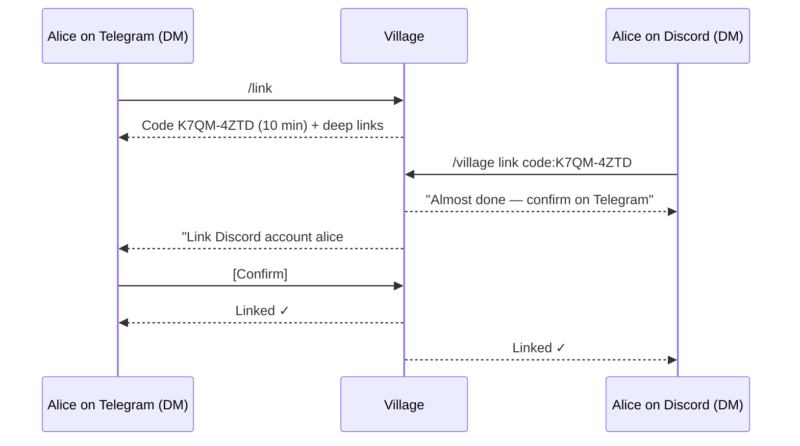
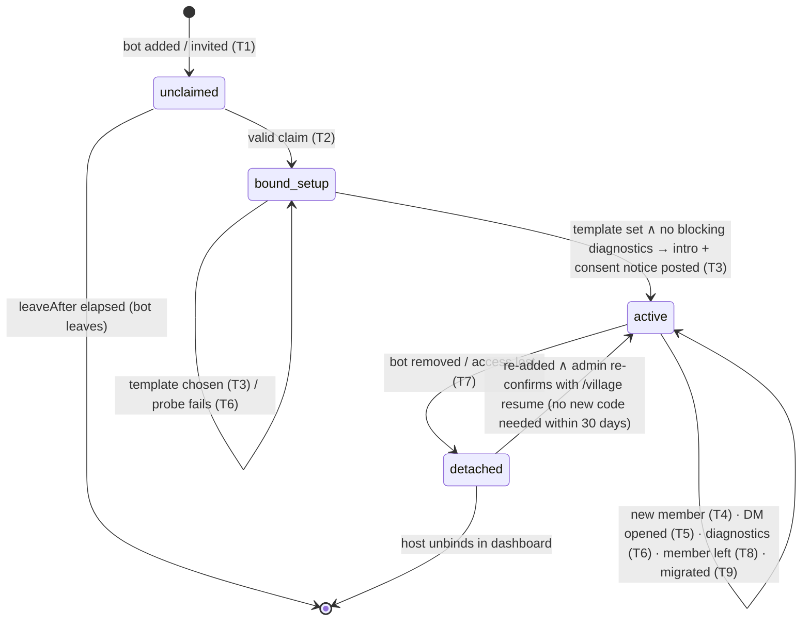

# 06 — Channels: Adapter SDK, Adapters, Identity and In-Chat Onboarding

> Status: **normative for the channel layer**. It elaborates `01-architecture.md` §7.1 (channel contract), §6.1 (inbound flow) and invariants I5–I7. It does not contradict the spine. Where a refinement needs a spine edit, it is listed in §12.
> Owns: `@village/channel-sdk` (contract, capability model, RichText AST, renderers, splitter, interactions, rate limiting, error taxonomy, conformance kit), every built-in adapter, identity mapping and linking, DM initiation, group claiming and in-chat setup flows, and platform failure handling.
> References: physical schema and the job queue → `02`; consent copy, IFC labels, audience semantics → `03`; memory retraction semantics → `04`; router, turn engine, copy/template engine, confirmations → `05`; polls/reminders/digests semantics → `07`; threat model and key management → `08`; HTTP auth, dashboard, CLI → `09`; plugin packaging → `10`; test strategy and harness → `11`; Docker/compose → `12`; docs site → `13`.
> Platform facts were verified on 2026-11-01. Each one cites its source inline. Re-verify the facts marked *(re-verify at M10)* before you implement them.

---

## 1. Purpose & scope

**Purpose.** Village lives in other people's chat apps. This document defines how it connects to them. Each connection must be correct, polite to rate limits and never double-send (I6). It must render well on each platform, stay private by default and be cheap to extend. Adapters are **dumb transport**. They normalize inbound platform traffic into `InboundEnvelope`/`ChannelEvent` and turn `OutboundMessage` into platform calls. All intelligence and policy stays in `engine`/`core`.

**In scope**
- **A. `@village/channel-sdk`:**
  - the contract and `AdapterContext`, plus a capability matrix;
  - the RichText AST with its parser, per-markup renderers and splitter;
  - mentions, buttons/interaction tokens, polls, reactions, attachments, typing and ephemeral messages;
  - rate limiting with retry/backoff, and the error taxonomy;
  - the conformance test kit.
- **B. Adapters:**
  - Telegram (reference), Web, Simulator (M3);
  - Discord, Slack, Matrix (beta), Signal (experimental) (M10);
  - a WhatsApp assessment (not built).
- **C. Identity and conversations:**
  - platform user → `ChannelIdentity` → `Person` → `Member`;
  - linking accounts across platforms with `/link`;
  - display names;
  - DM initiation and DM group context.
- **D. In-chat setup:** claim codes, unclaimed-chat policy, permission probes and fix-it guides, onboarding trigger points, and step-by-step host instructions per platform.
- **E. Platform failure modes:** bot removed, token revoked, chat migrated, too long, rate limited, edits/deletes, partitions.

**Out of scope here**
- Wording of the consent and intro messages (03).
- What the router does with a message (05).
- Poll decision rules (07).
- Persistence layout (02).
- Dashboard UI (09).
- Third-party channel plugin packaging (10). Plugins must still pass §3.25.

---

## 2. Key decisions

| # | Decision | Choice | Why |
|---|---|---|---|
| CH-1 | Contract shape | A **strict superset** of spine §7.1; §4.1 is authoritative for the full contract (01 §14 A26). `ingest(envelope)` handles messages and interactions. A new `ingestEvent(event)` handles edits, deletes, membership, migration, poll tallies and read markers. Adapters `await` the ingest ack before they acknowledge the platform. | At-least-once into SQLite. Ingestion dedupe (§6.1) makes it effectively once. |
| CH-2 | Adapter responsibilities | Transport only: normalize, render with SDK renderers, rate-limit, map errors. No storage imports, no policy, no model calls. | Enforced by spine §4. It keeps adapters small and testable. |
| CH-3 | Group binding | Chats bind to a group **only through a claim code** made by the host or an admin. The code is single-use with a 30-minute TTL. A Telegram deep link carries a 128-bit token. A typed code carries 40 bits and is attempt-limited. | A stranger can't bind a host's bot to their own group. |
| CH-4 | Unclaimed chats | **No message content is persisted.** The bot posts one "not set up" notice, ignores everything except a claim command, and leaves after 1 h if it can. | Privacy and cost. |
| CH-5 | Rich text | Own small **RichText AST**. The model writes a CommonMark subset, parsed with `mdast-util-from-markdown`. There is one renderer per markup, and the web gets AST JSON. **Splitting happens on the AST**, so each part is rendered independently and is well-formed by construction. | Escaping correctness and markup that never breaks. |
| CH-6 | Mentions | The model writes `@{mbr_…}` tokens. Renderers resolve them per platform. Mass mentions (`@everyone`, `@here`, `<!channel>`) are never produced, and Discord `allowed_mentions` is always explicit. | Prevents pinging everyone and fake mentions. |
| CH-7 | Buttons | An opaque **`v1.` + 22-char base64url** token (128 bits, 25 bytes) maps to a server-side `InteractionToken` row. Authority is the clicker's (I3) and is re-checked on every click. Where buttons are missing, the fallback is reactions, then numbered text replies. | Fits Telegram's 64-byte `callback_data`. Unforgeable. |
| CH-8 | Polls | Native when the spec fits the platform limits **and** the bot can see voter identity. That covers Telegram (non-anonymous), Discord, Matrix MSC3381, web and **Signal (native polls exist since 2025), once the M10 spike (SP-8, M10-T11) confirms the bot receives per-voter votes**; until then, and if it fails, Signal uses numbered replies (01 §14 A28). Slack, oversized polls and secret ballots are emulated. | Uses platform UX while keeping eligibility enforceable. |
| CH-9 | Attachments | Envelopes carry lazy `AttachmentRef`s. A new `attachment.fetch` job streams `adapter.fetchAttachment()` into the blob store with size caps and hashing. | Keeps ingestion under 20 ms (spine §11.10). Adapters never touch storage. |
| CH-10 | Delivery | Per-conversation ordered lanes. **Progress is persisted per split part.** Idempotency is native where available (Discord `nonce`+`enforce_nonce`, Matrix `txnId`). Slack is verifiable via message metadata. Telegram and Signal are at-least-once with a `possibleDuplicate` trace flag. | Honest I6. Resumes a split message mid-way after a crash. |
| CH-11 | Rate limits | SDK token buckets: global, per chat and per method. Waiters are priority-aware (interactive > scheduled > background) and round-robin across chats. **The platform's `retry_after` always wins.** discord.js keeps its own route buckets. | Smooth bursts. Replies jump ahead of digests. |
| CH-12 | Errors | 13 typed `ChannelErrorKind`s, each with a defined recovery behavior. Each adapter has a fixture-tested mapping table. | No silent catches (spine §11.6). |
| CH-13 | Telegram | **grammY 1.46** (Bot API 10.3), long polling by default and webhook optional. Recommended group setup is **admin with no extra rights**, which reads all messages and gets reactions and member events. Native polls are sent non-anonymous. Ephemeral messages and callback toasts are used for private nudges. | The reference adapter. Fewest setup traps. |
| CH-14 | Discord | **discord.js 14.28**, API v10. Intents include Message Content and Server Members, which an app with fewer than 10,000 users enables with a portal toggle. One `/village` slash command, registered **per guild on join**. Public Bot is off. | Works for self-hosted single-owner apps without review. |
| CH-15 | Slack | **@slack/bolt 5.1**, Socket Mode, a **single-workspace internal app** created from a provided manifest. That makes it exempt from the 2025 history rate cuts. Rendering uses mrkdwn sections plus an `actions` block. Polls are emulated and there is no typing indicator. | No public URL. Full rate limits. |
| CH-16 | Matrix | **`@vector-im/matrix-bot-sdk` 0.10.x** (Element fork) with **`@matrix-org/matrix-sdk-crypto-nodejs` ≥ 0.6.6**. E2EE is on. **The bot cross-signs itself** (MSC4153), and the host keeps the recovery key. Invites are accepted from an allowlist only. | The upstream SDK lacks cross-signing and pins a crypto version with a CVE. |
| CH-17 | Signal | **signal-cli ≥ 0.14.9** `daemon --http` (JSON-RPC + SSE with replay). A **dedicated registered number** is recommended; linked-device mode is discouraged. Polls are native once SP-8 passes, else numbered replies (A28). The adapter is labeled *experimental*. | Unofficial client. Signal's ToS risk is disclosed. |
| CH-18 | WhatsApp | **Not in 1.x.** There is no official way to join user-created groups, and the AI-provider ban applies outside EEA, Brazil and Türkiye. | §3.22. Never unofficial clients. |
| CH-19 | Identity linking | A one-time code is issued in a DM on platform A and redeemed in a DM on platform B. **A confirmation is always required back on A.** Person merges are refused when the two persons overlap in a group. | Proves control of both accounts. Defeats shoulder-surfed codes. |
| CH-20 | DMs | **One platform DM chat ↔ N Conversations** (one per group the person belongs to; 01 §14 A27). An explicit, sticky "active group" context is kept per DM chat. | Keeps group isolation (I4) for people in several groups. |
| CH-21 | Edits/deletes | An inbound edit updates the message and triggers re-extraction. An inbound delete purges text and attachments and **retracts derived memories by default** (04). Telegram has no delete events, so a `/forget` reply command covers it. | Respects members' intent to unsay something. |
| CH-22 | Streaming | **No partial-content streaming** (Telegram drafts, Slack streams). Placeholders and typing only. | I5: every byte that leaves passes the disclosure guard. |
| CH-23 | Conformance | One shared Vitest suite (C01–C24), recorded and **redacted** fixtures, and per-platform fake servers. Mandatory for built-in adapters and plugin adapters alike. | The adapter contract stays true as contributors arrive. |

---

## 3. Detailed design

### 3.1 Channel layer architecture

```mermaid
flowchart LR
  subgraph Adapter["Adapter (packages/channels/<x>)"]
    RX[Platform receive loop\npolling · gateway · socket · SSE] --> NORM[normalize → InboundEnvelope / ChannelEvent]
    SENDP[send/edit/react/poll] --> RL[SDK RateLimiter\nglobal · per-chat · per-method]
    RL --> API[Platform API]
    FETCH[fetchAttachment → stream]
  end
  NORM -->|await ctx.ingest / ctx.ingestEvent| ING[engine ingestion\n(dedupe · identity · persist)]
  ING --> ACT[group actor]
  ING -->|enqueue| AF[(job attachment.fetch)] --> FETCH --> BLOB[(blob store)]
  OUT[(outbox)] --> DISP[engine OutboundDispatcher\nper-conversation lanes] --> SENDP
  SENDP -->|ctx.sendProgress(part)| OUT
  HOST[engine AdapterHost\nctx impl · health · state KV] --- Adapter
```

- **`AdapterHost`** (in `engine/channels`) builds one `AdapterContext` per adapter. It starts adapters in parallel, so the HTTP server is never blocked. It supervises health and restarts crashed receive loops with backoff. On `SIGTERM` it stops them, giving each 5 s to drain.
- **Inbound.** The adapter normalizes a platform update, then `await ctx.ingest(...)`. It acknowledges the platform only after the ack: it advances the Telegram offset, acks the Slack envelope, or persists the Matrix sync token. Ingestion is synchronous on better-sqlite3 (<20 ms), so awaiting it is cheap.
- **Ordering.** Within one platform chat, an adapter must call `ingest`/`ingestEvent` sequentially in platform order. Across chats it may interleave.
- **Outbound.** The engine's `OutboundDispatcher` reads `pending` outbox rows. It keeps one in-flight send per conversation and bounded concurrency overall (default 8). It calls `adapter.send()`. The adapter renders with the SDK, splits, rate-limits and reports each delivered part through `ctx.sendProgress`. That call persists into the outbox row synchronously.
- **Interaction acks.** Discord deferral and Slack `ack()` are done **by the adapter, immediately, before `ingest`**. Telegram accepts only **one** `answerCallbackQuery` per query, so it is answered once: by the engine's fast path via `answerInteraction` (toast text or empty), or by the adapter with no text if that has not happened within 2 s (§3.7). They have hard deadlines (Discord 3 s, [docs](https://docs.discord.com/developers/interactions/receiving-and-responding)). The user-visible result goes through the outbox like any other message; the only exception is the Telegram callback toast (`answerInteraction`, §3.7), which must answer while the query is fresh.

### 3.2 Platform capability matrix

All values are for the default configuration. The `capabilities` constants live in `channel-sdk/src/profiles.ts` (§4.1), so the Simulator can emulate every platform.

| Capability | Telegram | Discord | Slack | Matrix (beta) | Signal (exp.) | Web | Simulator |
|---|---|---|---|---|---|---|---|
| Library / protocol | grammY 1.46.0 ([release](https://github.com/grammyjs/grammY/releases/tag/v1.46.0)) → Bot API **10.3** (2026-08-24, [changelog](https://core.telegram.org/bots/api-changelog)) | discord.js **14.28.0** ([npm](https://registry.npmjs.org/discord.js)), API **v10** ([ref](https://docs.discord.com/developers/reference)) | @slack/bolt **5.1.0**, Node ≥20 ([npm](https://registry.npmjs.org/@slack/bolt)), Socket Mode | @vector-im/matrix-bot-sdk **0.10.1-element.0** ([npm](https://registry.npmjs.org/@vector-im/matrix-bot-sdk)), spec **v1.19** ([changelog](https://spec.matrix.org/latest/changelog/v1.19/)) | signal-cli **0.14.9** ([releases](https://github.com/AsamK/signal-cli/releases)), JSON-RPC over HTTP | own (SSE + POST) | in-memory |
| `markup` | `telegram-html` | `discord-md` | `slack-mrkdwn` (+Block Kit) | `matrix-html` | `plain` + style ranges | `web-md` (AST JSON) | per profile |
| `maxMessageChars` / unit | 4096 "characters after entities parsing" ([sendMessage](https://core.telegram.org/bots/api#sendmessage)) / utf16 visible | 2000 ([message](https://docs.discord.com/developers/resources/message)) / utf16 raw | 12 000 per message (sections ≤3000, [section](https://docs.slack.dev/reference/block-kit/blocks/section-block)); `text` truncated above 40 000 ([postMessage](https://docs.slack.dev/reference/methods/chat.postMessage)) | 16 000 (our cap; event ≤65 536 bytes, [spec](https://spec.matrix.org/latest/client-server-api/#size-limits)) | **2000 UTF-8 bytes** (`MAX_MESSAGE_SIZE_BYTES`, [source](https://github.com/AsamK/signal-cli/blob/master/lib/src/main/java/org/asamk/signal/manager/config/ServiceConfig.java)) | 16 000 | per profile |
| `threads` | forum topics (`message_thread_id`) | threads/forum posts | `thread_ts` | `m.thread` | no | no | yes |
| `reactions` out / in | 1 per msg, restricted emoji set ([setMessageReaction](https://core.telegram.org/bots/api#setmessagereaction)) / **admin only** ([Update](https://core.telegram.org/bots/api#update)) | yes / yes | yes / yes | yes / yes | yes / yes | yes / yes | yes |
| `edits` (own) | yes | yes | yes ([chat.update](https://docs.slack.dev/reference/methods/chat.update)) | `m.replace` | `--edit-timestamp` | yes | yes |
| `deletes` (own) | <48 h ([deleteMessage](https://core.telegram.org/bots/api#deletemessage)) | yes | yes | redact | remote delete | yes | yes |
| inbound edits / deletes | yes / **no** (no delete update type) | yes / yes | yes / yes ([message_deleted](https://docs.slack.dev/reference/events/message/message_deleted)) | yes / yes | yes / yes | yes / yes | yes |
| `nativePolls` | 1–12 options, question ≤300, option ≤100; votes only for non-anonymous polls sent by the bot ([sendPoll](https://core.telegram.org/bots/api#sendpoll), [poll_answer](https://core.telegram.org/bots/api#update)) | ≤10 answers, question 300, answer 55, ≤32 days, not editable ([poll](https://docs.discord.com/developers/resources/poll)) | **emulated** | unstable MSC3381, ≤20 answers ([MSC](https://github.com/matrix-org/matrix-spec-proposals/blob/main/proposals/3381-polls.md)) | native 2–10 options ≤100 chars ([blog](https://signal.org/blog/polls/), [changelog](https://github.com/AsamK/signal-cli/blob/master/CHANGELOG.md)); the profile sets `nativePolls: false` until SP-8 passes (A28) | yes | yes |
| `buttons` | inline keyboard, `callback_data` **1–64 bytes** ([InlineKeyboardButton](https://core.telegram.org/bots/api#inlinekeyboardbutton)) | `custom_id` ≤100, 5/row, 5 rows ([components](https://docs.discord.com/developers/components/reference)) | `action_id` ≤255, `value` ≤2000 ([button](https://docs.slack.dev/reference/block-kit/block-elements/button-element)) | **no** → reactions/text | **no** → reactions/text | yes | yes |
| `typingIndicator` | ≤5 s per call ([sendChatAction](https://core.telegram.org/bots/api#sendchataction)) | 10 s ([channel](https://docs.discord.com/developers/resources/channel)) | **no** for plain bots ([setStatus](https://docs.slack.dev/reference/methods/assistant.threads.setStatus)) | yes ([spec](https://spec.matrix.org/latest/client-server-api/#put_matrixclientv3roomsroomidtypinguserid)) | 15 s (`sendTyping`) | yes | yes |
| `ephemeral` | best-effort (`ephemeral_message_parameters`; "not guaranteed", [api](https://core.telegram.org/bots/api#ephemeralmessageparameters)) + callback toasts | interaction-only (flag 64) | best-effort ([postEphemeral](https://docs.slack.dev/reference/methods/chat.postEphemeral)) | none | none | reliable | reliable |
| `silentSend` | `disable_notification` | `SUPPRESS_NOTIFICATIONS` | no | `m.notice` (suppressed by default push rule, [spec](https://spec.matrix.org/latest/client-server-api/#default-override-rules)) | no | yes | yes |
| voice / images / files | in: voice OGG/Opus, ≤**20 MB** download ([getFile](https://core.telegram.org/bots/api#getfile)); out: ≤50 MB ([sending files](https://core.telegram.org/bots/api#sending-files)) | out ≤**20 MiB** default since 2026-09-03 ([changelog](https://docs.discord.com/developers/change-log)) | `files.getUploadURLExternal`+`completeUploadExternal` ([files](https://docs.slack.dev/messaging/working-with-files)) | `m.upload.size` ([media config](https://spec.matrix.org/latest/client-server-api/#get_matrixclientv1mediaconfig)); Synapse default 50M | signal-cli cap 150 MiB | config | config |
| `mentionsByUserId` | yes (`tg://user?id=`) | yes `<@id>` | yes `<@U…>` | yes (`m.mentions`) | yes (ACI) | yes | yes |
| `dmInitiation` | `after-user-contact` | `any` (shared guild + user setting) | `any` | `any` (invite must be accepted) | `any` (message request) | `after-user-contact` | `any` |
| `readsAllGroupMessages` | `requires-setup` (privacy mode) | `requires-setup` (Message Content intent) | `yes` (once invited) | `yes` | `yes` | `yes` | `yes` |
| `memberListing` | `partial` (admins + count) | `exact` (needs Server Members intent) | `exact` | `exact` | `exact` | `exact` | `exact` |
| `deliveryVerification` | `none` | `native-idempotent` (`nonce`, "past few minutes", [message](https://docs.discord.com/developers/resources/message)) | `verifiable` (metadata lookup) | `native-idempotent` (`txnId`, [spec](https://spec.matrix.org/latest/client-server-api/#put_matrixclientv3roomsroomidsendeventtypetxnid)) | `none` | `native-idempotent` | configurable |
| `commands` | native (`setMyCommands`) | native (slash) | native (`/village`) | text (`!village`) | text (`village …`) | text | text |
| `datetimeTokens` | `<tg-time>` ([formatting](https://core.telegram.org/bots/api#date-time-entity-formatting)) | `<t:unix:F>` | `<!date^…>` ([formatting](https://docs.slack.dev/messaging/formatting-message-text)) | no | no | yes | yes |

### 3.3 Inbound normalization

**Envelope rules (all adapters).**
1. **Echo filter.** Drop the bot's own messages before `ingest`, using the platform's self id: Slack Bolt `ignoreSelf`, Discord `author.id`, Matrix `sender`, Signal own ACI.
2. **Other bots, webhooks and system messages.** These are dropped by default, controlled by `channels.<x>.acceptBotMessages: false`. Service events become `ChannelEvent`s, never envelopes.
3. **`senderKind`:**
   - `user`: a normal person.
   - `anonymous_admin`: Telegram `sender_chat` equal to the group itself ([Message](https://core.telegram.org/bots/api#message)).
   - `channel`: a Telegram linked channel, or `is_automatic_forward`.
   - `bot`: another bot or a webhook.
   - `system`: a platform service message.
   - Only `user` can be a requester with authority. The others never carry authority, and 05 treats them as untrusted content.
4. **Untrusted markers.** `forwarded`, `quotedExternal` and `linkPreviews` let ingestion set `untrusted=true` on the content they cover (spine §6.1 step 2.4). Per platform:
   - Telegram: `forward_origin`, `external_reply`, `quote`.
   - Discord: `message_snapshots`, or `message_reference.type=FORWARD`.
   - Slack: shared-message `attachments[].is_share`.
   - Matrix: none.
   - Signal: none.
   - Link previews (Discord embeds, Slack unfurls, Telegram `link_preview_options`) are **never** merged into `text`. They go to `linkPreviews[]` as untrusted.
5. **Text.**
   - `text` is the plain rendering. Platform markup is stripped and mentions are rendered as `@DisplayName`.
   - `richText` is the AST, with `mention{platformUserId}` nodes (§3.5).
   - Text is Unicode NFC.
   - Text over 32 768 UTF-16 units is truncated, `richText` is dropped and `truncated: true` is set.
6. **`mentionsBot`** is true for:
   - a platform mention of the bot user;
   - a command addressed to the bot (`/cmd@bot`, slash commands);
   - a Matrix `m.mentions.user_ids` entry containing the bot.
   Name invocation ("Village, …") is **not** detected here; the router does it (spine §6.1).
7. **`replyToPlatformMessageId`/`replyToIsBot`** come from platform reply metadata. Ingestion re-checks `replyToIsBot` against outbox receipts and never trusts the hint for authority.
8. **Dedupe identity.** Messages use `(channel, platformChatId, platformMessageId)` (spine). Non-message updates set `dedupeKey`: Telegram `update_id`/callback id, Discord interaction id, Slack `envelope_id`, Matrix event id, Signal `(sourceUuid,timestamp)`.
9. **Late delivery.** Anything received during catch-up after an outage (§3.24) gets `deliveredLate: true`. The router decides staleness (05). The default hint is `staleTriggerSec: 600`.
10. **Location and contact shares** become attachments of kind `location`/`contact` with `sensitive: true`. Ingestion labels them `sensitivity: sensitive`, because the spine §7.2 comment lists precise location as sensitive.

**`ChannelEvent`s** (via `ctx.ingestEvent`, §4.1):
- `message_edited`, `message_deleted`
- `bot_membership` (added / removed / banned / promoted / demoted / restricted)
- `member_joined`, `member_left`, `user_updated`
- `chat_migrated`, `chat_updated`
- `dm_blocked`, `dm_unblocked`
- `poll_updated` (aggregate tallies only)
- `read_marker` (a member's read position; emitted by Matrix from `m.read` receipts, by Web from the client's read cursor, and by Signal only for read receipts on Village's own messages; never by Telegram, Discord or Slack, which expose no read state for other users). Consumed only by 07's catch-up anchor for that member (07 §3.8.1) and never shown to anyone else.

These never trigger a turn directly. Ingestion maps them to state changes and to onboarding triggers (§3.20).

**Unclaimed chats (CH-4).**
- Ingestion asks `ChatBinding` (02) for the chat's status.
- For `unclaimed` chats, the envelope is inspected **in memory only**: is it a claim command or a mention? Then it is discarded with `IngestAck{status:'dropped', reason:'unclaimed'}`.
- No `Message` or `Person` row is created, and nothing is logged above `debug`.
- The adapter-side `ctx.bindings.status(chatId)` cache lets adapters skip expensive work early. For example, they don't download media in unclaimed chats.

### 3.4 Conversations, threads and DM context

| Platform construct | `platformChatId` | `platformThreadId` | Conversation |
|---|---|---|---|
| Telegram group/supergroup | chat id (string; ≤52 significant bits, [ResponseParameters](https://core.telegram.org/bots/api#responseparameters)) | `message_thread_id` for forum topics | one group conversation per chat; topics are threads |
| Telegram private chat | user id | (private topics, if any) | DM |
| Discord text channel / voice text / forum | channel id (for threads: **parent** id) | thread channel id | one group conversation per claimed channel |
| Discord DM | DM channel id | — | DM |
| Slack public/private channel, MPIM | `C…`/`G…` id | root `thread_ts` | group conversation |
| Slack IM | `D…` id | — | DM |
| Matrix room | room id | thread root event id | group if ≥3 joined members or not in `m.direct`; else DM |
| Signal group | `group:<base64 groupId>` | — | group |
| Signal 1:1 | `dm:<ACI uuid>` | — | DM |
| Web | `grp:<groupId>` (optional group room) / `dm:<personId>` | — | group / DM |

Rules:
- **One platform chat binds to at most one group.** A group may have **several group conversations on its home platform** (Discord or Slack channels, Matrix rooms) plus an optional web room. Cross-platform bridging is out of scope (00 §6.2). A claim that would add a chat on a different platform is refused, except the web room.
- **Threads** are not separate conversations. Replies go to the trigger's thread. Slack and Discord have `replyInThread: 'when-triggered-in-thread' | 'always'`, default the former.
- **DM context (CH-20).** One platform DM chat maps to N `Conversation(kind='dm', memberId)` rows, one per group in which the person is an active member. They are created lazily. `DmContext{channel, platformChatId, activeGroupId, setAt}` (02) is stored, and an inbound DM resolves its group in this order:
  1. explicit `/group <name>` or a group-picker button;
  2. a reply to a Village message (that message's conversation);
  3. an interaction token (the token's conversation);
  4. the stored `activeGroupId`;
  5. the only group, if the person has exactly one;
  6. otherwise Village asks with buttons, holds the message for ≤10 min, then drops it with a notice.

  When Village sends a DM for group G while the active group is H, the message is prefixed with `[G-name]`, and step 2 routes replies correctly. Group isolation (I4) holds because each DM conversation belongs to exactly one group.
- **Permalinks.** `adapter.permalink?(ref: PlatformMessageRef): string | null` is synchronous and makes no network call (07 uses it for decision citations, 07 §3.7):
  - Telegram supergroups: `https://t.me/c/<chat id without the -100 prefix>/<message_id>` (`null` for basic groups and DMs);
  - Discord: `https://discord.com/channels/<guildId>/<channelId>/<messageId>`;
  - Slack: `<workspace url from auth.test>archives/<channel>/p<ts without the dot>` (the documented permalink shape; no `chat.getPermalink` call on the hot path);
  - Matrix: `https://matrix.to/#/<roomId>/<eventId>`;
  - Signal: `null` (no message links); Web: the dashboard conversation URL when `instance.publicUrl` is set, else `null`.

### 3.5 RichText AST, parsing, rendering, splitting

#### 3.5.1 AST (`channel-sdk/src/richtext/ast.ts`)
```ts
export type RichText = { v: 1; blocks: Block[] };
export type Block =
  | { t: 'p'; c: Inline[] }                                    // paragraph
  | { t: 'h'; level: 1 | 2 | 3; c: Inline[] }                  // heading
  | { t: 'list'; ordered: boolean; start?: number; items: Block[][] }
  | { t: 'code'; lang?: string; text: string }                 // fenced block
  | { t: 'quote'; c: Block[] }
  | { t: 'hr' };
export type Mark = 'b' | 'i' | 's' | 'spoiler';
export type Inline =
  | { t: 'text'; text: string; marks?: Mark[] }                // marks sorted canonical: b,i,s,spoiler
  | { t: 'code'; text: string }                                // inline code; no marks inside
  | { t: 'link'; url: string; c: Array<Extract<Inline, { t: 'text' }>> }
  | { t: 'mention'; target: MentionTarget; fallback: string }  // fallback = "@Display Name"
  | { t: 'time'; at: string; fallback: string }                // ISO instant; templates only
  | { t: 'br' };
export type MentionTarget =
  | { kind: 'member'; memberId: MemberId }
  | { kind: 'platform_user'; platformUserId: string };
```
Hard limits are enforced by the zod `RichTextSchema`:
- list nesting ≤3 and quote nesting ≤2;
- ≤5 000 nodes;
- link URL schemes `https:`, `http:`, `mailto:` only; other links are degraded to text;
- `lang` must match `^[a-z0-9+#-]{1,20}$`.

There is no underline mark (CommonMark has none) and no tables (degraded, see below). `time` nodes come only from templates (05/07). The model never produces them.

#### 3.5.2 Parsing model output (`parse.ts`)
- Use `mdast-util-from-markdown` 2.x ([npm](https://registry.npmjs.org/mdast-util-from-markdown)) with three GFM extensions: strikethrough (`micromark-extension-gfm-strikethrough` + `mdast-util-gfm-strikethrough`), literal autolinks, and tables (parsed only so they can be degraded).
- **Soft line breaks become `br`.** Chat users and models expect a newline to be a line break.
- Mapping:
  - `**x**` / `__x__` → `b`; `*x*` / `_x_` → `i`; `~~x~~` → `s`.
  - Inline code, fenced or indented code, blockquote, lists and thematic break map one-to-one.
  - Headings h4–h6 become `h` level 3.
  - Images `` become `link(alt → u)`.
  - Raw HTML becomes literal text.
  - **GFM tables** become a `code` block of space-padded columns, which is readable in monospace everywhere.
- **Custom inline syntax** is applied after parsing, to `text` nodes only, never inside code:
  - `||x||` → `spoiler` mark (single text run, no nesting).
  - `@{mbr_<26-char typeid suffix>}` → `mention{kind:'member'}`. An unknown or ill-formed id becomes the text `@?` and logs `warn mention_unresolved`.
- **Failure mode.** Input over 64 KiB, a node limit exceeded or a parser exception all degrade to plain paragraphs split on blank lines, with `richtext_degraded_total{reason}` metric. Parsing never throws. This is checked by a property test.
- **Inbound parsing.** Each adapter maps platform entities straight to the AST: Telegram `MessageEntity[]` (UTF-16 offsets), Discord markdown (same parser plus `<@id>`/`<#id>`/`<t:…>`), Slack mrkdwn tokens, Matrix HTML (via a strict allowlist walker) and Signal ranges. Inbound ASTs are informational only. Labels come from `text`.

#### 3.5.3 Renderers (`render/*.ts`): exact escaping rules

Renderers are pure: `(ast, ctx: RenderContext) → Rendered`. `RenderContext` holds the resolved mentions, the bot's own identifiers, `linkPreview` and the locale fallback.

| Markup | Text escaping | Marks | Blocks | Mentions / time |
|---|---|---|---|---|
| `telegram-html` ([HTML style](https://core.telegram.org/bots/api#html-style)) | Replace `&`→`&amp;`, `<`→`&lt;`, `>`→`&gt;` in text. In attribute values also replace `"`→`&quot;`. Only `&lt; &gt; &amp; &quot;` named entities exist; never emit others. | `<b>`, `<i>`, `<s>`, `<tg-spoiler>`, `<code>` (nothing nested inside). Nesting order: `a > b > i > s > tg-spoiler`. | `p` → text + `\n\n`; `h` → `<b>…</b>\n`; list → lines prefixed `• ` / `n. `, indented 2×U+00A0 per level; `code` → `<pre><code class="language-x">…</code></pre>`; `quote` → `<blockquote>` (`<blockquote expandable>` if >600 chars; nested quotes flattened); `hr` → `———`. | `@username` if the user has a public username, else `<a href="tg://user?id=N">Name</a>`; `time` → `<tg-time unix="…" format="wDt">fallback</tg-time>` |
| `discord-md` | `escapeMarkdown()` from `@discordjs/formatters` ([source](https://github.com/discordjs/discord.js/blob/v14/packages/formatters/src/escapers.ts)), all options on. Then insert U+200B after `<` when followed by `@ # : / t: a:`, and after `@` in `@everyone`/`@here`. Neutralize `](` as `]​(`. | `**`, `*`, `~~`, `\|\|`; inline code uses double backticks with padding if the text contains a backtick. | `h` → `#`/`##`/`###`; list → `- ` / `n. ` with 2-space indent; `code` → fenced (U+200B between backticks of inner triple backticks); `quote` → `> ` per line (flattened); `hr` → `───`. | `<@id>`; `time` → `<t:unix:F>`; links → `[label](<url>)` (angle brackets suppress embeds) |
| `slack-mrkdwn` ([formatting](https://docs.slack.dev/messaging/formatting-message-text)) | Only `&`→`&amp;`, `<`→`&lt;`, `>`→`&gt;` ("don't encode the entire text"). mrkdwn has no backslash escape, so in text nodes insert U+200B after each `*`, `_`, `~` and backtick character. | `*b*`, `_i_`, `~s~`, `` `c` ``; spoiler → plain text. | `h` → `*text*` line; list → `• `/`n. ` with U+00A0 indentation; `code` → fenced, no language; `quote` → `> ` per line; `hr` → `divider` block. | `<@U…>`; link `<url\|label>` (URL `\|`→`%7C`, label escaped); `time` → `<!date^unix^{date_long_pretty} {time}\|fallback>` |
| `matrix-html` (allowlist in [spec](https://spec.matrix.org/latest/client-server-api/#mroommessage-msgtypes)) | `& < > " '` → entities. | `<strong>`, `<em>`, `<del>`, `<span data-mx-spoiler>`, `<code>`. | `<p>`, `<h1-3>`, `<ul>`/`<ol start>`/`<li>`, `<pre><code class="language-x">`, `<blockquote>`, `<hr>`, `<br>`. | `<a href="https://matrix.to/#/@user:server">Name</a>` plus `m.mentions.user_ids`; `time` → fallback |
| `plain` (Signal, fallbacks) | none | dropped; **Signal**: emitted as `textStyle` ranges `start:length:BOLD\|ITALIC\|STRIKETHROUGH\|SPOILER\|MONOSPACE` (UTF-16 offsets, [man](https://github.com/AsamK/signal-cli/blob/master/man/signal-cli.1.adoc)) | `• `/`n. ` lists; `> ` quotes; code verbatim (Signal MONOSPACE range); `h` → line (Signal BOLD); `hr` → `———` | `@Name` (Signal: `mention` range `start:length:<ACI>`); link → `label (url)` unless label==url |
| `web-md` | none (AST JSON; the dashboard renders React elements, **never** `innerHTML`) | — | — | resolved mentions embedded |

**Body/text fallbacks.**
- Matrix `body` uses the `plain` renderer.
- Slack top-level `text`: `plain`, truncated to 3 000 characters. It is used for notifications and accessibility.
- **Markup rejection fallback.** If a platform rejects the markup, the part is re-sent once with `plain`. Triggers: Telegram `400 can't parse entities`, Slack `invalid_blocks`, Discord `50035` on content. Every such fallback is logged at `warn` with a fixture captured in debug mode.

#### 3.5.4 Splitting (`split.ts`)
```
splitAndRender(ast, caps, renderer): RenderedPart[]
  limit = caps.maxMessageChars (in caps.lengthUnit)
  parts = []; cur = []
  for block in ast.blocks:
    pieces = measure([block]) <= limit ? [block] : splitBlock(block, limit)
    for p in pieces:
      if cur nonempty and measure(cur ++ [p]) > limit: parts.push(render(cur)); cur = [p]
      else cur.push(p)
  if cur nonempty: parts.push(render(cur))
  if parts.length > maxPartsPerMessage: keep first (max-1); last = truncation notice part (copy key channels.truncated)
```
- `measure` renders and counts **the unit the platform counts**:
  - Telegram: visible text length in UTF-16, tags stripped and entities decoded.
  - Discord: raw content length.
  - Slack: section text length, with an extra 3 000-per-section constraint (blocks are assembled after splitting).
  - Matrix: visible UTF-16 length ≤ 16 000 **and** serialized event JSON ≤ 60 000 bytes (≤ 40 000 in encrypted rooms; §3.21.4).
  - Signal: UTF-8 bytes of the plain text.
- `splitBlock` rules:
  - `p`/`h`: split the inline sequence at the best boundary, in this order: `br`, then sentence end (`. ! ? 。` followed by space), then whitespace, then a hard cut at a **grapheme boundary** (`Intl.Segmenter('und',{granularity:'grapheme'})`). Text nodes split into two nodes with the same marks.
  - `link`, `mention`, `code` inline nodes are atomic. An atomic node longer than the limit degrades to text.
  - `code`: split on line boundaries into several `code` blocks with the same `lang`. A single long line gets a grapheme hard cut.
  - `list`: split between items, with `start` continued for ordered lists. A single oversized item is split recursively.
  - `quote`: split its children; each piece is wrapped in `quote`.
- Each part is rendered from its own AST slice, so **markup can never be broken across parts**.
- Defaults: `maxPartsPerMessage` = 6. Per-platform safety factor 1.0, because measurement is exact. On a platform `message_too_long`, re-split once at 80% of the limit.
- Performance target: ≤3 ms p95 for a 4 000-character AST, ≤10 ms for 16 000 (§8).

### 3.6 Mentions

- **Outbound.** The engine resolves every `member` mention before sending: `OutboundMessage.mentions[memberId] = {platformUserId?, displayName, username?, canPing}`.
  - `canPing` is false when the member has no identity on this channel, when the outbound `messageClass` is `proactive` and the constitution forbids pings (07), or when `notify==='silent'`.
  - A mention that cannot ping renders as the plain `fallback` text.
  - Discord always sends `allowed_mentions: {parse: [], users: [<pingable ids>], replied_user: false}` ([message](https://docs.discord.com/developers/resources/message)).
  - Matrix always includes `m.mentions` (empty means no pings). This disables legacy body-match notifications ([spec](https://spec.matrix.org/latest/client-server-api/#user-and-room-mentions)).
- **Inbound.** Adapters emit `mention{kind:'platform_user'}`. Ingestion maps it to `memberId` when the identity is known. Unknown platform users stay as display text.
- **Never produced:** `@everyone`/`@here` (Discord), `<!channel>`/`<!here>`/`<!everyone>` (Slack), `@room` (Matrix). Renderers neutralize these in text (§3.5.3). The Matrix `m.mentions.room` key is never set.

### 3.7 Buttons and interaction callbacks

**Token scheme (CH-7).**
- A token is `v1.` + base64url (no padding) of 16 CSPRNG bytes. That is **25 ASCII bytes** for 128 bits of entropy.
- It fits Telegram `callback_data` (≤64 bytes), Discord `custom_id` (≤100), Slack `value` (≤2000) and `action_id` (≤255), and Telegram start payloads (≤64 chars of `A-Za-z0-9_-`, [features](https://core.telegram.org/bots/features#deep-linking)).
- The prefix allows a future format bump.
- The server stores only `sha256(token)` in an `InteractionToken` row (02):

```ts
interface InteractionTokenRecord {
  id: TypeId<'itk'>; tokenHash: Uint8Array;            // sha256(token)
  groupId: GroupId; conversationId: ConversationId; outboxMessageId?: OutboxId;
  action: { kind: string; params: unknown };            // e.g. {kind:'confirm', params:{confirmationId, option:'approve'}}; kinds below
  allowedClickers: 'any_member' | MemberId[];           // checked again by policy (I3)
  singleUse: boolean; expiresAt: Instant; usedAt?: Instant; usedBy?: MemberId;
  createdByTurnId?: TurnId;
}
```

**Action kinds.** This token is the **only** button payload on every platform. No structured strings (`cnf:…`, `poll:…`) ever go into `callback_data`, `custom_id` or `value`. Each `action.kind` is registered by its owner with a deterministic handler; the engine rejects unknown kinds as expired:
- 05: `confirm` `{confirmationId, option}` where `option ∈ approve|reject|approve_always|edit` (03 §3.3.12; entity `ConfirmationRequest`, 01 §14 A7); `cmd.undo` `{effectId}`; `cmd.more` `{turnId}`; `cmd.cancel` `{turnId}`.
- 07 (params always include `entityVersion`): `rsvp`, `reminder.done`, `reminder.snooze`, `task.accept`, `task.decline`, `task.done`, `swap.accept`, `swap.decline`, `giveaway.take`, `poll.vote`, `list.toggle`, `plan.step.confirm`, `plan.step.claim`, `proactive.feedback`, `digest.action`, `choice.replay`. 07's "token → `{handler, args, entityVersion, allowedMemberIds|null, expiresAt}`" is this record with `action.kind = handler`, `action.params = {...args, entityVersion}` and `allowedClickers = allowedMemberIds ?? 'any_member'`.
- 06: `setup.template` (template picker, T2), `dm.group` (DM group picker, §3.4), `link.confirm` / `link.cancel` (§3.18.1).
- Other owners register under their own prefix (e.g. 03 consent and constraint cards, 09 pairing approval).

**Flow.**
1. The click arrives. Telegram sends `callback_query.data`, Discord sends `interaction.customId`, Slack sends `block_actions[].value`, Web sends `POST /interactions`.
2. **The adapter acks immediately:**
   - Telegram: no answer yet. The fast path (step 5) answers once via `answerInteraction`; if it has not within 2 s, the adapter calls `answerCallbackQuery` with no text. Telegram rejects a second answer, so later results use edits, ephemeral messages or replies.
   - Discord: `deferUpdate()`.
   - Slack: `ack()`.
3. The adapter emits an envelope with `interaction:{kind:'button', payload:{token}}`. `platformMessageId` is the message carrying the button; `dedupeKey` is the platform callback/interaction id.
4. The engine resolves the token, then checks expiry, single use and that the clicker is an allowed member. The router turns it into an `interaction` decision (05 §3.2.5), and the registered handler for `action.kind` runs **with the clicker's authority** (I3) on the deterministic fast path: **no model call** (trace disposition `interaction`).
5. The result is delivered as one of:
   - an outbox **edit** of the original message (buttons removed, status line added);
   - a Telegram callback **toast**, `answerCallbackQuery(text ≤200)`, sent via a fast path because it must happen while the query is fresh;
   - an **ephemeral** message to the clicker (§3.12), or a normal reply.
   - Denials ("Only Alice can confirm this") always use toast or ephemeral and are never posted publicly.
6. Unknown or expired tokens get a toast or ephemeral reply saying "This button has expired". The click is never ingested as a trigger.

**Limits.**
- Each message has ≤8 buttons, ≤3 per row and labels ≤30 characters, truncated with `…`. This stays under every platform limit: Discord labels ≤80, Slack ≤75.
- The default token TTL is 7 days, or the poll/plan deadline + 1 day. Producers may set a shorter `expiresAt`: 07 choice tokens use 24 h, and `confirm` tokens expire with their `ConfirmationRequest` (03 §3.3.12 rule 5).

**Fallback when `buttons: false` (Matrix, Signal).** The SDK's `renderChoiceFallback(actions, caps)` appends:
- **Reaction choices**, used when `reactions: true` and there are ≤4 options. They map to `1️⃣ 2️⃣ 3️⃣ 4️⃣`, or `✅ ❌` for confirm/cancel (`👍 👎` where the platform's reaction set lacks them, §3.9), and Village pre-reacts with the options.
- **Text choices**: "Reply **1** for …, **2** for …".

`parseChoiceReply(text|reaction)` maps `1`, `yes`, `y`, `ok`, `✅`, `👍`, `no`, `n`, `❌`, `👎` (locale-extended by 05 copy) to an option. Ingestion resolves the pending choice when the message replies to the prompt, or is the next message from the allowed clicker in that conversation within 10 minutes. It then emits a synthetic `interaction.kind='button'` with the corresponding token.

**Confirmations are stricter** (03 §3.3.12 rule 2, normative). For `confirm` tokens the 10-minute next-message rule does **not** apply: a reaction counts only on the confirmation message itself (✅/👍 = approve, ❌/👎 = reject; anything else is ignored), and a text answer counts only when it is a platform *reply* to the confirmation message, matched by the per-locale lexicon. Ambiguous replies are ignored with a nudge. Only an eligible approver's linked identity can answer.

### 3.8 Polls: native vs emulated

`PollSpec { target; question; options: string[]; multiSelect; anonymous; closesAt?; idempotencyKey; replyTo? }` (§4.1 is authoritative, A26). Doc 07 owns quorum, deadlines, decision rules and results visibility; those stay engine-side and are **not** part of `PollSpec`. 07's option ids map to positions: `options[i]` is 07's i-th option, and every vote index refers to that order. 07's `allowMultiple` is `multiSelect` here. This doc owns the mapping only.

`closePoll?(ref)` returns `PollFinalTally { counts: number[]; totalVoters: number }` when the platform reports final counts on close (Telegram `stopPoll` returns the final `Poll`; Matrix and Signal: computed from received votes; Web: engine), or `null` when it does not (Discord expire). 07 reconciles that tally with its mirrored votes; platform counts win for native polls (07 §3.5.3).

`choosePollMode(spec, caps) → 'native' | 'emulated'`. It returns `native` only if **all** of these hold:
1. `caps.nativePolls` is set and the spec fits `caps.pollLimits`: option count, question and option lengths, and the duration window.
2. `spec.anonymous === false`. Secret ballots are emulated through DM buttons (07), because a native anonymous poll hides voters, so eligibility can't be enforced.
3. The platform delivers per-voter events for bot-created polls.
4. The host has not set `channels.<x>.nativePolls: false`.

| Platform | Native mapping | Votes in | Close |
|---|---|---|---|
| Telegram | `sendPoll{question, options[{text}], is_anonymous:false, allows_multiple_answers, allows_revoting:true, allow_adding_options:false, close_date?}`. `close_date` only if 5 s–2 628 000 s ahead ([sendPoll](https://core.telegram.org/bots/api#sendpoll)), else the engine closes it. | `poll_answer` → `poll_vote{mode:'replace', optionIndexes: option_ids}`; empty = retracted | `stopPoll` |
| Discord | Create Message `poll{question:{text}, answers[{poll_media:{text}}], duration: ceil(hours) 1..768, allow_multiselect}` (needs `SEND_POLLS`) | `MESSAGE_POLL_VOTE_ADD/REMOVE` → `poll_vote{mode:'delta', optionIndex, op}` (intents `GUILD_MESSAGE_POLLS`/`DIRECT_MESSAGE_POLLS`, [gateway](https://docs.discord.com/developers/events/gateway)) | `POST …/polls/{id}/expire` (own polls only) |
| Matrix | `org.matrix.msc3381.poll.start` (`kind: org.matrix.msc3381.poll.disclosed`, `max_selections`, answers `{id, org.matrix.msc1767.text}`) plus a text fallback | `…poll.response` (`m.reference`) → `poll_vote{mode:'replace'}`; the latest response per user wins; responses after end are ignored | `…poll.end` |
| Signal | `sendPollCreate` (2–10 options, `--no-multi` for single choice). **Used only after the M10 spike (SP-8, M10-T11) confirms the bot receives per-voter votes; otherwise the profile keeps `nativePolls: false` and polls fall back to numbered replies (§3.7; 01 §14 A28).** | `dataMessage.pollVote` → `poll_vote{mode:'replace'}` *(re-verify field shapes at M10 against 0.14.9 json-schemas)* | `sendPollTerminate` |
| Web | native component | `POST /interactions` | engine |
| Slack | emulated | — | — |

**Emulated poll.** One message with the question and one button per option (Slack ≤5 per `actions` block). For no-button platforms, reaction or text choices are used (§3.7). The live tally is shown by editing the message at most once per 10 s per poll, batched by the dispatcher, plus a final edit at close. Tally visibility (live / hidden until close) is 07's choice. Telegram's `poll` updates with aggregate counts are emitted as `poll_updated` events and used only for display reconciliation.

### 3.9 Reactions

- **Canonical keys:** `ack`, `done`, `no`, `seen`, `celebrate`, `heart`, `thinking`, `writing`, `one`, `two`, `three`, `four`, `check`, `cross`. `channel-sdk/src/reactions.ts` maps each key to an emoji per platform.
- **Telegram's allowed set has no ✅, ❌ or keycaps** ([ReactionTypeEmoji](https://core.telegram.org/bots/api#reactiontypeemoji)). So `done` → 👌, `check` → 👍, `cross` → 👎, `writing` → ✍, and the keycap keys are unsupported there; Telegram uses buttons instead anyway.
- Slack uses names (`white_check_mark`, `x`, `eyes`, `tada`, `heart`, `one`…), and the SDK map converts.
- **Outbound uses:**
  - lightweight acknowledgment instead of a text reply (quiet by default; 05 decides);
  - reaction choices (§3.7).
  - Telegram allows bots **one reaction per message** ([setMessageReaction](https://core.telegram.org/bots/api#setmessagereaction)).
- **Inbound** becomes `interaction{kind:'reaction', payload:{targetPlatformMessageId, emoji, action:'added'|'removed'}}`. Emoji are NFC-normalized and stripped of U+FE0F. Consumers are proactivity feedback (07: muted or ignored means less), reaction choices and 04's extraction windows (agreement signals).
- **Persistence (02 `message_reactions`).** Ingestion writes every inbound reaction by a known Member on a stored message of a **bound** conversation to 02's `message_reactions` table (`messageRid`, `memberId`, normalized `emoji`, `at`; a `removed` action deletes the row) in the ingest transaction, so 04's extraction windows can read them (04 §3.3.3). Rows inherit the target message's label and are deleted with it (retention and erasure follow the message). Reactions of members whose consent forbids extraction are stored but never rendered into extraction windows (A16; 04 drops them). Reactions from unknown identities, anonymous senders and bots, and anything in unclaimed chats, are not stored. `observeReactions` (default `true`) controls whether reactions on messages that are not Village's are ingested at all; a host who sets it to `false` keeps data minimal at the cost of reaction-based memory signals (reactions on Village's own messages are always ingested, for choices and feedback).
- **Telegram inbound reactions** require the bot to be an **administrator** and to request `message_reaction` in `allowed_updates` ([Update](https://core.telegram.org/bots/api#update)). They are not received for reactions set by bots.

### 3.10 Attachments

**Inbound (streaming to the blob store).**
1. The adapter puts `InboundAttachment{ ref: AttachmentRef, kind, mime?, name?, sizeBytes?, durationSec?, isVoiceNote, sensitive? }` into the envelope. `ref` is an opaque, adapter-specific JSON object holding what's needed to fetch later:
   - Telegram `file_id`;
   - Discord `{channelId, messageId, attachmentId, url}`;
   - Slack `url_private_download`;
   - Matrix `mxc` + `EncryptedFile` (contains a key; stored encrypted at rest with the message row);
   - Signal attachment `id`.
2. Ingestion persists `Message.attachments[]` as `pending` and enqueues **`attachment.fetch`**. This is a new job kind (01 §14 A25) with partition `groupId` and `runAt=now`, since some URLs expire. Neither the adapter nor ingestion ever downloads bytes inline (20 ms budget).
3. The media worker (concurrency 2, spine §8) calls `adapter.fetchAttachment(ref)` and pipes the stream through:
   - a byte counter that aborts at `media.maxInboundBytes` (default 25 MiB);
   - a SHA-256 hasher;
   - `file-type` sniffing ([npm](https://registry.npmjs.org/file-type)) of the first 4 KiB, which overrides the platform MIME if they disagree;
   - the blob store writer (02: encrypted, content-addressed).
4. On success the attachment becomes `stored{sha256}` and the media jobs are enqueued (`media.transcribe|vision|pdf`, spine §6.4). On failure it becomes `failed{reason}`: `too_large`, `expired`, `forbidden` or `unsupported`. The engine may tell the sender "I couldn't open that file (too large)" only when they addressed Village.
5. **Skipped entirely:** chats that are unclaimed or detached; messages from members whose consent is not `memory_on` (`unknown`, `informed`, `memory_off`; 01 §14 A16, 03 §3.8.2) **unless** the message directly addresses Village (DM, `mentionsBot`, or a reply to Village), in which case the attachment is fetched for transient use in that turn only; stickers and GIFs (they become text `[sticker 😀]`), and video larger than `media.maxVideoBytes` (default 0, meaning off, in 1.0).

**Per-platform fetch caps.**
- Telegram cloud Bot API: **20 MB download** ([getFile](https://core.telegram.org/bots/api#getfile)). Larger files are marked `too_large` without fetching unless `telegram.apiRoot` points to a self-hosted Local Bot API Server ("download files without a size limit", [api](https://core.telegram.org/bots/api#using-a-local-bot-api-server)).
- Discord CDN URLs are signed and expire. On 403/404, refresh by re-fetching the message over REST and retry once.
- Slack needs `Authorization: Bearer xoxb…` with `files:read`.
- Matrix uses authenticated media `GET /_matrix/client/v1/media/download/{server}/{id}` ([spec](https://spec.matrix.org/latest/client-server-api/#get_matrixclientv1mediadownloadservernamemediaid)), then `crypto.decryptMedia` for encrypted files.
- Signal's `getAttachment` returns **base64 in the JSON-RPC result** ([man](https://github.com/AsamK/signal-cli/blob/master/man/signal-cli.1.adoc)). It is decoded in a streaming fashion, capped at 25 MiB. Larger files require the shared-volume mode (`signal.attachmentsDir`), which reads the file directly.

**Outbound files.**
- `OutboundAttachment{ kind:'image'|'file'|'voice', name, mime, sizeBytes, open(): Promise<ReadableStream> }`.
- The engine supplies `open` from the blob store. Adapters must stream and never buffer the whole file except where an SDK forces it; Signal `data:` URIs are capped at 8 MiB, beyond which the shared directory is used.
- Over a platform's `maxOutboundAttachmentBytes`, the engine sends a dashboard link instead. That requires `instance.publicUrl` or a LAN URL; otherwise it sends a "file too large to send here" notice.
- Voice output (TTS) is not in 1.0. Voice notes from users are handled inbound only.

### 3.11 Typing indicators

The SDK `TypingManager` is driven by the engine: `typing.start(conversation)` when the router decides `respond`, and `typing.stop` when the first part is sent, on failure, or after `typing.maxSeconds` (60).

| Platform | Call | Refresh | Notes |
|---|---|---|---|
| Telegram | `sendChatAction('typing', message_thread_id?)` | every 4 s (lasts ≤5 s) | cleared by Telegram when the bot sends ([api](https://core.telegram.org/bots/api#sendchataction)) |
| Discord | `channel.sendTyping()` | every 8 s (expires after 10 s) | "Generally bots should not use this route" except for slow responses ([channel](https://docs.discord.com/developers/resources/channel)). Village uses it only for `respond` turns. |
| Slack | none | — | plain bots have no typing API |
| Matrix | `PUT /typing {typing:true, timeout:30000}` | every 25 s | `typing:false` on stop |
| Signal | `sendTyping` | every 12 s (shows 15 s) | `stop: true` on stop |
| Web | SSE `typing` event | — | client times out after 20 s |

Typing is never shown in chats where a send would fail (missing permission), and never for proactive or system messages. It has its own per-chat limit of 1 call per 4 s, which does not consume message tokens.

### 3.12 Ephemeral messages

`OutboundMessage.visibility = {kind:'ephemeral', platformUserId, fallback:'dm'|'toast'|'drop'}`.
- **Use only for non-essential, single-reader UX:** denial notices after a click, "I've sent you a DM", in-group consent nudges, and button-click confirmations.
- Anything that must be delivered goes to a DM. Telegram ephemeral delivery is "not guaranteed … especially if they are offline" ([EphemeralMessageParameters](https://core.telegram.org/bots/api#ephemeralmessageparameters)), and Slack ephemeral delivery "is not guaranteed" ([postEphemeral](https://docs.slack.dev/reference/methods/chat.postEphemeral)).
- The disclosure guard (I5) checks an ephemeral message against `Audience{members:[that member]}`. The guard and audience semantics are owned by 03.
- Per platform:
  - Telegram: `sendMessage(…, ephemeral_message_parameters:{receiver_user_id, callback_query_id?})`; for clicks, the `answerCallbackQuery` toast is preferred.
  - Discord: only as an interaction follow-up with flag 64 (`EPHEMERAL`), within the 15-minute token.
  - Slack: `chat.postEphemeral` (Tier 4).
  - Web: native.
  - Matrix, Signal: unsupported, so `fallback` applies.

### 3.13 Outbound delivery, idempotency and ordering

**Lanes and priority.**
- The dispatcher keeps one in-flight `send` per conversation, and rows within a conversation go strictly in outbox order.
- `OutboundMessage.priority` drives the SDK limiter's waiter queues: `interactive` (replies, interaction results), `scheduled` (reminders) and `background` (digests, recaps, onboarding notices). Default by `messageClass` (A24; the producer may override): `reply` → `interactive`; `requested` → `scheduled`; `digest`, `proactive` → `background`; `system` → `interactive` for recovery summaries, else `background`.
- `messageClass` (`reply | requested | digest | proactive | system`, 01 §14 A24) is stamped by the producer (05) on the outbox row and copied into `OutboundMessage`. Adapters use it only for `canPing` (§3.6) and the default priority; only 07's attention budget counts `proactive`. It is independent of the delivery **expiry class** below.
- Expiry classes (`expiryClass` on the outbox row, §4.3) are set by the producer (05/07):

| Expiry class | Expires | Used for |
|---|---|---|
| `must_deliver` | never; retried until `chat_access_lost` or `auth_revoked` | replies carrying `TurnEffect` acknowledgments (I7), reminders, recovery summaries |
| `timely` | 30 min | plain Q&A replies |
| `best_effort` | 6 h | digests, notices |

Expired rows become `expired`, and the TurnTrace records it.

**Split progress (CH-10).** The outbox row stores `parts: [{index, platformMessageId, sentAt}]` (02). `send()` is called with `resume.partsSent`. The adapter re-renders deterministically, skips the parts already sent, and calls `ctx.sendProgress.record(idempotencyKey, part)` **synchronously after each platform success**, before it sends the next part. A crash mid-split therefore resumes at the next part.

**Idempotency per platform (I6).**
- **Discord:** `nonce = base32(sha256(idempotencyKey + ':' + partIndex))[0..25]` with `enforce_nonce: true`. A retry within "the past few minutes" returns the existing message ([message](https://docs.discord.com/developers/resources/message)). Ambiguous failures are retried immediately.
- **Matrix:** `txnId = idempotencyKey + '.' + partIndex`, made URL-safe. The server deduplicates per access token ([spec](https://spec.matrix.org/latest/client-server-api/#transaction-identifiers)). For encrypted rooms this requires encrypting and then issuing the `PUT` with our txnId; see the M10-T8 spike. Fallback is `none`.
- **Slack:** attach `metadata:{event_type:'village_outbound', event_payload:{k:<hex16(sha256(key:part))>}}` ([metadata](https://docs.slack.dev/messaging/message-metadata)). On an ambiguous failure, `verifyDelivery` reads `conversations.history(channel, oldest=attemptStart−60s, include_all_metadata=true, limit=50)` and looks for `k`. This needs `metadata.message:read`.
- **Telegram, Signal:** there is no idempotency and no history read. An ambiguous failure (timeout or connection reset after the request was written; an `in_flight` row found at boot) is **retried once** and marked `possibleDuplicate: true` in the trace and metrics. `must_deliver` prefers a rare duplicate to a lost reminder; `timely` and `best_effort` are **not** retried after an ambiguous failure.
- **Mitigations:** HTTP keep-alive with a generous 30 s timeout. The `in_flight` mark is committed before the call and the receipt right after it, which shrinks the crash window to microseconds. This matches the spine's "best effort" wording for I6 (see §12-9).

### 3.14 Rate limiting and retry

**Token buckets** (`channel-sdk/src/ratelimit`). `RateLimiter.acquire(keys: BucketKey[], cost, priority, signal)` waits on all buckets atomically. Buckets refill continuously from the injected `Clock`, so tests use a virtual clock. Waiters are ordered by priority, then FIFO, with round-robin across chats.

| Platform | Global | Per chat | Per method / other | Retry signal honored |
|---|---|---|---|---|
| Telegram | 25 msg/s, burst 25 (platform ~30/s, [FAQ](https://core.telegram.org/bots/faq#my-bot-is-hitting-limits-how-do-i-avoid-this)) | DM: 1/s, burst 3. Group: **20/min** (capacity 5, refill 1 per 3 s). Edits count as sends. | `answerCallbackQuery`, `getFile` exempt; typing via TypingManager | `429` `parameters.retry_after` (s) |
| Discord | delegated to `@discordjs/rest` (50 req/s global + per-route buckets from `X-RateLimit-*`; "rate limits should not be hard coded", [rate limits](https://docs.discord.com/developers/topics/rate-limits)) | soft 5 per 5 s per channel (smoothing only) | interaction callbacks exempt from the global limit | `retry_after`, headers; guard against the 10 000 invalid requests/10 min ban: never retry 401/403 |
| Slack | 3 msg/s soft workspace cap | **1/s per channel**, burst 3 ([postMessage](https://docs.slack.dev/reference/methods/chat.postMessage)) | Tier 2 20/min, Tier 3 50/min, Tier 4 100/min per method ([tiers](https://docs.slack.dev/apis/web-api/rate-limits)) | `429` `Retry-After` |
| Matrix | per homeserver: 0.2/s, burst 10 (Synapse `rc_message` default, [config](https://github.com/element-hq/synapse/blob/develop/docs/usage/configuration/config_documentation.md)); configurable; recommend admin exemption | — | typing separate | `M_LIMIT_EXCEEDED` + `Retry-After` (preferred) / `retry_after_ms` ([spec](https://spec.matrix.org/latest/client-server-api/#rate-limiting)) |
| Signal | 1 msg/s, burst 5 (conservative; limits undocumented) | 1/s | typing ≤1 per 10 s | rate-limit failure `retryAfterSeconds`; *proof-required* → health `captcha_required` (§3.21.5) |
| Web / Simulator | none (simulator can inject) | — | — | — |

**Retry policy** (`retry.ts`). The delay for attempt `n` is `max(retryAfter ?? 0, U(0.5,1.0) × min(cap, base × 2^n))`, with `base = 1 s` and `cap = 60 s`. Other rules:
- `transient`: at most 8 attempts, about 4 minutes. After that the row goes back to `pending`, with `nextAttemptAt` = +5 min, until it expires.
- `rate_limited`: does not count toward attempts.
- Permanent kinds are never retried; they follow §3.15.
- **While the adapter's health is not `healthy`, the dispatcher pauses that adapter's lanes**, so attempts aren't burned during outages.

### 3.15 Error taxonomy

```ts
export type ChannelErrorKind =
  | 'rate_limited'        // retryAfterMs set; retryable, not counted
  | 'transient'           // 5xx/network before request was sent; retryable
  | 'ambiguous'           // may have been delivered; handled per deliveryVerification (§3.13)
  | 'auth_revoked'        // token invalid/revoked; adapter → health 'auth_failed'; stop loops
  | 'instance_conflict'   // another process uses the same credentials (Telegram 409, Signal lock)
  | 'chat_access_lost'    // kicked/removed/archived/blocked from chat → conversation 'detached'
  | 'user_unreachable'    // cannot DM this user (not started, blocked, closed DMs)
  | 'chat_migrated'       // newPlatformChatId set; retry immediately on new id
  | 'permission_missing'  // lacks a specific right; diagnostic + fix-it guide
  | 'message_too_long'    // re-split at 80% once, then plain fallback
  | 'markup_rejected'     // re-send plain once
  | 'not_found'           // target message/poll gone (edit/react/delete) → drop silently
  | 'bad_request';        // permanent bug; log error with fixture, mark row 'failed'
export class ChannelError extends Error {
  constructor(readonly kind: ChannelErrorKind, message: string, readonly details: {
    platformCode?: string | number; retryAfterMs?: number; newPlatformChatId?: string;
    permission?: string; cause?: unknown }) { super(message); }
  get retryable(): boolean { return ['rate_limited', 'transient', 'ambiguous', 'chat_migrated'].includes(this.kind); }
}
```

**Recovery behaviors** are owned by the engine and selected by kind:
- `chat_access_lost`:
  - The conversation becomes `detached`, and its pending rows are `cancelled`.
  - A `ConversationDetached` domain event is emitted; 07 re-routes `must_deliver` reminders to DMs if allowed.
  - The host is notified (§3.20 T7).
- `user_unreachable` on a DM: the row is `failed`, `ChannelIdentity.dmReachable=false` is set, and the next group interaction offers a DM link.
- `auth_revoked` and `instance_conflict`: the adapter stops its receive loop and stays registered with health `auth_failed`/`conflict`. The dashboard banner and `village doctor` explain the fix. Automatic retry happens every 15 min, at most, to pick up a rotated token after a config reload.
- `permission_missing`: a diagnostic (§3.20.3) is posted.

Per-adapter mapping tables are in §3.21 and each has a fixture in the conformance suite (C11).

### 3.16 Adapter lifecycle and health

States: `stopped → starting → healthy ⇄ degraded(reason) → auth_failed | conflict | captcha_required → stopped`.
- `start(ctx)` resolves once the platform identity has been fetched with `describeSelf()` and the receive loop has been launched. It must not wait for a full initial sync; Matrix syncs lazily. The timeout is 15 s, after which health becomes `degraded('start_timeout')` and retries continue in the background.
- Reconnect backoff: 1 s → 5 min cap with jitter. After 60 s disconnected, health becomes `degraded('disconnected')`.
- `stop()` is idempotent. It aborts `ctx.signal`, stops receiving, lets in-flight sends finish within 5 s, and flushes state.
- `ctx.health.report()` feeds the `/healthz` details (liveness; a channel problem shows at most as `degraded`, never `fail`), `village doctor`, metrics `channel_up{channel}` and the dashboard banner. Adapter health **never** affects `/readyz`, which ignores chat-platform outages (01 §14 A15; endpoint contract in 12 §4.3), so watchdogs never restart Village because a platform is down.

### 3.17 Commands

The engine supplies `ctx.commands: CommandSpec[]` (`{name, description, args: 'none'|'text', scope: 'group'|'dm'|'both', ephemeralReply: boolean}`). 03, 04, 05, 07 and 09 contribute commands, such as `privacy`, `forget`, `catchup`, `help` and `why` (05 §3.2.4 is the router's command catalog), and `pair`/`dashboard` (09 §3.9). This doc owns the channel commands `start`, `claim`, `addchat`, `resume`, `link`, `unlink`, `dm` and `group`, and routes `pair` codes to 09's `AuthService.lookupPairing` (09 §3.9.3). Adapters register all of them natively:
- **Telegram:** `setMyCommands` with scopes `all_group_chats` and `all_private_chats`. Commands arrive as `bot_command` entities at offset 0. `/cmd@OtherBot` is ignored.
- **Discord:** a single `/village` chat-input command with subcommands, ≤25 ([limits](https://docs.discord.com/developers/interactions/application-commands)). It is registered **per guild** on `guildCreate`/`ready`. Guild commands "update instantly". A bulk overwrite runs only when the spec hash changes, which respects the 200 creates/day/guild limit.
- **Slack:** a single `/village` command declared in the manifest; Village parses the text.
- **Matrix, Signal, Web:** text prefixes `!village <cmd>`, `/village <cmd>`, `@Village <cmd>`, and bare `<cmd>` in DMs.

Commands become `interaction{kind:'command', payload:{name, args, source:'slash'|'text'}}`.
- Slack and Discord slash commands are **not chat messages**, so the envelope gets a synthetic `platformMessageId = 'cmd:' + interactionId` and text = `"/village " + args`.
- The final answer goes out as Discord `editReply` within 15 min, or Slack `respond()` via `response_url`, when `replyTo.interactionId` is set. Otherwise it is a normal message.

### 3.18 Identity: platform users → Person → Member

**Resolution.** Ingestion runs these steps synchronously:
1. `ChannelIdentity` is keyed by `(channel, platformUserId)`. Stable ids per platform:
   - Telegram numeric user id;
   - Discord snowflake;
   - Slack `team_id:user_id`, so a future multi-workspace setup stays safe;
   - Matrix MXID;
   - Signal **ACI UUID**, never the phone number;
   - Web `personId`.
2. An unknown identity in a **bound group chat** creates a `Person`, a `ChannelIdentity{verifiedAt: now}` (the platform authenticated it) and a `Member{status:'active', consent:'unknown'}`. The `displayNameSource: 'platform'` field is set. The consent notice flow follows (03; spine §6.1).
3. An unknown identity in a **DM** with no group membership gets a short generic "I'm a group assistant; ask your group's host to add me to your group chat" reply, at most once per 24 h. No Person is created until the person appears in a bound group or redeems a link code.
4. **Display names.** `platformUserDisplayName` and `platformUsername` are compared on every envelope. A difference emits `user_updated` and updates `ChannelIdentity` only. `Person.displayName` changes only if `displayNameSource==='platform'`. If the member set a preferred name ("call me Mo", via 04/03 controls), it is kept. Renames are never announced. The group prompt layer refreshes at most hourly for renames, to protect the cache (spine §6.3). Name history is not kept.
5. **Multiple accounts.** A Person may hold several identities, even on the same platform, each one linked via §3.18.1. If two identities of one Person are in the same group chat, both resolve to the **same Member**. Votes are deduplicated per Member (07).
6. **Anonymous senders.** Telegram `anonymous_admin` and `channel` senders resolve to no Member. Their messages are observed as untrusted content and never authorize actions. Village answers them only with "please message me directly" when an authority-requiring action is requested.

#### 3.18.1 Cross-platform linking (`/link`)



- **Issue.** Codes are issued only in a **DM**, only to a Person with ≥1 active Member.
  - Typed code: 8 chars of Crockford base32 (40 bits), shown as `XXXX-XXXX`.
  - Deep-link token where the target platform supports payloads: `lnk_` + 22 base64url chars (128 bits), e.g. `https://t.me/<bot>?start=lnk_…`.
  - Stored hashed (`LinkCode`, 02), TTL 10 min, single use. Comparison runs on the normalized code, ignoring case and `-`, in constant time.
- **Redeem.** Only in a **DM** on platform B. A code typed in a group is rejected and **invalidated**, with an ephemeral or DM warning: "codes are secret; generate a new one".
- **Confirm.** After redemption Village always asks on A, with buttons showing B's display name and handle. **Only confirmation on A completes the link.** If nobody confirms within 10 min, the link is abandoned.
- **Merge rules.** Let P1 be the issuer and P2 the Person that currently owns B's identity.
  - (a) If P2 has no Members, B is re-pointed to P1 and P2 is deleted.
  - (b) If P2 has Members only in groups where P1 has none, the link needs **an additional confirmation on B** listing those groups. Then 02 performs a transactional merge: identities and Members move to P1, and an `AuditEvent identity.merged` is written.
  - (c) If P1 and P2 are both Members of the same group, the link is **refused**. The message says "contact your host", who resolves it in the dashboard (09). Merging two Members' private data is an IFC event that 03 must govern.
- **Abuse limits:**
  - ≤3 active codes per Person, and ≤5 issued per hour.
  - ≤5 failed redemptions per platform identity per 15 min, then a 1 h lockout.
  - Global: >50 failures per hour disables redemption for 15 min and alerts the host.
  - Every issue, redeem, confirm and failure writes an `AuditEvent`, never containing the code.
  - The counters above live in 02 `rate_limits` (keys `link.issue:<personId>`, `link.fail:<channelIdentityId>`, `link.fail.global`); none of them are kept only in memory, so restarts do not reset a lockout.
- **Unlink.** `/unlink <channel>` in a DM, or from the dashboard. The last identity cannot be unlinked.
- **Web.** A dashboard login already proves the Person: a pairing code approved in a DM (the default), or a bot-delivered magic link where allowed (spine §9, 01 §14 A9; 09 §3.9). The `web` identity is created on first login and never needs a code.

### 3.19 DM initiation per platform

| Platform | Constraint | Village flow |
|---|---|---|
| Telegram | A bot can't message a user who hasn't started it (`403 bot can't initiate conversation`). | The group notice includes a **"Tap to chat privately"** link `https://t.me/<bot>?start=onb_<groupHandle>`, where `groupHandle` is an 8-char non-secret per-group slug. Telegram supplies the tapper's user id, which establishes identity; the payload only gives context. Unknown tappers get the generic reply. |
| Discord | DMs need a shared guild and the user's "Allow direct messages from server members" setting. Otherwise error **50007** ([codes](https://docs.discord.com/developers/topics/opcodes-and-status-codes)). Discord advises DMs "be initiated by a user action" ([user](https://docs.discord.com/developers/resources/user)). | Village sends the onboarding DM only when the member interacts, or when the constitution allows onboarding DMs (§3.20.4). On 50007 it falls back to an ephemeral follow-up on their next interaction, or a group notice suggesting `/village dm`, which opens the DM from a user action. |
| Slack | `conversations.open` with `im:write` works for workspace users. The app's **Messages tab must be enabled** (`features.app_home.messages_tab_enabled`, [manifest](https://docs.slack.dev/reference/app-manifest)). | Direct DM is allowed. The link `https://slack.com/app_redirect?app=<APP_ID>` opens the app DM ([deep linking](https://docs.slack.dev/interactivity/deep-linking)). |
| Matrix | Village creates a room `{is_direct:true, invite:[user], preset:'trusted_private_chat'}` with encryption on, and updates `m.direct`. The user must accept. | Show the link `https://matrix.to/#/@village:server`. Village re-invites at most once. |
| Signal | Any Signal user can be messaged by ACI. A first contact shows a message request the user must accept. | Direct. The ACI is known from group membership. |
| Web | The member must log into the dashboard. | Pairing-code login approved in a DM on another platform by default; a magic link sent there only where 09 allows it (A9; 09 §3.9). |

`ctx.adapter.dmLink(payload)` returns the platform deep link or `null`. `openDm(platformUserId)` returns `{platformChatId} | ChannelError('user_unreachable')`.

### 3.20 In-chat setup: claiming, probes, onboarding triggers

#### 3.20.1 Claim codes (CH-3)

- **Binding rule (01 §14 A27).** A platform chat binds to a group **only** by redeeming a single-use claim code (30-minute TTL) created by the host or an admin. During M3 the claim binds with a **placeholder constitution**; the template picker (T2) lands in M4 (M4-T1).
- **Created by:**
  - the host via `village group claim [--channel <id>] [--group <grp_…>] [--template <archetype>] [--ttl ≤30m]` (CLI owned by 09 §3.9.4 and §3.11.3). Without `--channel` the code is channel-agnostic; without `--group` it creates a new group;
  - the dashboard;
  - in chat by a group admin with `/village addchat`, which needs `members.manage` (03) and only adds a chat to that admin's group.
- **Host claim.** The first-run instance claim that makes the redeemer the host is owned by 09 §3.9.4. When it is redeemed through a group deep link (`?startgroup=`), it also binds that chat exactly like a group claim here (T2).
- **Output:**
  - a typed code `VLG-XXXX-XXXX` (8 Crockford base32 characters = 40 bits; safe only because it is short-lived, single-use and attempt-limited);
  - a 128-bit link token `c_<22 chars>`;
  - per platform, a ready-made link:
    - Telegram: `https://t.me/<bot>?startgroup=c_<token>&admin=pin_messages`. This opens the "add to group" picker, suggests admin rights, and makes Telegram send `/start@<bot> c_<token>` into the group ([links](https://core.telegram.org/api/links)).
    - Discord: the OAuth2 install URL (§3.23.2) plus the code to type.
    - Slack, Matrix, Signal: the code to type.
- **Format ownership.** This section is the single owner of the claim-code and link-code formats (01 §14 A7). 09 (host and group claims, §3.9.1/§3.9.4), 08 (§3.7.12 token table) and 02 (`claim_codes`, `link_codes`) restate them verbatim: claim = typed `VLG-XXXX-XXXX` (40 bits) + link token `c_<22 base64url>` (128 bits), 30-min TTL, single use; link code (§3.18.1) = typed `XXXX-XXXX` (40 bits) + deep-link token `lnk_<22 base64url>` (128 bits), 10-min TTL, single use. All are stored only as SHA-256 hashes and compared in constant time on the normalized form.
- **Stored** as `ClaimCode` (02 `claim_codes`): `{id clm_, kind ('host'|'group'), codeHash, linkTokenHash, channel?, groupId?, template?, createdByPersonId, createdAt, expiresAt, failedAttempts, usedAt?, usedInChat?, usedByPersonId?}`. Single use, default TTL 30 min.
- **Redemption rules:**
  - The chat is a group and is `unclaimed`.
  - The code is valid and its channel matches.
  - If `groupId` is set, that group's home platform is the same.
  - Per chat, ≤5 failed attempts per hour; after that the bot ignores further attempts there for 1 h. Per code, 10 failed attempts burn it (09 §3.7 `claim.redeem`). Both counters live in 02 `rate_limits` (keys `claim.chat:<channel>:<platformChatId>` and the code row's `failedAttempts`).
  - **The redeeming member becomes the group's founding admin.** The role name comes from the template (03).
  - The redeemer's identity is **not** auto-linked to the host Person; that is done explicitly with `/link`. This prevents privilege by code theft.
- **Unclaimed-chat policy:**
  - The bot posts one notice: "I'm Village. This chat isn't set up — the person who runs this Village can set it up with a claim code." Once per chat; it is posted again only if the bot is removed and re-added (A27).
  - It then ignores everything except claim commands.
  - **It leaves after `unclaimed.leaveAfter` (1 h)** where it can: Telegram `leaveChat`, Matrix leave, Signal `quitGroup`. On Discord it leaves the guild only if that guild has **no** bound channel. On Slack it stays silent.
  - Hosts can further prevent stray adds:
    - Telegram BotFather `/setjoingroups` → Disable after setup;
    - Discord "Public Bot" off;
    - Slack internal app;
    - Matrix invite allowlist.

#### 3.20.2 Claim → setup state machine



`/village resume` re-activates the chat's **existing** binding (same chat id, same group), so it is not a new binding and does not bypass A27's claim-code rule. Only a member who is an admin of that group may run it. After 30 days, or for any other chat, a new claim code is required.

#### 3.20.3 Permission probes and fix-it guides

`adapter.probe(chat) → ChatProbe{canSend, readsAll, isAdmin?, missing: string[], memberCount?, encrypted?, isForum?, extShared?}` runs:
- at claim time;
- every 6 h for bound chats;
- on `bot_membership` and `chat_updated` events.

Diagnostics are `{code, severity: 'blocking'|'degraded'|'advisory', params}`. The copy lives in `packages/channels/<x>/copy/en.yaml`, rendered by the engine's copy service (05).
- `blocking`: posted in the chat if the bot can send, DM'd to the claimer and admins, and shown on the dashboard.
- `degraded`: posted once in the chat, short, plus the dashboard.
- `advisory`: dashboard and `village doctor` only.
- The same code is re-posted at most once per 24 h.

| Code | Severity | Detection | Fix-it guide (summary) |
|---|---|---|---|
| `tg.privacy_mode_on` | degraded | `getMe().can_read_all_group_messages === false` ([User](https://core.telegram.org/bots/api#user)) **and** the bot is not an admin in the chat | "I can only see messages that mention me. Recommended: make me an admin (no special rights needed). Or: in @BotFather → `/setprivacy` → Disable, then remove and re-add me." Re-adding is required ([features](https://core.telegram.org/bots/features#privacy-mode)). |
| `tg.no_reactions_updates` | advisory | not an admin | "Make me an admin to let reactions tune how often I speak." |
| `tg.cannot_send` | blocking | `ChatMemberRestricted.can_send_messages=false` | "Allow me to send messages." |
| `tg.join_groups_open` | advisory | `getMe().can_join_groups` after setup | "Optionally disable `/setjoingroups` in @BotFather." |
| `dc.message_content_missing` | degraded | gateway close **4014** with `MessageContent`, or content empty on a non-mention message ([gateway](https://docs.discord.com/developers/events/gateway)) | "Developer Portal → Bot → enable *Message Content Intent*." |
| `dc.members_intent_missing` | advisory | 4014 with `GuildMembers` | "Enable *Server Members Intent* so I know who can see this channel." |
| `dc.missing_permission:<P>` | blocking (`ViewChannel`, `SendMessages`, `ReadMessageHistory`) / degraded (others) | `channel.permissionsFor(me)` | channel-specific steps |
| `dc.public_bot` | advisory | `application.bot_public` | "Turn off *Public Bot* so only you can add me." |
| `sl.not_in_channel` | blocking | `conversations.info.is_member=false` | "`/invite @Village`" |
| `sl.missing_scope:<s>` | blocking | `auth.test` scopes (`x-oauth-scopes`) | "Reinstall the app from the updated manifest." |
| `sl.ext_shared` | blocking | `is_ext_shared` | "Slack Connect channels aren't supported (outsiders would see group data)." |
| `mx.crypto_unavailable` | blocking | room encrypted ∧ crypto not ready | "Run `village matrix setup`." |
| `mx.power_level` | blocking | insufficient power level for `m.room.message`/`m.reaction` | "Grant me permission to send messages." |
| `mx.not_cross_signed` | degraded | own device lacks cross-signing | "Run `village matrix setup` (needed as Element enforces verified devices)." |
| `mx.rate_limited_default` | advisory | repeated `M_LIMIT_EXCEEDED` | "Ask your homeserver admin to exempt @village (Synapse `override_ratelimit`)." |
| `sg.cli_outdated` | advisory >75 d / degraded >90 d | signal-cli release date | "Update signal-cli (older than three months may not work)." ([README](https://github.com/AsamK/signal-cli)) |
| `sg.linked_device_mode` | advisory | the account is a linked device | "Village can see all chats of that Signal account; use a dedicated number." |
| `sg.captcha_required` | blocking | proof-required send failure | "Run `village signal captcha`." |

#### 3.20.4 Onboarding trigger points (copy owned by 03 unless noted)

| ID | Trigger (channel event) | Engine action | Copy owner |
|---|---|---|---|
| T1 | `bot_membership{status:'added'}` in an unclaimed chat, or Telegram `/start@bot c_<token>` | If a valid link token is present, claim immediately (T2). Else post the unclaimed notice and start the leave timer. | 06 (`channels.unclaimed`) |
| T2 | valid claim | Bind the chat. Create the group if needed. The founding member gets the admin role. Probe. If no template was preset, post the **template picker** (buttons per archetype; only the claimer may choose; text fallback). In M3 there is no picker: the group gets the placeholder constitution and T3 follows directly (A27; picker in M4-T1). | 06 (`channels.claimed`, picker), 03 (template blurbs) |
| T3 | template chosen ∧ no blocking diagnostics | Post the **group intro + consent notice** (once). Include the DM link (§3.19). | 03 |
| T4 | first envelope from a `consent:'unknown'` member in an active group | Newcomer notice, **batched**: one group-visible notice at most per 6 h listing new members. Plus a DM if DM onboarding is allowed. | 03 |
| T5 | a member opens a DM (Telegram `/start onb_…`, any first DM) or Village DMs them | **Per-member DM onboarding:** what Village is; privacy and memory on/off buttons; timezone and locale confirmation, prefilled from platform hints (Telegram `language_code`, Discord `interaction.locale`, Slack `users.info.tz`); how to link other accounts; how to forget (on Telegram, mention that deletes aren't seen, so use `/forget`). | 03 (consent), 06 (link and forget hints) |
| T6 | probe diagnostics change | fix-it guide (§3.20.3) | 06 |
| T7 | `bot_membership{status:'removed'\|'banned'}` or `chat_access_lost` | The conversation becomes `detached`. Notify the host (dashboard) and group admins (DM on any reachable channel): "I was removed from <chat>. Your group's data is kept; re-add me and run `/village resume` within 30 days, or delete the group in the dashboard." | 06 |
| T8 | `member_left` | `Member.status='left'`. 03 decides about data. | 03 |
| T9 | `chat_migrated` | silent rebinding | — |
| T10 | link confirmed | confirmation in both DMs | 06 |

**Proactive DM onboarding default.** This is a constitution field, owned by 03: `onboarding.dmNewMembers`. It is true for `family`, `roommates`, `friends`, `trip` and `team`. It is false for `club`, `parents-class` and `oss-project`, where members DM first.

### 3.21 Adapters in depth

#### 3.21.1 Telegram (`@village/channel-telegram`, reference adapter)

**Stack.**
- `grammy@^1.46` supports Bot API 10.3 ([release](https://github.com/grammyjs/grammY/releases/tag/v1.46.0)).
- No `@grammyjs/runner`: sequential handling is enough, because ingest takes under 20 ms.
- No `auto-retry` or throttler plugins: the SDK owns retry and rate limiting.
- `bot.api` calls are wrapped by `tgCall(method, params, {chatKey, cost, priority})`. It acquires buckets, calls the API and maps errors.

**Receive.**
- **Long polling (default):** `bot.start({ allowed_updates, timeout: 30, limit: 100, drop_pending_updates: false })`.
  - On start, `getWebhookInfo` runs, then `deleteWebhook({drop_pending_updates:false})` if a webhook is set. getUpdates "will not work if an outgoing webhook is set up" ([getUpdates](https://core.telegram.org/bots/api#getupdates)).
  - Unconfirmed updates are re-delivered after a restart and kept for ≤24 h.
  - `update_id` "will be chosen randomly" after a week without updates ([Update](https://core.telegram.org/bots/api#update)). So **dedupe uses a persisted ring of the last 2 048 update_ids** in `ctx.state`, not a high-water mark. Ingestion dedupe is the second line of defense.
- **Webhook (optional, `telegram.mode: webhook`)** requires `instance.publicUrl` with HTTPS on port 443, 80, 88 or 8443 ([FAQ](https://core.telegram.org/bots/faq)).
  - It calls `setWebhook({url, secret_token, allowed_updates, max_connections: 4})`.
  - The route is `POST /hooks/telegram`. The `X-Telegram-Bot-Api-Secret-Token` header is checked in constant time ([setWebhook](https://core.telegram.org/bots/api#setwebhook)).
  - Village responds 200 only after the ingest ack, so Telegram re-delivers on failure.
- `allowed_updates`: `message`, `edited_message`, `callback_query`, `poll`, `poll_answer`, `my_chat_member`, `chat_member`, `message_reaction`. The last two arrive only when the bot is an admin ([Update](https://core.telegram.org/bots/api#update)).
- **409 Conflict** (another getUpdates consumer or webhook) → `instance_conflict`.

**Normalize.**
- `message` / `edited_message`:
  - `text` or `caption`; `entities` / `caption_entities` → AST (UTF-16 offsets).
  - Media: `photo` (largest size ≤ cap), `document`, `voice` (OGG/Opus, `isVoiceNote`), `audio`, `video_note`, `video`; `location`/`venue`/`contact` → sensitive attachments.
  - `reply_to_message` → replyTo, plus `replyToIsBot` when `from.id===me.id`.
  - `is_topic_message` → `message_thread_id`.
- `mentionsBot` is true for:
  - a `mention` entity equal to `@<me.username>` (case-insensitive);
  - a `text_mention` with `user.id===me.id`;
  - a `bot_command` addressed to `@me` or bare;
  - a reply to the bot.
- **Service messages**, delivered regardless of privacy mode ([FAQ](https://core.telegram.org/bots/faq)):
  - `new_chat_members` / `left_chat_member` → `member_joined` / `member_left`;
  - `migrate_to_chat_id` → `chat_migrated{from, to}`, with `migrate_from_chat_id` used as a cross-check;
  - `new_chat_title` → `chat_updated`.
- `my_chat_member`:
  - `member`/`administrator` → `added`/`promoted`;
  - `left`/`kicked` → `removed`/`banned`;
  - `restricted` → `restricted` plus a probe.
  - **In private chats, `kicked`/`member` mean the user blocked/unblocked the bot** ([Update](https://core.telegram.org/bots/api#update)) → `dm_blocked`/`dm_unblocked`.
- `poll_answer` → `poll_vote`. `poll` → `poll_updated`. `message_reaction` → reaction diff (`old_reaction` vs `new_reaction`).
- `callback_query` → button (answered once: fast-path toast or a 2 s empty-answer fallback, §3.7).

**Send.**
- `parse_mode: 'HTML'` with `link_preview_options: {is_disabled: !msg.linkPreview}`.
- `disable_notification` for silent messages, and `message_thread_id` for topics.
- `reply_parameters: {message_id, allow_sending_without_reply: true}` when `replyTo` is set.
- Inline keyboard for actions.
- Edits use `editMessageText` / `editMessageReplyMarkup`. **"message is not modified" counts as success.**
- Deletes use `deleteMessage`, valid for <48 h.
- Polls use `sendPoll` (§3.8). Reactions use `setMessageReaction` (one emoji, from the allowed set).
- Files:
  - images use `sendPhoto` (≤10 MB multipart), otherwise `sendDocument`;
  - voice uses `sendVoice`, which accepts OGG/OPUS, MP3 or M4A ([sendVoice](https://core.telegram.org/bots/api#sendvoice));
  - uploads stream through `new InputFile(stream, name)`.
- Ephemeral: §3.12.
- Download: `getFile` → `https://api.telegram.org/file/bot<token>/<file_path>`, valid ≥1 h. **This URL contains the token and must never be logged.** The logger redaction regex is `bot\d+:[A-Za-z0-9_-]{30,}`.

**Setup calls on start** (idempotent, skipped when the hash is unchanged):
- `setMyCommands` (§3.17);
- `setMyDescription` / `setMyShortDescription` from copy;
- `setMyDefaultAdministratorRights({rights: {can_pin_messages: true, all others false}})`, so "add as admin" suggests minimal rights ([api](https://core.telegram.org/bots/api#setmydefaultadministratorrights)).

**Groups vs supergroups.**
- A basic group holds at most 200 members and is migrated to a supergroup for some admin actions. Clients send all new messages to the new supergroup ([channels](https://core.telegram.org/api/channel)).
- On `chat_migrated`, ingestion atomically:
  - updates `Conversation.platformChatId`;
  - inserts a `ChannelChatAlias(old→new)` row, so late events and in-flight rows resolve;
  - re-targets pending outbox rows.
- An outbound `400` carrying `parameters.migrate_to_chat_id` yields `chat_migrated`; the dispatcher re-targets and retries immediately.
- Enabling forum topics also converts the chat to a supergroup.

**Error map.** First by `error_code`, then by a description regex. Each row has a fixture.

| HTTP / description | Kind |
|---|---|
| 429 (`retry_after`) | `rate_limited` |
| 400 + `migrate_to_chat_id` | `chat_migrated` |
| 400 `message is too long` | `message_too_long` |
| 400 `can't parse entities` | `markup_rejected` |
| 400 `message to edit not found` / `message to delete not found` / `MESSAGE_ID_INVALID` | `not_found` |
| 400 `message is not modified` | success (no-op) |
| 400 `not enough rights` / `CHAT_WRITE_FORBIDDEN` | `permission_missing` |
| 400 `chat not found` | `chat_access_lost` |
| 403 `bot was kicked` / `bot is not a member` | `chat_access_lost` |
| 403 `bot was blocked by the user` / `bot can't initiate conversation` / `user is deactivated` | `user_unreachable` |
| 401 | `auth_revoked` |
| 409 | `instance_conflict` |
| 5xx / network before the write | `transient` |
| after the write | `ambiguous` |
| other 400 | `bad_request` |

**Not used in 1.0, and why:**
- Rich Messages and `sendRichMessageDraft` / `sendMessageDraft` streaming (10.1–10.3): streaming conflicts with I5, and rich blocks are a renderer we can add later.
- Guest mode (10.0): it lets the bot answer in chats it isn't in, which bypasses claiming. Hosts must not enable it.
- Business and managed bots, inline mode, payments.

#### 3.21.2 Discord (`@village/channel-discord`)

**Stack.** `discord.js@^14.28` ([npm](https://registry.npmjs.org/discord.js)), engines Node ≥18, API v10. v15 is unreleased as of 2026-11-01 (dev tags only). Plan the migration post-1.0.

**Client options.**
- **Intents:** `Guilds`, `GuildMessages`, `MessageContent`*, `GuildMessageReactions`, `GuildMessagePolls`, `DirectMessages`, `DirectMessageReactions`, `DirectMessagePolls`, `GuildMembers`*. Starred intents are privileged ([gateway](https://docs.discord.com/developers/events/gateway)).
  - **Since 2026-06-10, apps with fewer than 10 000 users enable privileged intents with a Developer Portal toggle, without review** ([privileged intent review](https://docs.discord.com/developers/gateway/getting-started-with-privileged-intent-review)).
  - A self-hosted Village app is always far below that.
  - The old "100 servers → verification" rule no longer governs intents.
- **Partials:** `Channel`, `Message`, `Reaction`, `User`. `Channel` is required to receive DMs.
- **Caches:** `makeCache: Options.cacheWithLimits({ MessageManager: 50, PresenceManager: 0, GuildMemberManager: { maxSize: 1000, keepOverLimit: m => m.id === m.client.user.id }, ReactionManager: 0, ThreadMemberManager: 0 })`, plus sweepers for messages older than 30 min. These keep RSS low.
- **Mentions and REST:** `allowedMentions: { parse: [], repliedUser: false }` globally; `rest: { timeout: 15_000 }`.
- **Login fallback:** if login fails with close code **4014 "Disallowed intent(s)"** ([codes](https://docs.discord.com/developers/topics/opcodes-and-status-codes)), retry without the privileged intents and emit diagnostics. Without `MESSAGE_CONTENT`, content, embeds, attachments and components arrive empty except in DMs, messages that mention the app and the app's own messages ([message](https://docs.discord.com/developers/resources/message)). Village keeps working in "mention-only" mode.

**Events → envelope / events.**
- `messageCreate`: skip `author.bot`, `webhookId` and non-default message types (except `Reply`).
  - Threads: `platformChatId = channel.isThread() ? channel.parentId : channel.id`.
  - `mentionsBot = message.mentions.users.has(me.id) || message.mentions.roles.has(<bot managed role>)`.
  - `replyToPlatformMessageId = message.reference?.messageId`.
  - Forwards (`messageSnapshots` non-empty) → `forwarded`.
  - Attachments: voice messages carry the `IS_VOICE_MESSAGE` flag, `duration_secs` and `waveform` (OGG/Opus).
- `messageUpdate` (ignore if `content` is unchanged; embed-only updates fire too) → `message_edited`. `messageDelete` and `messageDeleteBulk` → `message_deleted`.
- `messagePollVoteAdd/Remove` → `poll_vote(delta)`. `messageReactionAdd/Remove` → reaction.
- `interactionCreate`:
  - chat-input `/village` → `deferReply({ephemeral: spec.ephemeralReply})` within 3 s, then a command envelope;
  - buttons → `deferUpdate()`, then a button envelope.
  - Interaction tokens stay valid for 15 min ([interactions](https://docs.discord.com/developers/interactions/receiving-and-responding)). The adapter keeps `interactionId → {token, expiresAt}` in memory and in `ctx.state` (TTL 15 min) for `editReply`/`followUp`.
- `guildCreate` → register guild commands and probe bound channels. `guildDelete` → `bot_membership removed` for every bound channel of that guild.
- `channelDelete`/`threadDelete` → removed/detached. `channelUpdate` (permission overwrites) → re-probe.
- `guildMemberAdd/Remove` → `member_joined`/`left`, only for members who can view a bound channel.

**Send.**
- `channel.send({ content, components, files, flags, nonce, enforceNonce: true, reply: { messageReference, failIfNotExists: false } })`.
- Flags: `SuppressEmbeds` unless `linkPreview`; `SuppressNotifications` when silent ([message flags](https://docs.discord.com/developers/resources/message)).
- Buttons: `ActionRowBuilder<ButtonBuilder>` with `customId = token`.
- Uploads ≤20 MiB, the default since 2026-09-03 ([changelog](https://docs.discord.com/developers/change-log)).
- **Embeds are not used for normal replies** (plain markdown is more native). Components V2 is not used in 1.0: the `IS_COMPONENTS_V2` flag can't be removed once set, and it disables `content`.
- Polls per §3.8. Reactions with `message.react(emoji)`, which needs `READ_MESSAGE_HISTORY` and `ADD_REACTIONS`.

**Members.** `listMembers(channel)` returns guild members with `permissionsIn(channel).has(ViewChannel)`. The guild member list comes from the cache plus `guild.members.fetch()`, limited to once per 30 s per guild (2025-08-14 change, [changelog](https://docs.discord.com/developers/change-log)).

**Sharding.** Not needed: sharding is required only at 2 500 guilds ([gateway](https://docs.discord.com/developers/events/gateway)).

**Error map.**

| Discord error | Kind |
|---|---|
| `50007` | `user_unreachable` |
| `50001` Missing access, `10003` Unknown channel | `chat_access_lost` |
| `50013` | `permission_missing` |
| `10008` Unknown message | `not_found` |
| `40001` / gateway `4004` | `auth_revoked` |
| `50035` on content | `message_too_long` or `bad_request` |
| `160002` | `permission_missing` (`READ_MESSAGE_HISTORY`) |
| 429 | `rate_limited` (normally handled inside `@discordjs/rest`) |
| 5xx | `ambiguous` (nonce makes the retry safe) |

**Watch item.** From 2026-11-16, Get Guild Channels omits channels the bot can't view ([changelog](https://docs.discord.com/developers/change-log)). The probe already relies on permissions, so no change is needed.

#### 3.21.3 Slack (`@village/channel-slack`)

**Stack.** `@slack/bolt@^5.1` (Node ≥20; v5 dropped Node 18, [releases](https://github.com/slackapi/bolt-js/releases)) with `socketMode: true`:
- `token: SLACK_BOT_TOKEN` (`xoxb-`) and `appToken: SLACK_APP_TOKEN` (`xapp-`, scope `connections:write`, [scope](https://docs.slack.dev/reference/scopes/connections.write));
- `ignoreSelf: true`;
- the WebClient for sends uses `{ rejectRateLimitedCalls: true, retryConfig: { retries: 0 } }`, so the SDK owns retries. Reads use the default retries.

Socket Mode allows up to 10 connections. Apps using it "are not currently allowed in the public Slack Marketplace" ([socket mode](https://docs.slack.dev/apis/events-api/using-socket-mode)). That doesn't matter, because Village is an internal app.

**Rate posture (CH-15).** Since 2025-05-29, apps *commercially distributed outside the Marketplace* get `conversations.history`/`replies` at 1 request per minute and 15 objects per request. This applies to new installs immediately and to existing installs from 2026-03-03. **"Internal customer-built applications are not impacted"** ([changelog](https://docs.slack.dev/changelog/2025/05/29/rate-limit-changes-for-non-marketplace-apps)). A self-hosted Village app installed only in the host's workspace is internal. **Village must never be distributed as a shared multi-workspace Slack app**; each host creates their own from the manifest.

**Startup.**
- `auth.test` → `user_id` (bot user), `bot_id`, `team_id`, plus the granted scopes from the response metadata.
- The manifest's `app_id` comes from `bots.info`.
- Missing scopes produce diagnostics.

**Events.**
- `message` (types `message.channels/groups/im/mpim`):
  - no subtype, `thread_broadcast` or `file_share` → envelope (`thread_ts` → `platformThreadId`);
  - `message_changed` → edit (ignore if `message.text` is unchanged; unfurls trigger it);
  - `message_deleted` → delete ([message_deleted](https://docs.slack.dev/reference/events/message/message_deleted));
  - `bot_message`, `channel_join` and other subtypes are dropped.
- `mentionsBot` is true when the text contains `<@BOT_USER_ID>`. `app_mention` is not subscribed; it would only duplicate message events.
- `reaction_added/removed`, and `member_joined_channel`/`member_left_channel` (the bot's own id → added/removed).
- `channel_left`, `group_left`, `channel_archive`, `group_archive` → removed/detached.
- `app_uninstalled`, `tokens_revoked` → `auth_revoked`. `user_change` → `user_updated`.
- **Ack order.** Events are acked after `await ingest` (at-least-once). `block_actions` and slash commands are acked **first** (3 s window, [interactivity](https://docs.slack.dev/interactivity/handling-user-interaction)).

**Send.**
- `chat.postMessage({ channel, thread_ts?, text: <plain fallback ≤3000>, blocks, unfurl_links: false, unfurl_media: false, metadata })`.
- Block assembly per part:
  - mrkdwn `section` blocks of ≤3 000 chars, produced by the splitter with a nested 3 000 limit;
  - `divider` for `hr`;
  - one `actions` block of ≤5 buttons, with `action_id: "v1_<i>"` and `value: <token>`;
  - ≤45 blocks in total (the platform max is 50, [blocks](https://docs.slack.dev/reference/block-kit/blocks)).
- Edits with `chat.update` and deletes with `chat.delete`, own messages only. Reactions with `reactions.add`, using names.
- Files: `files.uploadV2` (wraps `files.getUploadURLExternal` + `files.completeUploadExternal`). `files.upload` was sunset on 2025-11-12 ([files.upload](https://docs.slack.dev/reference/methods/files.upload)).
- Ephemeral with `chat.postEphemeral` (§3.12).
- DMs with `conversations.open({users})`. Slash-command replies via `respond()` (`response_url`).
- The Slack `markdown` block (standard markdown, 12 000-char cumulative limit, [markdown block](https://docs.slack.dev/reference/block-kit/blocks/markdown-block)) is **deferred**. mrkdwn sections are proven for mentions and dates. Re-evaluate at M10 (§11).

**Members.** `conversations.members` (Tier 4) plus a `users.info` cache with a 1 h TTL.

**Error map** (Slack `error` string):

| Error | Kind |
|---|---|
| `ratelimited` / HTTP 429 | `rate_limited` |
| `not_in_channel`, `channel_not_found`, `is_archived` | `chat_access_lost` |
| `invalid_auth`, `token_revoked`, `account_inactive`, `not_authed` | `auth_revoked` |
| `missing_scope` | `permission_missing` |
| `msg_too_long` | `message_too_long` |
| `invalid_blocks` | `markup_rejected` |
| `message_not_found`, `cant_update_message` | `not_found` |
| `user_not_in_channel` (ephemeral) | `user_unreachable` |
| `internal_error`, `fatal_error`, 5xx | `ambiguous` (verifiable) |

**Policy notes.**
- Slack's API ToS (effective 2025-10-10) applies to apps "offered for use outside your organization". It forbids training LLMs on API data and bulk export ([ToS](https://slack.com/terms-of-service/api)). Village never trains and is internal, so it is compliant.
- Free workspaces are limited to 10 apps, and custom apps count ([Slack help](https://slack.com/help/articles/115002422943)). Docs (13) must say so.

#### 3.21.4 Matrix (`@village/channel-matrix`, beta)

**Library choice (CH-16).**
- **`@vector-im/matrix-bot-sdk@0.10.1-element.0`**: engines Node ≥24, depends on `@matrix-org/matrix-sdk-crypto-nodejs ^0.6.6`, actively maintained by Element ([repo](https://github.com/element-hq/matrix-bot-sdk)). It is used by matrix-hookshot ([package.json](https://github.com/matrix-org/matrix-hookshot/blob/main/package.json)) and Draupnir.
- Rejected: upstream `matrix-bot-sdk@0.8.0`. It pins crypto-nodejs 0.4.x, which lacks the CVE-2026-45056 sender-spoofing fix shipped in 0.6.0 ([crypto changelog](https://github.com/matrix-org/matrix-rust-sdk-crypto-nodejs/blob/main/CHANGELOG.md)), and it has no cross-signing or recovery API.
- Rejected: `matrix-js-sdk@45`. In Node its Rust crypto has no persistent store; you must "create a new device… each time" ([README](https://github.com/matrix-org/matrix-js-sdk)).
- crypto-nodejs 0.6.6 ships prebuilt binaries for linux-x64/arm64 (gnu and musl) and darwin. That covers Docker and the Pi ([release](https://github.com/matrix-org/matrix-rust-sdk-crypto-nodejs/releases/tag/v0.6.6)). Binaries download at postinstall; the mirror can be overridden with `MATRIX_SDK_CRYPTO_DOWNLOADS_BASE_URL`, which matters for air-gapped Docker builds (12).

**Device trust (MSC4153).**
- Spec v1.18 says clients "SHOULD NOT send … room keys … to non-cross-signed devices by default" ([spec](https://spec.matrix.org/latest/client-server-api/#recommended-client-behaviour)).
- Element postponed enforcement with "one (1) month notice" ([Element docs](https://docs.element.io/latest/element-support/device-verification/how-to-verify-devices/)).
- **Therefore the bot cross-signs its own device.** `village matrix setup` calls `crypto.createIdentity()` (cross-signing keys plus a recovery key) and `enableKeyBackup()`.
  - It prints the **recovery key once** and writes it to `data/keys/matrix-recovery.key` (0600; 08 decides whether it is wrapped by the master key).
  - If the crypto store is lost, `confirmIdentityWithRecoveryKey()` restores it.
- The adapter refuses to start in encrypted mode without an identity, raising diagnostic `mx.crypto_unavailable`.

**Storage.**
- Sync token and filter go in a custom `IStorageProvider` backed by `ctx.state`, so they live in the main DB and backups.
- The crypto store is `RustSdkCryptoStorageProvider(<dataDir>/matrix/crypto, StoreType.Sqlite)` (0700). Whether its SQLite can take a passphrase is verified in M10-T8; if not, 08 documents the reliance on disk encryption.

**Receive.**
- `room.message` delivers decrypted events.
- `room.event` covers `m.reaction`, `m.room.redaction`, `org.matrix.msc3381.poll.*`, `m.room.member` (bot `leave`/`ban` with a non-bot sender = kicked/banned, [m.room.member](https://spec.matrix.org/latest/client-server-api/#mroommember)) and `m.room.tombstone` (room upgrade → join `replacement_room` → `chat_migrated`).
- Invites: a custom handler, **not** `AutojoinRoomsMixin`. It accepts only if the inviter is in `matrix.autojoin.allowUsers` / `allowServers`, or a pending Matrix claim code exists; otherwise it rejects.
- DM detection: the room is listed in the bot's `m.direct` account data, or has ≤2 joined members and was created `is_direct`.
- `mentionsBot` is true when `m.mentions.user_ids` contains the bot. Legacy fallback: the body contains the bot's display name or localpart, used only when `m.mentions` is absent.
- Edits are `m.relates_to.rel_type === 'm.replace'` (use `m.new_content`). Threads are `rel_type: 'm.thread'`. Replies use `m.in_reply_to` ([replies](https://spec.matrix.org/latest/client-server-api/#rich-replies)).
- Messages of type `m.notice` from others are ignored (bot-loop prevention).
- Undecryptable events increment `matrix_utd_total` and are skipped.
- `m.receipt` ephemeral events (sync) with `m.read` (never `m.read.private`, which the server does not share) → `read_marker{platformUserId, upToPlatformMessageId: eventId}` for bound rooms, throttled to one per user per room per minute.

**Send.**
- `m.room.message` with `msgtype: notify==='silent' ? 'm.notice' : 'm.text'`. Notices are suppressed by the default push rule `.m.rule.suppress_notices` ([push rules](https://spec.matrix.org/latest/client-server-api/#default-override-rules)). Reminders that must ping use `m.text`.
- Content: `format: 'org.matrix.custom.html'`, `formatted_body`, `body` (plain) and **always** `m.mentions`.
- Reply and thread relations mirror the trigger.
- Edits: a new event with `m.new_content` and `m.relates_to:{rel_type:'m.replace'}`.
- Deletes: `redactEvent`. Reactions: `m.reaction` annotations. Polls: §3.8. Typing: §3.11.
- Media: uploaded via `uploadContent`, encrypted when the room is (`crypto.encryptMedia`). The cap is `GET /_matrix/client/v1/media/config` → `m.upload.size`.
- **Size guard:** reject parts whose event JSON exceeds 60 000 bytes (40 000 in encrypted rooms, to leave room for the ciphertext overhead). The spec limit is 65 536 bytes ([size limits](https://spec.matrix.org/latest/client-server-api/#size-limits)).

**Rate limits.** Synapse's default `rc_message` is 0.2/s with a burst of 10. Admins can lift it with `POST /_synapse/admin/v1/users/<user>/override_ratelimit` ([admin API](https://github.com/element-hq/synapse/blob/develop/docs/admin_api/user_admin_api.md)).

**Error map.**

| Error | Kind |
|---|---|
| `M_LIMIT_EXCEEDED` | `rate_limited` |
| `M_UNKNOWN_TOKEN` | `auth_revoked` (for `soft_logout`, re-login is required, and Village never stores the password) |
| `M_FORBIDDEN`, not a member | `chat_access_lost` |
| `M_FORBIDDEN`, power level too low | `permission_missing` |
| `M_NOT_FOUND` | `not_found` |
| `M_TOO_LARGE` | `message_too_long` |
| network / 5xx | `transient`, or `ambiguous` (safe via `txnId`) |

**Polls** use the unstable `org.matrix.msc3381.*` types. MSC3381 is accepted but carries the labels `spec-pr-missing` and `blocked`, and spec v1.19 has no `m.poll` ([PR](https://github.com/matrix-org/matrix-spec-proposals/pull/3381)). Element renders them. Stable `m.poll.*` events are handled as aliases when they appear.

#### 3.21.5 Signal (`@village/channel-signal`, experimental)

**Runtime.**
- **signal-cli ≥ 0.14.9** (2026-10-07) runs as a separate process or container ([releases](https://github.com/AsamK/signal-cli/releases)):
  `signal-cli -a <+number> daemon --http=0.0.0.0:8080 --receive-mode=on-connection`.
- It needs **Java 25** since 0.14.0. Native libsignal is bundled only for x86_64 Linux, Windows and macOS. **arm64 Linux, including the Pi, needs a separately built libsignal** ([wiki](https://github.com/AsamK/signal-cli/wiki/Provide-native-lib-for-libsignal)). 12 owns the image.
- `on-connection` keeps messages queued on Signal's servers while Village is disconnected *(re-verify semantics at M10)*.
- Not supported in 1.0: the community `bbernhard/signal-cli-rest-api` (one protocol only; §11 Q).

**Protocol** ([jsonrpc(5)](https://github.com/AsamK/signal-cli/blob/master/man/signal-cli-jsonrpc.5.adoc)):
- `POST /api/v1/rpc` takes JSON-RPC 2.0 requests. The method is the CLI command name, and params are the camelCase long options (e.g. `groupId`, `quoteTimestamp`). Multi-valued options take arrays.
- `GET /api/v1/events` is SSE. The daemon "keeps the last 1000 events" and replays after `Last-Event-ID`; **if the id is unknown (restart), all kept events are re-sent**, so dedupe is mandatory. The last event id is persisted in `ctx.state`.
- `GET /api/v1/check` is used for health.
- The client uses `undici` + `eventsource-parser` and adds no WebSocket dependency.

**Identity.**
- `platformUserId` = `sourceUuid` (ACI).
- `sourceNumber` is **never persisted** (it exists only in `raw`, in debug mode).
- Display name = `sourceName` (profile name).
- `platformMessageId` = `<authorAci>:<timestamp>` (Signal identifies messages by author plus sent timestamp).
- `sentAt` uses `serverReceivedTimestamp` when present, because the sender's clock may be wrong.

**Receive** (`receive` notifications, `params.envelope`):
- `dataMessage`:
  - `message` + `mentions[{start,length,uuid}]` + `textStyles` → AST;
  - `groupInfo.groupId` → the group chat;
  - `quote.id` → replyTo;
  - `attachments[{id, contentType, filename, size}]`;
  - `reaction{emoji, targetAuthorUuid, targetSentTimestamp, isRemove}`;
  - `remoteDelete{timestamp}` → delete;
  - `pollCreate` / `pollVote` / `pollTerminate`.
- `editMessage{targetSentTimestamp, dataMessage}` → edit.
- `typingMessage` is ignored. `receiptMessage` of type `READ` on one of Village's own messages → `read_marker` (07 treats it as `lastInteractionAt`); other receipts are ignored.
- `syncMessage` is ignored in registered mode. In linked mode it carries the **owner's** own messages; they are processed only in claimed chats, attributed to the owner, with an advisory diagnostic.
- Field shapes are pinned to the 0.14.9 `json-schemas` release asset (M10-T11).

**Send.**
- `send{groupId | recipient:[aci], message, textStyle:[…], mention:[…], quoteTimestamp?, quoteAuthor?, attachments?, editTimestamp?}`. The result `timestamp` is the message id.
- **Split at 2 000 UTF-8 bytes.** The alternative, signal-cli's automatic long-text attachment, is behind `signal.longText: 'attachment'`.
- `sendReaction`, `remoteDelete`, `sendTyping` (with `stop`), `sendPollCreate` / `sendPollTerminate`.
- Attachments: a `data:` URI up to 8 MiB; larger files go through a shared volume path (`signal.attachmentsDir`).

**Groups and claiming.**
- Option 1: a group admin adds Village's number to the group, then anyone sends `village claim VLG-…`.
- Option 2, for when the bot is only a pending invitee: the admin DMs Village `claim VLG-… https://signal.group/#…`. Village runs `joinGroup{uri}`, may wait for admin approval, then binds.
- `listGroups` gives members and admins, so `memberListing` is `exact`.

**Registration** ([registration wiki](https://github.com/AsamK/signal-cli/wiki/Registration-with-captcha)):
- *Recommended:* a dedicated number via `register` (it "will unregister any existing client associated with the same number"). It may need a captcha from `signalcaptchas.org`. Voice verification only works after an SMS attempt.
- *Discouraged:* `link` as a secondary device (QR / `sgnl://linkdevice`; at most 5 linked devices, [wiki](https://github.com/AsamK/signal-cli/wiki/Linking-other-devices-(Provisioning))). Village could then see all of that person's chats. The phone may also unlink idle devices; Signal's support page says after 45 days *(re-verify at M10)*.

**Stability and ToS (label: experimental).**
- signal-cli is an "unofficial commandline, JSON-RPC and dbus interface". Releases "older than three months may not work correctly" ([README](https://github.com/AsamK/signal-cli)).
- Signal's Terms prohibit "bulk messaging, auto-messaging, and auto-dialing" and creating accounts "through unauthorized or automated means" ([terms](https://signal.org/legal/)).
- Village's posture: a low-volume participant in groups that chose it. It never broadcasts. It runs with **conservative rate limits**. The docs carry a prominent "experimental, may stop working, not for critical reminders" banner, and registration is always performed by the host by hand (SMS code, plus a captcha whenever Signal asks), never scripted.
- `rate limit` failures with `retryAfterSeconds` → `rate_limited`. *Proof-required* → health `captcha_required`; `village signal captcha` walks the host through `submitRateLimitChallenge` ([man](https://github.com/AsamK/signal-cli/blob/master/man/signal-cli.1.adoc)).
- Unregistered recipient → `user_unreachable`. Not a group member → `chat_access_lost`. Daemon unreachable → `transient` plus health `degraded`.

#### 3.21.6 Web (`@village/channel-web`)

- **Transport:**
  - SSE `GET /api/chat/stream`;
  - `POST /api/chat/conversations/:id/messages` with `{clientMessageId: uuid, text, attachmentUploadIds?: string[], replyTo?}` → 202 `{platformMessageId}`, idempotent on `clientMessageId`;
  - `POST /api/chat/interactions` with `{token}` → 204.
  - `POST /api/chat/conversations/:id/read` with `{platformMessageId}` → 204; the client reports its read cursor (debounced, ≤1 per 30 s), and the adapter emits `read_marker`.
  - These routes are exported by the package as a Hono sub-app, `createWebChatRoutes(deps)`, and mounted by `apps/server` behind 09's session and CSRF middleware. **History reads are 09's API**, served IFC-filtered by the engine.
- **Identity:** `platformUserId = personId` from the session. M3 ships a dev-only bearer token (`VILLAGE_DEV_WEB_TOKEN`, refused when `NODE_ENV=production`) until 09's dashboard auth (pairing-code login by default, A9) lands in M9.
- **SSE events:** `message`, `message_edit`, `message_delete`, `reaction`, `typing`, `poll`, `ping` (every 15 s).
  - Event ids are monotonic per process.
  - A ring buffer keeps the last 500 events per conversation for `Last-Event-ID` resume. On a gap the client refetches history.
  - Payloads carry **the AST (`web-md`), never HTML**.
- **Conversations:** `dm:<personId>` for each member, plus optional group rooms `grp:<groupId>` (`web.groupRooms`, default off; on for demo instances). A web group room is a separate group conversation with audience = all group members. It is not a bridge.
- **Capabilities:** everything, with `ephemeral: reliable`, `deliveryVerification: native-idempotent` and `maxMessageChars` 16 000.

#### 3.21.7 Simulator (`@village/channel-simulator`)

- **Purpose:** deterministic tests, evals (11), and the in-browser demo (13).
- `createSimulator({ profile: 'telegram'|'discord'|'slack'|'matrix'|'signal'|'web'|'ideal', clock: ManualClock, seed })` → `{ adapter, control }`.
  - The adapter uses the **real** capability profile and renderer, so a test sees exactly what a Telegram user would see. That covers the HTML string, the splits and the fallbacks.
  - Message ids are sequential per chat. Timestamps come from the virtual clock.
- **`control` API:**
  - `user(id).joins(chat)`, `.says(chat, text, {replyTo?, thread?, forwarded?, attachments?})`, `.edits(msgId, text)`, `.deletes(msgId)`, `.reacts(msgId, emoji)`, `.clicks(token)`, `.votes(pollRef, idx[])`, `.opensDm()`;
  - `addBot(chat)`, `kickBot(chat)`, `migrate(chat, newId)`, `revokeToken()`, `setPrivacyMode(on)`;
  - fault injection: `failNext(kind, {retryAfterMs?, ambiguous?})` and `setLatency(ms)`;
  - `transcript(chat)` returns rendered and AST messages with metadata; `outbound()` and `flush()` (await quiescence: all ingests acked and outbox drained under the virtual clock).
- **Virtual clock hooks:** buckets, typing, TTLs and backoff all use the injected `Clock`. `control.advance(ms)` steps time. No real timers are used, enforced by a lint rule in the package.
- **Record/replay:** `control.recordTo(path)` writes a JSONL of inbound and outbound events. `replay(path)` reproduces it, for regression scenarios in 11.

### 3.22 WhatsApp: assessment (CH-18)

**Findings (2026-11-01).**
1. **Groups API** (launched 2025-10-06, [changelog](https://developers.facebook.com/documentation/business-messaging/whatsapp/changelog)) is "open to all businesses with an Official Business Account".
   - Limits: at most **8 participants** per group, 10 000 groups per number.
   - **The business creates the group and invites by link. "You cannot add participants directly."** ([groups](https://developers.facebook.com/docs/whatsapp/cloud-api/groups), [reference](https://developers.facebook.com/docs/whatsapp/cloud-api/groups/reference))
   - No documented way exists for a business number to join a group that a user created on a consumer phone.
   - Interactive messages, edits and deletes are unsupported in groups.
2. **AI-provider ban.** The Meta Terms for WhatsApp Business Platform §4.7 "AI Providers" strictly prohibits providers of "general-purpose artificial intelligence assistants" from using the platform when AI is "the primary (rather than incidental or ancillary) functionality" ([terms](https://www.facebook.com/legal/Meta-Terms-for-WhatsApp-Business-Platform)). It took effect for new users on 2025-10-15 and existing users on 2026-01-15 ([TechCrunch](https://techcrunch.com/2025/10/18/whatssapp-changes-its-terms-to-bar-general-purpose-chatbots-from-its-platform/)).
   - Exceptions are forced by regulators in Italy, the rest of the EU/EEA, Brazil and Türkiye ([AI providers page](https://developers.facebook.com/documentation/business-messaging/whatsapp/pricing/ai-providers)).
   - The EU interim measures of 2026-06-09 are under appeal ([EC](https://ec.europa.eu/commission/presscorner/api/files/document/print/en/ip_26_1276/IP_26_1276_EN.pdf)).
3. **Cost and eligibility.**
   - Since 2026-10-01, service messages are charged beyond 1 000 free per month, and group messages are charged **per delivered participant** ([pricing](https://developers.facebook.com/documentation/business-messaging/whatsapp/groups/pricing)).
   - OBA requires a verified business portfolio, 30 days on the platform and an approved display name, and is not granted to "business employees, test accounts" ([OBA](https://developers.facebook.com/documentation/business-messaging/whatsapp/official-business-accounts)).

**Conclusion.**
- WhatsApp is **out of scope for 1.x.** Village cannot join a family's existing WhatsApp group by any official means.
- Outside EEA, Brazil and Türkiye, Village as a general-purpose assistant is barred.
- Inside them, it would need a verified business, OBA, Village-created groups of ≤8 members and per-recipient fees, which is impossible for a self-hosting family.
- **Re-entry conditions.** All of these must hold:
  - (a) Meta officially supports a business or bot participant in user-created groups;
  - (b) the AI-provider restriction no longer applies in the host's region;
  - (c) there is a path for individuals without OBA or business verification.
- 15 tracks a quarterly re-check. **We will never use unofficial clients** (Baileys, whatsapp-web.js) (00 §6.2).

### 3.23 Host setup guides (source text for 13; keep in sync)

#### 3.23.1 Telegram
1. In Telegram, open **@BotFather** → `/newbot`. Enter a display name (e.g. "Village"), then a username ending in `bot` (e.g. `OurFamilyVillageBot`).
2. Copy the token. Paste it into `village init`, or set `TELEGRAM_BOT_TOKEN=…` in `.env`. Treat it like a password.
3. Choose **one** way to let Village read group messages:
   - **(recommended)** after adding Village to the group, make it an **admin**. You can switch off every right; leaving "Pin messages" on is optional. Admin bots receive all messages, reactions and member updates.
   - **or** in @BotFather: `/setprivacy` → choose your bot → **Disable**. If Village is already in the group, **remove and re-add it**, because the change only applies on re-add.
4. Leave inline mode, guest mode and business mode **off** in @BotFather.
5. Run `village group claim --template family`. Open the printed `t.me/...?startgroup=...` link on your phone, pick the group, and confirm. Village posts a setup message and asks you to choose a template if you didn't pass one.
6. Optional hardening after setup: @BotFather → `/setjoingroups` → **Disable**, so nobody can add your bot elsewhere. Re-enable it temporarily to add more groups.
7. Members tap "Chat privately" in Village's intro, so it can DM them reminders. Telegram bots can't start a DM on their own.

#### 3.23.2 Discord
1. Go to https://discord.com/developers/applications → **New Application** → name it.
2. **Bot** tab:
   - **Reset Token** → copy it into `DISCORD_BOT_TOKEN`.
   - Switch **Public Bot** off.
   - Under *Privileged Gateway Intents*, enable **Message Content Intent** and **Server Members Intent**. Apps under 10 000 users need no review.
3. **Installation** (or OAuth2 → URL Generator):
   - Scopes `bot` and `applications.commands`.
   - Permissions: View Channels, Send Messages, Send Messages in Threads, Create Public Threads, Read Message History, Add Reactions, Embed Links, Attach Files, Send Polls.
   - The integer is **563259191184448**; `village init` prints the full URL.
4. Open the URL, pick your server and authorize.
5. In the channel Village should serve, type `/village claim code:VLG-XXXX-XXXX` using the code from `village group claim`. Repeat with `/village addchat` codes for more channels.
6. Members who want DMs: *Server → Privacy Settings → Allow direct messages from server members*, or run `/village dm`.

#### 3.23.3 Slack
1. Go to https://api.slack.com/apps → **Create New App** → **From a manifest** → pick your workspace. Paste the manifest from `village init --print-slack-manifest`, shown in §5.2.
2. **Basic Information** → *App-Level Tokens* → **Generate Token and Scopes**, add `connections:write`, and copy the `xapp-…` token into `SLACK_APP_TOKEN`.
3. **Install App** → *Install to Workspace* → copy the *Bot User OAuth Token* (`xoxb-…`) into `SLACK_BOT_TOKEN`.
4. Start Village. In a channel run `/invite @Village`, then `/village claim VLG-XXXX-XXXX`.
5. Note: on the Free plan this app counts toward the 10-app limit. Slack Connect (shared) channels are not supported.

#### 3.23.4 Matrix (beta)
1. Create a dedicated account for Village on your homeserver, e.g. `@village:example.org`, with a strong password.
2. Run `village matrix login --homeserver https://matrix.example.org --user @village:example.org`. The password is used once to create device "Village"; only the access token is stored, in `.env` as `MATRIX_ACCESS_TOKEN`.
3. Run `village matrix setup`. It creates cross-signing keys and key backup and prints a **recovery key: store it in your password manager**. The key is also written to `data/keys/matrix-recovery.key`.
4. Optional, on a Synapse admin: exempt the bot from rate limits with `override_ratelimit`.
5. Set `channels.matrix.autojoin.allowUsers: ["@you:example.org"]`. Invite Village to the room from that account, then send `!village claim VLG-XXXX-XXXX`.
6. Encrypted rooms work. In Element, Village shows as a verified device of a cross-signed user.

#### 3.23.5 Signal (experimental)
1. Get a **dedicated phone number** that can receive SMS or voice calls. **Do not use your personal number:** registering signs out other Signal apps on that number.
2. Start the signal-cli container from the compose variant (`deploy/compose/…signal`, 12) with a persistent volume. It requires signal-cli ≥ 0.14.9.
3. Run `village signal register +15551234567`. If asked, solve the captcha at https://signalcaptchas.org/registration/generate.html and paste the `signalcaptcha://…` link, then enter the SMS code.
4. Run `village signal profile --name Village`.
5. In the Signal app, add Village's number to your group, then send `village claim VLG-XXXX-XXXX` in the group. If Village shows as "invited", instead DM it `claim VLG-XXXX-XXXX <group link>`.
6. Keep signal-cli updated: releases older than about three months may stop working. `village doctor` warns you.

#### 3.23.6 Web
Nothing to set up. Members sign in to the dashboard with a pairing code they approve in a DM with Village (or a magic link where the host allows it; 09 §3.9). Group web rooms are enabled per group in settings.

### 3.24 Edits, deletes and network partitions

**Edits (`message_edited`).**
- Ingestion updates `Message.text` and `richText`, sets `editedAt` and increments `editCount`. The previous text is **not kept**.
- It enqueues re-extraction for the message's window with `reason: 'source_edited'`. 04 reconciles: supersede, update or retract derived memories.
- An already-answered turn is never re-answered. **Exception:** if an edit within `editRetriggerSec` (60 s) newly addresses Village (mention, name, command), it is treated as a new trigger.
- Edits of messages older than retention are ignored.

**Deletes (`message_deleted`).**
- Ingestion turns the Message into a **tombstone**: text, richText and attachments are cleared, blob refs are released (02 garbage-collects when unreferenced), and `deletedAt` is set.
- Derived memories are **retracted by default** (`status:'retracted'`, `reason:'source_deleted'`, cascade and exceptions per 04, e.g. multi-source items or poll-ratified decisions).
- Village does not delete or edit its own earlier replies about the message (§11 Q8).
- A delete by a moderator is treated the same way; platforms rarely say who deleted.
- **Telegram exception.** The Bot API has no delete update for normal chats; the update types list only `deleted_business_messages` ([Update](https://core.telegram.org/bots/api#update)). Telegram users therefore reply to a message with `/forget`, or say "Village, forget that" (04 tool). The DM onboarding tells them (T5).

**Network partitions and catch-up.**
- While disconnected, the outbox holds (§3.14), and receive loops reconnect with backoff.
- After reconnect, each platform backfills as follows. All backfilled envelopes carry `deliveredLate:true`.

| Platform | Catch-up |
|---|---|
| Telegram | pending updates (≤24 h) |
| Discord | gateway RESUME; if the session can't resume, REST `GET /channels/{id}/messages?after=<last seen id>` per bound channel, ≤100 per channel, ≤24 h old |
| Slack | Socket Mode redelivers unacked envelopes; after long gaps, `conversations.history(oldest=<last ts>)` per bound channel, ≤200, ≤24 h (internal-app limits) |
| Matrix | `/sync?since=<persisted token>`, complete |
| Signal | server-side queue via `on-connection`, plus SSE replay |
| Web | clients re-POST using `clientMessageId` |

- The last-seen cursors per chat live in `ctx.state`.
- **Clock sanity:** `sentAt` is the platform time. `receivedAt` is the local clock, recorded by ingestion. A skew over 5 min logs `warn clock_skew`.

### 3.25 Adapter conformance kit (`@village/channel-sdk/testkit`)

**Harness.**
```ts
export interface ConformanceHarness<P extends FakePlatformControl> {
  channel: ChannelId;
  createFake(opts: { clock: ManualClock; seed: number }): Promise<P>;       // fake platform server/client
  createAdapter(fake: P): ChannelAdapter;                                    // adapter pointed at the fake
  fixtures: string;                                                          // fixtures/channels/<id>/
  capabilities: ChannelCapabilities;                                         // must equal profiles.<id>
}
export interface FakePlatformControl {
  deliver(fixtureOrRaw: string | unknown): Promise<void>;   // push an inbound platform payload
  outbound(): readonly RecordedCall[];                       // platform API calls the adapter made
  failNext(match: CallMatcher, response: string | unknown): void; // error fixture
  kickBot(chat: string): Promise<void>; migrate(chat: string, to: string): Promise<void>;
  revokeAuth(): void; disconnect(ms: number): void;
}
export function describeAdapterConformance<P extends FakePlatformControl>(
  h: ConformanceHarness<P>, opts?: { skip?: Partial<Record<CaseId, string /* justification */>> }): void;
```
**Fakes per platform** (in each adapter's `test/fake/`):
- Telegram: an in-process HTTP server implementing the used Bot API methods and `getUpdates`.
- Discord: an `undici` `MockAgent` for REST plus a fake gateway WebSocket (`ws`) speaking op codes 10, 2, 0 and 11.
- Slack: a mock Web API plus a fake Socket Mode WS (`hello`, `events_api`, `interactive`, `slash_commands`; it expects acks).
- Matrix: a mock homeserver serving `/sync`, `/send`, `/media`, using unencrypted rooms. Real E2EE is covered by the nightly Synapse integration (§9).
- Signal: a fake JSON-RPC HTTP server with SSE.
- Web and Simulator: in-process.

**Cases.** All are mandatory unless capability-gated.

| ID | Case |
|---|---|
| C01 | Every `inbound/*.json` fixture normalizes to its `expect` envelope or event snapshot. The output validates against the zod schemas. |
| C02 | Redelivering the same payload yields identical dedupe identity. |
| C03 | `mentionsBot`, `replyToIsBot` and `senderKind` are correct for each fixture class (mention, reply, command, anonymous, forwarded). |
| C04 | Echo filter: the bot's own messages are never ingested. |
| C05 | Ordering: N messages in one chat are ingested in platform order. The platform is not acked before the ingest ack. |
| C06 | Render corpus: each `outbound/render-*.json` AST yields its expected platform payload. Escaping is checked against the injection corpus. |
| C07 | Splitting property (fast-check, 500 runs): every part fits the limit, markup is well-formed (Telegram HTML balanced allowlist; Matrix HTML allowlist; Discord fences balanced), and the concatenated plain text is preserved. |
| C08 | Mentions: pings only for `canPing`. Discord `allowed_mentions` is explicit. No mass-mention tokens. |
| C09 | Buttons: tokens fit limits; a click is acked before ingest (Discord, Slack) or answered exactly once within 2 s (Telegram); the envelope carries the token; expired-token handling works. Gated on `buttons`. |
| C10 | Polls: create mapping, vote mapping (replace or delta), close (`closePoll` returns `PollFinalTally` or `null` as declared in §3.8). Gated on `nativePolls`. |
| C11 | Error map: every `errors/*.json` maps to its `expectKind` with `retryAfterMs` and `newPlatformChatId` populated. |
| C12 | Rate limits: a 429 with retry-after delays the retry by ≥ that amount on the virtual clock. Per-chat buckets are respected under a burst of 50. |
| C13 | Split resume: a fault after part 1 of 3, then `send(resume)`, sends only parts 2–3. |
| C14 | Delivery verification behaves as declared (`native-idempotent`: a retry after an ambiguous failure produces no duplicate in the fake). |
| C15 | Lifecycle: `start` and `stop` are idempotent; `stop` completes in ≤5 s; there are no unhandled rejections or dangling timers (fake timers check). |
| C16 | Membership events: added, removed, kicked; DM blocked (where supported). |
| C17 | Migration: `chat_migrated` emitted, outbound re-targeted. Gated per platform. |
| C18 | Auth revoked: the adapter stops its loops and reports `auth_failed` within 1 s. |
| C19 | Attachments: an inbound ref streams the correct bytes; the size cap aborts; unclaimed chats never fetch. |
| C20 | Edits and deletes are emitted as events. Gated on `inboundEdits` and `inboundDeletes`. |
| C21 | Typing refresh cadence and auto-stop. Gated. |
| C22 | Log hygiene: at `info`, the captured pino output contains no message text, tokens (regexes per platform), phone numbers or URLs with credentials. |
| C23 | The capabilities object equals `profiles.<id>`, and each optional method's presence matches its capability. |
| C24 | Probe: each `probe/*.json` scenario produces the expected diagnostic codes. |

**Fixtures.**
- Layout: `fixtures/channels/<id>/{inbound,outbound,errors,probe}/*.json`, each `{meta:{platformVersion, recordedAt, source:'recorded'|'synthetic'}, raw|ast|request+response, expect}`.
- **Recording:** `pnpm --filter @village/channel-<id> record` runs the real adapter against a test bot with `VILLAGE_RECORD_FIXTURES=1` and writes raw payloads through the **redactor**:
  - ids are remapped to stable fakes via HMAC with a per-repo salt;
  - names are replaced from a persona list;
  - tokens, URLs with signatures, phone numbers and emails are removed;
  - media is replaced with tiny synthetic files.
- CI `fixtures:lint` fails on token, phone and email patterns and on any `source:'recorded'` file without redaction markers.
- Third-party channel plugins (10) must ship a harness and pass the kit to be listed.

---

## 4. Interfaces

### 4.1 `@village/channel-sdk` public API (`src/contract.ts`; normative)

```ts
import type { Clock, Rng } from '@village/core/ports';
import type { MemberId } from '@village/core';
import type { Logger } from '@village/shared';
import type { RichText } from './richtext/ast.js';
import type { z } from 'zod';
// Also exported from the SDK (shapes elided here): ChannelMetrics (counter/histogram facade, §8),
// RenderContext {mentions, self, linkPreview, locale}, RenderedPart {payload: unknown; measured: number; plainText: string},
// AdapterFactory<C> {id; configSchema; create(config: C): ChannelAdapter}.

export type ChannelId = 'telegram' | 'discord' | 'slack' | 'matrix' | 'signal' | 'web' | 'simulator' | (string & {});
export type Markup = 'telegram-html' | 'discord-md' | 'slack-mrkdwn' | 'matrix-html' | 'plain' | 'web-md';
export type Priority = 'interactive' | 'scheduled' | 'background';

export interface PollLimits { minOptions: number; maxOptions: number; maxQuestionChars: number;
  maxOptionChars: number; multiSelect: boolean; maxDurationSec: number | null; voterIdentity: boolean; }
export interface ButtonLimits { maxPerMessage: number; maxPerRow: number; maxLabelChars: number; tokenMaxBytes: number; }

export interface ChannelCapabilities {
  // spine §7.1 (unchanged)
  threads: boolean; reactions: boolean; edits: boolean; deletes: boolean;
  nativePolls: boolean; buttons: boolean; typingIndicator: boolean;
  voiceNotes: boolean; images: boolean; files: boolean;
  maxMessageChars: number; markup: Markup;
  mentionsByUserId: boolean; dmInitiation: 'any' | 'after-user-contact' | 'none';
  readsAllGroupMessages: 'yes' | 'requires-setup';
  // 06 refinements (additive; §12-1)
  lengthUnit: 'utf16' | 'utf8-bytes';
  inboundEdits: boolean; inboundDeletes: boolean;
  pollLimits: PollLimits | null; buttonLimits: ButtonLimits | null;
  reactionSet: 'any' | 'restricted'; maxReactionsPerMessage: number | null;
  ephemeral: 'none' | 'best-effort' | 'interaction-only' | 'reliable';
  silentSend: boolean; datetimeTokens: boolean;
  deliveryVerification: 'native-idempotent' | 'verifiable' | 'none';
  memberListing: 'exact' | 'partial' | 'none';
  maxInboundAttachmentBytes: number | null; maxOutboundAttachmentBytes: number;
  commands: 'native' | 'text';
  deleteWindowSec: number | null;   // Telegram 172800
  // security refinements requested by 08 PSC-9 (S5/S6), adopted here
  linkPreviewControl: 'per-message' | 'client-side';   // can the bot suppress previews per message (S5)?
  massMentionTokens: readonly string[];                // tokens renderers must neutralize (S6): Discord ['@everyone','@here'], Slack ['<!channel>','<!here>','<!everyone>'], Matrix ['@room']
}

export interface PlatformChatRef { channel: ChannelId; platformChatId: string; platformThreadId?: string }
export interface PlatformMessageRef extends PlatformChatRef { platformMessageId: string }
export interface PlatformPollRef extends PlatformMessageRef { platformPollId: string }

export type AttachmentKind = 'image' | 'voice' | 'audio' | 'video' | 'file' | 'sticker' | 'location' | 'contact';
export interface AttachmentRef { channel: ChannelId; data: Readonly<Record<string, unknown>> } // adapter-specific; zod-validated by adapter
export interface InboundAttachment { ref: AttachmentRef; kind: AttachmentKind; mime?: string; name?: string;
  sizeBytes?: number; durationSec?: number; isVoiceNote: boolean; sensitive?: boolean;
  inline?: { lat: number; lon: number } | { contactName: string } }   // location/contact: no fetch needed

export interface LinkPreview { url: string; title?: string; description?: string }  // always untrusted

export type InboundInteraction =
  | { kind: 'button'; payload: { token: string } }
  | { kind: 'poll_vote'; payload: { platformPollId: string; platformMessageId?: string }
        & ({ mode: 'replace'; optionIndexes: number[] } | { mode: 'delta'; optionIndex: number; op: 'add' | 'remove' }) }
  | { kind: 'reaction'; payload: { targetPlatformMessageId: string; emoji: string; action: 'added' | 'removed' } }
  | { kind: 'command'; payload: { name: string; args: string; source: 'slash' | 'text'; interactionId?: string } };

export interface InboundEnvelope {             // spine §7.1 + additive fields (§12-2)
  channel: ChannelId;
  platformChatId: string; chatKind: 'group' | 'dm';
  platformThreadId?: string;
  platformMessageId: string; platformUserId: string; platformUserDisplayName: string;
  platformUsername?: string;
  senderKind: 'user' | 'anonymous_admin' | 'channel' | 'bot' | 'system';   // 08 PSC-9 `isBot` ≡ senderKind === 'bot' (S4 gate: no model call for bots)
  sentAt: string;
  text: string; richText?: RichText; truncated?: boolean;
  mentionsBot: boolean; replyToPlatformMessageId?: string; replyToIsBot?: boolean;
  forwarded?: { fromName?: string; originalSentAt?: string };
  quotedExternal?: boolean; linkPreviews?: LinkPreview[];
  attachments: InboundAttachment[];
  interaction?: InboundInteraction;
  userHints?: { locale?: string; timezone?: string };
  deliveredLate?: boolean;
  dedupeKey?: string;
  raw: unknown;                                // retained only in debug mode (spine)
}

export type ChannelEvent =
  | { type: 'message_edited'; chat: PlatformChatRef; platformMessageId: string; editedAt: string;
      text: string; richText?: RichText; attachments?: InboundAttachment[] }
  | { type: 'message_deleted'; chat: PlatformChatRef; platformMessageIds: string[]; deletedAt: string }
  | { type: 'bot_membership'; chat: PlatformChatRef; chatKind: 'group' | 'dm';
      status: 'added' | 'removed' | 'banned' | 'promoted' | 'demoted' | 'restricted';
      byPlatformUserId?: string; startPayload?: string }
  | { type: 'member_joined' | 'member_left'; chat: PlatformChatRef; platformUserId: string; displayName?: string }
  | { type: 'user_updated'; channel: ChannelId; platformUserId: string; displayName: string; username?: string }
  | { type: 'chat_migrated'; channel: ChannelId; fromPlatformChatId: string; toPlatformChatId: string }
  | { type: 'chat_updated'; chat: PlatformChatRef; title?: string; isForum?: boolean; encrypted?: boolean; extShared?: boolean }
  | { type: 'dm_blocked' | 'dm_unblocked'; channel: ChannelId; platformUserId: string }
  | { type: 'poll_updated'; poll: PlatformPollRef; counts: number[]; totalVoters: number; closed: boolean }
  | { type: 'read_marker'; chat: PlatformChatRef; platformUserId: string; upToPlatformMessageId: string; at: string }; // Matrix m.read, Web, Signal own-message receipts (§3.3)

export interface IngestAck { status: 'accepted' | 'duplicate' | 'dropped'; reason?: 'unclaimed' | 'detached' | 'filtered' }

export interface ResolvedMention { platformUserId?: string; displayName: string; username?: string; canPing: boolean }
export interface ActionButton { label: string; style: 'primary' | 'secondary' | 'danger'; token: string;
  emojiFallback?: string; textFallback?: string }
export type ActionRow = ActionButton[];
export interface OutboundAttachment { kind: 'image' | 'file' | 'voice'; name: string; mime: string; sizeBytes: number;
  open(): Promise<ReadableStream<Uint8Array>> }
export interface SentPart { index: number; platformMessageId: string; sentAt: string; possibleDuplicate?: boolean }

export interface OutboundMessage {
  idempotencyKey: string;                                    // spine I6: derived from (turnId, index)
  target: PlatformChatRef & { chatKind: 'group' | 'dm' };
  body: RichText;
  messageClass: 'reply' | 'requested' | 'digest' | 'proactive' | 'system';   // 01 §14 A24; copied from the outbox row (§3.13)
  priority: Priority;
  replyTo?: { platformMessageId: string } | { interactionId: string };
  mentions: Readonly<Record<MemberId, ResolvedMention>>;
  actions?: ActionRow[];
  attachments?: OutboundAttachment[];
  visibility?: { kind: 'normal' } | { kind: 'ephemeral'; platformUserId: string; fallback: 'dm' | 'toast' | 'drop' };
  notify?: 'normal' | 'silent';
  linkPreview?: boolean;                                     // default false
  resume?: { partsSent: readonly SentPart[] };
}
export interface SendReceipt { parts: SentPart[]; fellBackToPlain: boolean }

export interface PollSpec { target: PlatformChatRef; question: string; options: string[]; multiSelect: boolean;
  anonymous: boolean; closesAt?: string; idempotencyKey: string; replyTo?: { platformMessageId: string } }
export interface PollFinalTally { counts: number[]; totalVoters: number }   // counts[i] ↔ PollSpec.options[i]

export interface PlatformMember { platformUserId: string; displayName: string; username?: string; isBot: boolean; isAdmin?: boolean }
export interface MemberListing { members: PlatformMember[]; completeness: 'exact' | 'partial'; totalCount?: number }
export interface ChatProbe { canSend: boolean; readsAll: boolean; isAdmin?: boolean; title?: string; memberCount?: number;
  isForum?: boolean; encrypted?: boolean; extShared?: boolean; diagnostics: Diagnostic[] }
export interface Diagnostic { code: string; severity: 'blocking' | 'degraded' | 'advisory'; params?: Record<string, string | number> }
export interface SelfInfo { platformUserId: string; username?: string; displayName: string; appId?: string;
  flags: Record<string, boolean | string> }   // e.g. {canReadAllGroupMessages:false, canJoinGroups:true, botPublic:false}

export interface CommandSpec { name: string; description: string; args: 'none' | 'text';
  scope: 'group' | 'dm' | 'both'; ephemeralReply: boolean }

export interface AdapterStateStore {                         // durable KV, namespaced per adapter; JSON values ≤64 KiB
  get<T>(key: string): T | undefined;
  set<T>(key: string, value: T, opts?: { ttlSec?: number }): void;   // synchronous (better-sqlite3)
  delete(key: string): void;
}
export type AdapterHealth = 'starting' | 'healthy' | 'degraded' | 'auth_failed' | 'conflict' | 'captcha_required' | 'stopped';
export interface HealthReporter { report(status: AdapterHealth, detail?: { reason: string; diagnostics?: Diagnostic[] }): void }
export interface SendProgressSink { record(idempotencyKey: string, part: SentPart): void } // synchronous durable write
export interface BindingView { status(platformChatId: string): 'bound' | 'unclaimed' | 'detached';
  hasPendingClaim(channel: ChannelId): boolean }
export interface WebhookRegistrar { route(method: 'POST', path: string, handler: (req: Request) => Promise<Response>): void }

export interface AdapterContext {
  readonly channel: ChannelId;
  readonly config: unknown;                    // adapter validates with its own zod schema (defineAdapter)
  readonly secrets: { get(name: string): string | undefined };
  readonly logger: Logger;                     // pino child {channel}; content redaction serializers installed
  readonly clock: Clock; readonly rng: Rng;
  readonly signal: AbortSignal;                // aborted by stop()
  readonly fetch: typeof globalThis.fetch;     // injectable for tests/proxies
  readonly dataDir: string;                    // <dataDir>/channels/<id>/ (Matrix crypto store, Signal files)
  ingest(envelope: InboundEnvelope): Promise<IngestAck>;
  ingestEvent(event: ChannelEvent): Promise<IngestAck>;
  readonly state: AdapterStateStore;
  readonly health: HealthReporter;
  readonly commands: readonly CommandSpec[];
  readonly bindings: BindingView;
  readonly sendProgress: SendProgressSink;
  readonly metrics: ChannelMetrics;            // counters/histograms (§8)
  readonly webhooks?: WebhookRegistrar;        // present when the server exposes HTTP to this adapter
}

export interface ChannelAdapter {
  readonly id: ChannelId;
  readonly capabilities: ChannelCapabilities;
  start(ctx: AdapterContext): Promise<void>;
  stop(): Promise<void>;
  send(msg: OutboundMessage): Promise<SendReceipt>;
  edit?(ref: PlatformMessageRef, msg: OutboundMessage): Promise<void>;
  delete?(ref: PlatformMessageRef): Promise<void>;
  react?(ref: PlatformMessageRef, emoji: string): Promise<void>;
  unreact?(ref: PlatformMessageRef, emoji: string): Promise<void>;
  createPoll?(spec: PollSpec): Promise<PlatformPollRef>;
  closePoll?(ref: PlatformPollRef): Promise<PollFinalTally | null>;   // null when the platform reports no final counts (§3.8)
  setTyping?(chat: PlatformChatRef, on: boolean): Promise<void>;
  fetchAttachment(ref: AttachmentRef, opts: { maxBytes: number; signal: AbortSignal }): Promise<ReadableStream<Uint8Array>>;
  listMembers?(chat: PlatformChatRef): Promise<MemberListing>;
  // 06 additions (§12-4)
  describeSelf(): Promise<SelfInfo>;
  describeUser?(platformUserId: string): Promise<PlatformMember & { locale?: string; timezone?: string }>;
  probe?(chat: PlatformChatRef): Promise<ChatProbe>;
  openDm?(platformUserId: string): Promise<{ platformChatId: string }>;
  dmLink?(payload: string): string | null;
  addToGroupLink?(payload: string): string | null;
  leave?(chat: PlatformChatRef): Promise<void>;
  verifyDelivery?(target: PlatformChatRef, idempotencyKey: string, partIndex: number, since: string): Promise<'delivered' | 'not_found' | 'unknown'>;
  answerInteraction?(interactionId: string, reply: { text: string; alert?: boolean }): Promise<void>; // fast-path toast (Telegram)
  permalink?(ref: PlatformMessageRef): string | null;                 // synchronous, no network (§3.4); 07 decision citations
}

// Helpers
export function defineAdapter<C>(def: { id: ChannelId; configSchema: z.ZodType<C>;
  create(config: C): ChannelAdapter }): AdapterFactory<C>;
export function splitAndRender(ast: RichText, caps: ChannelCapabilities, ctx: RenderContext): RenderedPart[];
export function choosePollMode(spec: PollSpec, caps: ChannelCapabilities): 'native' | 'emulated';
export function newInteractionToken(rng: Rng): string;              // 'v1.' + 22 base64url chars
export function renderChoiceFallback(rows: ActionRow[], caps: ChannelCapabilities): { appendix: RichText; reactions: string[] };
export function parseChoiceReply(input: { text?: string; emoji?: string }, options: number, locale: string): number | 'yes' | 'no' | null;
export const profiles: Record<'telegram' | 'discord' | 'slack' | 'matrix' | 'signal' | 'web' | 'ideal', ChannelCapabilities>;
```
`optional` methods: their presence must match their capabilities (C23). Notably, `fetchAttachment` gains an `opts` argument compared to the spine sketch. This is additive and recorded in §12-4. `closePoll?` returning `PollFinalTally | null`, `permalink?` and the `read_marker` event adopt 07's proposal SC-3 (07 §12); `OutboundMessage.messageClass` implements A24. This section is the authoritative channel contract (01 §14 A26).

### 4.2 Engine-side ports consumed by adapters (implemented in `engine/channels`, 02 owns tables)

| Port | Backed by (02) | Notes |
|---|---|---|
| `AdapterStateStore` | `channel_state(channel, key, value_json, expires_at)` | Telegram update-id ring, Matrix sync token, Signal last event id, Discord interaction tokens, cursors |
| `SendProgressSink` | `outbox.parts_json` | synchronous update inside a tiny transaction |
| `BindingView` | in-memory cache of `ChatBinding`/`Conversation.status`, invalidated on change | read-only to adapters |
| `ingest` / `ingestEvent` | ingestion service (spine §6.1) | returns `IngestAck` |

### 4.3 New logical records (physical schema in 02)

| Record | Key fields |
|---|---|
| `ChatBinding` (or `Conversation.status` + fields) | channel, platformChatId, status `unclaimed`/`bound`/`detached`, groupId?, firstSeenAt, unclaimedNoticeAt?, leaveAt?, detachedAt?, lastProbe (json) |
| `ChannelChatAlias` | channel, oldPlatformChatId → conversationId, createdAt |
| `DmContext` | channel, platformChatId, personId, activeGroupId, setAt |
| `InteractionToken` | §3.7 |
| `ClaimCode` | §3.20.1 |
| `LinkCode` | id `lnk_`, codeHash, tokenHash, issuerPersonId, issuerChannelIdentityId, expiresAt, redeemedBy?, state `issued`/`redeemed`/`confirmed`/`cancelled` |
| `ChannelIdentity` additions | platformUsername?, platformDisplayName, dmReachable (bool), dmChatId?, lastSeenAt; `Person.displayNameSource` |
| `Message` additions | platformThreadId?, senderKind, editedAt?, editCount, deletedAt?, deliveredLate, attachments[].state |
| `Outbox` additions | parts_json, expiryClass, priority, inFlightSince?, possibleDuplicate. (`messageClass`, `guardRef` and `seq` are already required by 01 §14 A7 and owned by 02/05; the dispatcher only reads them.) |
| `ReadMarker` | memberId, conversationId, upToMessageId, at; one row per (member, conversation), overwritten; readable only by that member's catch-up (07) |

### 4.4 HTTP routes contributed by channels (mounted by `apps/server`; auth is 09's)

| Route | Package | Auth |
|---|---|---|
| `POST /hooks/telegram` | channel-telegram (webhook mode) | `X-Telegram-Bot-Api-Secret-Token`, constant-time |
| `GET /api/chat/stream` (SSE) | channel-web | dashboard session |
| `POST /api/chat/conversations/:id/messages` | channel-web | session + CSRF |
| `POST /api/chat/interactions` | channel-web | session + CSRF |
| `POST /api/chat/conversations/:id/read` | channel-web | session + CSRF |

---

## 5. Configuration

### 5.1 `village.yaml` (`channels` section; zod schemas in each package, merged into the config reference in M9)

```yaml
channels:
  defaults:
    acceptBotMessages: false
    observeReactions: true           # reactions on member messages are persisted to 02 message_reactions for 04 extraction (§3.9); false = data-minimal
    unclaimed: { notice: true, leaveAfter: 1h }
    outbound:
      maxPartsPerMessage: 6
      linkPreview: false
      lanesConcurrency: 8            # dispatcher, across conversations
    media:
      maxInboundBytes: 26214400      # 25 MiB
      maxVideoBytes: 0               # 0 = do not fetch video in 1.0
    typing: { enabled: true, maxSeconds: 60 }
    ephemeral: { enabled: true }
    backfill: { enabled: true, maxMessagesPerChat: 200, maxAge: 24h }
    staleTriggerSec: 600             # hint for the router (05)
    editRetriggerSec: 60
    replyInThread: when-triggered-in-thread   # | always
    nativePolls: true
  telegram:
    enabled: true
    mode: polling                    # polling | webhook
    apiRoot: https://api.telegram.org   # or a Local Bot API Server
    polling: { timeoutSec: 30, limit: 100 }
    webhook: { path: /hooks/telegram, maxConnections: 4 }   # needs instance.publicUrl (https)
    useEphemeral: true
    rateLimit: { globalPerSec: 25, dmPerSec: 1, groupPerMin: 20 }
  discord:
    enabled: false
    intents: { messageContent: true, guildMembers: true }
    commandRegistration: guild       # guild | global
    suppressEmbeds: true
  slack:
    enabled: false
    slashCommand: /village
    rateLimit: { perChannelPerSec: 1, workspacePerSec: 3 }
  matrix:
    enabled: false
    homeserverUrl: null
    userId: null                     # @village:example.org
    encryption: true
    autojoin: { allowUsers: [], allowServers: [] }
    rateLimit: { perSec: 0.2, burst: 10 }   # raise if the bot is exempted on the homeserver
  signal:
    enabled: false
    cliUrl: http://localhost:8080
    account: null                    # +15551234567 (single-account daemon)
    longText: split                  # split | attachment
    attachmentsDir: null             # shared volume for large attachments
    rateLimit: { perSec: 1, burst: 5 }
  web:
    enabled: true
    groupRooms: false
  simulator:
    enabled: false                   # dev/test only; refused when NODE_ENV=production
```

**Secrets** (env or keyfile only, per spine ADR-014):

| Variable | Used by |
|---|---|
| `TELEGRAM_BOT_TOKEN`, `TELEGRAM_WEBHOOK_SECRET` (webhook mode; 32+ random chars, `A-Za-z0-9_-`) | Telegram |
| `DISCORD_BOT_TOKEN` | Discord |
| `SLACK_BOT_TOKEN` (`xoxb-`), `SLACK_APP_TOKEN` (`xapp-`) | Slack |
| `MATRIX_ACCESS_TOKEN`; the recovery key is in `data/keys/matrix-recovery.key` | Matrix |
| none (signal-cli holds the account keys in its own data dir) | Signal |
| `VILLAGE_DEV_WEB_TOKEN` (dev only) | Web |
| `VILLAGE_IMAP_PASSWORD` (or `VILLAGE_IMAP_PASSWORD_FILE`; name per 08 §3.10 and 12 §3.3) | Email ingestion (spine `email.imap.*`, job `email.poll`, M11): the IMAP mailbox password. Host-only (01 §14 A14); never in the DB or `village.yaml`. On appliance installs it may be entered once via the setup page into `keys/secrets.enc` (01 §14 A29) |

**DB-persisted runtime settings** (dashboard-editable, spine ADR-014): per-group `replyInThread`, `nativePolls` and `observeReactions`. Nothing secret.

### 5.2 Slack app manifest (emitted by `village init --print-slack-manifest`)

```yaml
_metadata: { major_version: 2 }
display_information:
  name: Village
  description: Your group's self-hosted assistant
  background_color: "#2f4f3a"
features:
  app_home: { home_tab_enabled: false, messages_tab_enabled: true, messages_tab_read_only_enabled: false }
  bot_user: { display_name: Village, always_online: true }
  slash_commands:
    - command: /village
      description: Talk to Village (help, ask, claim, link, dm)
      usage_hint: "help | ask <question> | claim <code> | link <code>"
      should_escape: true
oauth_config:
  scopes:
    bot: [channels:history, channels:read, groups:history, groups:read, im:history, im:read, im:write,
          mpim:history, mpim:read, chat:write, reactions:read, reactions:write, files:read, files:write,
          users:read, commands, metadata.message:read]
settings:
  event_subscriptions:
    bot_events: [message.channels, message.groups, message.im, message.mpim, reaction_added, reaction_removed,
                 member_joined_channel, member_left_channel, channel_left, group_left, channel_archive,
                 group_archive, app_uninstalled, tokens_revoked, user_change]
  interactivity: { is_enabled: true }
  org_deploy_enabled: false
  socket_mode_enabled: true
  token_rotation_enabled: false
```
Scopes and events are verified against the reference ([scopes](https://docs.slack.dev/reference/scopes), [events](https://docs.slack.dev/reference/events), [manifest](https://docs.slack.dev/reference/app-manifest)). `features.assistant_view`/`agent_view` are intentionally absent; Slack agent features need paid plans ([agents](https://docs.slack.dev/ai/developing-agents)).

### 5.3 Discord install URL
`https://discord.com/oauth2/authorize?client_id=<APP_ID>&scope=bot%20applications.commands&permissions=563259191184448`
The permission integer is the sum of these bits ([permissions](https://docs.discord.com/developers/topics/permissions)):

| Permission | Bit |
|---|---|
| ADD_REACTIONS | 1<<6 |
| VIEW_CHANNEL | 1<<10 |
| SEND_MESSAGES | 1<<11 |
| EMBED_LINKS | 1<<14 |
| ATTACH_FILES | 1<<15 |
| READ_MESSAGE_HISTORY | 1<<16 |
| CREATE_PUBLIC_THREADS | 1<<35 |
| SEND_MESSAGES_IN_THREADS | 1<<38 |
| SEND_POLLS | 1<<49 |

---

## 6. Failure modes & edge cases

| # | Situation | Detection | Behavior |
|---|---|---|---|
| F1 | Bot removed or kicked from a group | Telegram `my_chat_member` left/kicked; Discord `guildDelete`/`50001`; Slack `channel_left`/`group_left`; Matrix `m.room.member` leave/ban; Signal group update / not a member | Conversation → `detached`; pending rows `cancelled`; `must_deliver` reminders re-routed to DMs (07); T7 notices; data kept 30 days for `/village resume`, then per host choice |
| F2 | Token revoked or invalid | Telegram 401; Discord 40001/4004; Slack `invalid_auth`/`token_revoked`/`tokens_revoked`; Matrix `M_UNKNOWN_TOKEN`; Signal account unregistered | Adapter health `auth_failed`, loops stop (no hot loop), dashboard banner plus `village doctor`. Other adapters keep working. Dispatcher pauses that adapter's lanes. Re-check every 15 min, or immediately on config reload. |
| F3 | Telegram group → supergroup migration | `migrate_to_chat_id` service message; `400` with `parameters.migrate_to_chat_id` | Atomic rebind plus alias; in-flight sends retried to the new id; no user-visible message |
| F4 | Matrix room upgrade | `m.room.tombstone` | Join `replacement_room`; `chat_migrated`; bot leaves the old room |
| F5 | Message too long | splitter (should prevent it); platform `message_too_long` | Re-split at 80% once, then plain; after `maxPartsPerMessage` parts, a truncation notice plus `warn` |
| F6 | Markup rejected | Telegram `can't parse entities`; Slack `invalid_blocks`; Discord `50035` | Plain-text fallback once; debug fixture capture; `channel_markup_fallback_total` |
| F7 | Rate limited | 429 / `M_LIMIT_EXCEEDED` / signal-cli `retryAfterSeconds` | Wait for retry-after plus jitter, then retry. Doesn't count toward attempts. Priority queue keeps replies ahead. Sustained (>5 min) → health `degraded('rate_limited')`. |
| F8 | Ambiguous send failure | timeout or reset after write | §3.13 per `deliveryVerification`; `possibleDuplicate` metric |
| F9 | Crash mid-split | boot finds outbox row with `parts_json` partial or `inFlightSince` set | Resume from the next part; in-flight part per F8 |
| F10 | Edited message | §3.24 | Update plus re-extract; maybe a new trigger if newly addressed within 60 s |
| F11 | Deleted message | §3.24 | Tombstone plus retraction (04). Telegram: no event, so `/forget`. |
| F12 | Deleting a message that triggered an in-progress turn | delete event during a running turn | The turn continues (I7 effects are already committed). The reply is sent without quoting the deleted text. The router (05) may cancel `timely` replies whose sole trigger was deleted before send. |
| F13 | Network partition | reconnect loop | Outbox holds; backfill on reconnect (§3.24); `deliveredLate` |
| F14 | Village down >24 h (Telegram) | gap in update ids / downtime > 24 h | Updates lost (platform retention). Log `warn telegram_updates_expired`. Nothing is fabricated. |
| F15 | Second Village instance with the same token | Telegram 409; Signal daemon lock; Discord duplicate sessions | `instance_conflict`. Stop and alert. Never fight for the session. |
| F16 | Discord Message Content intent revoked | 4014 or empty content | Degraded mention-only mode plus diagnostic |
| F17 | Telegram privacy mode on and not admin | `getMe` flag plus probe | Degraded; Village sees only mentions, commands and replies; fix-it guide |
| F18 | Bot loses send permission | `permission_missing` / probe | Diagnostic DM to admins; group messages queued as `must_deliver` until fixed, or expired |
| F19 | User blocked the bot (Telegram DM) or closed DMs (Discord 50007) | `dm_blocked` / `user_unreachable` | `dmReachable=false`. Digests for that member pause. Reminders fall back to a group mention only if the reminder is group-visible (07). Never leak private reminders to groups. |
| F20 | Expired or used button | token lookup | Toast or ephemeral "expired"; no ingest |
| F21 | Click by an unauthorized member | policy deny | Toast or ephemeral denial; no public message |
| F22 | Code (claim/link) posted publicly or brute-forced | §3.18.1, §3.20.1 limits | Link codes typed in groups are invalidated. Claim codes in a group are expected; they are single use. Lockouts and audit. |
| F23 | Bot added to a random group by a stranger | unclaimed | One notice; leave after 1 h; no data stored |
| F24 | Slack Connect channel | `is_ext_shared` | Refuse to bind (`sl.ext_shared`) |
| F25 | Telegram anonymous admin or linked-channel post | `sender_chat` | No authority; untrusted; "please DM me" for actions |
| F26 | Matrix undecryptable event | UTD | Skip; metric; if the rate exceeds 10% for 1 h → diagnostic `mx.decrypt_failures` (key backup or verification hint) |
| F27 | Matrix crypto store lost | identity mismatch on start | Refuse encrypted mode; CLI restores with the recovery key |
| F28 | signal-cli outdated or rejected by servers | version table / errors | Diagnostic; may stop working; label experimental |
| F29 | signal-cli restarted (SSE ring reset) | unknown `Last-Event-ID` | Re-sent events are deduplicated by ingestion |
| F30 | Discord CDN URL expired before fetch | 403/404 on fetch | Re-fetch the message for fresh URLs; retry once |
| F31 | Attachment over the cap | size known or the byte counter trips | `too_large`; a short notice only if Village was addressed |
| F32 | Huge burst (300 msgs in 1 min, e.g. pasted logs) | ingest rate | Adapter keeps ingesting in order (ingestion back-pressure, spine §8). Extraction is debounced (spine). No per-message work in the adapter beyond normalization. |
| F33 | Clock skew | `sentAt` vs `receivedAt` > 5 min | `warn`; ordering uses platform order, not timestamps |
| F34 | Emoji the platform doesn't allow (Telegram) | reaction map | Skip the reaction silently (debug log) |
| F35 | Mentioned member has no identity on this platform | resolution | Render the display name, no ping |
| F36 | Same person, two accounts in one group | identity → same Member | Single Member; votes deduplicated |
| F37 | Forum topic closed or deleted (Telegram) | 400 `TOPIC_CLOSED`/`message thread not found` | Retry in General (no thread id) once, with `[topic]` prefix |
| F38 | Discord thread archived | send fails `50083`-class / archived | Unarchive if permitted, else post in the parent channel with a reference *(re-verify codes at M10)* |

---

## 7. Security & privacy

- **Credentials:**
  - Tokens come only from env or a keyfile (spine ADR-014).
  - pino redaction paths cover `token`, `appToken`, `accessToken` and `authorization`.
  - A string serializer scrubs the regexes `bot\d+:[A-Za-z0-9_-]{30,}`, `xox[abp]-[A-Za-z0-9-]+`, `xapp-[A-Za-z0-9-]+`, Discord token shape `[\w-]{24,}\.[\w-]{6}\.[\w-]{27,}`, `syt_[A-Za-z0-9_]+`, and E.164 phone numbers.
  - Telegram file URLs (which contain the token) are never logged.
  - Conformance C22 enforces all of this.
- **Content in logs:** none above `debug` (spine §11.7). `raw` payloads are kept only with `VILLAGE_DEBUG_CONTENT=1`.
- **Unclaimed chats:** no persistence (CH-4). This minimizes data collected from people who never agreed to Village.
- **Untrusted content:** forwarded and external-quote content, link previews and documents are flagged so ingestion labels them `untrusted` (03 injection defense). Adapters never interpret message text as instructions; the router does all intent handling.
- **Markup injection:** every renderer escapes per §3.5.3, with an injection corpus test. Inputs include `</b><a href="javascript:…">`, `<!channel>`, `@everyone`, `<@123>`, `]( `, triple backticks, and RTL override characters. URL schemes are allowlisted. No mass mentions are ever produced.
- **Interaction forgery:** tokens are 128-bit random and stored hashed. The clicker's authority is checked every time (I3). Payloads are never trusted.
- **Codes:**
  - Claim and link codes are hashed at rest, compared in constant time, short-lived, single use and rate-limited, with audit events.
  - Link completion needs confirmation on the issuing platform, which defeats shoulder-surfing.
  - The redeemer of a claim code gets the group admin role but **not** the host Person's identity.
- **Audiences:**
  - DMs map to `{member}`. Ephemeral messages map to `{member}`. A web group room maps to all group members.
  - **Adapters report `memberListing` completeness.** Telegram groups can't be enumerated, so 03 must treat unknown chat participants as readers of anything posted in the group, modeled as outsider seats on the audience (01 §14 A5; 03 §3.4; §12-13).
  - Slack Connect channels are refused.
  - Signal linked-device mode exposes the owner's other chats to the Signal account (not to Village's storage, because unclaimed chats are dropped). It is still discouraged.
- **Signal phone numbers** are never persisted. The ACI is the identifier.
- **Matrix E2EE:**
  - Keys are held by the Rust crypto store on disk (0700).
  - The recovery key file is 0600, and 08 decides whether the master key wraps it.
  - The bot is cross-signed (MSC4153).
  - Undecryptable events are skipped and never "retried" through other channels.
- **Platform policies:**
  - Slack: internal app; no LLM training (ToS).
  - Discord: the Developer Policy reportedly forbids training on message content (the policy page returns 403 to automated fetches, so re-verify manually). Village never trains.
  - Signal: ToS posture disclosed; experimental.
  - WhatsApp: excluded.
- **Webhook:** the Telegram secret token is checked. The endpoint is mounted only in webhook mode. Its body limit is 1 MiB.
- **Supply chain:**
  - Adapters' native dependencies are `@matrix-org/matrix-sdk-crypto-nodejs` (postinstall download from GitHub releases; pin its version and verify the checksum in the Docker build, 12) and the signal-cli container image (12).
  - Lockfile pinned. Renovate is grouped per adapter.

---

## 8. Performance & cost

| Metric | Budget | How enforced |
|---|---|---|
| Normalize one update (adapter) | ≤2 ms p95 | benchmark in each adapter (`vitest bench`) with recorded fixtures |
| Ingest total (incl. adapter) | ≤20 ms p95 (spine) | 11 perf suite |
| Parse model output 4 000 chars | ≤2 ms p95 | SDK bench |
| Render + split 4 000 / 16 000 chars | ≤3 / ≤10 ms p95 | SDK bench; CI regression >20% fails |
| Outbound overhead beyond platform RTT (no limit hit) | ≤50 ms | dispatcher timing metric |
| Adapter start → `healthy` | Telegram ≤1 s, Slack ≤2 s, Discord ≤5 s, Matrix ≤5 s (lazy sync), Signal ≤2 s | lifecycle test with fakes; live smoke |
| Idle RSS contribution | Telegram ≤10 MB, Discord ≤40 MB (limited caches), Slack ≤25 MB, Matrix ≤60 MB (incl. crypto), Signal adapter ≤10 MB | heap snapshot in perf suite; total server idle ≤300 MB (spine) |

- The signal-cli JVM is a separate process and is not counted in Village RSS. Its footprint must be measured in M10 and documented in 12 because it matters on a Pi. This is unverified; a GraalVM native build exists for x86_64.
- **Metrics** (`ChannelMetrics` → OTel/pino, 11):
  - `channel_inbound_total{channel,kind}`;
  - `channel_outbound_parts_total{channel,result}`;
  - `channel_send_latency_ms`;
  - `channel_rate_limited_total`;
  - `channel_retry_total{kind}`;
  - `channel_possible_duplicate_total`;
  - `channel_markup_fallback_total`;
  - `channel_up{channel}`;
  - `attachment_fetch_bytes_total`;
  - `matrix_utd_total`.
- **Cost:**
  - The channel layer makes **no model calls**. The unclaimed-chat policy and the observe-only defaults prevent wasted extraction cost.
  - Platform costs: Telegram, Discord and Slack (internal app) are free. Matrix costs whatever the host's homeserver costs. Signal costs the price of a phone number.
  - WhatsApp would cost per delivered recipient, which is one reason it is excluded.
  - Bandwidth: attachments are fetched once (content-addressed) and only in bound chats for consenting members.

---

## 9. Testing & evals

- **Unit:** parser, renderers (golden corpus of ≥150 AST cases × 6 markups), escaping injection corpus, splitter, token codec, choice-reply parser, reaction maps, retry math, error maps.
- **Property-based (fast-check, mandatory):**
  - Splitter (C07).
  - Parser totality: never throws, and its output validates against the schema.
  - Renderer well-formedness: Telegram HTML balanced and allowlisted; Matrix HTML stable under `sanitize-html` with the spec allowlist.
  - `plain(render(ast))` keeps the text content (modulo whitespace).
  - Rate limiter: never exceeds the configured rate over any window; priority never starves (bounded wait under a mixed load).
- **Conformance kit** (§3.25): every adapter, in CI on every PR touching `packages/channels/**`.
- **Simulator scenario tests** (with 11): claim flow, unclaimed policy, onboarding T1–T10, link flow including merge refusal, DM group context switching, migration mid-conversation, kick and re-add, edits and deletes → retraction, poll native/emulated parity across profiles, chaos (kill -9 between parts, ambiguous failures) asserting I6 and I7 per `deliveryVerification`.
- **Integration (nightly, not on PRs):**
  - Matrix against a real **Synapse** container with E2EE: matrix-js-sdk as the test client sends encrypted messages, Village decrypts, replies, reacts, creates polls and is cross-signed.
  - signal-cli against a mock? Not feasible. Signal gets **manual release checklists** only.
- **Live smoke (nightly, opt-in via CI secrets):** a real Telegram test bot in a test group, a Discord test guild, and a Slack test workspace. Each runs a script: claim → ask → button → poll → edit → delete → typing → file → kick → re-add. Failures notify maintainers; they don't block PRs.
- **Fixture hygiene:** `fixtures:lint` (§3.25). Recorded fixtures must be refreshed when the platform version changes, e.g. a Telegram Bot API minor bump, tracked by Renovate notes.
- **Fuzzing:** each normalizer gets a 10k-iteration random/mutated payload fuzz (fast-check `anything()` mixed with fixture mutations). It must not throw; unexpected shapes are dropped with a `warn`.
- **Evals (11):** a channel-rendering eval runs model outputs from the chat eval set through every renderer and checks rendering errors = 0, fallbacks < 0.5%, and mean parts per reply. Proactivity evals use the Simulator's reaction feedback.

---

## 10. Implementation tasks

Task IDs follow the plan convention. `14-milestones.md` is authoritative for final numbering and order; other documents reference these tasks with the doc prefix, e.g. `06:M3-T1` (01 §14 A20; §11 Q15). **Each task includes tests and package README updates.** "AC" = acceptance criteria.

### M3 — Channel SDK, simulator, web, Telegram (exit: Village replies correctly in a real Telegram group; crash-safe outbox)

**M3-T1 — SDK contract, schemas, profiles**
- Files: `packages/channels/sdk/src/{contract.ts,schemas.ts,profiles.ts,errors.ts,index.ts}`, `packages/channels/sdk/README.md`
- AC:
  - All §4.1 types are exported.
  - zod schemas exist for envelope, event, outbound, poll spec and capabilities, with round-trip tests.
  - `profiles` match §3.2.
  - `ChannelError` has `retryable`.
  - dependency-cruiser: sdk imports only `core`/`shared`.
- Deps: M0 (shared), M1 (core ports `Clock`/`Rng`).

**M3-T2 — RichText AST + parser**
- Files: `sdk/src/richtext/{ast.ts,schema.ts,parse.ts,custom-syntax.ts,degrade.ts}`
- AC:
  - §3.5.2 mapping holds for a ≥150-case golden corpus.
  - Tables → code block. Mention token and spoiler parsing work.
  - Total and throw-free on fuzz (property test).
  - ≤2 ms p95 for 4k chars.
- Deps: M3-T1.

**M3-T3 — Renderers: plain, telegram-html, web-md + measurement**
- Files: `sdk/src/richtext/render/{plain.ts,telegram-html.ts,web.ts,measure.ts,escape.ts}`
- AC:
  - Exact escaping per §3.5.3.
  - The injection corpus passes.
  - The Telegram HTML validator (balanced, allowlisted tags) passes for all outputs.
  - `<tg-time>` output.
  - Mention resolution and `canPing`.
- Deps: M3-T2.

**M3-T4 — Splitter**
- Files: `sdk/src/richtext/split.ts`
- AC:
  - §3.5.4 algorithm.
  - fast-check C07 properties at 1 000 runs for Telegram/plain/web profiles.
  - Grapheme-safe cuts. Code blocks split per line with `lang` kept. Ordered list numbering continues. `maxPartsPerMessage` truncation notice.
  - ≤3/10 ms budgets.
- Deps: M3-T3.

**M3-T5 — Interactions & choice fallback**
- Files: `sdk/src/interactions/{token.ts,fallback.ts,choice-parser.ts}`, `sdk/src/reactions.ts`
- AC:
  - Token is 25 bytes, `^v1\.[A-Za-z0-9_-]{22}$`, and fits every platform limit.
  - Fallback renders reactions or numbered text.
  - The parser handles digits, yes/no in EN plus locale hooks, and ✅/👍/❌/👎/keycaps.
  - Reaction maps per platform, including the Telegram allowlist.
  - `confirm` tokens follow 03 §3.3.12 rule 2: reactions count only on the confirmation message and text only as a platform reply to it (test: a bare "yes" as the next message does not decide a confirmation).
  - The action-kind registry rejects unknown kinds (§3.7).
- Deps: M3-T1.

**M3-T6 — Rate limiter, retry, error helpers**
- Files: `sdk/src/ratelimit/{bucket.ts,limiter.ts,scheduler.ts}`, `sdk/src/retry.ts`
- AC:
  - Multi-key atomic acquire. Priority plus round-robin.
  - Virtual-clock tests with no real timers.
  - Retry-after honored.
  - Property: the rate is never exceeded and interactive work is never starved.
- Deps: M3-T1, M1 Clock.

**M3-T7 — TypingManager**
- Files: `sdk/src/typing.ts`
- AC: per-platform refresh cadence from profiles, auto-stop at `maxSeconds`, stop on first part, a separate per-chat limiter.
- Deps: M3-T6.

**M3-T8 — Conformance kit + fixture tooling**
- Files: `sdk/src/testkit/{harness.ts,cases/*.ts,fake-utils.ts}`, `tools/fixtures/{record.ts,redact.ts,lint.ts}`, root script `fixtures:lint`
- AC:
  - C01–C24 are implemented and capability-gated.
  - The redactor is deterministic.
  - `fixtures:lint` catches seeded secrets in tests.
  - The kit passes against the Simulator.
- Deps: M3-T1…T7.

**M3-T9 — Simulator adapter**
- Files: `packages/channels/simulator/src/{adapter.ts,platform.ts,control.ts,record.ts}`
- AC:
  - §3.21.7 API, with all profiles.
  - Deterministic across runs given a seed.
  - Fault injection for every `ChannelErrorKind`.
  - Record and replay.
  - Passes conformance with all profiles.
- Deps: M3-T8.

**M3-T10 — Engine AdapterHost + context**
- Files: `packages/engine/src/channels/{host.ts,context.ts,state-store.ts,health.ts,bindings-cache.ts}`, `apps/server/src/wiring/channels.ts`
- AC:
  - Parallel start, non-blocking HTTP.
  - Supervision with backoff.
  - Graceful stop, ≤5 s per adapter.
  - State KV with TTL.
  - Health feeds `/healthz` details and `village doctor` (09 hooks); an adapter in `auth_failed` makes `/healthz` at most `degraded` and leaves `/readyz` at 200 (A15 test).
  - The simulator is refused in production.
- Deps: M3-T1, 02 (`channel_state` table), M1.

**M3-T11 — Outbound dispatcher integration**
- Files: `packages/engine/src/channels/{dispatcher.ts,progress.ts,verify.ts,expiry.ts}`
- AC:
  - One in-flight send per conversation; bounded concurrency.
  - Parts are persisted via `sendProgress`.
  - Resume after `kill -9` mid-split (chaos test with the Simulator) sends no duplicate parts on `native-idempotent` profiles and at most one `possibleDuplicate` part on `none` profiles.
  - Expiry classes. Lanes pause while the adapter is unhealthy.
  - `messageClass` is copied from the outbox row into `OutboundMessage`, and default priorities follow §3.13.
  - `chat_migrated` re-target. `chat_access_lost` cancels.
- Deps: M3-T10, 02 outbox, 05 outbox producer.

**M3-T12 — Ingestion glue for channels**
- Files: `packages/engine/src/ingestion/{channel-events.ts,identity.ts,dm-context.ts,unclaimed.ts,attachments.ts}`
- AC:
  - Identity resolution per §3.18 (Person, ChannelIdentity, Member).
  - Display-name updates. Anonymous senders get no Member.
  - DM context resolution order per §3.4.
  - Unclaimed drops with no persistence (test asserts zero rows).
  - `ChannelEvent` handling: edit, delete tombstone, membership, migration alias, `read_marker` upsert.
  - The `attachment.fetch` job with caps and hashing; ingestion never downloads inline (A25), and attachments of members whose consent is not `memory_on` are fetched only when Village is directly addressed (§3.10).
- Deps: M3-T10, 02 ingestion repos and blob store (blob writes only from the `attachment.fetch` job), 04 retraction API (stub until M6).

**M3-T13 — Telegram adapter core**
- Files: `packages/channels/telegram/src/{adapter.ts,api.ts,inbound/normalize.ts,inbound/entities.ts,outbound/send.ts,errors.ts,state.ts}`, `test/fake/bot-api-server.ts`, `fixtures/channels/telegram/**`
- AC:
  - Long polling with the persisted update-id ring.
  - Normalization per §3.21.1.
  - Send, edit, delete, react, typing.
  - Error map with fixtures for every row.
  - ≥40 recorded inbound fixtures (text, entities, topics, replies, forwards, anonymous admin, media types, service messages).
  - Conformance passes.
- Deps: M3-T8, M3-T10.

**M3-T14 — Telegram interactions, polls, commands, ephemeral, deep links**
- Files: `telegram/src/{outbound/keyboard.ts,outbound/polls.ts,commands.ts,ephemeral.ts,links.ts}`
- AC:
  - Inline keyboards with tokens; `answerCallbackQuery` called exactly once per query (fast-path toast via `answerInteraction`, else an empty answer after 2 s; fake-clock test).
  - `sendPoll` non-anonymous, `poll_answer` mapping, `stopPoll` → `closePoll` returns the final `PollFinalTally`.
  - `setMyCommands`, plus `setMyDefaultAdministratorRights` only when the hash changes.
  - Ephemeral via `ephemeral_message_parameters` with fallback.
  - `startgroup`/`start` link builders (≤64 chars, allowed charset).
- Deps: M3-T13, M3-T5.

**M3-T15 — Telegram membership, migration, probes, webhook**
- Files: `telegram/src/{membership.ts,migration.ts,probe.ts,webhook.ts}`, `telegram/copy/en.yaml`
- AC:
  - `my_chat_member`/`chat_member`/service messages → events.
  - Migration handled in both directions (service message and 400 parameter).
  - Probe diagnostics `tg.*`.
  - Webhook mode with secret check, mutually exclusive with polling, and 409 handling.
- Deps: M3-T13.

**M3-T16 — Telegram attachments**
- Files: `telegram/src/media.ts`
- AC:
  - `fetchAttachment` streams `getFile` downloads.
  - The 20 MB cap is pre-checked via `file_size`.
  - The `apiRoot` override works.
  - Outbound photo, document and voice from streams.
  - Token never appears in logs (C22).
- Deps: M3-T13, M3-T12.

**M3-T17 — Claim flow, unclaimed policy, onboarding triggers (placeholder template)**
- Files: `packages/engine/src/onboarding/{claim.ts,triggers.ts,probes.ts,diagnostics.ts}`, `packages/engine/copy/channels/en.yaml`, `apps/cli/src/commands/claim.ts` (coordinate with 09)
- AC:
  - `village group claim` (09's command) prints the code plus the Telegram link.
  - Claim via `/start@bot c_…` or `/claim`. Codes are single-use with a 30-minute TTL (A27); a reused or expired code is rejected.
  - The claim binds with the placeholder constitution (A27).
  - Unclaimed chats: zero `Message`/`Person` rows, exactly one notice.
  - Limits and audit.
  - T1, T2, T6, T7, T9 implemented.
  - T3 posts a placeholder intro until M4/M5 supply the template and consent copy.
  - Leave-after-1h works.
  - Simulator scenarios cover all paths.
- Deps: M3-T12, M3-T15.

**M3-T18 — Web channel adapter (dev auth)**
- Files: `packages/channels/web/src/{adapter.ts,routes.ts,sse.ts,ring-buffer.ts}`
- AC:
  - SSE with `Last-Event-ID` resume.
  - POST idempotent on `clientMessageId`.
  - Interactions route. Read-cursor route emits `read_marker`.
  - AST payloads only.
  - Dev bearer token refused in production.
  - Conformance passes.
- Deps: M3-T10; 09 mounts the routes in M9.

**M3-T19 — Real-group exit check**
- Files: `docs/architecture/channels-telegram-smoke.md`, `scripts/smoke/telegram.ts`
- AC: the scripted live smoke (§9) passes in a real Telegram group with privacy mode off, then again with the admin setup; and a manual 10-step checklist passes.
- Deps: M3-T13…T17.

### M4 — Policy core (06 slice)

**M4-T1 — Template picker and founding-admin role in the claim flow**
- Files: `engine/src/onboarding/{template-picker.ts,claim.ts}`, copy
- AC: the picker renders buttons (fallback text); only the claimer may choose; a preset `--template` skips it; the founding role comes from the template (03); T3 is gated on template choice.
- Deps: M3-T17, 03 templates (M4).

### M5 — IFC (06 slice)

**M5-T1 — Audience inputs from channels**
- Files: `engine/src/channels/audience.ts`
- AC:
  - Ephemeral and DM visibilities map to member audiences.
  - `memberListing` completeness is passed to 03's audience resolver.
  - Guard checks are applied to edits and ephemeral messages (I5 test).
- Deps: 03 M5 IFC.

### M9 — Dashboard (06 slice)

**M9-T1 — Web chat on real sessions**
- Files: `channels/web/src/routes.ts`, `apps/server` wiring
- AC: session and CSRF middleware from 09; the dev token is removed from production builds; dashboard chat e2e (Playwright, 09) passes against the adapter.
- Deps: 09 auth.

### M10 — More channels

**M10-T1 — Identity linking**
- Files: `engine/src/identity/{link.ts,merge.ts}`, copy, `channels/*` command wiring
- AC:
  - §3.18.1 flow across Telegram↔Discord↔Slack↔Matrix↔Signal in the Simulator.
  - Confirm-on-A is required.
  - Merge rules (a), (b), (c), with (c) refused.
  - Limits, lockouts and audit.
  - Codes in groups are invalidated.
- Deps: M3-T12, 02 merge transaction.

**M10-T2 — Renderers: discord-md, slack-mrkdwn + blocks, matrix-html, signal-styled**
- Files: `sdk/src/richtext/render/{discord.ts,slack.ts,slack-blocks.ts,matrix-html.ts,signal.ts}`
- AC: escaping per §3.5.3; injection corpus; C07 for these profiles; Slack 3 000-per-section nesting; Signal UTF-16 range correctness, including astral characters.
- Deps: M3-T3/T4.

**M10-T3 — Discord adapter core**
- Files: `packages/channels/discord/src/{adapter.ts,client.ts,inbound.ts,send.ts,errors.ts,members.ts}`, `test/fake/{rest.ts,gateway.ts}`, fixtures
- AC:
  - Intents and partials per §3.21.2; the 4014 fallback.
  - Thread mapping. Nonce idempotency.
  - Limited caches (RSS budget).
  - Error map fixtures.
  - Conformance passes.
- Deps: M10-T2, M3-T8.

**M10-T4 — Discord interactions, commands, polls**
- Files: `discord/src/{interactions.ts,commands.ts,polls.ts}`
- AC: `/village` guild registration, hash-gated; defer within 3 s (test with a fake clock); `editReply`/`followUp` within 15 min, else a channel message; native polls with delta votes and expire; ephemeral follow-ups.
- Deps: M10-T3.

**M10-T5 — Discord probes, diagnostics, install URL**
- Files: `discord/src/{probe.ts,install-url.ts}`, `discord/copy/en.yaml`, CLI hook `village init` (09)
- AC: `dc.*` diagnostics; the permission integer equals 563259191184448 (test); the Public Bot advisory.
- Deps: M10-T3.

**M10-T6 — Slack adapter core**
- Files: `packages/channels/slack/src/{adapter.ts,inbound.ts,send.ts,blocks.ts,errors.ts,files.ts,members.ts}`, `test/fake/{webapi.ts,socket.ts}`, fixtures
- AC:
  - Socket Mode. Acks after ingest for events, before ingest for interactions and commands.
  - Subtype handling.
  - `files.uploadV2`.
  - Error map.
  - Conformance passes.
- Deps: M10-T2.

**M10-T7 — Slack interactions, commands, emulated polls, ephemeral, verification, manifest**
- Files: `slack/src/{interactions.ts,commands.ts,polls.ts,verify.ts,manifest.ts}`
- AC:
  - Manifest emitted exactly per §5.2 (snapshot).
  - `verifyDelivery` via metadata (C14).
  - Emulated polls with throttled tally edits.
  - `postEphemeral` with fallback.
  - `sl.*` probes, including Slack Connect refusal.
- Deps: M10-T6.

**M10-T8 — Matrix spike (time-boxed 3 days)**
- Files: `docs/architecture/matrix-spike.md`
- AC: answers with evidence:
  - (1) Crypto store passphrase support in `RustSdkCryptoStorageProvider`.
  - (2) Encrypt-then-PUT with our own `txnId` in encrypted rooms (else `deliveryVerification:'none'` for encrypted rooms).
  - (3) Tombstone and upgrade events in bot-sdk.
  - (4) `createIdentity`, `confirmIdentityWithRecoveryKey` and `enableKeyBackup` against Synapse; Element shows the device as verified.
  - (5) linux-arm64 musl/gnu binaries install in our Docker base.
- Deps: none.

**M10-T9 — Matrix adapter core + E2EE + CLI setup**
- Files: `packages/channels/matrix/src/{adapter.ts,storage.ts,crypto.ts,inbound.ts,send.ts,invites.ts,errors.ts}`, `apps/cli/src/commands/matrix.ts`
- AC:
  - Allowlisted invites. DM detection. `m.mentions` always set.
  - `m.notice` for silent messages.
  - Size guard. Error map.
  - `village matrix login|setup` with one-time recovery key display and file write.
  - Conformance passes (mock homeserver).
- Deps: M10-T8, M10-T2.

**M10-T10 — Matrix polls, reactions, threads, edits, redactions, media; nightly Synapse E2EE test**
- Files: `matrix/src/{polls.ts,reactions.ts,media.ts}`, `.github/workflows/nightly-matrix.yml`, `packages/evals/integration/matrix/*`
- AC: MSC3381 mapping, with `closePoll` returning the tally computed from received responses; `m.read` receipts → `read_marker` (never `m.read.private`); encrypted media decrypt and encrypt; nightly E2EE test green.
- Deps: M10-T9.

**M10-T11 — Signal spike (time-boxed 2 days)**
- Files: `docs/architecture/signal-spike.md`, `fixtures/channels/signal/schemas/*`
- AC: against signal-cli 0.14.9:
  - Exact JSON-RPC param names for send, textStyle, mention, poll and edit.
  - Pending group-invite behavior and `joinGroup`.
  - `on-connection` receive semantics.
  - JVM RSS on x86_64 and arm64, plus the arm64 libsignal procedure.
  - Poll payload shapes, and the SP-8 decision (15 §4): do per-voter `pollVote` events for bot-created polls reach the bot? The answer sets `profiles.signal.nativePolls` (A28).
- Deps: none.

**M10-T12 — Signal adapter**
- Files: `packages/channels/signal/src/{adapter.ts,rpc.ts,sse.ts,inbound.ts,send.ts,polls.ts,errors.ts}`, `test/fake/daemon.ts`
- AC:
  - SSE with persisted `Last-Event-ID`, deduplicated.
  - ACI-only identity (test asserts no phone number in the DB).
  - UTF-8 2000-byte split.
  - Styles and mentions. Polls: native only if M10-T11 passed SP-8, otherwise numbered-reply fallback with `nativePolls: false` (A28); both paths have a conformance case. Reactions. Remote delete. Edits.
  - Own-message `READ` receipts → `read_marker`.
  - Error and captcha health states.
  - Conformance passes.
- Deps: M10-T11, M10-T2.

**M10-T13 — Signal CLI helpers + freshness**
- Files: `apps/cli/src/commands/signal.ts`, `signal/src/version.ts`
- AC: `village signal register|verify|link|profile|captcha` wrap signal-cli safely (no number in logs); a version freshness table produces `sg.cli_outdated`.
- Deps: M10-T12, 12 compose variant.

**M10-T14 — Cross-adapter CI matrix + nightly live smoke**
- Files: `.github/workflows/{channels.yml,nightly-live-smoke.yml}`, `scripts/smoke/{discord,slack}.ts`
- AC: conformance runs per adapter on PRs touching channels; nightly smoke for Telegram, Discord and Slack with secrets, reporting to maintainers.
- Deps: M10-T3…T12.

**M10-T15 — Host setup guides**
- Files: `apps/docs/src/content/docs/channels/{telegram,discord,slack,matrix,signal,web}.md` (13 owns the site; content from §3.23)
- AC: each guide is dry-run by a fresh tester to a working claim in ≤10 min; screenshots taken.
- Deps: M10 adapters.

### M11 — Multimodal hooks

**M11-T1 — Attachment normalization**
- Files: `sdk/src/media.ts`, `engine/src/ingestion/attachments.ts`
- AC:
  - Unified `AttachmentKind` and voice-note detection per platform: Telegram `voice`, Discord `IS_VOICE_MESSAGE`, Slack audio clips (`subtype`/mimetype *re-verify*), Matrix `m.audio` + voice flag, Signal `audio/*` + voice-note flag.
  - Duration propagation.
  - `file-type` sniff override.
  - Caps enforced mid-stream.
- Deps: M3-T12.

**M11-T2 — Platform fetch specifics**
- Files: `discord/src/media.ts`, `slack/src/files.ts`, `matrix/src/media.ts`, `signal/src/attachments.ts`
- AC: Discord URL refresh on expiry; Slack bearer download; Matrix authenticated media plus decrypt; Signal base64 streaming decode ≤25 MiB and shared-dir mode; all with C19 fixtures.
- Deps: M11-T1, M10 adapters.

**M11-T3 — Outbound files**
- Files: `*/src/send.ts` (files), `engine/src/channels/attachments-out.ts`
- AC: images, files and voice per platform, streamed; over-cap → dashboard link or notice; tests for each platform's cap.
- Deps: M11-T1.

---

## 11. Open questions (with recommended defaults)

| # | Question | Recommended default |
|---|---|---|
| Q1 | Should the Telegram setup recommend admin rights or privacy-mode-off? | **Admin with no extra rights.** It reads everything and gets reactions and `chat_member` updates. Privacy-off is the documented alternative. |
| Q2 | Proactive onboarding DMs on Discord, Slack, Matrix and Signal without prior user contact? | Per template (§3.20.4): on for small private archetypes, off for `club`/`parents-class`/`oss-project`. 03 owns the field. |
| Q3 | Signal long text: split or attachment? | **Split** at 2 000 UTF-8 bytes, consistent with other platforms. |
| Q4 | Matrix idempotency in encrypted rooms | Decide in M10-T8. Fallback: `deliveryVerification: 'none'` for encrypted rooms. |
| Q5 | Matrix crypto store encryption at rest | Use the passphrase if supported (M10-T8). Otherwise document reliance on disk encryption (08). |
| Q6 | Slack `markdown` block vs mrkdwn sections | **mrkdwn sections** in 1.0. Re-evaluate in M10-T2 once mention and date support in markdown blocks is verified. |
| Q7 | Discord command registration: guild vs global | **Guild, on join** (instant, few guilds). Global stays as a config option. |
| Q8 | When a source message is deleted, should Village delete or edit its own replies that quoted it? | **No** in 1.0. Retract memories only. Revisit with user research. |
| Q9 | Telegram Rich Messages and streaming drafts | **No** in 1.0 (I5). Consider rich blocks for digests post-1.0. |
| Q10 | Should Signal support the community REST image too? | **No.** Native JSON-RPC only, to keep one protocol to test. |
| Q11 | Unclaimed-chat leave delay | **1 h.** Hosts can set `0` (stay silent forever). |
| Q12 | Anonymous ballots | **Emulated DM ballots** (07). Never native anonymous polls, because eligibility can't be enforced. |
| Q13 | Web group rooms on by default? | **Off.** On for demo instances. |
| Q14 | Treat Telegram `anonymous_admin` as the admin role? | **No authority** (can't attribute). The admin is asked to DM. |
| Q15 | Task ID collisions across plan documents | Resolved by 01 §14 A20: 14 owns numbering; cross-doc references use the doc prefix (e.g. `06:M3-T4`). |
| Q16 | WhatsApp re-check cadence | Quarterly entry in 15. Trigger re-evaluation if Meta announces bot participants in consumer groups. |
| Q17 | `observeReactions` on non-Village messages | **On** (R4 alignment): 04's extraction windows use reactions as agreement signals, so they are persisted to 02 `message_reactions` (§3.9). Data stays inside the bound group, inherits the message label and retention, and is consent-filtered by 04. Hosts and groups can switch it off (data-minimal mode). |

---

## 12. Proposed spine changes

All are additive or clarifying. This document is already consistent with the current spine; these edits make the spine state what 06 relies on.

1. **§7.1 `ChannelCapabilities`: add the refinement fields of §4.1.** They are `lengthUnit`, `inboundEdits`, `inboundDeletes`, `pollLimits`, `buttonLimits`, `reactionSet`, `maxReactionsPerMessage`, `ephemeral`, `silentSend`, `datetimeTokens`, `deliveryVerification`, `memberListing`, `maxInboundAttachmentBytes`, `maxOutboundAttachmentBytes`, `commands` and `deleteWindowSec`. *Rationale:* the engine needs them for honest I6, poll mode choice, fallbacks and IFC audience completeness. `maxMessageChars` alone is ambiguous: Signal counts bytes, and Slack nests 3 000-character sections. **Status → Resolved: 01 §14 A26** (§4.1 is authoritative).
2. **§7.1 `InboundEnvelope`: add these optional fields.** `platformThreadId`, `platformUsername`, `senderKind`, `replyToIsBot`, `quotedExternal`, `linkPreviews`, `userHints`, `deliveredLate`, `dedupeKey`, `truncated`, plus the typed `interaction` payload union. *Rationale:* threads and topics, authority for anonymous senders, injection quarantine, and dedupe of non-message updates. **Status → Resolved: 01 §14 A26.**
3. **§7.1 / §6.1: add `ChannelEvent` and `AdapterContext.ingestEvent`** for edits, deletes, membership, migration, user updates, DM block and poll tallies. *Rationale:* these aren't messages, but they drive retraction (04), detachment, onboarding and migrations. **Status → Resolved: 01 §14 A26** (the `read_marker` event from 07 SC-3 is added here).
4. **§7.1 `ChannelAdapter`: add optional methods** `delete`, `unreact`, `closePoll`, `describeSelf` (required), `describeUser`, `probe`, `openDm`, `dmLink`, `addToGroupLink`, `leave`, `verifyDelivery`, `answerInteraction`. Add `opts {maxBytes, signal}` to `fetchAttachment`. Also define the `OutboundMessage`/`SendReceipt` shapes (parts, visibility, priority, notify). *Rationale:* setup flows, split-resume and delivery verification. **Status → Resolved: 01 §14 A26** (`closePoll` now returns `PollFinalTally | null`, and `permalink?` is added, per 07 SC-3; `OutboundMessage.messageClass` per A24).
5. **§6.1 step 2.5 and §6.4: attachments are downloaded by a new `attachment.fetch` job**, not inline. *Rationale:* downloads can take seconds and would break the 20 ms ingestion budget. **Status → Resolved: 01 §14 A25.**
6. **§6.1 step 2.2/2.4: unbound (unclaimed) chats persist no `Message` rows.** Only a `ChatBinding{status:'unclaimed'}` row is kept. *Rationale:* privacy for people who never agreed to Village. **Status → Resolved: 01 §14 A27.**
7. **§5 Domain: add `ChatBinding` (or `Conversation.status`), `ChannelChatAlias`, `DmContext`, `InteractionToken`, `ClaimCode` and `LinkCode`.** State that **one platform DM chat maps to N DM Conversations, one per group.** *Rationale:* migration, group isolation in DMs, and setup security. **Status → Resolved: 01 §14 A27** (DM mapping, claim codes); **entities → Accepted, owned here** (A7 lists `ClaimCode` under 09 but not `ChatBinding`, `ChannelChatAlias`, `DmContext`, `InteractionToken`, `LinkCode` or `ReadMarker`; 02 must add them, see the review log).
8. **§3 / ADR table:**
   - Name the Matrix package as **`@vector-im/matrix-bot-sdk`** (Element fork) with `@matrix-org/matrix-sdk-crypto-nodejs` ≥ 0.6.6.
   - Note that **signal-cli ≥ 0.14.9 requires Java 25** and has no bundled arm64-Linux libsignal (affects the Pi; 12).
   - Pin **grammY ≥ 1.46 (Bot API 10.3)**, **discord.js 14.x** and **@slack/bolt 5.x**.

   **Status → Accepted, owned here** (versions pinned in §3.2 and §3.21; the signal-cli image, Java 25 and arm64 libsignal are 12's).
9. **00 §7 Reliability target "0 duplicate sends"** should be qualified as "on platforms with native idempotency or verification (Discord, Matrix, Slack, Web). On Telegram and Signal, ambiguous network failures may yield at most one duplicate for `must_deliver` messages, which is measured and reported." This matches I6's "best effort" wording. **Status → Resolved: 01 §14 A4** (I6 refined per `sendIdempotency` capability class; 00 §7 is read with that qualification).
10. **00 §6.1 and the assignment premise:**
    - **Signal now has native polls** (Signal app 2025-11-19; signal-cli ≥ 0.13.23), so Signal uses native polls.
    - The **Discord privileged-intent rule changed on 2026-06-10** to a 10 000-user threshold; it is no longer "100 servers".

    **Status → Resolved: 01 §14 A28** (Signal polls are native only once the M10 spike SP-8 confirms the bot receives votes).
11. **§7.1 `markup` union:** optionally add `'signal-styled'` to name Signal's text-plus-ranges output explicitly. 06 currently models it as `plain` plus ranges inside the Signal adapter. **Status → Deferred: not needed for 1.0;** Signal stays `markup: 'plain'` with ranges emitted by the adapter's `signal.ts` renderer (M10-T2).
12. **§10 config:** add the `channels.defaults` block and per-channel keys from §5.1. `signal.account` and `matrix.userId` are needed alongside the existing URLs. **Status → Accepted, owned here** (§5.1; merged into the generated config reference in M9; channel keys are not host-only under A14 except tokens, which stay env-only).
13. **§7.2 / 03 (IFC audiences):** define how a group conversation's audience is computed when the adapter's `memberListing` is `partial` (Telegram). Recommendation: the audience is "all chat participants", which is ⊇ known Members. Unknown participants are treated as group readers but never as owners or declassification parties. **Status → Resolved: 01 §14 A5** (outsider seats on `Audience`; 03 §3.4 authoritative).
