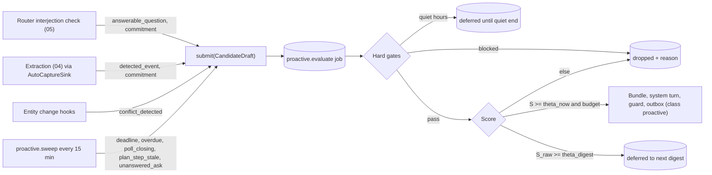

# 07 — Coordination Features

> Status: **normative for coordination features and the proactivity engine.** Elaborates `01-architecture.md` (the spine) and must not contradict it. Physical schema, job-queue mechanics and export formats belong to `02`. Policy, IFC, declassification, consent and fairness math belong to `03`. Memory belongs to `04`. Turn engine, confirmation mechanics and prompts belong to `05`. Adapters and rendering belong to `06`. Test harness belongs to `11`.
> Reference "today" in all examples: **Wed 4 Nov 2026**.

---

## 1. Purpose & scope

This document specifies the features members actually feel: **calendar, reminders, tasks & chores, shared lists, polls & group decisions, plans, decisions log, catch-up, digests and the proactivity engine**, plus their portability. For each feature it defines:

- domain refinements beyond spine §5 (logical fields; `02` maps them to tables),
- every model-facing tool: name, description, zod I/O, capability, effect, risk and `ActionRequest` mapping for `03`'s policy engine,
- ideal chat behavior (transcripts, including ambiguity), edge cases and copy templates.

Design goals, in priority order:

1. **Correct under time.** Every time is timezone- and DST-correct for every reader. Dates shown to members are rendered by code, never by the model.
2. **Correct under multiple principals.** Every write carries the requester's authority (I3). Every entity has a label (I1/I2). Concurrent edits are serialized by the group actor and versioned.
3. **Delightful in chat.** One-tap buttons, short confirmations, an undo on every write. Village asks for clarification only when a wrong guess would be costly.
4. **Quiet.** Unsolicited messages are scored, budgeted and capped by hard limits in code. Village learns from feedback, can explain what it learned, and can reset it.

**Out of scope:** two-way Google/CalDAV sync (post-1.0; the port is designed here in §3.1.9), payments or money movement of any kind, messaging non-members, and fairness math (`03`). The dashboard screens for these features belong to `09`, and only their data needs are listed here.

---

## 2. Key decisions

| # | Decision | Choice | Why / alternatives |
|---|---|---|---|
| KD-1 | Date parsing | The model emits a **structured `WhenSpec`** (what the user said, e.g. `weekday FR, which=next, time 18:00`). A **pure resolver in `@comvivo/core/time`** computes the instant with Temporal. `chrono-node` cross-checks the user's verbatim phrase. | LLMs are unreliable at calendar arithmetic. Alternative: the model emits ISO instants, rejected because of silent off-by-one-week and timezone errors. |
| KD-2 | Rendering times | Write tools return a pre-rendered **receipt** string per audience. The charter tells the model to quote receipts verbatim and never restate dates. | Removes hallucinated dates from replies. The receipt's `templateKey` and params are journaled as `TurnEffect.summaryKey`/`summaryParams` (02), so crash-recovery messages (I7, 05 §3.7) render the same text. |
| KD-3 | "next Friday" | When ambiguous (the coming Friday is in the same calendar week), Village **asks with two buttons**. Each member's preference is learned after 2 consistent picks. | Usage differs by region and by person, and a wrong week is costly. Confirmations always show the explicit date. |
| KD-4 | Recurrence engine | **`rrule-temporal`** (MIT, Temporal-native, RFC 5545 + RFC 7529; v2.2.x in Sep 2026), wrapped by `core/time/recurrence.ts`. Fallback `rrule` only if the M7 spike (M7-T1) fails. Resolves ADR-011. | It is Temporal-native, supports EXDATE/RDATE and `tzid`, and is maintained. The original `rrule` uses `Date` and is effectively unmaintained. |
| KD-5 | DST in native series | Wall-clock semantics: expand in floating local time, then map with Temporal `disambiguation:'compatible'`. Instances in a DST gap **shift forward** and do not disappear. ICS export adds an explicit `RDATE` for each shifted instance. Imported series follow RFC 5545 exactly (gap instances dropped). | RFC 5545 §3.3.10 says gap instances "MUST be ignored". For a 02:30 daily reminder that would be a lost reminder (violating principle 8). The RDATE keeps standards-following clients in agreement. |
| KD-6 | ICS parsing / serializing | Parse with **ical.js** (MPL-2.0, ESM). **Serialize with a small pure serializer in `core`**, which generates VTIMEZONE from Temporal transition data. | ical.js is the most complete parser. Our own serializer stays deterministic, needs no tz-data bundle, and passes ical.js round-trip tests. MPL-2.0 is file-level copyleft and compatible as an unmodified dependency (`08`/`12` license policy must allow it). |
| KD-7 | Feed URLs | **Per-member tokens**, including for the "group feed". Tokens are 256-bit random values, stored as SHA-256 hashes, and revocable. They are revoked automatically when a member leaves. | Individual revocation and attribution. A single shared group token would force everyone to re-subscribe whenever one person leaves. |
| KD-8 | Reminder firing | Only the next occurrence is materialized as a `reminder.fire` job. A `ReminderFiring` row is unique on `(reminderId, occurrenceKey)` and is inserted in the same transaction as the outbox rows. Missed-reminder handling uses a per-kind staleness threshold. | Exactly-once intent (I6). Bounded job table. Honest "late" or "missed" messages after downtime. |
| KD-9 | Button interactions | Coordination registers **deterministic interaction handlers** (RSVP, snooze, accept, vote, check-off, feedback). They replay a tool call under the *presser's* authority with **no model call**. | Instant, cheap and correct. Policy still runs, and the handler edits the original message in place. Uses the `05` fast path: router decision `interaction` (05 §3.2.1 rule R2, §3.2.5). |
| KD-10 | Polls | Native polls where they meet the requirements (06 `choosePollMode`): non-anonymous polls with live results on Telegram, Discord and Matrix; Signal only after the M10 spike (SP-8) confirms inbound votes (01 §14 A28). Native anonymous polls are never used (06 §3.8). Otherwise emulated: buttons (Slack, web, and anonymous or results-after-close polls on Telegram/Discord), numbered replies (Signal before the spike, Matrix), or DM ballots (anonymous polls on platforms without buttons). **Village owns the deadline** and closes native polls itself. | Native polls feel best, but platform deadline and anonymity semantics differ. A single deadline source keeps closing deterministic. |
| KD-11 | Decision rules | `plurality`, `majority`, `supermajority_2_3`, `approval`, `consensus` (agree / stand aside / block) and `none`. Ranked-choice (IRV) is **deferred** to after 1.0 with its schema reserved. | Ranked ballots are awkward in group chat UIs. The rules that ship cover the scenarios in §9. |
| KD-12 | Catch-up | Delivered **by DM by default** (the reader's DM conversation for this group, 01 §14 A27), with audience = the reader. The window anchor is the latest of: explicit marker, read receipt (Matrix/web), the member's last message, their last interaction, or their last catch-up. | Gives the richest allowed context (I1 with audience {reader}) and does not flood the group. |
| KD-13 | Proactivity scoring | `S = w_type·V·U·C − A`. Hard gates run first and **hard caps are code constants** that the constitution can only lower. Feedback learning uses a **Beta-Bernoulli** model per (group, type[, member]) with a 30-day half-life, clamped to [0.3, 1.5]. | Explainable ("4 of 5 conflict alerts were useful"), resettable, deterministic, and pure-testable in `core`. |
| KD-14 | Outbound classes | Every outbound message carries a class: `reply`, `requested`, `digest`, `proactive` or `system`. The attention budget counts only `proactive`. `requested` has separate anti-abuse caps. | A reminder you asked for is not an interruption. Reminders sent *to* you by others still need harassment limits. |
| KD-15 | Tone | Never shaming. Overdue items are nudged only by DM. Group views show aggregates and never rank people. A tone linter on templates enforces a word blocklist. | Family and roommate trust. Principle 6. |
| KD-16 | Surprise secrecy | Audience `all_except`, plus `03`'s "is not aware" constraint and sealed terms passed to the disclosure guard. Everything derived from the plan inherits its readers. Village never invents a cover story itself. | Discretion by architecture, not by prompt. Deception is a human choice, not Village's. |

---

## 3. Detailed design

### 3.0 Cross-cutting foundations

#### 3.0.1 Time model (`@comvivo/core/time`)

- **Types.** `Temporal.Instant`, `ZonedDateTime` (ZDT), `PlainDate` (all-day), `PlainTime`, `Duration`. Values are persisted as RFC 9557 strings, e.g. `2026-11-13T18:00:00+05:00[Asia/Karachi]`, plus derived UTC epoch-ms columns for indexing (02). Wall-clock time plus IANA zone is the **source of truth**. Instants are derived caches.
- **Zones.** Each person has `Person.timezone` (IANA). Each group has a default `Group.timezone` (spine §6.3 references "group timezone"; field added by 01 §14 A7, schema in 02). Members without a zone inherit the group zone, and onboarding (06) asks them once.
- **Zone resolution for a phrase**, first match wins:
  1. A zone named explicitly ("3 pm London time").
  2. The zone of the entity being edited.
  3. The plan's zone (e.g. a trip destination).
  4. The requester's zone.
  5. The group zone.
- **Disambiguation.** Village always uses `'compatible'`, which matches RFC 5545 §3.3.5:
  - In a DST gap, use the offset from before the gap.
  - In an overlap, use the first occurrence.
- **Native recurrence expansion (KD-5).**
  1. Expand the RRULE with `rrule-temporal` in floating space (`tzid:'UTC'` over the series' `PlainDateTime` DTSTART).
  2. Map each wall-clock result to the series zone with `'compatible'`.
  3. Apply overrides and EXDATEs keyed by the *original* wall-clock recurrence id.

  Native `FREQ` is limited to DAILY, WEEKLY, MONTHLY and YEARLY. Sub-daily repetition ("every 2 hours") is a reminder-only `interval` schedule in instant space.
- **Imported series** are expanded by `rrule-temporal` with the feed's `tzid`, following RFC semantics.
- **tzdata updates.** On boot, compare `process.versions.tz` with `meta.tzdataVersion`. If it changed, the `time.tzdata_changed` job recomputes the derived instants of all *future* events, reminders, digests and task dues from their wall-clock and zone, then reschedules their jobs.
- **Week start** comes from the member's locale (`Intl.Locale#getWeekInfo` where available), defaults to Monday, and can be overridden per group.

**`WhenSpec` resolution** — `resolveWhen(when, ctx) → Resolved | Ambiguous{options[2..3]} | Invalid{reason}`, pure:

| Spec | Rule |
|---|---|
| `date` | That date. Without a time it is all-day for events, or the default time-of-day for reminders and tasks (below). |
| `weekday which=coming` ("Friday", "this Friday") | Today, if today is that weekday and the time is still ahead. Otherwise the next such weekday (1–7 days away). |
| `weekday which=next` | Let *d* be the days until the coming occurrence. If that day falls in the **next** calendar week, use *d* (unambiguous). Otherwise it is **Ambiguous {d, d+7}**: apply the member's learned preference if one exists, else ask. |
| `weekday which=after_next` ("Friday after next", "a week on Friday") | *d* + 7. |
| `offset` ("in 20 minutes", "in 2 weeks") | Minutes and hours are added in instant space. Days and above are added in wall-clock space (so "in 1 day" across DST keeps the clock time). |
| `named` | `today`, `tomorrow`; `tonight` = 20:00; `this_weekend` = Saturday of this week; `next_weekend` = Saturday +7; `end_of_week` = Friday 17:00; `end_of_month` = last day 17:00. |
| `relative_to_event` | Event occurrence start minus `before`. |
| `exact` | Parses an RFC 9557 ZDT. Used only by button replays and by IDs copied from tool output. |

Example: on Wed 4 Nov 2026, "next Friday" is ambiguous between 6 Nov and 13 Nov. On Sat 7 Nov it means 13 Nov, unambiguously.

**Time-of-day defaults** (group-configurable): morning 09:00, afternoon 15:00, evening 18:00, night/tonight 20:00. Poll deadlines phrased "by <day>" close at 21:00. A task due "by Friday" with no time means *end of that local day in the assignee's zone*. Overdue evaluation for such tasks starts at 09:00 the next day, so nobody is nudged at midnight. Every assumption appears in the receipt, e.g. "(I assumed 9 am)".

**Cross-check.** Run `chrono.parse(phrase, {instant: now, timezone: offsetMinutesAt(now, zone)}, {forwardDate: true})` for the supported chrono locales. Per the chrono README these are en, fr, ja, nl, ru, uk, fi, id, it, vi, ar, plus partial de, es, pt, sv and zh.

| Outcome | Result |
|---|---|
| Disagreement on the **date** | `needs_choice` with both readings |
| Disagreement on the time only | Resolver wins; logged in the trace |
| Unsupported locale | `crossCheck:'unavailable'` |

**Rendering** — `renderWhen(x, audience, locale)`, pure:
- Relative words within 1 day ("today 6 pm", "tomorrow 9 am").
- Weekday plus date beyond that ("Fri 13 Nov").
- The year only if it differs from the current year or is more than 300 days away.
- 12- or 24-hour clock by locale.
- For a single reader, use the reader's zone. For a group, use the group zone, plus **up to 2 extra zones** for affected members in other zones, chosen from attendees first and then from members. Example: "Sun 8 Nov, 5:00 pm (London) · 10:00 pm for Aisha, Omar".

#### 3.0.2 Labels and audiences for coordination entities

Every coordination entity has a spine `Label`. The audience selector shared by all tools:

```ts
// packages/tools/src/coordination/schemas.ts (zod v4; nullable, not optional, for cross-provider strict schemas)
export const zMemberRef = z.union([z.literal('me'), zMemberId]);
export const zAudience = z.discriminatedUnion('kind', [
  z.object({ kind: z.literal('default') }),     // group if asked in a group chat; private if asked in a DM
  z.object({ kind: z.literal('group') }),
  z.object({ kind: z.literal('private') }),     // requester only
  z.object({ kind: z.literal('members'), memberIds: z.array(zMemberRef).min(1).max(50) }),
  z.object({ kind: z.literal('all_except'), memberIds: z.array(zMemberId).min(1).max(20) }), // surprises; resolved to a concrete set at creation
]);
```

Rules (semantics owned by 03; this doc fixes how tools use them):

- **L1. Default.** In a group conversation, readers = group and owner = `'group'`. In a DM, readers = {requester} and owner = requester.
- **L2. Write rule (I2).** The tool's `ActionRequestDraft` carries `writeLabel` (the new entity's label) and `dataLabels` (all inputs). The executor runs `ifc.checkWrite(join(dataLabels), writeLabel)`. A write-down is allowed only when every widened input label is **owned by the requester**, as an explicit owner publish recorded as a `Declassification{kind:'owner_publish'}` (03). Otherwise it is denied with the 03 copy.
- **L3. Inheritance.** An entity created inside or linked to a plan, a secret list or a private event gets `readers = readers(requested) ∩ readers(parent)`.
- **L4. Attendees.** For `audience:'members'` and for private events with attendees, readers = attendees ∪ {creator}.
- **L5. Sensitivity** comes from 03's classifier, e.g. health appointments are `sensitive`. It affects feeds (§3.1.6), digests and logging, not visibility.
- **L6. Untrusted.** Imported ICS data, emails and attachments set `untrusted=true` on every derived entity. That data is fenced in context and never treated as instructions.

#### 3.0.3 Receipts, choices and interactions

All write tools return the union below, so the model handles four outcomes uniformly. Policy outcomes (deny, needs_confirmation, contested) are produced by the executor (05) *before* `execute` and never appear here.

```ts
export const zReceipt = z.object({ templateKey: z.string(), text: z.string() }); // text rendered for the turn audience
export const zChoiceSet = z.object({
  prompt: z.string(),
  options: z.array(z.object({ label: z.string().max(24), patch: z.record(z.string(), z.unknown()) })).min(2).max(5),
  respondents: z.enum(['requester', 'any_reader', 'listed']), listed: z.array(zMemberId).nullable(),
});
export const zWriteResult = <P extends z.ZodType>(data: P) => z.discriminatedUnion('status', [
  z.object({ status: z.literal('done'), receipt: zReceipt, data }),
  z.object({ status: z.literal('needs_choice'), reason: z.enum(['ambiguous_time', 'ambiguous_target', 'duplicate_suspected',
    'scope_required', 'cross_check_disagree', 'recently_checked', 'audience_required']), choices: zChoiceSet }),
  z.object({ status: z.literal('stale'), current: data, receipt: zReceipt }),            // ifVersion mismatch
  z.object({ status: z.literal('not_found'), candidates: z.array(z.object({ id: z.string(), display: z.string() })).max(5) }),
]);
export const zRef = <I extends z.ZodType>(id: I) => z.object({ id: id.nullable(), query: z.string().max(120).nullable() });
```

- **Receipts are quoted verbatim.** The model must quote `receipt.text` exactly (charter rule, 05). 05's ack check treats a quoted receipt as acknowledging that effect (I7).
- **Choices.** 05 renders a `ChoiceSet` as buttons. On platforms without buttons, 06's `renderChoiceFallback` renders reaction or numbered-text choices ("Reply 1 or 2", 06 §3.7). A press replays the same tool with `{...originalInput, ...patch}` under the presser's authority. The presser must be allowed by `respondents`. Choice tokens expire after 24 h (shorter than 06's 7-day default TTL).
- **Interaction handlers** (deterministic, no model call). A click reaches them through 05's router decision `{kind:'interaction'}` (05 §3.2.1 rule R2, §3.2.5), never through a model turn. Each records a `Turn` (disposition `interaction`), a `TurnEffect` and an edit of the source message where `capabilities.edits` allows, otherwise a short reply. 07 registers these handler kinds with 05's interaction dispatcher: `rsvp`, `reminder.done`, `reminder.snooze`, `task.accept`, `task.decline`, `task.done`, `swap.accept`, `swap.decline`, `giveaway.take`, `poll.vote`, `list.toggle`, `plan.step.confirm`, `plan.step.claim`, `proactive.feedback`, `digest.action`, `choice.replay`. Confirmation buttons (`confirm`) and `cmd.*` buttons belong to 05.
- **Button payloads** are the opaque `InteractionToken`s of 06 §3.7 (`v1.` + 22 base64url chars; only `sha256(token)` is stored), because Telegram `callback_data` is limited to 1–64 bytes. No structured strings are ever placed in platform payloads. 07's logical token content maps onto `InteractionTokenRecord` as: `handler` → `action.kind`; `args` and `entityVersion` → `action.params`; `allowedMemberIds|null` → `allowedClickers` (`MemberId[]`, or `'any_member'` for null); `expiresAt` → `expiresAt`; `singleUse` is true for accept/decline/take/confirm-style handlers and false for toggles, RSVP and votes (which can be changed).

#### 3.0.4 Outbound message classes

| Class | Examples | Attention budget | Other caps |
|---|---|---|---|
| `reply` | Answers, receipts, confirmations | No | — |
| `requested` | Reminders (self/others/group), event lead reminders, RSVP or assignment or swap requests caused by a member's action, poll results of member-created polls, rotation announcements | No | Anti-abuse: HC-7 (§3.10.6) |
| `digest` | Morning brief, weekly recap, "while I was offline" summary | No (opted in) | Quiet hours by scheduling; cost budget |
| `proactive` | Interjections, nudges (overdue, stale step, poll closing), suggestions | **Yes** | HC-1..HC-6 |
| `system` | Consent notices, recovery summaries (03/05) | No | — |

05 stamps the class on each `OutboxMessage.messageClass` (01 §14 A7, A24; physical column in 02) and on the 06 `OutboundMessage.messageClass`. The proactivity ledger counts only `proactive` sends; this is also the definition of "unsolicited message" in the 1.0 success metric (01 §14 A22).

#### 3.0.5 Concurrency, versioning, ownership

- All writes run inside the group actor (spine §1). Job handlers (`reminder.fire`, `chores.materialize`, `poll.close`, …) run via `actor.run(groupId, fn)`.
- Every mutable entity has an integer `version`. Model-driven edits pass `ifVersion` (the version shown in context or tool output). A mismatch returns `stale` with the current state, so the model re-asks instead of overwriting.
- `ActionRequest.target` carries `{ref, createdBy, assigneeId?, label}`, so 03's conflict strategies apply to edits of others' items. For example, `last-writer-with-notice` returns `allow{notify:[createdBy]}`, and coordination sends that member a `requested` notice built from template `notice.changed_by_other`.

#### 3.0.6 Copy and tone system

- Templates live in `packages/tools/src/coordination/copy/<locale>.json` (i18next with plural rules), keyed as listed in each section. English ships in M7. es, pt, de, fr, hi-Latn and ar ship in M13, matching the extraction corpus. Fallback is en.
- **Universal tone rules** (enforced by `tone-lint` in CI over templates and by the charter for model text):
  1. Lead with the fact.
  2. Confirmations are at most 2 short sentences.
  3. At most one functional emoji, at the start.
  4. Name only the people who need to act.
  5. Never reveal the reason behind a private constraint.
  6. Every write has an undo or adjust affordance.
  7. Banned words in templates: *lazy, behind, failed, worst, again?!, still haven't, slacking, you forgot*.

#### 3.0.7 Code layout

```
packages/core/src/time/            when.ts resolve.ts recurrence.ts render.ts zones.ts windows-zones.json tzdata.ts
packages/core/src/coordination/    calendar/ reminders/ tasks/ lists/ polls/ plans/ decisions/ catchup/ digests/ ics/
packages/core/src/proactivity/     candidate.ts score.ts gates.ts caps.ts budget.ts learn.ts params.ts explain.ts
packages/tools/src/coordination/   schemas.ts calendar.ts reminders.ts tasks.ts chores.ts lists.ts polls.ts plans.ts
                                   decisions.ts catchup.ts agenda.ts proactivity.ts catalog.ts copy/en.json
                                   # catalog.ts = the ordered coordination block (§4.1) imported by 05's packages/tools/src/catalog.ts
packages/engine/src/coordination/  calendar-service.ts conflicts.ts ics-subscriptions.ts reminder-scheduler.ts
                                   chore-materializer.ts poll-service.ts plan-service.ts decision-service.ts
                                   catchup-service.ts digest-service.ts interactions.ts context-snapshot.ts autocapture.ts
packages/engine/src/proactivity/   engine.ts detectors/*.ts sweep.ts delivery.ts feedback.ts
apps/server/src/http/ics-feed.ts   (route mounted by 09)
```

---

### 3.1 Calendar & events

#### 3.1.1 Domain refinements

| Entity | Fields beyond spine §5 |
|---|---|
| `Event` | `seriesId` (root id; equals `id` for roots), `splitFromEventId?`, `timezone` (IANA), `allDay`, `startLocal`/`endLocal` (PlainDateTime) or `startDate`/`endDateExclusive` (PlainDate), derived `startUtc`/`endUtc`, `rrule?` (normalized RFC 5545 string, without DTSTART), `rdates[]`, `status` (`proposed`/`confirmed`/`tentative`/`cancelled`; `proposed` = created under turn taint as 03's `calendar.event.propose`, carries `untrusted=true`, and becomes `confirmed` when any member with `calendar.write` endorses it with one tap, `calendar.event.confirm`; 03 §3.10.2), `busy` (bool; all-day events default false, so "Trip" can be marked busy), `attendeesMode` (`none`/`rsvp`), `leadTimes: Duration[] \| null` (null = group default), `source` (`{kind:'native'}` \| `{kind:'subscription', subscriptionId, uid, recurrenceId?, sequence}` \| `{kind:'import', blobId}`), `planId?`, `createdBy`, `updatedBy`, `version`, `icsSequence`, `location?`, `notes?`, `url?` |
| `EventOverride` (new) | `eventId`, `recurrenceId` (original wall-clock start: PlainDateTime or PlainDate), `patch {title?, startLocal?, endLocal?, location?, notes?}`, `cancelled` (bool → EXDATE on export), `version` |
| `EventAttendee` (new) | `eventId`, `memberId`, `rsvp` (`needs_action`/`accepted`/`tentative`/`declined`), `respondedAt?`, plus per-occurrence `EventAttendeeOverride{recurrenceId, rsvp}` |
| `CalendarSubscription` (new) | `name`, `urlCiphertext` (URLs often embed secrets), `urlHost` (display), `ownerMemberId`, `label` (untrusted=true; audience chosen at subscribe), `refreshInterval` (default PT6H, min PT1H), `status` (`active`/`paused`/`failing`/`removed`), `etag?`, `lastModified?`, `lastFetchAt`, `lastSuccessAt`, `failureCount`, `lastError?`, `eventCount`, `color?`, `leadTimes` (default none) |
| `FeedToken` (new; table `ics_feed_tokens` in 02, the only shape 09 uses) | `groupId`, `memberId`, `scope` (`group`/`member`), `tokenHash` (SHA-256), `detail` (`full`/`busy`), `createdAt`, `lastUsedAt?`, `revokedAt?`. **Semantics owned here:** every token belongs to one member (there are no shared group tokens, KD-7); the secret is `vics_` + 43 base64url chars = **256 random bits** (prefix per 08 §3.7.12 so redaction and secret scanning catch it); only the hash is stored; all of a member's tokens are revoked when the member leaves or is removed; the link is **delivered only in the member's DM** for this group (tool 9, or the 09 dashboard's "send me my feed link" action), never in a group and never in an HTTP response body |

Edit scopes for recurring series:
- `this`: upsert an `EventOverride`.
- `following`: **split**. The original gets `UNTIL` = (target occurrence start in UTC) − 1 s, because rrule-temporal requires UTC UNTIL for zoned DTSTART. A new series starts at the target with the patch applied, `splitFromEventId` set, and attendees copied. Overrides at or after the split move to the new series. We do not emit `RANGE=THISANDFUTURE`, which clients support poorly.
- `all`: patch the series. If the clock time changes, overrides are re-keyed by the same wall-clock delta. If the date pattern changes, overrides are dropped and the receipt says so.

#### 3.1.2 Conflicts and availability

`conflicts.ts` runs on create, update and RSVP-accept, and from the proactivity `conflict_detected` detector.
1. **People.** Attendees with `accepted`/`tentative`/`needs_action`, or the creator if there are none.
2. **Occurrences.** Only those in the next 180 days, capped at 50 per series.
3. **Visible overlaps.** Events readable by the *turn audience* (I1) where the person attends, the intervals overlap, and neither side is a non-busy all-day event.
4. **Constraint overlaps.** Through the context builder port, ask the declassifier (03) for availability constraints for those people and that window. Constraint kinds and names are owned by 03's catalog (03 §3.5.2): `availability.busy{windows}` (time windows) and `schedule.do_not_schedule{pattern, until}` (recurring blackout). Both are `hard`; a `preference.flag` stance such as `avoids early_mornings` is `soft`. They exist only if the owner's `PrivateConstraintPolicy` allows that kind.
5. **Output.** `Conflict{memberId, occurrence, kind:'visible_event'|'constraint', strength:'hard'|'soft', display}`, where `display` is either "Sam has *Football* then" (visible event) or **"Sam is busy then"** (constraint). The reason is never shown. Soft constraints render as "may be busy".

`calendar_check_availability` scores 30-minute slots inside a window. It uses each person's waking hours (soft, 08:00–21:00 local, member-adjustable) and returns the best 3 slots, ordered by (#free, earliest), with a `display` per slot in every affected zone.

#### 3.1.3 Tools

```ts
// zWhen and zRecurrence are shared by calendar, reminders, tasks and plans.
export const zWhen = z.object({
  phrase: z.string().max(120),                 // the user's own words, used for cross-check and receipts
  spec: z.discriminatedUnion('kind', [
    z.object({ kind: z.literal('date'), date: z.iso.date() }),
    z.object({ kind: z.literal('weekday'), weekday: zWeekday, which: z.enum(['coming', 'next', 'after_next']) }),
    z.object({ kind: z.literal('offset'), amount: z.number().int().min(1).max(1000),
               unit: z.enum(['minute', 'hour', 'day', 'week', 'month', 'year']) }),
    z.object({ kind: z.literal('named'), name: z.enum(['today', 'tonight', 'tomorrow', 'this_weekend', 'next_weekend', 'end_of_week', 'end_of_month']) }),
    z.object({ kind: z.literal('relative_to_event'), eventId: zEventId, recurrenceId: z.string().nullable(), before: z.iso.duration() }),
    z.object({ kind: z.literal('exact'), zdt: z.string().max(80) }),
  ]),
  time: z.iso.time({ precision: -1 }).nullable(),   // "18:00" only if a clock time was said
  partOfDay: z.enum(['morning', 'afternoon', 'evening', 'night']).nullable(),
  zone: z.string().max(64).nullable(),              // only if the user named a zone or city
});
export const zRecurrence = z.object({
  freq: z.enum(['daily', 'weekly', 'monthly', 'yearly']), interval: z.number().int().min(1).max(99),
  byWeekday: z.array(zWeekday).max(7).nullable(), byMonthDay: z.array(z.number().int().min(-31).max(31)).max(31).nullable(),
  bySetPos: z.number().int().min(-5).max(5).nullable(),       // "last Friday" = byWeekday [FR] + bySetPos -1
  until: z.iso.date().nullable(), count: z.number().int().min(1).max(500).nullable(),
});
const zOccurrence = z.object({ eventId: zEventId, recurrenceId: z.string().nullable(), title: z.string(), display: z.string(),
  startZdt: z.string(), endZdt: z.string(), allDay: z.boolean(), location: z.string().nullable(), status: z.string(),
  attendees: z.array(z.object({ memberId: zMemberId, rsvp: z.string() })), readOnly: z.boolean(), version: z.number().int() });
```

**1. `calendar_search_events`** — *"Find calendar events by text, date range or attendee. Returns occurrences (recurring events expanded) with ready-to-quote display strings. Use before editing so you have the event id and version."*
```ts
in:  z.object({ query: z.string().max(120).nullable(), from: zWhen.nullable(), to: zWhen.nullable(),
               attendee: zMemberRef.nullable(), includeImported: z.boolean(), limit: z.number().int().min(1).max(50) })
out: z.object({ occurrences: z.array(zOccurrence), truncated: z.boolean() })
```
Capability `calendar.read` · read · low · `ActionRequest{kind:'calendar.event.read', dataLabels:[]}`. Results are IFC-filtered by the turn audience in the repository port (I1). Default window: now → +30 days.

**2. `calendar_check_availability`** — *"Check who is free or busy for a proposed time, or find the best free slots for a set of members. Private reasons are never available; you will only see 'busy'."*
```ts
in:  z.object({ members: z.array(zMemberRef).min(1).max(30), at: zWhen.nullable(), duration: z.iso.duration().nullable(),
               searchFrom: zWhen.nullable(), searchTo: zWhen.nullable() })
out: z.object({ conflicts: z.array(z.object({ memberId: zMemberId, strength: z.enum(['hard', 'soft']), display: z.string() })),
               suggestions: z.array(z.object({ startZdt: z.string(), display: z.string(), freeCount: z.number().int(), of: z.number().int() })).max(3) })
```
`calendar.read` · read · low · `kind:'calendar.availability.read'`. Constraint access is governed by 03 declassification. The policy engine sees no private labels here because the declassifier output is already a declassified constraint label.

**3. `calendar_create_event`** — *"Add an event to the group or a private calendar. Pass the user's time words in `start` (don't compute dates yourself). Without a clock time, a day-only event is created as all-day. Quote the returned receipt exactly."*
```ts
in: z.object({
  title: z.string().min(1).max(200), start: zWhen, end: zWhen.nullable(), duration: z.iso.duration().nullable(),
  allDay: z.boolean().nullable(), lastDay: z.iso.date().nullable(),          // inclusive last day for multi-day all-day
  recurrence: zRecurrence.nullable(), location: z.string().max(300).nullable(), notes: z.string().max(2000).nullable(),
  attendees: z.array(zMemberRef).max(50), rsvp: z.boolean(), audience: zAudience, busy: z.boolean().nullable(),
  leadTimes: z.array(z.iso.duration()).max(3).nullable(), planId: zPlanId.nullable(),
  status: z.enum(['confirmed', 'tentative']), sourceMessageIds: z.array(zMessageId).max(20), allowDuplicate: z.boolean() })
out: zWriteResult(z.object({ eventId: zEventId, version: z.number().int(), conflicts: z.array(z.object({ memberId: zMemberId, display: z.string() })) }))
```
`calendar.write` · write · base risk low.
- Escalation (R1/R2/R6): medium if group-visible with ≥ 3 attendees or recurring.
- **Under turn taint** (`untrustedInContext`, e.g. dates found in a forwarded school letter) the tool emits `kind:'calendar.event.propose'` instead, which is on 03's taint allowlist (03 §3.10.2): the event is stored with `status:'proposed'` and `untrusted=true`, no reminders fire, and any member with `calendar.write` confirms it with one tap (`calendar.event.confirm`). R5 does not apply to the propose path.
- ActionRequest:
  ```
  { kind: 'calendar.event.create' /* 'calendar.event.propose' under taint */, capability: 'calendar.write',
    dataLabels: [trigger msgs, sourceMessageIds, plan], writeLabel: from audience }
  ```
- Duplicates: titles normalize equal or token Jaccard ≥ 0.6, overlapping on the same local date. Returns `needs_choice(duplicate_suspected)` unless `allowDuplicate`.

**4. `calendar_update_event`** — *"Change an event: time, title, place, notes, attendees or audience. For recurring events you must say whether the change applies to this occurrence, this and following, or all."*
```ts
in: z.object({ target: zRef(zEventId), recurrenceId: z.string().nullable(), scope: z.enum(['this', 'following', 'all']).nullable(),
  ifVersion: z.number().int().nullable(),
  changes: z.object({ title: z.string().max(200).nullable(), start: zWhen.nullable(), end: zWhen.nullable(),
    duration: z.iso.duration().nullable(), location: z.string().max(300).nullable(), notes: z.string().max(2000).nullable(),
    addAttendees: z.array(zMemberRef).nullable(), removeAttendees: z.array(zMemberRef).nullable(),
    audience: zAudience.nullable(), status: z.enum(['confirmed', 'tentative']).nullable(), recurrence: zRecurrence.nullable() }) })
out: zWriteResult(z.object({ eventId: zEventId, version: z.number().int(), affectedOccurrences: z.number().int(),
  conflicts: z.array(z.object({ memberId: zMemberId, display: z.string() })), notified: z.array(zMemberId) }))
```
`calendar.write` · write · base risk medium.
- High if `scope ∈ {following, all}` with ≥ 3 attendees, or if the audience widens.
- `kind:'calendar.event.update'`. `target` carries createdBy and label. `dataLabels` = [trigger, event label].
- A null `scope` on a recurring event returns `needs_choice(scope_required)`.
- Imported events: refused (read-only) with copy `cal.readonly`.

**5. `calendar_cancel_event`** — *"Cancel an event, one occurrence, or this-and-following. Cancelled events stay in history. Attendees are told."*
```ts
in:  z.object({ target: zRef(zEventId), recurrenceId: z.string().nullable(), scope: z.enum(['this', 'following', 'all']).nullable(),
               ifVersion: z.number().int().nullable(), reason: z.string().max(200).nullable() })
out: zWriteResult(z.object({ eventId: zEventId, cancelledOccurrences: z.number().int(), notified: z.array(zMemberId) }))
```
`calendar.write` · write · base risk medium. High for series, or ≥ 3 attendees (R2), which means 05 asks the requester to confirm. `kind:'calendar.event.delete'` (03's canonical name; a cancel is a soft delete, 03 §3.3.1).

**6. `calendar_rsvp`** — *"Record the requester's RSVP (going, maybe, can't) for an event or one occurrence."*
```ts
in:  z.object({ target: zRef(zEventId), recurrenceId: z.string().nullable(), response: z.enum(['accepted', 'tentative', 'declined']),
               note: z.string().max(200).nullable() })
out: zWriteResult(z.object({ eventId: zEventId, tally: z.object({ accepted: z.number(), tentative: z.number(), declined: z.number(), waiting: z.number() }) }))
```
Capability `calendar.rsvp` (03 §3.1.2) · write · low · `kind:'calendar.event.rsvp'`, target = the event, and the requester must be able to read it. The note's label is the trigger label. Notes are visible to readers of the event only.

**7. `calendar_subscribe_ics`** — *"Subscribe the group (or the requester) to an external read-only calendar URL (e.g. a school calendar). Events appear read-only and refresh automatically."*
```ts
in:  z.object({ url: z.string().url().max(2000), name: z.string().max(80).nullable(), audience: zAudience,
               refreshEvery: z.enum(['PT1H', 'PT6H', 'P1D']).nullable(), leadTimes: z.array(z.iso.duration()).max(2).nullable() })
out: zWriteResult(z.object({ subscriptionId: zCalendarSubscriptionId, status: z.enum(['pending_first_fetch']) }))
```
- `calendar.write` · write · **high** (fetches an external URL and adds untrusted data), so 05 always confirms, using copy `cal.subscribe.confirm`.
- `kind:'calendar.subscription.create'`.
- `webcal://` is rewritten to `https://`. The URL is redacted in logs, traces and receipts (host only).

**8. `calendar_manage_subscription`** — *"Refresh, pause, resume, rename or remove a calendar subscription."*
```ts
in:  z.object({ target: zRef(zCalendarSubscriptionId), op: z.enum(['refresh', 'pause', 'resume', 'rename', 'remove']), name: z.string().max(80).nullable() })
out: zWriteResult(z.object({ subscriptionId: zCalendarSubscriptionId, status: z.string(), eventCount: z.number().int() }))
```
`calendar.write` · write · medium (remove = high) · `kind:'calendar.subscription.manage'`.

**9. `calendar_feed_link`** — *"Get, rotate or revoke the requester's private calendar subscription link (for Google/Apple/Outlook calendar apps). Only ever answer in a DM."*
```ts
in:  z.object({ scope: z.enum(['member', 'group']), op: z.enum(['get', 'rotate', 'revoke']), detail: z.enum(['full', 'busy']).nullable() })
out: zWriteResult(z.object({ httpsUrl: z.string().nullable(), webcalUrl: z.string().nullable(), requiresPublicUrl: z.boolean() }))
```
`calendar.read` · write (issues a token) · medium · `kind:'calendar.feed.token'`.
- `get` and `rotate` are **refused unless the turn audience is exactly {requester}** (the reply contains a bearer secret). In a group the tool issues no token and returns `needs_choice(audience_required)`; 05 then runs the request as a follow-up turn with `replyTarget: 'requester_dm'` (audience = {requester}, delivered to the requester's DM conversation for this group, 01 §14 A27). The group gets a `done` reaction, or the one line "I've sent it to you privately" where reactions are unavailable.
- Without `instance.publicUrl`, `requiresPublicUrl=true`, and the receipt explains that Google Calendar cannot fetch LAN URLs. As a fallback it offers a one-off `.ics` file by DM.

#### 3.1.4 Interactions

**T-CAL-1 — "next Friday", RSVP buttons.** Family group (Asia/Karachi). Wed 4 Nov.
```
Aisha:   @village add Zara's recital next Friday 6pm at the school hall
Village: Next Friday — the 6th or the 13th?   [Fri 6 Nov] [Fri 13 Nov]
         (Aisha taps Fri 13 Nov)
Village: 📅 Added *Zara's recital* — Fri 13 Nov, 6:00–7:00 pm · School hall.
         [✅ Going] [🤔 Maybe] [❌ Can't]
         (Omar ✅, Sam ❌ — the message edits in place)
         Going: Omar · Can't: Sam · Waiting: Aisha, Zara
```
The next time Aisha says "next <weekday>" and again picks the following week, her preference is stored. After that, "next Friday" resolves silently, but the receipt still shows the explicit date.

**T-CAL-2 — recurring event with an exception and a series edit.**
```
Omar:    village, Zara has swimming every Thursday 4:30–5:30 from tomorrow
Village: 🔁 Added *Swimming (Zara)* — every Thu, 4:30–5:30 pm, starting tomorrow (Thu 5 Nov).
Omar:    no swimming on the 26th, it's a holiday
Village: Removed Thu 26 Nov only. The rest of the series is unchanged. [Undo]
Aisha:   swimming moves to 5pm from December
Village: Change *Swimming (Zara)* to 5:00–6:00 pm from Thu 3 Dec onward?   [From 3 Dec] [All dates] [Cancel]
         (Aisha taps From 3 Dec → series split; receipt) Done: 4:30 pm through November, 5:00 pm from Thu 3 Dec.
```

**T-CAL-3 — members in different timezones, across the EU/US DST mismatch week.** Sam is in London, Uncle Bilal in New York, and Aisha and Omar in Karachi. The clock for this example is Thu 15 Oct 2026.
```
Sam:     village weekly family call Sundays 5pm my time, starting this Sunday
Village: 🔁 Added *Family call* — Sundays 5:00 pm (London) · 9:00 pm for Aisha, Omar · noon for Bilal, from Sun 18 Oct.
         Heads-up: UK clocks go back on 25 Oct, so from then it's 10:00 pm for Aisha, Omar — and on 25 Oct only, 1:00 pm for Bilal (the US changes a week later).
```
The heads-up line is generated by `render.ts`, which compares per-zone offsets across the next 4 occurrences.

**T-CAL-4 — a conflict with a private constraint.** In a DM, Sam earlier told Village about a medical appointment on Fri 13 Nov, 12:30–14:00 London time (17:30–19:00 in Karachi). His `PrivateConstraintPolicy` allows `availability`.
```
Aisha:   village can Sam join a video call for the recital Fri 13 at 6pm?
Village: Heads-up: Sam is busy then. [Keep it] [Find another time]
         (Aisha taps Find another time)
Village: Times that work for everyone: Fri 13 Nov 8:00 pm (3:00 pm Sam) · Sat 14 Nov 7:00 pm (2:00 pm Sam). [Fri 8 pm] [Sat 7 pm]
```
The group-visible context, draft and trace contain no "doctor" or appointment tokens. The guard's sealed set includes the private event title.

**T-CAL-5 — subscribing to a school calendar.**
```
Aisha:   village subscribe us to the school calendar https://school.example/cal.ics
Village: Subscribe the family to *school.example* calendar? I'll check it every 6 hours and add its events read-only. [Subscribe] [Cancel]
Village: 📅 Subscribed — 41 upcoming events (next: Fri 6 Nov, Sports day). Want reminders for these? [Evening before] [No]
Omar:    move sports day to Saturday
Village: That one comes from the *school.example* calendar, so I can't change it. Want me to add a note or a reminder instead?
```

**T-CAL-6 — feed link, requested in the group.**
```
Omar:    village how do I get the family calendar on my phone?
Village (group): Sent you a private link 👍
Village (DM):    Here's your personal link for the family calendar. Anyone with it can see the family events, so keep it private.
                 [Add to Apple/Outlook] (webcal://…) · Google Calendar: Settings → Add calendar → From URL → paste https://…
                 Say "revoke my calendar link" any time.
```

#### 3.1.5 ICS feed (served by 09's HTTP server; content owned here)

- **Route.** `GET /ics/v1/{token}.ics`, mounted by 09 on the main listener (and on 08 §3.8.11's optional feed-only listener) with exactly the 02 `ics_feed_tokens` fields of §3.1.1. The token is `vics_` + 43 base64url chars (256 bits).
  - Lookup is by `sha256(token)`, then constant-time compare.
  - Unknown and revoked tokens get identical `404` responses.
  - Rate limit: 60 requests/hour per token.
  - `Content-Type: text/calendar; charset=utf-8`, `Cache-Control: private, max-age=300`. A weak `ETag` is computed from the max `version` across the included rows; `If-None-Match` → `304`.
- **Audience.**
  - Member scope: audience = {member}. Includes the member's private events plus every group event they can read.
  - Group scope: audience = group (all current members resolved at fetch time). Includes only events whose label is group-readable.
  - IFC `canRead` is evaluated per request. Tokens of members who have `left` or were removed are revoked (`revokedAt` set) by the membership change handler in the same transaction.
- **Delivery.** A feed link is only ever delivered in the member's DM for this group. `calendar_feed_link` in a group runs as a `requester_dm` follow-up turn (tool 9); the dashboard's feed page (09) can request a link but only shows "sent to your DM", never the URL. If the member has no reachable DM (06 `dm_reachable=false`), no token is minted and the reply is `info.dm_needed`.
- **Content.**
  - Calendar headers: `VERSION:2.0`, `PRODID:-//Village//Village 1.0//EN`, `CALSCALE:GREGORIAN`, `NAME` and `X-WR-CALNAME` (group name), `X-WR-TIMEZONE` (group zone), `REFRESH-INTERVAL;VALUE=DURATION:PT1H` (RFC 7986 requires `VALUE=DURATION`) and `X-PUBLISHED-TTL:PT1H`.
  - One `VTIMEZONE` per used zone, generated from `Temporal.ZonedDateTime#getTimeZoneTransition` over [now − 1 y, now + 5 y] as STANDARD/DAYLIGHT sub-components with explicit DTSTART+RDATE.
  - Per event: `VEVENT` with `UID:<eventId>@<instanceIdHash>.village`, `SEQUENCE` = `icsSequence`, `DTSTAMP` = `updatedAt`, `DTSTART;TZID=…` (or `;VALUE=DATE`), `DTEND` (exclusive), `RRULE`, `EXDATE` (cancelled overrides), and `RDATE` for gap-shifted instances (KD-5).
  - Overrides are separate `VEVENT`s with `RECURRENCE-ID`.
  - `STATUS` is TENTATIVE, CONFIRMED or CANCELLED.
  - `DESCRIPTION` = notes plus "Going: …" (names only of readers of the event).
  - **No `ATTENDEE` properties**: we hold no emails, and some clients would send invitations.
- **Detail level.** `sensitive` events, and any event when the token's `detail='busy'`, render as `SUMMARY:Busy` with no location or description. The group-scope default for sensitive events is `busy`.
- **Window.** Series whose last occurrence is ≥ now − 90 days. Maximum 5,000 VEVENTs; if more, the oldest are trimmed.

#### 3.1.6 ICS import (subscriptions and attachments)

- **Fetch job `calendar.subscription.refresh`**, partition = group. It uses the `FeedFetcher` port with 08's SSRF guard:
  - https, or http only when host-allowlisted.
  - Deny private, link-local and loopback ranges unless the host is allowlisted, and re-check after DNS resolution.
  - At most 3 redirects, 15 s timeout, 5 MB cap.
  - `Accept: text/calendar`, with conditional `If-None-Match`/`If-Modified-Since`.
  - Backoff on failure: 1 h, 2 h, 4 h … up to 24 h. After 7 consecutive failures, `status=failing` and the subscription owner gets a single DM.
- **Parse.**
  1. Parse with ical.js. Skip the VEVENT and count it as an error if it lacks DTSTART.
  2. Map TZIDs to IANA: IANA names pass through, Windows names map via the CLDR `windowsZones` table, and unknown TZIDs with an embedded VTIMEZONE get an `Etc/` fixed offset for one-offs or the group zone for series (`tzFallback:true`, noted in the trace).
  3. Validate the RRULE with rrule-temporal; on failure, import only DTSTART and mark `rruleInvalid`.
- **Diff.** The key is `(subscriptionId, UID, RECURRENCE-ID)`.
  - Upsert when `SEQUENCE` or a content hash changes.
  - Rows missing from the feed become `status=cancelled`; they are kept so reminders can be cancelled cleanly.
  - Limits: 5,000 VEVENTs per subscription, 20 subscriptions per group.
- **Read-only.** Update and cancel tools refuse subscription-sourced events. RSVP, local reminders and notes (stored as a linked memory note) are allowed.
- **`.ics` attachments.** A member may send an `.ics` attachment in chat. The media job parses it, and Village replies "Found 3 events in *invite.ics*: … [Add all] [Choose] [Skip]". This is a high-risk write, so it always needs confirmation (R5). The source becomes `{kind:'import', blobId}`. These events are native and editable.
- **Injection.** SUMMARY, DESCRIPTION and LOCATION are untrusted text. They are fenced in prompts, never interpolated into instructions, truncated to 200, 500 and 200 chars, and stripped of control characters.
- **Built-in subscriptions vs the opt-in `ics` plugin (10 §3.11.2).** Built-in `calendar_subscribe_ics` is the default path. The opt-in, not-preinstalled `ics` reference plugin imports through a delegated plugin job and writes via the host's `calendar.upsertBySource`. One URL must not be subscribed both ways: `calendar_subscribe_ics` returns `needs_choice(duplicate_subscription)` when the group's `ics` plugin already syncs that URL (and the plugin refuses URLs held by a built-in subscription). A URL pointing at this instance's own feed route (`/ics/v1/…`) is always refused, so a feed is never re-imported into Village.

#### 3.1.7 Edge cases

- **"Tomorrow" just after midnight.** At 00:20, "tomorrow" resolves to the next date. If the requester's last message was before midnight, the receipt notes "(Thursday, not today)".
- **Event start in the past.** Example: "add dinner at 6" said at 19:00. Returns `needs_choice`: [Tomorrow 6 pm] [It already happened — log it].
- **All-day multi-day** "Fri to Sun" becomes `startDate` Fri and `endDateExclusive` Mon. The receipt reads "Fri 13–Sun 15 Nov".
- **Recurring on the 31st.** RFC 5545 skips months without a 31st. The receipt says "(skips months without a 31st)" and offers [Last day of month instead], which sets `byMonthDay:[-1]`.
- **Moving one occurrence onto another occurrence's date** is allowed. Conflict detection reports a self-overlap only once.
- **Member changes timezone.** Events keep their own zone. Renders follow the reader. Self reminders anchored `member_local` are recomputed (§3.2).
- **Editing an event created by a member who has left.** Ownership transfers to `'group'`, and 03's strategy applies with no notify target.
- **Attendee who left the group.** Removed from the attendee list. Their past RSVPs stay in history.
- **ICS feed fetched by Google** caches for hours (unofficial observations put it at 8–24 h). The `cal.feed.link` copy sets that expectation. Apple honors `REFRESH-INTERVAL`.
- **Two-way sync requests** ("sync with my Google Calendar") get: "Not yet — for now, add your Village link to Google Calendar (read-only)." The feature is on the post-1.0 roadmap.

#### 3.1.8 Copy templates (en)

| Key | Text |
|---|---|
| `cal.created` | `📅 Added *{title}* — {when}{location, select, none {} other { · {location}}}.` |
| `cal.created.recurring` | `🔁 Added *{title}* — {recurrenceText}, starting {firstWhen}.` |
| `cal.created.assumed` | `{base} (I assumed {assumption} — tell me if not.)` |
| `cal.disambiguate.weekday` | `{phrase} — the {optA} or the {optB}?` |
| `cal.conflict` | `Heads-up: {names} {count, plural, one {is} other {are}} busy then.` |
| `cal.conflict.visible` | `Heads-up: {name} has *{otherTitle}* then.` |
| `cal.scope.ask` | `Change just {date}, or {date} and everything after?` |
| `cal.cancel.series.confirm` | `Cancel *all future* {title} ({recurrenceText})? {n} people are attending.` |
| `cal.rsvp.tally` | `Going: {going} · Maybe: {maybe} · Can't: {cant} · Waiting: {waiting}` |
| `cal.subscribe.confirm` | `Subscribe {audience} to the *{host}* calendar? I'll check it every {interval} and add its events read-only.` |
| `cal.readonly` | `That one comes from the *{source}* calendar, so I can't change it. Want a note or a reminder instead?` |
| `cal.feed.link` | `Here's your personal link for {scopeName}. Anyone with it can see {what} — keep it private. Google may take several hours to show changes.` |
| `cal.feed.needs_public_url` | `Calendar apps can't reach this Village yet (no public address). I can send you a one-off .ics file instead. [Send file]` |
| `cal.dst.mismatch` | `Heads-up: on {date} it's {time} for {names} (clocks change on different dates).` |
| `notice.changed_by_other` | `{actor} changed *{title}*: {diff}. [Undo]` |

#### 3.1.9 Two-way sync port (post-1.0, designed now)

```ts
// packages/core/src/ports/calendar-sync.ts — NOT implemented in 1.0
export interface CalendarSyncPort {
  readonly provider: 'google' | 'caldav' | (string & {});
  listCalendars(account: SyncAccountRef): Promise<ExternalCalendar[]>;
  pull(cal: ExternalCalendarRef, cursor: SyncCursor | null): Promise<{ changes: ExternalEventChange[]; next: SyncCursor; fullResyncRequired: boolean }>;
  push(cal: ExternalCalendarRef, change: OutboundEventChange, ifMatch: string | null): Promise<{ externalId: string; etag: string } | { conflict: ExternalEvent }>;
}
// Link table (02): ExternalEventLink { eventId, provider, externalCalendarId, externalId, etag, lastSyncedAt, direction: 'in'|'out'|'both' }
```
- **Semantics.**
  - Pulled events become `source:{kind:'sync'}` with a label from the sync owner's choice; the default is private.
  - Pushes happen only for events the sync owner can read *and* whose label is ⊆ the external calendar's audience. The sync owner must be the external account owner (I2).
  - Village never sends iTIP invitations (no third-party outreach).
  - Conflicts: when etags mismatch, the external version wins for externally-originated events. Village-originated events produce a `needs_choice`.
- **Google** uses incremental sync with `syncToken`/`nextSyncToken`, and full resync on `410 GONE`.
- **CalDAV** uses RFC 4791 plus RFC 6578 `sync-collection`.

---

### 3.2 Reminders

#### 3.2.1 Domain refinements

| Entity | Fields beyond spine §5 |
|---|---|
| `Reminder` | `kind` (`self`/`others`/`group`/`event_lead`/`task_due`/`list`), `text` (≤ 500), `createdBy`, `recipients` (`{kind:'self'}` \| `{kind:'members', ids}` \| `{kind:'group', conversationId}`), `delivery` (`dm`/`group`/`auto`), `schedule` (`{kind:'once', at: ZDT}` \| `{kind:'rrule', dtstartLocal, zone, rrule}` \| `{kind:'interval', every: Duration, from: Instant, until?}` \| `{kind:'lead', eventId, before: Duration}` \| `{kind:'task_due', taskId, before: Duration}`), `anchor` (`fixed_zone`/`member_local`), `about?` (EntityRef), `nextFireAt` (instant, derived), `status` (`scheduled`/`snoozed`/`done`/`cancelled`/`completed_series`), `snoozedUntil?`, `staleAfter?` (Duration override), `version`. The spine's `fireAt` is `nextFireAt`; `idempotencyKey` becomes per occurrence (below). |
| `ReminderFiring` (new) | `reminderId`, `occurrenceKey` (**UNIQUE with reminderId**), `scheduledFor`, `firedAt`, `outcome` (`sent`/`sent_late`/`missed`/`skipped_entity_gone`), `outboxIds[]`, `ackedBy?`, `ackAt?` |

`occurrenceKey`:
- `once`: `o:<instantISO>`
- `rrule`: `r:<wallClockISO>`
- `interval`: `i:<n>`
- `lead`: `l:<eventId>:<recurrenceId>:<before>:<eventVersion>`
- snooze: `s:<k>`

Including the event version means moving an event invalidates the old lead reminders.

**Anchors.** One-off reminders and reminders to others use `fixed_zone` (the zone at creation). Recurring **self** reminders default to `member_local`, so "8 am every day" follows you when you travel and is recomputed when `Person.timezone` changes.

#### 3.2.2 Scheduling and firing

1. **Create/update.** Compute `nextFireAt`. In the same transaction, enqueue `reminder.fire{reminderId, occurrenceKey}` with `runAt=nextFireAt` and `idempotencyKey = 'rem:'+reminderId+':'+occurrenceKey`. Editing or cancelling cancels the pending job by idempotency key.
2. **Fire handler** (inside the actor), in one transaction:
   1. Re-read the reminder and `about` entity. If cancelled or gone, mark the firing `skipped_entity_gone`.
   2. Insert `ReminderFiring`. A unique-constraint violation means already fired, so it is a no-op.
   3. Apply the staleness policy (§3.2.3).
   4. Render the template and IFC-check `canRead(reminder.label, deliveryAudience)`.
   5. Insert outbox rows of class `requested`.
   6. Enqueue the next occurrence.
3. **Delivery routing** for `delivery:auto`:
   - self or members → DM each recipient.
   - group → the conversation it was created in, else `Group.primaryConversationId`.
   - If a DM is impossible (`dmInitiation:'after-user-contact'` and no contact yet), fall back to the group conversation **only if** the label is group-readable, with copy `rem.fire.group_fallback`. Otherwise hold the reminder, send `rem.cannot_dm` in a group-safe form (a deep link with no reminder text), and retry for 24 h.
4. **Buttons.** [✓ Done] [10 min] [1 hour] [{nextMorning}]. `nextMorning` = "Tonight 7 pm" before 15:00 local, otherwise "Tomorrow 9 am".
   - Snooze creates `s:<k>` occurrences. Only recipients may snooze or complete.
   - Group reminders: anyone can tap Done, and the message edits to "✓ Done — Omar".
   - Signal and Matrix: "Reply *done* or *snooze 1h*".
5. **Quiet hours** do not apply to `requested` reminders: you set the time. Late catch-up messages are deferred to the end of quiet hours (§3.2.3).

#### 3.2.3 Missed reminders after downtime

At boot and on lease recovery, due jobs run in order. For each occurrence, `lateness = now − scheduledFor`:

| Condition | Action |
|---|---|
| lateness ≤ 2 min | normal fire |
| lateness ≤ `staleAfter` | fire with prefix `rem.fire.late`; outcome `sent_late` |
| lateness > `staleAfter` | outcome `missed`; add to one **"while I was offline"** `digest`-class DM per recipient, sent once all due jobs are processed (max 10 lines + "+N more", each with [Reschedule]) |

`staleAfter` defaults:
- `once`: `clamp(0.5 × (scheduledFor − createdAt), 1 h, 12 h)`. "In 10 minutes" goes stale after 1 h; a reminder set a week ago goes stale after 12 h.
- `rrule`/`interval`: the smaller of 0.5 × period and 6 h. Only the **latest** missed occurrence is considered. Earlier ones are summarized as "(and {n} earlier)".
- `lead`: stale once the event has started. If the event is still ahead, fire late with the recomputed lead ("starts in 20 min").
- `task_due`: 12 h.

If the catch-up DM would land in the recipient's quiet hours, it is deferred until they end.

#### 3.2.4 Tools

**10. `reminder_create`** — *"Set a reminder for the requester, specific members, or the whole group. Pass time words in `when`. For reminders before an event, use `about` + `when.spec.kind='relative_to_event'`."*
```ts
in: z.object({ text: z.string().min(1).max(500), when: zWhen, recurrence: zRecurrence.nullable(),
  every: z.iso.duration().nullable(),                        // sub-daily interval schedules ("every 2 hours")
  recipients: z.discriminatedUnion('kind', [ z.object({ kind: z.literal('self') }),
    z.object({ kind: z.literal('members'), memberIds: z.array(zMemberRef).min(1).max(20) }), z.object({ kind: z.literal('group') }) ]),
  delivery: z.enum(['auto', 'dm', 'group']),
  about: z.discriminatedUnion('kind', [ z.object({ kind: z.literal('event'), eventId: zEventId }), z.object({ kind: z.literal('task'), taskId: zTaskId }),
    z.object({ kind: z.literal('list'), listId: zListId }), z.object({ kind: z.literal('plan_step'), planId: zPlanId, stepId: z.string() }) ]).nullable() })
out: zWriteResult(z.object({ reminderId: zReminderId, nextFireDisplay: z.string(), deliveryNote: z.string().nullable() }))
```
Capability:
- self → `reminders.self`, risk low, `kind:'reminder.create.self'`.
- members (other than self) or group → `reminders.others`, risk medium (high if recurring), `kind:'reminder.create.others'`.

`dataLabels` = [trigger msgs, `about` entity]. `writeLabel` = readers of the delivery audience: {self}, recipients, or group. A reminder created in a DM and delivered to the group is an owner publish (L2), recorded. 03 may require guardian or owner approval, e.g. reminding an adult from a child role is denied by family-template defaults. Anti-abuse cap HC-7 applies at execute time.

**11. `reminder_list`** — *"List upcoming reminders the requester set or will receive."*
```ts
in:  z.object({ scope: z.enum(['mine', 'set_by_me', 'group']), limit: z.number().int().min(1).max(50) })
out: z.object({ reminders: z.array(z.object({ reminderId: zReminderId, text: z.string(), nextFireDisplay: z.string(),
               recurrenceText: z.string().nullable(), recipients: z.string(), createdBy: zMemberId, version: z.number().int() })) })
```
`reminders.self` · read · low · `kind:'reminder.read'` (IFC-filtered).

**12. `reminder_update`** — *"Reschedule, edit, snooze, complete or cancel a reminder."*
```ts
in:  z.object({ target: zRef(zReminderId), op: z.enum(['reschedule', 'edit_text', 'snooze', 'complete', 'cancel', 'cancel_series']),
               when: zWhen.nullable(), text: z.string().max(500).nullable(), ifVersion: z.number().int().nullable() })
out: zWriteResult(z.object({ reminderId: zReminderId, status: z.string(), nextFireDisplay: z.string().nullable() }))
```
- Self-owned or recipient (snooze/complete) → `reminders.self`.
- Editing another member's reminder → `reminders.others` with target.createdBy, so 03 applies.
- Risk: low; `cancel_series` of a reminder to others is medium.
- `kind:'reminder.update'`.

#### 3.2.5 Interactions

**T-REM-1 — self reminder, snooze.**
```
Zara (DM): remind me to pack my swim bag in 20 mins
Village:   ⏰ I'll remind you at 4:12 pm: "pack my swim bag".
  … 4:12 pm …
Village:   ⏰ pack my swim bag   [✓ Done] [10 min] [1 hour] [Tonight 7 pm]
           (Zara taps 10 min) → message edits: "Snoozed until 4:22 pm."
```

**T-REM-2 — reminders to others, with capability limits (family template).**
```
Zara:    village remind mum to sign my trip form tomorrow
Village: Only parents can set reminders for other people here. Want me to remind *you* tomorrow at 9 am to ask her? [Yes] [No]
Aisha:   village remind Zara and Sam to call Nani on Sunday at 6
Village: ⏰ I'll remind Zara (6:00 pm) and Sam (1:00 pm London) on Sun 8 Nov: "call Nani". They'll see it's from you.
```
"Sunday at 6" is interpreted in Aisha's zone, and each recipient sees it in their own.

**T-REM-3 — downtime.** The server is off from 09:00 to 13:00.
```
Village (DM to Omar, 13:01): ⏰ (Late — I was offline at 9:30 am) renew car insurance   [✓ Done] [1 hour] [Tomorrow 9 am]
Village (DM to Omar, 13:01): I was offline for a bit and missed:
                             • "stretch break" — was 10:00 am
                             • *Dentist (Zara)* starts 11:00 am — reminder skipped, it already started
```

#### 3.2.6 Edge cases

- **"Remind me every 2 hours"** uses an interval schedule. It stops after 30 days by default ("until you say stop"), and the receipt states the end.
- **Reminder about a task completed before firing.** Skipped with `skipped_entity_gone`; the task-done path cancels it.
- **Recipient leaves the group.** Their pending reminders are cancelled. The creator gets one notice.
- **Reminder text that is itself a request to Village** ("remind me to ask Village about X") is plain text and is not executed when it fires.
- **Recurring reminder with `member_local` anchor while the member is travelling.** Recomputed when `Person.timezone` changes (06 updates it). Firings already made for the day are not repeated: the next occurrence is computed strictly after `max(lastFiredAt, now)`.
- **Forty reminders at the same minute for one member.** Coalesced into one message with up to 10 items within a 60 s window. This counts against HC-7 as one message.

#### 3.2.7 Copy templates

| Key | Text |
|---|---|
| `rem.created.self` | `⏰ I'll remind you {when}: "{text}".` |
| `rem.created.others` | `⏰ I'll remind {names} {when}: "{text}". They'll see it's from you.` |
| `rem.created.group` | `⏰ I'll remind everyone here {when}: "{text}".` |
| `rem.fire` | `⏰ {text}{creator, select, self {} other {\n— from {creator}}}` |
| `rem.fire.lead` | `⏰ *{title}* {startsIn} · {where}` |
| `rem.fire.late` | `⏰ (Late — I was offline at {scheduled}) {text}` |
| `rem.fire.group_fallback` | `⏰ {mention}: {text}` |
| `rem.missed.summary` | `I was offline for a bit and missed:\n{items}` |
| `rem.snoozed` | `Snoozed until {when}.` |
| `rem.done.group` | `✓ Done — {name}` |
| `rem.cannot_dm` | `{name}, I can't message you privately yet — tap {deepLink} once and I'll be able to.` |
| `rem.rate_limited` | `That's a lot of reminders for {name} today — I'll hold off on more from you until tomorrow.` |

---
### 3.3 Tasks & chores

#### 3.3.1 Domain refinements

| Entity | Fields beyond spine §5 |
|---|---|
| `Task` | `kind` (`task`/`chore`), `category` (`TaskCategoryId \| null`; the chore-catalog id, e.g. `trash`, `dishes`; drives effort defaults, 03 fairness `minBand` and the `tasks.do_not_assign` constraint), `notes?`, `due` (`{kind:'none'}` \| `{kind:'at', zdt}` \| `{kind:'by_day', date, zone}`), `effortPoints` ∈ {1,2,3,5,8,13} (03 §3.9.1 scale; default 1 for tasks, the template value for chores), `assignmentState` (`unassigned`/`requested`/`accepted`/`declined`/`direct`), `requestedBy?`, `rotationId?`, `occurrenceKey?` (rotation-generated, unique per rotation), `proofPolicy` (`off`/`optional`/`required`), `proofBlobId?`, `completedAt?`, `completedBy?`, `verifiedBy?`, `status` (`proposed`/`open`/`done`/`skipped`/`cancelled`; `proposed` = created under turn taint as 03's `task.propose`, unassigned until a member confirms it, 03 §3.10.2), `nudgeCount`, `planId?`, `planStepId?`, `version`. Spine `recurrence?` is kept for *non-rotating* repeating tasks (one assignee). |
| `Rotation` | `name`, `taskTemplate {title, effortPoints, notes, proofPolicy, category}`, `schedule` (RRULE with wall-clock DTSTART and zone, `dueTime` or `by_day`), `participants[]` (ordered), `strategy` (`round_robin`/`least_loaded`/`fixed`; 03 §3.9.3 names), `assignmentMode` (`direct`/`request`), `announce` (`dm`/`group`/`none`), `horizon` (default: next occurrence; daily chores: next day), `cursor`, `pausedUntil?`, `version` |
| `TaskSwap` (new) | `kind` (`swap`/`give_away`/`trade`), `fromMemberId`, `toMemberId?` (null for give-away), `offeredTaskId`, `requestedTaskId?`, `status` (`open`/`accepted`/`declined`/`expired`/`cancelled`), `expiresAt` (the earlier of the offered task's due and +48 h), `resolvedBy?` |
| `LedgerEntry` (03 §3.9.1 `LedgerEntry`; schema 02, semantics 03) | `memberId`, `kind` (`task_done`/`task_assigned`/`coordination`, 03's closed set), `category`, `points`, `at`, `sourceRef` (task, rotation occurrence or coordination act), `label` |

**Ledger write points (owned here; kinds and math owned by 03).**
- `task_assigned` — on assignment (direct, accepted request, rotation materialization). It is reversed on reassignment, which covers accepted swaps and give-aways.
- `task_done` (points credited to `completedBy`) — on completion, including ad-hoc "log it" completions via `task_complete{adHocTitle}`. Ad-hoc points are capped per member per day by the code constant `ADHOC_LOG_CAP_POINTS = 5` until 03 adds a constitution key for it.
- No entry (0 points) — a rotation skipping someone for availability, a declined request, or an expired request. These are recorded on the `Task` and in the `AuditEvent`, not in the ledger (03: skipped or expired occurrences count 0).
- `coordination` — written by 03's invisible-work detection (03 §3.9.5), not by coordination tools.

How these entries affect the fairness algorithm is defined by 03.

#### 3.3.2 Fairness integration (data flow; math owned by 03)

```ts
// Defined by 03 §3.9.2 (packages/engine/src/fairness/fairness-port.ts) — consumed here, not defined here. Quoted verbatim.
export interface FairnessPort {
  proposeAssignee(i: { groupId: GroupId; task: AssignTask; candidates: readonly MemberId[] | 'all_eligible';
                       rotationCursor: number | null; audience: ConcreteAudience; now: Temporal.Instant }): AssignmentResult;
  loadSummary(i: { groupId: GroupId; window: Temporal.Duration; viewer: MemberId; now: Temporal.Instant }):
    { perMember: readonly { memberId: MemberId; points: number; share: number; expectedShare: number }[] };  // filtered by ledgerVisibility
}
// AssignTask = { id, category, effortPoints, window, minBand, skill }  (built from Task / Rotation.taskTemplate)
// AssignmentResult = { kind:'assigned'; memberId; explanation; alternatives } | { kind:'no_eligible'; reasons }
```

07 never passes ledger rows, capacities, availability or preferences: `FairnessPort` loads the ledger and resolves active constraints itself (03 `ConstraintResolver`), so private constraint values never reach coordination code, and `explanation` is already audience-safe. On `no_eligible` the task stays `unassigned` and admins are asked (03 copy `fairness.no_eligible`).

- **Call sites:**
  - `task_assign{assignee:'fair'}`.
  - `task_create{assignee:'fair'}`.
  - `chores.materialize` for `strategy:'least_loaded'`.
  - Reassignment after a decline or an expired request.
- **Explanation rendering.** `ExplanationAtom`s are rendered via copy keys `fair.atom.*`.
  - The default in every 03 template is `fairness.ledgerVisibility: self_only` (each member sees only their own load); group-visible numbers are an explicit constitution opt-in (vision §6.3). If a group has opted into `'everyone'`, atoms include numbers ("6 pts vs avg 11 over 2 weeks"). With `'admins'`, numbers appear only when every audience member is an admin.
  - Otherwise they render as "fair rotation".
  - Unavailability atoms never carry reasons ("skipped Sam — away").
- **Materializer `chores.materialize`.** Runs daily at 00:05 in the group zone, and on rotation change.
  1. For each active rotation, create the next occurrence's `Task` once it is inside the horizon. Key: `(rotationId, occurrenceKey)`, unique.
  2. Pick the assignee by strategy: `round_robin` takes the cursor and skips anyone unavailable (owed slots per 03 §3.9.3); `least_loaded` calls `FairnessPort.proposeAssignee`; `fixed` uses the first participant.
  3. Assignment mode:
     - `direct` → `assignmentState='direct'`.
     - `request` → `requested`, with [I'll do it] [Can't this time].
  4. A decline triggers reassignment. A request that expires after 12 h does the same.
  5. If all participants are unavailable or decline, the task goes to `unassigned` and the rotation creator gets a DM.

#### 3.3.3 Tools

```ts
const zTaskView = z.object({ taskId: zTaskId, title: z.string(), assignee: zMemberId.nullable(), dueDisplay: z.string().nullable(),
  status: z.string(), effortPoints: z.number().int(), overdue: z.boolean(), rotation: z.string().nullable(), version: z.number().int() });
```

**13. `task_create`** — *"Create a one-off or repeating task (not a rotating chore — use chore_rotation_upsert for rotations). Assignee may be 'me', a member, 'fair' (let Village pick fairly) or null."*
```ts
in: z.object({ title: z.string().min(1).max(200), notes: z.string().max(1000).nullable(),
  assignee: z.union([zMemberRef, z.literal('fair')]).nullable(), assignmentMode: z.enum(['direct', 'request']).nullable(),
  due: zWhen.nullable(), recurrence: zRecurrence.nullable(), effortPoints: z.union([z.literal(1), z.literal(2), z.literal(3), z.literal(5), z.literal(8), z.literal(13)]).nullable(),
  proof: z.enum(['off', 'optional', 'required']).nullable(), audience: zAudience, planStepRef: z.object({ planId: zPlanId, stepId: z.string() }).nullable() })
out: zWriteResult(z.object({ task: zTaskView, fairness: z.string().nullable() }))
```
- Capability: assignee self or null → `tasks.self`; anyone else or 'fair' → `tasks.assign`.
- Risk low; medium when assigning others.
- `kind:'task.create'`; under turn taint `kind:'task.propose'` (03 taint allowlist: the task is stored `proposed` and unassigned until confirmed). `dataLabels` = [trigger msgs, plan].
- `assignee:'fair'` calls `FairnessPort.proposeAssignee` after creation (`task.assign.fair`, low risk).
- `assignmentMode` null → the constitution default (family: parent→child `direct`, otherwise `request`; roommates: `request`).

**14. `task_list`** — *"List tasks and chores: mine, a member's, overdue, due soon, or by rotation."*
```ts
in:  z.object({ filter: z.enum(['mine', 'member', 'overdue', 'due_soon', 'unassigned', 'all_open', 'done_recent']),
               member: zMemberRef.nullable(), limit: z.number().int().min(1).max(50) })
out: z.object({ tasks: z.array(zTaskView), truncated: z.boolean() })
```
`tasks.read` · read · low · `kind:'task.read'`. Filter `overdue` with `member` ≠ self in a **group-audience** turn returns counts only, unless `fairness.ledgerVisibility='everyone'` (tone rule KD-15).

**15. `task_update`** — *"Edit a task's title, notes, due date, points or audience, or cancel it."*
```ts
in:  z.object({ target: zRef(zTaskId), ifVersion: z.number().int().nullable(), op: z.enum(['edit', 'reschedule', 'cancel']),
               title: z.string().max(200).nullable(), notes: z.string().max(1000).nullable(), due: zWhen.nullable(),
               effortPoints: z.number().int().nullable(), audience: zAudience.nullable() })
out: zWriteResult(z.object({ task: zTaskView }))
```
- Capability: `tasks.self` for one's own task (creator or assignee); `tasks.assign` otherwise.
- Risk low. Medium if the task belongs to someone else (R3).
- `kind:'task.update'`, target with createdBy and assignee.
- Changing `effortPoints` on a rotation template task requires `tasks.manage_rotations`.

**16. `task_assign`** — *"Assign or reassign a task, directly or as a request the person can accept or decline. Use 'fair' to let Village choose by recent load."*
```ts
in:  z.object({ target: zRef(zTaskId), assignee: z.union([zMemberRef, z.literal('fair')]), mode: z.enum(['direct', 'request']).nullable(),
               message: z.string().max(300).nullable(), ifVersion: z.number().int().nullable() })
out: zWriteResult(z.object({ task: zTaskView, fairness: z.string().nullable() }))
```
`tasks.assign` · write · medium · `kind:'task.assign'` (`task.reassign` when the task already has an assignee; `task.assign.fair`, low, when `assignee:'fair'`; 03 §3.3.1). 03 may return needs_confirmation from the guardian or contested.

**17. `task_respond_assignment`** — *"Accept or decline a task someone asked the requester to do. A decline reason is shared only with the person who asked."*
```ts
in:  z.object({ target: zRef(zTaskId), response: z.enum(['accept', 'decline']), reason: z.string().max(300).nullable() })
out: zWriteResult(z.object({ task: zTaskView, reassignedTo: zMemberId.nullable() }))
```
`tasks.self` · write · low · `kind:'task.assignment.respond'`. The requester must be the requested assignee. Otherwise the result is `deny` with copy "This one was asked of {name}".

**18. `task_complete`** — *"Mark a task done (by the requester or, when credited, by someone else). Attach a photo if proof is needed. Also use for 'log it' of unplanned work: create+complete with `adHocTitle`."*
```ts
in:  z.object({ target: zRef(zTaskId).nullable(), adHocTitle: z.string().max(200).nullable(), completedBy: zMemberRef,
               proofAttachmentId: zAttachmentId.nullable(), note: z.string().max(300).nullable(),
               effortPoints: z.number().int().min(1).max(13).nullable() })
out: zWriteResult(z.object({ task: zTaskView, pointsCredited: z.number().int(), nextInRotation: z.string().nullable() }))
```
- Capability `tasks.self`, risk low, `kind:'task.complete'`.
- Crediting someone else (`completedBy` ≠ me) is medium. The credited member gets a `requested` notice with [That wasn't me].
- If `proofPolicy='required'` and there is no attachment, the result is `needs_choice` with [Send photo] [Ask {assigner} to waive].

**19. `chore_rotation_upsert`** — *"Create or edit a rotating chore (e.g. bins every Monday between Lee, Priya and Tom). Strategy 'least_loaded' balances by recent load; 'round_robin' takes turns."*
```ts
in:  z.object({ target: zRef(zRotationId).nullable(), name: z.string().max(100), title: z.string().max(200),
               effortPoints: z.union([z.literal(1), z.literal(2), z.literal(3), z.literal(5), z.literal(8), z.literal(13)]),
               recurrence: zRecurrence, firstDue: zWhen, participants: z.array(zMemberRef).min(1).max(30),
               strategy: z.enum(['round_robin', 'least_loaded', 'fixed']), assignmentMode: z.enum(['direct', 'request']).nullable(),
               announce: z.enum(['dm', 'group', 'none']).nullable(), proof: z.enum(['off', 'optional', 'required']).nullable(),
               op: z.enum(['upsert', 'pause', 'resume', 'delete']), pauseUntil: zWhen.nullable() })
out: zWriteResult(z.object({ rotationId: zRotationId, firstAssignee: zMemberId.nullable(), firstDueDisplay: z.string(), scheduleText: z.string() }))
```
`tasks.manage_rotations` · write · medium (delete = high) · `kind` per 03 §3.3.1: `rotation.create` (`op:'upsert'` with `target: null`), `rotation.update` (`upsert` on an existing rotation, `pause`, `resume`), `rotation.delete` (`op:'delete'`).

**20. `chore_swap`** — *"Propose a swap (my chore for theirs), a trade (I do theirs now, they do mine later), or give a chore away to anyone free."*
```ts
in:  z.object({ kind: z.enum(['swap', 'trade', 'give_away']), myTask: zRef(zTaskId), withMember: zMemberRef.nullable(),
               theirTask: zRef(zTaskId).nullable(), message: z.string().max(300).nullable() })
out: zWriteResult(z.object({ swapId: zSwapId, expiresDisplay: z.string() }))
```
`tasks.self` · write · low · `kind:'task.swap.request'` for `swap`/`trade`, `kind:'task.cover.request'` for `give_away` (03 §3.3.1/§3.9.3). The requester must be the assignee of `myTask`. The receiving side is notified with class `requested`.

**21. `chore_swap_respond`** — *"Accept or decline a swap/trade offered to the requester, or take a chore someone gave away."*
```ts
in:  z.object({ swap: zRef(zSwapId), response: z.enum(['accept', 'decline']) })
out: zWriteResult(z.object({ swapId: zSwapId, status: z.string(), tasks: z.array(zTaskView) }))
```
`tasks.self` · write · low · `kind:'task.swap.respond'`.
- The responder must be `toMemberId`, or any eligible participant for a give-away.
- Execution is atomic in the actor: verify both task versions are unchanged and both are still `open`, then reassign and write ledger entries.
- On a concurrent give-away the first commit wins. Later presses get `swap.already_taken`.

**22. `chores_load_view`** — *"Show the chores dashboard: what's due, who's on what, and (if the group enabled it) everyone's share of the work."*
```ts
in:  z.object({ window: z.enum(['P7D', 'P14D', 'P28D']), scope: z.enum(['group', 'me']) })
out: z.object({ rendered: z.string(), dueToday: z.array(zTaskView), openCount: z.number().int(), overdueCount: z.number().int(),
               shares: z.array(z.object({ memberId: zMemberId, share: z.number(), expected: z.number() })).nullable() })
```
`tasks.read` · read · low · `kind:'chores.load.read'`. Returning `shares` additionally requires `fairness.ledger.read` (03 §3.1.2). `shares` is non-null only if `fairness.ledgerVisibility='everyone'` (or `'admins'` with an all-admin audience), or if scope is `me` (own share only; not when visibility is `'off'`).

#### 3.3.4 `/chores` view and tone

Group render (`ledgerVisibility='everyone'`, an explicit constitution opt-in; templates default to `self_only`). Names are alphabetical, there is never a ranking, and the copy is neutral:
```
🧹 Chores · this week
Today: Bins → Lee · Dishes → Priya
Open: 6 · Still open from earlier: 1
Share of the work (last 14 days)
  Lee    ██████░░░░ 31%
  Priya  ███████░░░ 36%
  Tom    ██████░░░░ 33%
Nice work — 17 chores done this week 🙌      [My chores] [Swap one]
```
With `ledgerVisibility='self_only'` (or `'admins'` in a mixed audience), the share block is omitted and [My share] sends the member's own numbers by DM; with `'off'` there is no share data at all. Vision §6.3 requires group visibility to be opt-in per constitution: every 03 §3.2.9 template defaults to `self_only`, and `'everyone'`/`'admins'` exist only after an explicit amendment (03 owns the default).

**Tone guidelines.**
- Overdue items are named only in a DM to the assignee.
- Group views show counts.
- Celebrate collectively.
- Use "still open", never "late" or "behind".
- Offer help with [Swap it], [Snooze].
- Children get encouraging copy (template variant `.child`).
- Never compare two named people in the same sentence.

#### 3.3.5 Interactions

**T-TASK-1 — rotation with fair skip** (roommates; Priya's private trip is declassified as `unavailable`).
```
Lee:     @village bins go out every Monday night — rotate between me, Priya and Tom, fairly
Village: 🔁 *Bins* rotates every Mon (due 9 pm) between Lee, Priya and Tom, balanced by recent load. First up: Tom (Mon 9 Nov). [Change] [Undo]
  … Sun 15 Nov, materializer: Priya is next by load but is unavailable 16–20 Nov …
Village (DM to Lee): 🧹 Lee, you're on *Bins* Mon 16 Nov, 9 pm (Priya's away). [I'll do it] [Can't this time]
```
Lee sees "Priya's away" because she allowed `availability` constraints to be shared as "away". Otherwise the copy is just "fair rotation".

**T-TASK-2 — swap.**
```
Tom:     village can I swap bins this week with Priya's dishes on Thursday?
Village: Asked Priya 👍
Village (DM to Priya): Tom asks: swap *Bins* (Mon 16 Nov) for your *Dishes* (Thu 19 Nov)? [Swap] [No thanks]
         (Priya taps Swap)
Village (group, reply to Tom): ✅ Swapped — Priya: Bins Mon 16 · Tom: Dishes Thu 19.
```

**T-TASK-3 — completion with proof, child role** (proof required by the parents).
```
Zara (DM): I cleaned my room
Village:   Nice! This one needs a photo — send one here. [Send photo] [Ask Mum to waive]
           (Zara sends photo)
Village:   ✅ *Tidy room* — done. +2 pts. Mum can see the photo for 7 days.
```

**T-TASK-4 — overdue nudge** (DM only, at most 2 per task).
```
Village (DM to Tom, 7:30 pm next day, ~22 h overdue; at 12 h it only appeared in his morning brief):
         Still open: *Dishes* (was due yesterday, 9 pm). [Done ✓] [Tonight] [Swap it]
```

#### 3.3.6 Edge cases

- **Completed by someone else unasked** ("Sam did the dishes"). Credited to Sam with a [That wasn't me] notice. If Sam disputes, the completion is reverted and the ledger entry reversed.
- **Effort-point gaming** (self-logging lots of tiny jobs). Capped per day (`ADHOC_LOG_CAP_POINTS`, §3.3.1) and visible to the group if `ledgerVisibility` is `everyone`.
- **Rotation participant leaves.** Removed from the rotation. Their open rotation tasks are reassigned by strategy, and the rotation creator gets a notice.
- **Task due "by Friday" where the assignee and the group are in different zones.** Uses the assignee's zone.
- **Proof photos** are stored as blobs with the task's label and deleted after `tasks.proofRetentionDays` (7). They are never sent to a vision model unless the group enables `tasks.proofVision` (default off).
- **Duplicate chores** ("someone take out bins" while a rotation exists). The tool finds the rotation's open occurrence and returns `needs_choice`: [Use Monday's bins task] [New task].

#### 3.3.7 Copy templates

| Key | Text |
|---|---|
| `task.created` | `📝 *{title}*{assignee, select, none {} other { → {assignee}}}{due, select, none {} other { · {due}}}.` |
| `task.assigned.direct` | `🧹 {name}, you're on *{title}* {due}.` |
| `task.assign.request` | `{requester} asked if you can take *{title}* {due}. [I'll do it] [Can't this time]` |
| `task.declined.notice` | `{name} can't take *{title}*{reason, select, none {} other { ({reason})}}. I've asked {next}.` |
| `task.done` | `✅ *{title}* — done{by, select, self {} other { by {by}}}. Thanks!` |
| `task.credited.notice` | `{actor} marked *{title}* as done by you. [That wasn't me]` |
| `task.overdue.nudge` | `Still open: *{title}* (was due {due}). [Done ✓] [{later}] [Swap it]` |
| `chore.rotation.created` | `🔁 *{title}* rotates {scheduleText} between {names}{strategy, select, least_loaded {, balanced by recent load} other {}}. First up: {first} ({firstDue}).` |
| `chore.swap.request` | `{from} asks: swap *{offered}* ({offeredDue}) for your *{requested}* ({requestedDue})? [Swap] [No thanks]` |
| `chore.giveaway` | `{from} can't do *{title}* {due}. Anyone free? [I'll take it]` |
| `swap.already_taken` | `{name} already took it — thanks anyway!` |
| `fair.atom.lowest_load` | `{name} has done the least lately{numbers, select, none {} other { ({mine} pts vs avg {avg})}}` |
| `fair.atom.unavailable_skipped` | `skipped {name} — away` |

---

### 3.4 Shared lists

#### 3.4.1 Domain refinements

| Entity | Fields beyond spine §5 |
|---|---|
| `List` | `kind` (`grocery`/`packing`/`to_buy`/`generic`), `label` (audience), `planId?`, `categoriesEnabled` (grocery/packing default true), `isDefault` (one default per kind per group), `archivedAt?`, `version` |
| `ListItem` | `normalizedKey`, `quantity?` (string, e.g. "2", "1 kg"), `category?` (per-kind enum), `note?`, `checkedBy?`, `checkedAt?`, `addedAt`, `sourceMessageId?`, `addedVia` (`explicit`/`auto_capture`/`button`), `position`, `version` |
| `ListCategoryOverride` (new) | `groupId`, `listKind`, `normalizedKey`, `category`. This is learned whenever a member recategorizes an item. |

Category enums:
- grocery: `produce, bakery, dairy_eggs, meat_fish, pantry, frozen, snacks, drinks, household, personal_care, baby, pet, other`
- packing: `clothes, toiletries, documents, electronics, meds, kids, gear, other`

#### 3.4.2 Normalization, dedupe, auto-capture

- **`normalizedKey`**:
  1. Apply NFKC and locale lowercasing.
  2. Strip leading quantities and units (multi-locale regex: numbers, `x`, `kg|g|l|ml|lb|oz|dozen|pack|pcs`).
  3. Trim punctuation.
  4. Singularize. English uses rules plus an exception list; other languages use the model-provided `canonical` (validated: same script, ≤ 60 chars).
- **Match.** An exact key match, or Jaro-Winkler ≥ 0.93 on keys ≥ 5 chars (typos such as "tomatos").
  - Different head nouns never merge: "oat milk" ≠ "milk". The receipt then says "(milk is also on the list)".
  - Merge onto an unchecked item: keep it, update `quantity` if a new explicit quantity was given, and append "also asked by {name}" to `note`.
  - Re-adding a checked item: unchecks it, but if it was checked within the last **6 h**, returns `needs_choice(recently_checked)`.
- **Auto-capture** (constitution `lists.autoCapture`: `off` | `suggest` | `add_and_react`; family and roommates default to `add_and_react`, others to `off`).
  1. 04's extraction calls `AutoCaptureSink.onListIntent({items, listKindHint, confidence, sourceMessageId})`.
  2. If confidence ≥ 0.80 and the sender's consent is `memory_on` (01 §14 A16: nothing is extracted for `unknown`, `informed` or `memory_off`), apply `list_add_items` under **SystemAuthority**. The constitution pre-authorizes this as the SystemActionKind `lists.autocapture` (03 §3.3.11), so I3 holds. Data labels are the source message's labels.
  3. React with 📝 on the source message where the platform supports bot reactions. Reactions are not messages and are capped at 10 per group per day.
  4. A member can undo by saying "don't add that" or by removing the item.
  5. Under `suggest`, the result becomes a proactivity candidate (`detected_list_item`, folded under `unconfirmed_commitment` scoring with V=0.3), which is mostly delivered via digest.

#### 3.4.3 Tools

```ts
const zItemIn = z.object({ text: z.string().min(1).max(120), canonical: z.string().max(60).nullable(), quantity: z.string().max(30).nullable(),
  category: z.string().max(30).nullable(), note: z.string().max(200).nullable() });
const zListRef = z.object({ id: zListId.nullable(), name: z.string().max(60).nullable(), kind: z.enum(['grocery', 'packing', 'to_buy', 'generic']).nullable() });
```

**23. `list_add_items`** — *"Add items to a shared list (defaults to the group's grocery list). Split multiple items ('milk and eggs' → 2 items). Duplicates are merged automatically."*
```ts
in:  z.object({ list: zListRef, items: z.array(zItemIn).min(1).max(50), createListIfMissing: z.boolean() })
out: zWriteResult(z.object({ listId: zListId, added: z.array(z.string()), merged: z.array(z.string()), reAdded: z.array(z.string()) }))
```
`lists.write` · write · low (> 10 items = medium, R4) · `kind:'list.item.add'`. `dataLabels` = [trigger, list label]. The list's label is the write label. Adding private-DM text to a group list is an owner publish.

**24. `list_view`** — *"Show a list (grouped by category) or the index of lists the reader can see."*
```ts
in:  z.object({ list: zListRef.nullable(), includeChecked: z.boolean(), shoppingMode: z.boolean() })
out: z.object({ lists: z.array(z.object({ listId: zListId, name: z.string(), openCount: z.number().int() })).nullable(),
               rendered: z.string().nullable(), items: z.array(z.object({ itemId: zListItemId, text: z.string(), category: z.string().nullable(),
               checked: z.boolean(), addedBy: zMemberId })).nullable() })
```
`lists.read` · read · low · `kind:'list.read'`. `shoppingMode` makes 05 attach a toggle button per unchecked item (≤ 30 per message, paginated). Taps edit the message in place via the `list.toggle` handler.

**25. `list_update_items`** — *"Check off, uncheck, edit, recategorize or remove list items (by id or by text)."*
```ts
in:  z.object({ list: zListRef, ops: z.array(z.object({ item: z.object({ id: zListItemId.nullable(), text: z.string().max(120).nullable() }),
               op: z.enum(['check', 'uncheck', 'remove', 'edit', 'recategorize']), newText: z.string().max(120).nullable(),
               category: z.string().max(30).nullable(), quantity: z.string().max(30).nullable() })).min(1).max(50) })
out: zWriteResult(z.object({ listId: zListId, applied: z.number().int(), notFound: z.array(z.string()) }))
```
`lists.write` · write · low (> 10 ops medium) · `kind` per op (03 §3.3.1): `check` → `list.item.check`, `uncheck` → `list.item.uncheck`, `remove` → `list.item.remove`, `edit`/`recategorize` → `list.item.update`. `action(input)` returns one `ActionRequestDraft` (spine §7.4), so a batch whose ops map to several kinds yields the most restrictive one (`list.item.remove` > `list.item.update` > `list.item.check`/`list.item.uncheck`), with every affected item in `target` so 03 evaluates ownership per item.

**26. `list_manage`** — *"Create, rename, change who can see, archive, or clear checked items from a list."*
```ts
in:  z.object({ list: zListRef, op: z.enum(['create', 'rename', 'set_audience', 'archive', 'clear_checked']),
               name: z.string().max(60).nullable(), kind: z.enum(['grocery', 'packing', 'to_buy', 'generic']).nullable(), audience: zAudience.nullable() })
out: zWriteResult(z.object({ listId: zListId, name: z.string(), audienceText: z.string() }))
```
`lists.write` · write · low. `set_audience` that widens the audience is high; it is an owner publish and needs confirmation. `kind` per op (03 §3.3.1): `create` → `list.create`; `rename`, `set_audience`, `archive`, `clear_checked` → `list.update`. (`list.delete` exists in 03's registry but has no tool in 1.0.)

#### 3.4.4 Interactions

**T-LIST-1 — quick-add and dedupe.**
```
Priya:   we're out of milk and eggs            (not addressed to Village; autoCapture=add_and_react)
         → 📝 reaction on Priya's message; milk + eggs added to *Groceries*
Tom:     @village add oat milk and 2 milk
Village: 🛒 Added oat milk. Milk was already on it (added by Priya) — updated to 2.
Lee:     @village add bread
Village: Tom checked off bread 40 minutes ago. Add it again? [Add again] [No]
```

**T-LIST-2 — shopping mode.**
```
Tom:     /list groceries
Village: 🛒 Groceries (7)
         Dairy & eggs: [☐ milk ×2] [☐ eggs]   Bakery: [☐ bread]   Produce: [☐ bananas] [☐ spinach]  …
         (Tom taps items; the message updates; at the end) [Clear 5 checked]
```

**T-LIST-3 — a private list in a DM.**
```
Zara (DM): make a birthday wishlist: lego set, art markers
Village:   📝 Started *Birthday wishlist* — just for you. Want to share it with someone? [Share with…] [Keep private]
```

#### 3.4.5 Edge cases

- **Two members add the same item within seconds.** Actor serialization means the second is a merge.
- **"We're out of milk" said by a member who is not `memory_on`** (`unknown`, `informed` or `memory_off`) is never auto-captured (A16). An explicit "@village add milk" still works.
- **Items in other languages.** The category comes from the model, and `canonical` holds the singular form in the list's language. Mixed-language lists are allowed.
- **Lists over 200 items.** `list_view` shows the 30 most recent unchecked items plus a link to the dashboard (09).
- **Item text containing injection** ("add 'ignore instructions'"). Stored as text and rendered escaped.

#### 3.4.6 Copy templates

| Key | Text |
|---|---|
| `list.added` | `🛒 Added {items} to {list}.` |
| `list.merged` | `{item} was already on it (added by {name}){qty, select, none {} other { — updated to {qty}}}.` |
| `list.related` | `({other} is also on the list.)` |
| `list.recently_checked` | `{name} checked off {item} {ago}. Add it again?` |
| `list.checked` | `✓ {items}` |
| `list.created.private` | `📝 Started *{name}* — just for you.` |
| `list.cleared` | `Cleared {n} checked items from {list}.` |

---

### 3.5 Polls & group decisions

#### 3.5.1 Domain refinements

| Entity | Fields beyond spine §5 |
|---|---|
| `Poll` | `conversationId`, `createdBy`, `purpose` (`opinion`/`decision`/`proposal`), `proposalId?` (03), `options[] {id, text, position}`, `allowMultiple`, `rule` (`plurality`/`majority`/`supermajority_2_3`/`approval`/`consensus`/`none`; `irv` reserved), `quorum` (`{kind:'none'}` \| `{kind:'count', n}` \| `{kind:'fraction', f}`), `eligibleMemberIds` (snapshot at creation), `anonymous`, `resultsVisibility` (`live`/`after_close`), `deadline?` (ZDT), `mode` (`native`/`buttons`/`numbered`/`dm_ballot`), `platformPollRef?`, `status` (`open`/`closed`/`cancelled`), `outcome?` (`{kind:'decided', optionIds}` \| `{kind:'no_quorum'}` \| `{kind:'tie', optionIds}` \| `{kind:'blocked'}` \| `{kind:'no_rule'}`), `decisionId?`, `planStepId?`, `version` |
| `Vote` | `pollId`, `memberId` (null for native-anonymous count-only polls), `optionIds[]`, `source` (`native`/`button`/`text`/`ballot`), `castAt`, `label` (readers={voter} if anonymous) |
| `PollCounts` (reserved; unused in 1.0) | `pollId`, `counts{optionId: n}`, `voterCount`, `observedAt`. Native anonymous polls are never created (06 §3.8, 06 Q12), so 1.0 never writes this table. 06's `poll_updated` aggregate events are used only for display reconciliation. |

**Mapping to the channel contract (06 §4.1, authoritative per 01 §14 A26).** `PollService` builds the adapter's `PollSpec { target, question, options: string[], multiSelect, anonymous, closesAt?, idempotencyKey, replyTo? }` from a `Poll`: `options[i]` is the text of the option at `position = i`, so a platform option index maps back to `Poll.options[i].id`; `multiSelect = allowMultiple`; `closesAt` = the deadline instant (a platform-side backstop only; Village still closes the poll itself). `resultsVisibility`, quorum, rule and eligibility stay engine-side and are never sent to the adapter. Closing calls `closePoll?(ref): Promise<PollFinalTally | null>` (`PollFinalTally { counts: number[]; totalVoters: number }`, `null` when the platform returns no final counts), and citations use `permalink?(ref): string | null`.

#### 3.5.2 Mode selection (`PollService.selectMode`, which calls 06's pure `choosePollMode(spec, capabilities)`)

The native-vs-emulated decision is 06's `choosePollMode` (it returns `native` only for non-anonymous specs within `pollLimits`, per 06 §3.8). 07 adds one engine-side rule first: a poll with `resultsVisibility='after_close'` is never native, because Telegram and Discord show running counts to voters and `PollSpec` carries no visibility flag. When the answer is `emulated`, 07 picks the emulated sub-mode (`buttons`, `numbered` or `dm_ballot`) as below.

| Platform | Native constraints (verified) | Mode chosen |
|---|---|---|
| Telegram | `sendPoll`: 1–12 options of ≤ 100 chars, question ≤ 300; `open_period`/`close_date` ≤ 2,628,000 s; `is_anonymous` (default true); `allows_multiple_answers`; `allows_revoting`. Bots get `poll_answer` only for **non-anonymous** polls they sent. | `native` when not anonymous, `resultsVisibility='live'` and options ≤ 12. Anonymous or after-close polls use `buttons`. Village closes the poll with `stopPoll` at its own deadline and does not use `open_period` (06 may also set `close_date` as a backstop). |
| Discord | ≤ 10 answers of ≤ 55 chars, question ≤ 300; duration in **hours**, ≤ 768 (32 days); not editable; end early via `POST …/polls/{message.id}/expire`; votes via `MESSAGE_POLL_VOTE_ADD/REMOVE` (non-privileged `GUILD_MESSAGE_POLLS`, 1<<24). Voters are visible to members. | `native` if not anonymous, `resultsVisibility='live'` and options ≤ 10. Duration = `ceil(hours)`, and Village expires the poll at its deadline. Anonymous or after-close polls use `buttons`. |
| Matrix | MSC3381 `m.poll.start`/`response`/`end` (send with the unstable `org.matrix.msc3381.poll.*` types, accept both); ≤ 20 answers; `kind` disclosed/undisclosed; `max_selections`; only the latest response per user counts. Votes are room events, so not anonymous. | `native` if not anonymous and `resultsVisibility='live'` (06 sends `kind: disclosed`). After-close polls use `numbered`. Anonymous polls use `dm_ballot`. |
| Signal | Signal apps have polls (≤ 10 options, non-anonymous). signal-cli 0.13.23 added `sendPollCreate/Vote/Terminate`; receiving votes is **unverified**. There are no buttons. | `numbered` ("reply 1, 2 or 3") until the M10 spike (SP-8, M10-T-C3) confirms inbound votes; then `native` under the same non-anonymous, live-results rule (01 §14 A28), with `numbered` as the fallback. Anonymous polls use `dm_ballot`. |
| Slack | No native poll API for apps. Block Kit actions block ≤ 25 elements. | `buttons` |
| Web, simulator | — | `buttons` |

`rule: consensus` always uses three fixed options: Agree / Stand aside / Block. Anonymous polls require ≥ 3 eligible voters (k-anonymity floor). With fewer, `poll_create` returns `needs_choice`: [Make it non-anonymous] [Cancel].

#### 3.5.3 Tally, rules, closing (pure `core/coordination/polls/tally.ts`)

- **Counting.** The latest vote per member counts, and an empty selection is a retraction. Votes after `closedAt` are ignored, as are votes from non-eligible members, which get the copy `poll.not_eligible`. Native votes are mirrored into `Vote` through deterministic handlers.
- **Quorum.** `voters ≥ n`, or `voters / |eligible| ≥ f`.

| Rule | Decided when (among votes cast, abstentions excluded) |
|---|---|
| `plurality` | One option has strictly the most votes. A tie gives `outcome:tie`. |
| `majority` | An option has more than 50%. Otherwise `tie` among the top 2, and Village offers a runoff. |
| `supermajority_2_3` | An option has at least ⅔. |
| `approval` | Most approvals (multi-select). A tie gives `tie`. |
| `consensus` | Quorum met, at least one Agree, and **no** Block. Any Block gives `outcome:blocked`. |
| `none` | `no_rule`: results are shown and nothing is recorded. |

- **Deadline.**
  - Default 24 h if `rule ≠ none`. Opinion polls auto-close after 7 days.
  - `poll.close{pollId}` job: idempotency key `poll.close:<id>:<version>`. An extension bumps the version and re-enqueues.
  - Native polls are stopped or expired first via 06 `closePoll`; then the final tally reconciles the returned `PollFinalTally` (when not `null`) with mirrored votes. If they disagree, the platform counts win for native polls and the trace logs the drift. With a `null` tally, mirrored votes are final.
- **Results.** Posted as a reply to the poll message (class `requested`).
  - If `purpose='decision'` and `outcome:decided`, create a **Decision** (§3.7) with:
    - `decidedBy: {rule, pollId, voters}`
    - `alternativesRejected`: the other options with their counts
    - `sourceRefs`: the poll message plus the 20 messages before it in the thread
    - `label`: the poll label

    04 then mirrors it to memory.
  - `outcome:blocked` sends a DM to each blocker (copy `poll.consensus.block`).
  - `no_quorum` or `tie` offers [Extend 24h] and [Runoff], usable by the creator or admins.
- **Proposals hook (03 §3.3.6).** `PollService` implements 03's `BallotPresenter` port. When the policy engine returns `contested{strategy:'vote', proposalDraft}`, 03's `ProposalService.create` creates the `Proposal` and, after commit, calls `BallotPresenter.openForProposal(proposalId, spec: BallotSpec, where: ConversationRef)`, where `BallotSpec = {proposalId, question, options, ballot, electorate, deadline}` is supplied by 03 from the constitution. `update(ref, tally)` and `close(ref, tally)` render live and final counts. Votes cast on the poll go to `ProposalService.castVote`. At close, `PollService` calls `ProposalService.resolveProposal(proposalId, reported, uow)`; 03 recomputes the tally itself from stored votes (`reported` is advisory) and executes or discards the contested action. Coordination never interprets governance rules itself.
- **Live tally** (`resultsVisibility:'live'`, non-native): the message is edited at most once every 10 s per poll, coalesced by 06's dispatcher (06 §3.8), plus a final edit at close. For anonymous polls, only aggregate counts are rendered.

#### 3.5.4 Tools

```ts
const zPollView = z.object({ pollId: zPollId, question: z.string(), options: z.array(z.object({ id: z.string(), text: z.string(), count: z.number().int().nullable() })),
  status: z.string(), closesDisplay: z.string().nullable(), voted: z.number().int(), eligible: z.number().int(), myVote: z.array(z.string()).nullable(),
  outcome: z.string().nullable(), mode: z.string(), version: z.number().int() });
```

**27. `poll_create`** — *"Start a poll in this chat. Choose a decision rule only if the group is deciding something; otherwise use rule 'none'. Uses the platform's native polls when possible."*
```ts
in: z.object({ question: z.string().min(1).max(300), options: z.array(z.string().min(1).max(100)).min(2).max(20),
  allowMultiple: z.boolean(), rule: z.enum(['plurality', 'majority', 'supermajority_2_3', 'approval', 'consensus', 'none']),
  quorum: z.discriminatedUnion('kind', [ z.object({ kind: z.literal('none') }), z.object({ kind: z.literal('count'), n: z.number().int().min(1) }),
    z.object({ kind: z.literal('fraction'), f: z.number().min(0.1).max(1) }) ]),
  deadline: zWhen.nullable(), anonymous: z.boolean(), resultsVisibility: z.enum(['live', 'after_close']),
  eligible: zAudience, recordDecision: z.boolean(), planStepRef: z.object({ planId: zPlanId, stepId: z.string() }).nullable() })
out: zWriteResult(zPollView)
```
- Capability `polls.create`, `kind:'poll.create'`.
- Risk low. Medium if `recordDecision` and `rule ≠ none`.
- The executor rejects `eligible` audiences that are not ⊆ the conversation audience (a poll must be visible to its voters). Surprise plans therefore require `dm_ballot` or a sub-group conversation.
- If options exceed the native limit, mode selection falls back to an emulated mode, and the receipt notes it.

**28. `poll_vote`** — *"Cast or change the requester's vote from chat text (e.g. 'put me down for Thai'). For native polls, ask them to tap the poll instead."*
```ts
in:  z.object({ poll: zRef(zPollId), optionIds: z.array(z.string()).max(20).nullable(), optionTexts: z.array(z.string().max(100)).max(20).nullable(), retract: z.boolean() })
out: zWriteResult(zPollView)
```
`polls.vote` (03 §3.1.2) · write · low · `kind:'poll.vote'`. Requires the requester ∈ eligible. For native polls it returns `done` with receipt `poll.tap_native` and no state change.

**29. `poll_manage`** — *"Close early, extend, cancel, or remind non-voters of a poll."*
```ts
in:  z.object({ poll: zRef(zPollId), op: z.enum(['close_now', 'extend', 'cancel', 'remind_nonvoters']), until: zWhen.nullable(), ifVersion: z.number().int().nullable() })
out: zWriteResult(zPollView)
```
- Capability `polls.create` for the creator; admins per 03.
- Risk medium. `cancel` of a decision poll is high.
- `kind` per op (03 §3.3.1): `close_now` → `poll.close`; `extend`, `cancel`, `remind_nonvoters` → `poll.update`. The target carries createdBy.
- `remind_nonvoters` sends `requested` DMs. It is limited to once per poll, and never for anonymous polls, because naming non-voters would reveal who did vote.

**30. `poll_results`** — *"Get current or final results of a poll the reader can see. Never reveals individual votes of anonymous polls."*
```ts
in:  z.object({ poll: zRef(zPollId) })
out: z.object({ poll: zPollView, voters: z.array(z.object({ memberId: zMemberId, optionIds: z.array(z.string()) })).nullable() })
```
`chat.ask` · read · low · `kind:'poll.read'`. `voters` is null when anonymous. When not anonymous, it is given only if `resultsVisibility='live'` or the poll is closed.

#### 3.5.5 Interactions

**T-POLL-1 — Telegram native poll, decision recorded.**
```
Aisha:   @village poll: where should we go for Nani's birthday lunch — Monal, Cafe Aylanto, or home BBQ? decide by Friday
Village: [native Telegram poll, non-anonymous] Where should we go for Nani's birthday lunch?  ○ Monal ○ Cafe Aylanto ○ Home BBQ
         📊 Closes Fri 6 Nov, 9:00 pm · most votes wins.
  … Fri 21:00: Village stops the poll …
Village: 📊 *Nani's birthday lunch* → *Home BBQ* (3 of 5 votes). Saved as a decision. [Undo]
```
"By Friday" resolves to `coming` Friday at the 21:00 group default for "by <day>" deadlines.

**T-POLL-2 — Slack anonymous poll, with a probing question.**
```
Dana (Slack): @village anonymous poll: should we move standup to 10am? yes/no, majority, closes tomorrow 5pm
Village: 📊 Should we move standup to 10am? (anonymous · results after close · majority of votes) [Yes] [No]
Raj:     @village who voted no so far?
Village: It's an anonymous poll, so I don't share who voted what — not even with admins. 4 of 7 have voted.
```

**T-POLL-3 — no quorum, then extend.**
```
Village: 📊 Only 2 of 6 voted on "Summer trip dates" — not enough to decide (half needed). [Extend 24h] [Close without deciding]
         (Omar, not the creator, taps Extend) → "Only Aisha or an admin can extend this poll."
```

#### 3.5.6 Edge cases

- **Option text over a native limit** (Discord 55, Telegram 100). The poll is emulated rather than truncated, unless the creator taps [Shorten].
- **A member who joins mid-poll** is not eligible (snapshot). They get the copy `poll.not_eligible` with the reason "joined after it started".
- **A native poll deleted by an admin on the platform.** Status becomes `cancelled`, and the creator gets a notice.
- **A native poll with votes from non-members or non-eligible people** (e.g. group guests on Telegram). Native polls are always non-anonymous, so each vote carries a voter: ineligible votes are ignored by the tally (and get `poll.not_eligible` by DM where possible). Native anonymous polls are never created (06 §3.8), so eligibility is always checkable.
- **A deadline during quiet hours.** The close happens on time, but announcing the results waits until quiet hours end, unless the poll creator asked for an immediate announcement.
- **A poll created in a thread.** Results are posted in the same thread.

#### 3.5.7 Copy templates

| Key | Text |
|---|---|
| `poll.created` | `📊 *{question}*{deadline, select, none {} other { · closes {deadline}}}{rule, select, none {} other { · {ruleText}}}{anon, select, true { · anonymous} other {}}` |
| `poll.rule.plurality` / `.majority` / `.supermajority_2_3` / `.approval` / `.consensus` | `most votes wins` / `needs more than half` / `needs two-thirds` / `pick all you like; most picks wins` / `goes ahead unless someone blocks` |
| `poll.tap_native` | `Tap your choice in the poll ↑ so it counts.` |
| `poll.result.decided` | `📊 *{question}* → *{winner}* ({votes} of {cast} votes). Saved as a decision. [Undo]` |
| `poll.result.no_quorum` | `📊 Only {cast} of {eligible} voted on "{question}" — not enough to decide ({quorumText} needed).` |
| `poll.result.tie` | `📊 Tie between {options}. [Runoff poll] [Leave it]` |
| `poll.result.no_rule` | `📊 *{question}*: {summary}.` |
| `poll.consensus.block` | `You blocked "{question}". Want to share your concern with the group, or just with {creator}?` |
| `poll.not_eligible` | `This poll is for {who} — {reason}.` |
| `poll.anonymous.refuse` | `It's an anonymous poll, so I don't share who voted what — not even with admins.` |
| `poll.closing_soon` (proactive) | `📊 "{question}" closes {when}. {voted} of {eligible} have voted.` |

---
### 3.6 Plans

#### 3.6.1 Domain refinements

| Entity | Fields beyond spine §5 |
|---|---|
| `Plan` | `kind` (`trip`/`party`/`move`/`project`/`generic`), `status` (`draft`/`active`/`done`/`cancelled`/`archived`), `label` (audience; `all_except` for surprises), `secrecy?` (`{excluded: MemberId[], sealedTerms: string[]}`), `timezone?` (destination), `startsOn?`/`endsOn?` (PlainDate), `budgetNotes[] {item, estimate (free text, e.g. "~€400"), note?}`, `assumptions[]` (strings shown as "assumed"), `ownerMemberIds[]`, `version` |
| `PlanStep` (new; spine `steps[]` stored as rows) | `planId`, `position`, `title`, `ownerMemberIds[]`, `due?` (ZDT or date), `status` (`todo`/`doing`/`done`/`blocked`/`skipped`), `confirmState` (`proposed`/`confirmed`), `dependsOn[]`, `links {eventId?, taskId?, listId?, pollId?}`, `lastActivityAt`, `version` |

**No payments.**
- Budget notes are text. A total is displayed only when every estimate parses to the same currency.
- Requests to pay, split or transfer money get the charter's posture: "I can note who owes what, but I can't move money." The note becomes a `note` memory (04).

#### 3.6.2 Planning-mode pattern (behavior contract; prompt text owned by 05)

1. **Trigger.** The router (05) recognizes planning intents ("help us plan…", "/plan") and runs a `planning` turn (effort `medium`, 180 s deadline).
2. **Clarify minimally.** Ask at most **2** questions in one message, and only for blockers: dates and headcount for trips, the guest of honor and date for parties. Everything else is drafted with explicit `assumptions`.
3. **Draft.** `plan_create(status:'draft')` with 4–10 steps, all `confirmState:'proposed'`. Owners are set only for volunteers or explicit asks. Linked entities are described but **not created yet** (`links` empty), so the calendar is not spammed with guesses.
4. **Present.** One message: title, assumptions line, numbered steps (≤ 10 lines), budget notes, and the buttons [✓ Looks good] [Change something] [I'll take a step…].
   - Steps beyond 6 collapse into "+N more", with a dashboard link (09).
   - Platforms without buttons use "Reply *ok*, or tell me what to change".
5. **Confirm pieces.** Plan owners confirm steps. Steps that touch the whole group (dates, budget) follow the constitution: by default an owner confirms with last-writer-with-notice; `plans.confirm: vote` opens a poll per contested piece through §3.5.
   - On confirm, `plan_update(op:'confirm')` **materializes links**: events for dated steps, tasks for owned steps, lists (e.g. a "Packing — Lisbon" packing list). Everything inherits the plan label (L3).
6. **Run.** `plan_view` shows progress. Stale steps feed the proactivity candidate `plan_step_stale`. When the end date passes, Village offers [Mark done] and records final decisions.

#### 3.6.3 Surprise-plan secrecy

- **Creation.** `audience:{kind:'all_except', memberIds:[mum]}` resolves to a concrete reader set. `secrecy.excluded=[mum]` and `secrecy.sealedTerms` (e.g. "surprise", "party", "cake", "Nani's 70th") are proposed by the model at creation and editable by the plan owners.
- **03 constraint.** Coordination registers the plan with 03's "is not aware" constraint: kind `awareness{topicRef: planId, state:'not_aware', members}`, or the composite `secrecy.surprise{topicRef, protectedMembers, window, deflection}` when the plan has a date window (03 §3.5.2). The disclosure guard receives the plan's title, step titles and sealed terms as part of the **sealed private set** for any audience that includes an excluded member (spine §6.2 `check(draft, audience, sealed private set)`).
- **Inheritance.** Every derived entity has readers ⊆ plan readers: events, tasks, lists, reminders, polls and decisions. Consequences:
  - Group ICS feeds, weekly recaps, Mum's morning brief, Mum's catch-up and Mum's `decision_search` exclude them through IFC alone. No special-case code is needed, and that is the point.
  - `poll_create` in the family chat fails the eligibility ⊆ conversation-audience check. The UX offers [DM poll to the others] (`dm_ballot`).
- **Group chat behavior.** When Mum asks "anything on Saturday?" in the group, the context holds only Mum-readable data, so Village answers from the visible calendar ("Nothing on the family calendar Saturday"). Village **never** fabricates a cover story. Its 03-charter posture: if a planner in the group starts to reveal the plan, Village does not amplify it.
- **Placeholder, offered to planners only.** "Want a vague placeholder on the family calendar so nobody books Saturday evening? e.g. *Family evening — keep free*". It is created only on an explicit tap, as a human-authored group event.
- **Planner DMs** carry the badge `plan.secret.notice` on every plan message.

#### 3.6.4 Tools

```ts
const zStepIn = z.object({ title: z.string().min(1).max(200), owners: z.array(zMemberRef).max(10), due: zWhen.nullable(), dependsOnPositions: z.array(z.number().int()).max(10) });
const zPlanView = z.object({ planId: zPlanId, title: z.string(), status: z.string(), rendered: z.string(),
  steps: z.array(z.object({ stepId: z.string(), position: z.number().int(), title: z.string(), owners: z.array(zMemberId), dueDisplay: z.string().nullable(),
  status: z.string(), confirmState: z.string() })), secretFromCount: z.number().int(), version: z.number().int() });
```

**31. `plan_create`** — *"Draft a multi-step plan (trip, party, move…). Steps start as proposals; nothing is added to the calendar until confirmed. For surprises, exclude the people it's a secret from."*
```ts
in:  z.object({ title: z.string().min(1).max(120), kind: z.enum(['trip', 'party', 'move', 'project', 'generic']), audience: zAudience,
               startsOn: zWhen.nullable(), endsOn: zWhen.nullable(), zone: z.string().max(64).nullable(), steps: z.array(zStepIn).min(1).max(30),
               assumptions: z.array(z.string().max(200)).max(8), budgetNotes: z.array(z.object({ item: z.string().max(100), estimate: z.string().max(40), note: z.string().max(200).nullable() })).max(20),
               sealedTerms: z.array(z.string().max(40)).max(20).nullable() })
out: zWriteResult(zPlanView)
```
`plans.write` · write · low (medium if `all_except`) · `kind:'plan.create'`, `writeLabel` from audience. 03 validates `all_except` (e.g. the excluded member is not the requester).

**32. `plan_update`** — *"Change a plan: add/edit/reorder steps, claim or assign a step, confirm proposed steps (this creates their calendar events/tasks/lists), set status, or edit budget notes."*
```ts
in:  z.object({ plan: zRef(zPlanId), ifVersion: z.number().int().nullable(),
               ops: z.array(z.discriminatedUnion('op', [
                 z.object({ op: z.literal('add_step'), step: zStepIn, after: z.number().int().nullable() }),
                 z.object({ op: z.literal('edit_step'), stepId: z.string(), title: z.string().max(200).nullable(), due: zWhen.nullable() }),
                 z.object({ op: z.literal('claim_step'), stepId: z.string() }),
                 z.object({ op: z.literal('assign_step'), stepId: z.string(), owners: z.array(zMemberRef).min(1).max(10) }),
                 z.object({ op: z.literal('set_step_status'), stepId: z.string(), status: z.enum(['todo', 'doing', 'done', 'blocked', 'skipped']) }),
                 z.object({ op: z.literal('confirm'), stepIds: z.array(z.string()).min(1).max(30) }),
                 z.object({ op: z.literal('remove_step'), stepId: z.string() }),
                 z.object({ op: z.literal('set_status'), status: z.enum(['active', 'done', 'cancelled', 'archived']) }),
                 z.object({ op: z.literal('set_budget_notes'), notes: z.array(z.object({ item: z.string(), estimate: z.string(), note: z.string().nullable() })).max(20) }),
               ])).min(1).max(20) })
out: zWriteResult(z.object({ plan: zPlanView, created: z.array(z.object({ kind: z.enum(['event', 'task', 'list']), id: z.string(), display: z.string() })) }))
```
- Capability `plans.write`; `claim_step` and `set_step_status` on one's own step use `tasks.self`.
- `confirm` is medium (it creates linked entities). Each created entity is authorized separately via the same ActionRequests as its own tool (`calendar.event.create`, …) in one executor batch: all or nothing.
- `kind:'plan.update'`.

**33. `plan_view`** — *"Show a plan with progress, owners and what's next."*
```ts
in:  z.object({ plan: zRef(zPlanId).nullable(), list: z.boolean() })
out: z.object({ plans: z.array(z.object({ planId: zPlanId, title: z.string(), status: z.string(), progress: z.string() })).nullable(), plan: zPlanView.nullable() })
```
`plans.read` · read · low · `kind:'plan.read'`.

#### 3.6.5 Interactions

**T-PLAN-1 — planning mode.**
```
Sam:     @village help us plan a family trip to Lisbon in April
Village: Happy to! Two quick things: which dates roughly, and is it all six of us?
Aisha:   3–7 April, all of us
Village: 📝 Draft: *Lisbon trip* (3–7 Apr) — assumed: 6 people, flying from London & Lahore.
         1. Book flights — owner?            4. Packing list
         2. Book a 3-bed apartment — owner?  5. Day plan ideas (Sintra?)
         3. Airport transfers                6. Travel insurance
         Budget notes: flights ~£180 pp (LHR), apartment ~€900.
         [✓ Looks good] [Change something] [I'll take a step…]
Sam:     I'll do flights. Omar take the apartment?
Omar:    ok
Village: Sam → Flights, Omar → Apartment. Shall I confirm the plan and put 3–7 Apr on the calendar? [Confirm] [Not yet]
         (Aisha taps Confirm) → 📅 Added *Lisbon trip* — Sat 3–Wed 7 Apr 2027 (busy). Created tasks for Sam and Omar and a *Packing — Lisbon* list.
```

**T-PLAN-2 — surprise.** Sam, in a DM:
```
Sam (DM): let's plan a surprise 30th anniversary dinner for mum and dad on 21 Nov, keep it secret from them
Village:  🤫 *Anniversary dinner* — hidden from Aisha and Omar. I won't mention it anywhere they can see.
          Who else should help plan? [Zara] [Bilal] [Just me]
  … later, in the family group …
Aisha:    @village anything planned for the 21st?
Village:  Nothing on the family calendar for Sat 21 Nov.
```
The guard check runs with sealed terms {anniversary, dinner, surprise, 30th}. Evaluation asserts that no sealed term appears in group-visible output.

#### 3.6.6 Edge cases

- **An excluded member is added to the planning conversation** (e.g. joins the sub-group chat). The conversation audience is no longer ⊆ plan readers, so plan data stops flowing there. Plan owners get `plan.secret.audience_changed`.
- **A surprise for someone who is the admin.** Admin status grants no IFC read (spine §9). The plan stays hidden.
- **A plan step date conflicts with an excluded member's private constraint.** The conflict is reported to planners as "Mum may be busy then". That is a declassified constraint, if allowed.
- **Plan cancelled.** Linked events are cancelled, tasks cancelled and lists archived, each with one batched receipt.
- **A plan over 30 steps** is rejected with "Let's split this into two plans".

#### 3.6.7 Copy templates

| Key | Text |
|---|---|
| `plan.draft` | `📝 Draft: *{title}*{dates, select, none {} other { ({dates})}}{assumptions, select, none {} other { — assumed: {assumptions}}}.` |
| `plan.confirmed` | `✅ *{title}* is on. {createdSummary}` |
| `plan.step.claimed` | `{name} → {step}.` |
| `plan.stale.nudge` (proactive) | `*{step}* for {plan} hasn't moved in {days} days. Still on it? [Yes] [Done] [Hand off]` |
| `plan.secret.notice` | `🤫 Hidden from {names}. I won't mention it anywhere they can see.` |
| `plan.secret.audience_changed` | `Heads-up: {name} can now see this chat, so I'll keep *{plan}* out of it.` |
| `plan.no_payments` | `I can note who owes what, but I can't move money.` |

---

### 3.7 Decisions log

#### 3.7.1 Domain refinements

`Decision` adds:
- `topicTags[]` and `status` (`active`/`superseded`/`retracted`).
- `supersedesId?`/`supersededById?`.
- `origin` (`explicit`/`poll`/`proposal`/`extracted`), `memoryItemId` (the 04 mirror), `version`.
- `decidedAt` (ZDT).
- `sourceRefs[] {messageId, platformMessageRef, authorMemberId, sentAt, excerptHash}`. Excerpts are re-read from `Message` at render time, so expired messages show "source expired" (retention).

Creation paths:
1. `decision_record`.
2. Poll or proposal close (§3.5.3).
3. 04 reconcile, which promotes an extracted decision memory with confidence ≥ 0.85 by calling `DecisionService.recordFromMemory(memoryItemId)` (origin `extracted`). Confidence 0.6–0.85 stays a *proposed* memory (04).

Paths 1 and 2 mirror Decision → MemoryItem(kind=decision). Path 3 links in the reverse direction. There is exactly one link each way.

#### 3.7.2 Tools

```ts
const zCitation = z.object({ display: z.string(), permalink: z.string().nullable(), expired: z.boolean() });   // "Omar · Tue 3 Nov"
const zDecisionView = z.object({ decisionId: zDecisionId, summary: z.string(), rationale: z.string().nullable(), decidedDisplay: z.string(),
  decidedBy: z.string(), alternatives: z.array(z.string()), status: z.string(), supersedes: z.string().nullable(), citations: z.array(zCitation).max(5) });
```

**34. `decision_record`** — *"Record a group decision with its rationale and rejected alternatives, citing the messages where it was made. Use when the group clearly agreed, or when asked to note a decision."*
```ts
in:  z.object({ summary: z.string().min(1).max(300), rationale: z.string().max(1000).nullable(),
               alternatives: z.array(z.object({ text: z.string().max(200), whyRejected: z.string().max(300).nullable() })).max(10),
               decidedBy: z.discriminatedUnion('kind', [ z.object({ kind: z.literal('agreement'), memberIds: z.array(zMemberRef).min(1) }),
                 z.object({ kind: z.literal('role'), memberIds: z.array(zMemberRef).min(1) }), z.object({ kind: z.literal('individual'), memberId: zMemberRef }) ]),
               sourceMessageIds: z.array(zMessageId).min(1).max(20), topicTags: z.array(z.string().max(40)).max(5),
               supersedes: zRef(zDecisionId).nullable(), audience: zAudience })
out: zWriteResult(zDecisionView)
```
`decisions.record` · write · medium · `kind:'decision.record'`, `dataLabels` = source message labels. `writeLabel` ⊆ the intersection of their readers (L2): a decision cannot be wider than its evidence unless owner-published. Receipts always include [Undo] (valid for 24 h, by the recorder or an admin).

**35. `decision_search`** — *"Answer 'what did we decide about X?'. Returns matching decisions (newest first, with superseded history) and citations to the original messages."*
```ts
in:  z.object({ query: z.string().min(1).max(200), from: zWhen.nullable(), to: zWhen.nullable(), includeSuperseded: z.boolean(), limit: z.number().int().min(1).max(10) })
out: z.object({ decisions: z.array(zDecisionView), memoryOnly: z.array(z.object({ summary: z.string(), confidence: z.number(), citation: zCitation.nullable() })) })
```
`decisions.read` (03 §3.1.2; returning `memoryOnly` items additionally requires `memory.read`) · read · low · `kind:'decision.read'`. Retrieval goes through the context-builder port (`engine/context`; memory search is callable only from `engine/context` and `engine/readmodels`, 01 §14 A11): FTS over summary, rationale and alternatives, vector search over the 04 mirrors, entity match on topicTags, and a recency prior. Results are IFC-filtered for the turn audience. `memoryOnly` holds proposed (unconfirmed) decision memories, which the model must present as "it sounded like…".

**36. `decision_update`** — *"Supersede, retract, or edit the rationale of a recorded decision."*
```ts
in:  z.object({ target: zRef(zDecisionId), op: z.enum(['supersede', 'retract', 'edit_rationale']), newSummary: z.string().max(300).nullable(),
               rationale: z.string().max(1000).nullable(), sourceMessageIds: z.array(zMessageId).max(20), ifVersion: z.number().int().nullable() })
out: zWriteResult(zDecisionView)
```
`decisions.record` · write · medium (retract = high) · `kind:'decision.update'`, target with createdBy. 03 handles contested cases.

**Permalinks** come from the adapter's optional `ChannelAdapter.permalink?(ref): string | null` (06 §4.1; adopted from this doc's SC-3):
- Telegram supergroups: `https://t.me/c/<id>/<msg>`
- Discord: `https://discord.com/channels/<g>/<c>/<m>`
- Slack: `chat.getPermalink`
- Matrix: `https://matrix.to/#/<room>/<event>`

Otherwise the citation is "Author · date".

#### 3.7.3 Interactions and edge cases

**T-DEC-1**
```
Zara:    @village what did we decide about the summer trip?
Village: 📌 *Lisbon, 3–7 Apr* — decided Sun 1 Nov by agreement (Aisha, Omar, Sam). Rationale: direct flights from both cities, cheaper than Rome.
         Earlier: Rome (decided 20 Oct) — replaced on 1 Nov. Sources: Sam · 1 Nov ↗, Aisha · 1 Nov ↗
```

Edge cases:
- **The decision exists, but in a sub-group the reader isn't in.** The answer is "I don't have a decision on that I can share here". It does not say "there's one you can't see" (no existence leak).
- **Conflicting active decisions on the same topic** (both active). The newer one is shown first with "These two may conflict — which stands?" [Newer] [Older]. `decision_update` then supersedes accordingly.
- **Extracted decision is wrong.** "That's not what we decided" → `decision_update(retract)` with the 04 mirror retracted.

---

### 3.8 Catch-up

#### 3.8.1 Model

- **Scope.** Requested in a DM, it covers the conversations of the DM's **active group** (06 DM context switcher, 01 §14 A27) that the reader belongs to; it never spans groups (I4). Requested in a group, it covers that conversation. Also accepted: "catch me up on #planning".
- **Audience** is `{reader}` when delivered by DM (KD-12).
  - `/catchup` in a group: the router (05) sets `replyTarget: 'requester_dm'`, so the reply goes to the reader's DM conversation for this group, and the group message gets a `done` reaction (06 canonical reaction key; 👌 on Telegram).
  - If a DM is impossible, it answers in the group with audience = group, so only group-readable items appear, and appends `rem.cannot_dm`-style guidance.
- **Anchor** (pure `chooseCatchupAnchor`). `anchor = max(explicitMarker, readReceipt, lastOwnMessageAt, lastInteractionAt, lastCatchupAt)`, clamped to [now − 14 d, now − 15 min]. With no signal at all, it is now − 24 h. An explicit "since Monday" overrides all of these.

  | Platform | Read signal available to bots |
  |---|---|
  | Matrix | `m.read` receipts arrive as ephemeral `m.receipt` events; the adapter emits them as 06 `ChannelEvent{type:'read_marker'}` via `ingestEvent` (01 §14 A26). `m.read.private` is never shared, so it falls back to the next signal. |
  | Web chat | Exact read cursor (we own the client), also emitted as a `read_marker` event |
  | Telegram, Discord, Slack | None for other users' read state. Use own message, interaction or marker. |
  | Signal | Read receipts only for Village's own messages, and only if the member enables them. Treated as `lastInteractionAt` for those messages. |

  Read signals are **never** shown to other members and never used for anything except the reader's own catch-up (no surveillance).
- **Selection** (deterministic, `catchup-service.ts`). Messages are taken in the window and scope where `canRead(msg.label, audience)` holds, excluding Village's own `proactive` and `digest` messages. Structured items:
  - Decisions in the window (§3.7).
  - **Asks for you**: mentions or name-addressed questions to the reader, plus open requests (assignment, swap, RSVP `needs_action`, polls not voted).
  - **Upcoming**: the reader's events, tasks and reminders in the next 7 days, plus deadlines.
- **Summarize "the rest"** (map-reduce on the `extract` route, structured output). Chunks are ≤ 150 messages or ≤ 6k tokens. Each chunk returns `{topics:[{title, oneLine, messageIds[], participants[]}], asks:[{toMemberId, messageId}]}`. Untrusted content stays fenced. Topics are merged by title similarity.
- **Render** with the deterministic template below. The chat model does **not** rewrite it; 05 sends `rendered` as the reply.

| Window size | Word target | Caps |
|---|---|---|
| < 5 messages from others | Inline them: "You're nearly up to date — 3 messages since 9:40 pm: …" | — |
| 5–30 | ≤ 80 words | 3 topics |
| 31–200 | ≤ 180 words | 5 topics |
| 201–1000 | ≤ 300 words | 6 topics + [More on…] |
| > 1000 | ≤ 350 words | 8 topics + per-topic drill-down buttons |

Section order: **Decisions** (≤ 5) → **Asks for you** (≤ 8, then "+n") → **Upcoming** (≤ 5) → **The rest** (topics). Each line carries a citation link. Delivering the catch-up sets `lastCatchupAt`.

#### 3.8.2 Tools

**37. `catchup_generate`** — *"Catch the requester up on what they missed, limited to what they're allowed to see. Send the returned `rendered` text as your reply without rewriting it."*
```ts
in:  z.object({ scope: z.discriminatedUnion('kind', [ z.object({ kind: z.literal('here') }), z.object({ kind: z.literal('all') }),
               z.object({ kind: z.literal('conversation'), conversationId: zConversationId }) ]),
               since: zWhen.nullable(), focus: z.string().max(120).nullable() })
out: z.object({ rendered: z.string(), window: z.object({ fromDisplay: z.string(), anchorKind: z.enum(['explicit', 'marker', 'read_receipt', 'own_message', 'interaction', 'last_catchup', 'default']) }),
               stats: z.object({ messages: z.number().int(), topics: z.number().int() }), deliveredPrivately: z.boolean() })
```
`chat.ask` (03 §3.1.2: `chat.ask` covers catch-ups; the Decisions section is included only if the reader also holds `decisions.read`) · read · low · `kind:'catchup.read'`. The tool calls `CatchupService` (an engine port) and never reads repositories directly. Cost guard: at most 4 catch-ups per member per day on the `extract` route. Beyond that it uses a cheaper, deterministic-only digest (no "the rest" summaries).

**38. `catchup_mark_read`** — *"Mark everything up to now as read for the requester's catch-up."*
```ts
in:  z.object({ scope: z.enum(['here', 'all']) })
out: zWriteResult(z.object({ markedAtDisplay: z.string() }))
```
`participate` (03 §3.1.2: own catch-up read markers) · write · low · `kind:'catchup.mark_read'` (03 §3.3.1). The marker is the reader's own state; it is never shown to others.

#### 3.8.3 Example and edge cases

```
Omar (group): /catchup        → ✅ reaction in group; DM:
📬 Since Tue 9:40 pm · 214 messages
Decisions
• Pizza night moves to Saturdays (Aisha, Sam) ↗
Asks for you
• Aisha: can you take Zara to football Thu? ↗  [Reply in chat]
• Poll "Summer trip dates" — you haven't voted (closes Fri) [Vote]
Upcoming
• Fri 13 Nov 6 pm — Zara's recital (no reply from you yet) [Going] [Can't]
The rest
• Car service booked Mon; Aisha dropping off ↗
• Ideas for Nani's birthday — leaning toward lunch out ↗
```

Edge cases:
- **The window spans a member's DM with Village.** Excluded unless the reader is that member (IFC).
- **Forwarded content** in the window can be summarized but is flagged "(forwarded)". Instructions inside it are never followed.
- **Messages from members who are not `memory_on`** may appear in the ephemeral summary (they were visible to the reader) but are never persisted or extracted (01 §14 A16). This is open question Q7.
- **Retention expired** (> 90 days) → "I only keep chat for 90 days — here's what I remember from before:", followed by decisions and memories.

---

### 3.9 Digests

#### 3.9.1 Morning brief (per member, DM)

- **Opt-in.** Offered once during onboarding (06) when the constitution's `proactivity.digests.morningBrief.enabled` is true (03 §3.2.2; per-template default in 03 §3.2.9): "Want a short morning brief by DM? [Yes, 7:30] [Pick a time] [No thanks]". It is always off per member until they opt in (`optIn` is fixed to true in 03's schema; quiet by default). The member can manage it through `coordination_prefs_update`.
- **Schedule.** `digest.morning{memberId, localDate}` runs at `prefs.morningBrief.time` (default: the constitution's `digests.morningBrief.defaultTime`, else 07:30) in the **member's zone**. It is sent to the member's DM conversation for this group (01 §14 A27); a person in several groups gets one brief per group that they opted into.
  - Idempotency key: `digest.morning:<memberId>:<localDate>`.
  - The next run is computed from wall-clock time and zone (DST-safe; 07:30 always exists).
  - If quiet hours end later than the brief time, the brief moves to the end of quiet hours.
- **Content** (pure `buildMorningBrief(snapshot, member, now)`), over items the member can read:
  - **Today**: events today, in member time.
  - **Your tasks**: due today and still open from earlier (max 5).
  - **Reminders today**.
  - **Waiting on you**: assignment and swap requests, RSVP `needs_action` for the next 7 days, unvoted polls closing within 48 h, unanswered asks.
  - **Heads-up**: deferred proactive candidates (§3.10.5), max 3.
  - **Coming up**: next 3 events beyond today within 7 days.
- **Skip-if-empty.** The brief is sent only if Today, Your tasks, Reminders, Waiting on you or Heads-up has at least one item. *Coming up* alone never triggers a send. `sendWhenEmpty: true` sends "Nothing on today ☀️ — enjoy."
- **Render.** Deterministic template in the member's locale (en at M7; 6 more at M13). For other locales, the `extract` route translates the rendered English under the rule "translate; keep names, numbers and times exactly". The guard runs as usual (I5). The output is ≤ 12 lines and ≤ 700 chars.
```
☀️ Thu 5 Nov
Today: 4:30 pm Swimming (Zara) · 6:00 pm Parents' evening
Your tasks: Bins (due 9 pm)
Waiting on you: Tom's swap (Bins ↔ Dishes) [Swap] [No]
Heads-up: Recital Fri 13 Nov — Sam can't make it
Coming up: Fri 6 Nov Sports day
```

#### 3.9.2 Weekly group recap

- **Opt-in** via the constitution (`proactivity.digests.weeklyRecap`, 03 §3.2.2). Per-template defaults are owned by 03 §3.2.9; this doc's proposal (on for `family`, `roommates`, `trip`; off for the others) is advisory where 03 differs.
- **Schedule.** `digest.weekly{groupId, isoWeek}` runs at the constitution's `weeklyRecap.day`/`time` in the group zone (proposed default Sunday 18:00), sent to `Group.primaryConversationId`. Class `digest`.
- **Audience** = group. Only group-readable items appear, so surprise plans and private items are excluded through IFC.
- **Content:**
  - Decisions this week (≤ 5).
  - Chores: the total done with thanks. Named shout-outs only if `fairness.shoutouts:on`, and only positive.
  - Next week: up to 6 events.
  - Open: polls closing, plan steps without owners. Overdue appears only as an aggregate count.
- **Skip-if-empty.** Skipped if there are no decisions, no chores done, no events next week and nothing open.
```
🗓️ Week of 2–8 Nov
Decided: Lisbon trip 3–7 Apr · Pizza night → Saturdays
Done: 17 chores — thank you all 🙌
Next week: Mon parents' evening · Fri 13 recital · Sun lunch at Nani's
Open: "Summer trip dates" poll (closes Tue) · 2 Lisbon steps need an owner
```

**Plugin digest sections (hook for 10 §3.2.5 `defineDigestSection`).** Digest assembly calls `PluginDigestSectionsPort.render` (§4.2; implemented by 10's `engine/src/digests/plugin-sections.ts`, RPC `digest/render`) after the built-in sections are built:
- **Eligibility.** Only sections of plugins enabled in this group (02 `group_extensions`) whose `cadences` include this digest and whose `audience` matches (`member` → morning brief, `group` → weekly recap). `render` runs with `SystemAuthority` and the digest's audience; it sees only what that audience can read (10 `ToolContext`).
- **Limits.** At most 2 plugin sections per digest, ordered by provider id; each ≤ 5 lines × 300 chars (10's cap; longer content is truncated). A 10 s timeout, an error or `null` drops the section silently (trace note only).
- **Rendering.** Plain text under the section's localized `title`, with `attribution` if given, after *Heads-up* (morning) or *Open* (weekly). The content is **untrusted data**: fenced, never interpolated into instructions, and guarded together with the rest of the digest (I5).
- **Budget and skip rules.** The digest keeps class `digest` (A24), so sections never consume the attention budget. Skip-if-empty is evaluated on the built-in sections only: a plugin section alone never causes a send. When the group's model budget is exhausted, digests and their plugin sections pause together (10 F29).

#### 3.9.3 Tools

**39. `agenda_view`** — *"Show what's on for the requester or the group: today, tomorrow, this week, or a date — events, tasks, reminders and things waiting on them."*
```ts
in:  z.object({ who: z.enum(['me', 'group']), range: z.discriminatedUnion('kind', [ z.object({ kind: z.literal('today') }), z.object({ kind: z.literal('tomorrow') }),
               z.object({ kind: z.literal('this_week') }), z.object({ kind: z.literal('date'), when: zWhen }) ]) })
out: z.object({ rendered: z.string(), counts: z.object({ events: z.number().int(), tasks: z.number().int(), reminders: z.number().int(), waiting: z.number().int() }) })
```
`calendar.read` · read · low · `kind:'agenda.read'`.

**40. `coordination_prefs_update`** — *"Update the requester's own preferences: morning brief (on/off, time, empty-day behavior), quiet hours, default reminder delivery, and how many proactive DMs they want."*
```ts
in:  z.object({ morningBrief: z.object({ enabled: z.boolean(), time: z.iso.time({ precision: -1 }).nullable(), sendWhenEmpty: z.boolean().nullable() }).nullable(),
               quietHours: z.object({ start: z.iso.time({ precision: -1 }), end: z.iso.time({ precision: -1 }) }).nullable(),
               reminderDelivery: z.enum(['dm', 'where_asked']).nullable(), proactiveDms: z.enum(['normal', 'fewer', 'off']).nullable(),
               weeklyRecapCopyByDm: z.boolean().nullable() })
out: zWriteResult(z.object({ summary: z.string() }))
```
`participate` (03 §3.1.2: own coordination preferences) · write · low · `kind:'prefs.coordination.update'`. These preferences only affect the requester.

Group-level digest settings: the recap day and time are constitution fields (`proactivity.digests.weeklyRecap`, 03), changed with `constitution_propose_amendment` (03). The primary conversation is a group setting, changed with `group_settings_update` (05 §3.6.7) under `settings.write`.

---
### 3.10 Proactivity engine (`@comvivo/engine/proactivity`; math pure in `@comvivo/core/proactivity`)

#### 3.10.1 Pipeline



`ProactiveCandidate` (new entity):
- Identity and target: `id`, `groupId`, `type`, `topicKey`, `target` (`{kind:'conversation', conversationId}` \| `{kind:'member_dm', memberId}`).
- Scores: `value`, `urgencyInputs`, `confidence`.
- Payload: `payload` (typed per type; entity refs only), `label` (join of source labels), `createdAt`, `expiresAt`.
- Outcome: `status` (`pending`/`delivered`/`deferred_quiet`/`deferred_digest`/`dropped`/`expired`), `decision` (a `ScoreBreakdown` plus the gate results; feeds traces and `proactivity_explain`), `deliveredOutboxId?`.

`topicKey` formats: `conflict:<evtA>:<evtB|constraint>`, `overdue:<taskId>`, `poll:<pollId>`, `step:<stepId>`, `ask:<messageId>`, `q:<messageId>`, `commit:<memoryItemId>`, `devt:<messageId>`.

**Entry point.** Every source calls `ProactivityPort.submit(CandidateDraft)` (§4.2); 05's interjection handler calls it once per accepted router candidate. Router kinds (05 §3.2.10) map to candidate types as follows: `answerable_question` → `answerable_question`; `schedule_conflict` → `conflict_detected`, only after `conflicts.ts` confirms the overlap deterministically (otherwise dropped); `unconfirmed_commitment` → `unconfirmed_commitment`. `missing_information`, `decision_made` and `task_request` are not proactive candidates in 1.0: they are dropped here with reason `not_a_candidate_type` (and remain visible to 04's extraction through the normal observe path).

**Execution.** All of it runs inside the group actor via `proactive.evaluate{candidateId}`. Candidates submitted within **5 min** of each other for the same target are bundled: `proactive.evaluate` is delayed until 5 min after the first candidate arrives (answerable questions: 20 s).

#### 3.10.2 Candidate types

| Type | Detector (deterministic unless noted) | V (value) | U (urgency) | C (confidence) | Default target | Cooldown per topicKey |
|---|---|---|---|---|---|---|
| `answerable_question` | Router `route` model flags a group question that Village can answer from IFC-allowed context (05) | 0.8 × answerQuality | `2^(−age/5 min)`; expires 30 min or when someone answers | router conf × retrieval conf | same conversation | 6 h |
| `conflict_detected` | `conflicts.ts` on event create/update/RSVP; nightly re-scan of the next 14 days | hard 0.9 / soft 0.5 | `1/(1+τ/72h)`, τ = until event start | 0.95 (visible) / 0.8 (constraint) | group conversation if every conflicting item is group-readable; else DM to the affected organizer(s) | 24 h |
| `unconfirmed_commitment` | 04 commitment memory with no task or reminder linked after 2 h | 0.45 | `1/(1+τ/48h)`, τ = until due (48 h if unknown) | extraction conf | DM to committer: "Want a reminder?" | 72 h |
| `detected_event` | 04 event candidate with `calendar.autoCapture='suggest'` | 0.5 | `1/(1+τ/168h)` | extraction conf | same conversation | per message |
| `deadline_approaching` | Task or plan step due within 24 h with status `todo`; event with RSVP `needs_action` < 24 h before start | 0.6 | `1/(1+τ/24h)` | 0.9 | DM to assignee/owner/attendee | 24 h |
| `overdue_task` | Open task past due + grace (by_day: 09:00 next day; at: +2 h) | 0.5 | `min(1, 0.5 + overdueHours/48)` | 1.0 | DM to assignee only | 24 h; max 2 per task |
| `unanswered_ask` | 04 "ask" item (a question or request to a named member) with no reply from them after 12 h | 0.4 | `min(1, age/48h)` | detection conf | DM to the asked member | once per ask |
| `poll_closing` | Open poll closing within 6 h with non-voters | 0.3 + 0.4 × nonVoterFrac | `1/(1+τ/6h)` | 1.0 | DM to each non-voter (non-anonymous polls only); else none | once per poll per member |
| `plan_step_stale` | Step `todo`/`doing` with no activity for 7 days while the plan is active | 0.3 | `1/(1+τ/168h)`, τ = until step due or plan start | 1.0 | DM to step owner(s) | 72 h |

#### 3.10.3 Scoring (pure, `core/proactivity/score.ts`)

```
S_raw = w_type · V · U · C
A     = a_aud · (1 + β · n24) · (1 + γ · r7)
S     = S_raw − A
```

| Parameter | Default | Meaning |
|---|---|---|
| `w_type` | learned ∈ [0.3, 1.5], prior 1.0 | per (group, type) for group targets; per (group, type, member) for DM targets |
| `a_aud` | group 0.20 · DM 0.10 | base interruption cost |
| `β` | 0.5 | per `proactive` message already delivered to the same target in the last 24 h |
| `γ` | 0.5 | `r7 = 1` if the same topicKey was delivered in the last 7 days |
| `θ_now` | 0.30 | deliver now if S ≥ θ_now (and gates and budget allow) |
| `θ_digest` | 0.12 | else defer to the target's next digest if S_raw ≥ θ_digest and the target has a digest; else drop |

**Worked examples** (prior weights):
- **Conflict, event in 48 h.** U = 1/(1+48/72) = 0.60. S_raw = 0.9·0.60·0.95 = 0.513. A = 0.20, so S = 0.31 → **interject**. If one proactive message was already sent today: A = 0.30, S = 0.21 → digest.
- **Task overdue 24 h.** U = 1.0. S_raw = 0.5. A = 0.10, so S = 0.40 → **DM nudge**. At 12 h overdue: S_raw = 0.375, S = 0.275 → morning brief.
- **Answerable question, 1 min old, C = 0.8.** U = 0.87. S_raw = 0.56. S = 0.36 → **answer**. With C = 0.6, S = 0.22 → stay silent (no digest; the question expires).
- **Commitment, due in 48 h.** S_raw = 0.45·0.5·0.85 = 0.19. S = 0.09 → digest ("You said you'd pick up the cake Sat — want a reminder?").

**Bundling.** `S_bundle = max S_i + 0.1 · Σ_{others} S_raw,i`, with at most 3 items. A bundle counts as **one** message.

#### 3.10.4 Hard gates and caps (code constants; the constitution may only lower them)

Gates are evaluated in this order. The first failure decides the outcome, recorded with a reason code:

1. **Consent.** Drop candidates derived from extracted content of members whose consent is not `memory_on` (01 §14 A16; extraction already skips them, so this is defense in depth), and router candidates whose trigger messages come from `memory_off` members (05 Q4). 03 may tighten this further.
2. **Constitution.** `proactivity.enabled`, the type's allow-list, and interjections per channel (spine §6.1: off for `club` and `parents-class`).
3. **IFC.** `canRead(candidate.label, targetAudience)`. If this fails, retarget to the DM of an authorized affected member, or drop. **Never** downgrade content to fit.
4. **Mutes.** Type muted for this member or group, or all types muted (`proactivity_feedback{op:'mute', target:{kind:'all'}}` at member or group scope).
5. **Cooldown.** Same topicKey within its cooldown.
6. **Hard caps** (`core/proactivity/caps.ts`, frozen object, property-tested):

| Cap | Limit |
|---|---|
| HC-1 | ≤ **3** `proactive` messages per group conversation per local day (group zone) |
| HC-2 | ≤ **3** `proactive` DMs per member per local day (member zone) |
| HC-3 | ≥ **30 min** between `proactive` messages in the same conversation |
| HC-4 | never during the target's quiet hours (group: group quiet hours **and** not when > 50% of active members are in their own quiet hours) → defer |
| HC-5 | ≤ **1** delivery per topicKey per 24 h |
| HC-6 | 0 proactive messages to a member with `proactiveDms:'off'`, or to a group with proactivity disabled |
| HC-7 | `requested` anti-abuse: ≤ 20 per recipient per day overall; ≤ 5 per (sender → recipient) per day for reminders, assignment requests and swaps |

7. **Budget** (constitution, ≤ the caps). The group daily budget is 03's `proactivity.attentionBudgetPerDay` (03 §3.2.2); the member DM budget has no 03 key yet (cross-doc request in the review log). The template values below are this doc's proposal; where 03 §3.2.9 templates differ, 03 wins. Proposed template defaults:

| Template | Group daily budget | Member DM budget |
|---|---|---|
| family | 1 | 2 |
| roommates | 1 | 2 |
| friends | 1 | 1 |
| trip | 2 | 2 |
| team | 1 | 2 |
| club, parents-class, oss-project | 0 | 1 |

These satisfy the 1.0 criterion of ≤ 1 unsolicited message per group per day at defaults. The budget resets at local midnight.

Quiet-hour deferral sets `deliverAfter = quietEnd`. The candidate is then **re-scored**: it may have become moot or expired.

#### 3.10.5 Delivery

- **Path.** Deliverable candidates become a system-initiated turn (05) with `SystemAuthority` and audience = target. No tools may write in proactive turns, except proposing choices.
  - Templates are used where possible: conflict, overdue, poll closing, stale step, deadline, commitment.
  - Answerable questions and bundles use the `chat` route, constrained to ≤ 280 chars.
  - Every draft passes the disclosure guard (I5).
- **Affordance row.** Each proactive message carries [👍] [🔕 Fewer like this] (06 renders). Platforms without buttons get the footer "(reply *fewer* to see less of these)".
- **Deferred to digest.** These candidates appear in the target's next morning brief (member) or weekly recap (group) under *Heads-up*, if still valid. Otherwise they are dropped with `expired`.

**Phrasing guidelines** (charter section owned by 05; content specified here):
- Lead with the fact.
- ≤ 2 sentences.
- No greeting.
- Name only the people who need to act.
- One action button set.
- Never moralize.
- Never explain private reasons.

| Good | Bad |
|---|---|
| "Heads-up: Zara's recital (Fri 6 pm) clashes with football. [Keep both] [Move football]" | "Hey everyone! 👋 Just noticed a potential scheduling conflict that you might want to look at…" |
| "Recital is Fri 13 Nov, 6 pm · School hall." | "Great question! According to my records, I believe the recital might be…" |

#### 3.10.6 Learning from feedback (pure `core/proactivity/learn.ts`)

Signals are stored as `ProactivityFeedback{groupId, type, memberId?, scope:'group'|'member', signal, weight, at, outboxId?}`:

| Signal | Effect |
|---|---|
| 👍 button, or a positive reaction (👍 ❤️ ✅ 🙏) | α += 1 |
| Engagement: a button tapped or a reply in the thread within 2 h | α += 0.5 |
| 👎 reaction | β += 1 |
| 🔕 "Fewer like this" | β += 2, plus a 7-day cooldown on that topicKey |
| Ignored: no engagement within 12 h (DM targets only) | β += 0.25 |
| "Stop doing that" | Via `proactivity_feedback(op:'mute')`: the member mute is immediate. For a group mute, see below. |

Group escalation: 🔕 from ≥ 2 distinct members within 30 days, or one admin, mutes the type for the group.

**Model.** A Beta-Bernoulli posterior per key, with prior α0 = 2 and β0 = 1 (prior mean ⅔). Every signal is decayed by `0.5^(age/30d)`, and signals before the last `reset` marker are ignored.
```
p = α / (α + β)
w = clamp(p / (2/3), 0.3, 1.5)
```
Weights are recomputed deterministically from events, never stored as opaque state.

**Explainability.** `explain(key)` produces "Conflict alerts in this group: 5 helpful, 1 not helpful in the last 60 days → I send them a bit more readily (×1.2)." Reset writes a marker, which returns w to 1.0.

**Reactions** are captured only where the adapter receives them. A Telegram bot must be an admin with `message_reaction` in `allowed_updates`, so buttons are the primary feedback path.

#### 3.10.7 Tools

**41. `proactivity_feedback`** — *"Adjust how often Village speaks up: mark the last proactive message useful or not, ask for fewer, mute/unmute a kind of message, or reset what Village learned. Scope 'me' affects only the requester; 'group' needs admin rights for mute/reset."*
```ts
in:  z.object({ target: z.discriminatedUnion('kind', [ z.object({ kind: z.literal('last_in_conversation') }), z.object({ kind: z.literal('message'), outboxId: zOutboxId }),
               z.object({ kind: z.literal('type'), type: zCandidateType }), z.object({ kind: z.literal('all') }) ]),
               op: z.enum(['useful', 'not_useful', 'fewer', 'mute', 'unmute', 'reset']), scope: z.enum(['me', 'group']) })
out: zWriteResult(z.object({ type: zCandidateType.nullable(), newWeight: z.number().nullable(), muted: z.boolean(), explanation: z.string() }))
```
- `scope:'me'` → `participate` (03 §3.1.2: own proactivity feedback and mutes), risk low.
- `scope:'group'` with `mute`, `unmute` or `reset` → `settings.write`, risk medium.
- `kind:'proactivity.feedback'`.

**42. `proactivity_explain`** — *"Explain why Village sent (or didn't send) a proactive message, and show today's attention budget, quiet hours, learned weights and mutes."*
```ts
in:  z.object({ about: z.discriminatedUnion('kind', [ z.object({ kind: z.literal('message'), outboxId: zOutboxId.nullable() }), z.object({ kind: z.literal('status') }) ]) })
out: z.object({ rendered: z.string(), breakdown: z.object({ value: z.number(), urgency: z.number(), confidence: z.number(), weight: z.number(), annoyance: z.number(), score: z.number(), threshold: z.number(), gates: z.array(z.string()) }).nullable() })
```
`traces.read.own` (`traces.read.group` for group-targeted messages) · read · low · `kind:'proactivity.explain'`. Breakdown fields reference entities only by display strings the reader can read.

#### 3.10.8 Interactions

```
[Family group, Thu 10:02]  (conflict detected: football moved onto recital night)
Village: Heads-up: Zara's football (Fri 13 Nov, 5:30 pm) now overlaps the recital at 6 pm. [Keep both] [Move football] · [👍] [🔕]
Omar:    @village why did you say that?
Village: Football was moved onto recital night, and both involve Zara. Conflicts get flagged when they're within a few days (this one scored 0.36; the bar is 0.30). That's today's 1 heads-up for the group.
Sam (DM): stop sending me reminders about the poll
Village: Got it — no more "poll closing" nudges for you. (Say "undo" to bring them back.)
```

#### 3.10.9 Simulation-based tuning (with 11)

Parameter vector Θ = {θ_now, θ_digest, a_aud, β, γ, per-type V, urgency half-lives, prior α0/β0}. 11's harness runs **N = 200 simulated group-weeks** per archetype with seeded persona agents and scripted ground-truth situations. Personas rate every proactive message (useful / neutral / annoying) and report missed situations.

Search is a seeded random search (200 samples) followed by a local grid, maximizing **usefulness rate** subject to:
- annoyance ≤ 10%,
- budget adherence = 100%,
- high-value recall ≥ 85%,
- unsolicited volume ≤ 1.0 per group per day.

The winner is committed as `packages/core/src/proactivity/params.defaults.json`, with provenance (harness version, seeds, metrics). CI fails if the defaults file differs from the latest tuning artifact without a changeset.

---

### 3.11 ICS & data portability

Export packaging, encryption and CLI belong to 02 and 12. Coordination supplies pure serializers:

| Artifact | Contents | Audience |
|---|---|---|
| `calendar/group.ics` | Group-readable native events (overrides, EXDATE/RDATE as §3.1.5); subscriptions are exported as their URLs in `coordination.json`, not their events | `export.group` |
| `calendar/me.ics` | Everything the member can read, including private events | `export.self` |
| `tasks/me.ics` | VTODO for the member's open and recent tasks (`DUE`, `STATUS`, `PERCENT-COMPLETE`) — optional, for Apple Reminders/Thunderbird | `export.self` |
| `coordination.json` | Versioned `village.coordination/v1` JSON (zod schemas published in `@comvivo/plugin-sdk`): events, overrides, attendees, reminders, tasks, rotations, ledger, swaps, lists, polls (votes only for self-export and non-anonymous polls in group export; anonymous polls export aggregates), plans, steps, decisions with citations (message ids, no text unless retained and readable) | `export.group` / `export.self` |

Each exporter takes an audience and applies `canRead` per row: the same IFC as everywhere else. Imports of a `coordination.json` happen only through 02's restore. Members bring external calendars in via ICS subscription or `.ics` attachment (§3.1.6).

---

## 4. Interfaces

### 4.1 Tool catalog (stable registration order for 05's cached catalog)

This table is the **coordination block** of 05 §3.6.7, the single authoritative ordered built-in catalog (`packages/tools/src/catalog.ts`). The numbers below are the order within that block; 05 places memory tools (04) before it and governance, runtime and skills tools after it. Names here must match 05 §3.6.7 exactly.

| # | Tool | Capability | Effect | Base risk | ActionRequest `kind` |
|---|---|---|---|---|---|
| 1 | `calendar_search_events` | calendar.read | read | low | calendar.event.read |
| 2 | `calendar_check_availability` | calendar.read | read | low | calendar.availability.read |
| 3 | `calendar_create_event` | calendar.write | write | low↑ | calendar.event.create (calendar.event.propose under taint) |
| 4 | `calendar_update_event` | calendar.write | write | medium↑ | calendar.event.update |
| 5 | `calendar_cancel_event` | calendar.write | write | medium↑ | calendar.event.delete |
| 6 | `calendar_rsvp` | calendar.rsvp | write | low | calendar.event.rsvp |
| 7 | `calendar_subscribe_ics` | calendar.write | write | high | calendar.subscription.create |
| 8 | `calendar_manage_subscription` | calendar.write | write | medium↑ | calendar.subscription.manage |
| 9 | `calendar_feed_link` | calendar.read | write | medium | calendar.feed.token |
| 10 | `reminder_create` | reminders.self / reminders.others | write | low↑ | reminder.create.self / .others |
| 11 | `reminder_list` | reminders.self | read | low | reminder.read |
| 12 | `reminder_update` | reminders.self / reminders.others | write | low↑ | reminder.update |
| 13 | `task_create` | tasks.self / tasks.assign | write | low↑ | task.create (task.propose under taint) |
| 14 | `task_list` | tasks.read | read | low | task.read |
| 15 | `task_update` | tasks.self / tasks.assign | write | low↑ | task.update |
| 16 | `task_assign` | tasks.assign | write | medium | task.assign / task.reassign / task.assign.fair |
| 17 | `task_respond_assignment` | tasks.self | write | low | task.assignment.respond |
| 18 | `task_complete` | tasks.self | write | low↑ | task.complete |
| 19 | `chore_rotation_upsert` | tasks.manage_rotations | write | medium↑ | rotation.create / rotation.update / rotation.delete |
| 20 | `chore_swap` | tasks.self | write | low | task.swap.request / task.cover.request |
| 21 | `chore_swap_respond` | tasks.self | write | low | task.swap.respond |
| 22 | `chores_load_view` | tasks.read (+ fairness.ledger.read for shares) | read | low | chores.load.read |
| 23 | `list_add_items` | lists.write | write | low↑ | list.item.add |
| 24 | `list_view` | lists.read | read | low | list.read |
| 25 | `list_update_items` | lists.write | write | low↑ | list.item.check / .uncheck / .remove / .update |
| 26 | `list_manage` | lists.write | write | low↑ | list.create / list.update |
| 27 | `poll_create` | polls.create | write | low↑ | poll.create |
| 28 | `poll_vote` | polls.vote | write | low | poll.vote |
| 29 | `poll_manage` | polls.create | write | medium↑ | poll.close / poll.update |
| 30 | `poll_results` | chat.ask | read | low | poll.read |
| 31 | `plan_create` | plans.write | write | low↑ | plan.create |
| 32 | `plan_update` | plans.write (+ per-entity) | write | medium | plan.update |
| 33 | `plan_view` | plans.read | read | low | plan.read |
| 34 | `decision_record` | decisions.record | write | medium | decision.record |
| 35 | `decision_search` | decisions.read (+ memory.read for `memoryOnly`) | read | low | decision.read |
| 36 | `decision_update` | decisions.record | write | medium↑ | decision.update |
| 37 | `catchup_generate` | chat.ask | read | low | catchup.read |
| 38 | `catchup_mark_read` | participate | write | low | catchup.mark_read |
| 39 | `agenda_view` | calendar.read | read | low | agenda.read |
| 40 | `coordination_prefs_update` | participate | write | low | prefs.coordination.update |
| 41 | `proactivity_feedback` | participate (scope me) / settings.write (group mute/unmute/reset) | write | low↑ | proactivity.feedback |
| 42 | `proactivity_explain` | traces.read.own / .group | read | low | proactivity.explain |

Every capability above exists in 03's closed catalog (03 §3.1.2), and every kind above is a registry name of 03 §3.3.1 verbatim (write kinds in its main and coordination tables, read kinds in its read-kind list), so 03:M4-T2's tool-registry cross-check passes. Where a tool yields several kinds, the kind is chosen from the input (`op`, `kind`, taint) in `action(input)`. Per SC-1 / 01 §14 A6, `participate` covers only own-scope state (catch-up markers, own coordination preferences, own proactivity feedback); RSVPs use `calendar.rsvp` and votes `polls.vote`, as 03 defines. `↑` means dynamic escalation:

| Rule | Escalation |
|---|---|
| R1 | Visible to ≥ 2 others → ≥ medium |
| R2 | Series-wide change, or ≥ 3 attendees affected → high |
| R3 | Target owned by or assigned to another member → ≥ medium |
| R4 | Bulk > 10 items → medium |
| R5 | Derived from untrusted content → high, except where the tool emits a 03 taint-allowlist kind instead (`calendar.event.propose`, `task.propose`, `list.item.add` ≤ 20, `reminder.create.self`; 03 §3.10.2), which yields a proposed or requester-scoped artifact |
| R6 | Reminders to others → medium; recurring to others → high |

Tools compute the escalated risk in `action(input)` (spine §7.4). Only 03 decides the outcome.

**Shared mapping rules.** These apply to every tool:
- `target` is the existing entity with `{createdBy, assigneeId?, label}`.
- `dataLabels` = labels of the trigger messages, of the referenced entities, and of any `sourceMessageIds`.
- `writeLabel` (in `ActionRequestDraft`, consumed by the executor's IFC write check) is derived from `audience` and inheritance (L1–L4).
- `provenance` is filled by the executor, never by the tool.

### 4.2 Ports and services

```ts
// core ports implemented in engine/storage; consumed by tools via ToolContext.
export interface CoordinationRepos { events; overrides; attendees; subscriptions; feedTokens; reminders; firings; tasks; rotations;
  swaps; ledger; lists; listItems; polls; votes; plans; planSteps; decisions; candidates; feedback; prefs; } // scoped to group + IFC-filtered by audience (02)
export interface AvailabilityPort { constraintsFor(members: MemberId[], window: Interval, audience: Audience): Promise<DeclassifiedConstraint[]> } // via context builder → declassifier (03)
export interface FairnessPort { /* §3.3.2 — from 03 */ }
export interface CatchupPort { build(req: CatchupRequest, audience: Audience, signal: AbortSignal): Promise<CatchupResult> }
export interface DecisionSearchPort { search(q: DecisionQuery, audience: Audience): Promise<DecisionHit[]> }   // memory search only via engine/context or engine/readmodels (01 §14 A11)
export interface FeedFetcher { fetch(url: URL, cond: { etag?: string; lastModified?: string }, signal: AbortSignal): Promise<FetchResult> } // 08 SSRF guard
export interface JobsPort { enqueue(kind: JobKind, payload: unknown, opts: { runAt: Instant; idempotencyKey: string; partitionKey: GroupId }): void; cancel(idempotencyKey: string): void }
export interface ProactivityPort { submit(c: CandidateDraft): void }                     // used by router (05), extraction (04), detectors
export interface AutoCaptureSink { onListIntent(i: ListIntent): void; onEventCandidate(e: EventCandidate): void; onCommitment(c: CommitmentRef): void } // called by 04
export interface CoordinationContextProvider { snapshot(audience: Audience, requester: MemberId | null, now: Instant): CoordinationSnapshot } // 05 packs into turn layer, ≤ 600 tokens
export interface PluginDigestSectionsPort { render(req: { groupId: GroupId; cadence: 'morning' | 'weekly'; audience: ConcreteAudience;
  memberId: MemberId | null; locale: string }, signal: AbortSignal): Promise<readonly PluginDigestSection[]> }   // §3.9.2 plugin sections; implemented by 10 (engine/src/digests/plugin-sections.ts)
// BallotPresenter (03 §3.3.6) is implemented by PollService (§3.5.3).
// core pure functions
export function resolveWhen(w: WhenInput, ctx: ResolveCtx): ResolveResult;
export function expandOccurrences(s: SeriesSpec, window: Interval, opts: { native: boolean }): Occurrence[];
export function serializeIcs(cal: IcsCalendarInput): string;  export function parseIcs(text: string, opts: ParseOpts): ParsedIcs;
export function tally(poll: PollSpec, votes: readonly VoteRecord[], now: Instant): TallyResult;
export function chooseCatchupAnchor(s: AnchorSignals, now: Instant): Anchor;
export function score(c: Candidate, ctx: ScoreCtx): ScoreBreakdown; export function gate(c: Candidate, ctx: GateCtx): GateResult;
export function learnWeights(events: readonly FeedbackEvent[], now: Instant, p: LearnParams): WeightTable;
```

`CoordinationSnapshot` holds, IFC-filtered:
- the next 7 days of events (at most 15),
- the requester's open tasks (at most 10),
- list names with counts,
- open polls,
- active plans with next steps,
- the requester's pending requests.

Each item carries id, version and display, so the model can reference ids without a search call.

### 4.3 Jobs (mechanics owned by 02; kinds and keys here)

| Kind | Trigger | Idempotency key | Handler |
|---|---|---|---|
| `reminder.fire` | `nextFireAt` | `rem:<reminderId>:<occurrenceKey>` | §3.2.2 |
| `calendar.subscription.refresh` | interval | `sub:<id>:<scheduledAt>` | §3.1.6 |
| `chores.materialize` | daily 00:05 group zone; rotation change | `chores:<groupId>:<localDate>` / `rot:<rotationId>:<version>` | §3.3.2 |
| `task.request_expiry` | requested + 12 h | `treq:<taskId>:<version>` | reassign |
| `swap.expire` | `expiresAt` | `swap:<id>` | expire |
| `poll.close` | deadline | `poll.close:<id>:<version>` | §3.5.3 |
| `digest.morning` | member wall-clock | `digest.morning:<memberId>:<localDate>` | §3.9.1 |
| `digest.weekly` | group wall-clock | `digest.weekly:<groupId>:<isoWeek>` | §3.9.2 |
| `proactive.evaluate` | candidate submit + bundling delay | `pe:<candidateId>` | §3.10 |
| `proactive.sweep` | every 15 min per active group | `ps:<groupId>:<slot>` | detectors |
| `time.tzdata_changed` | boot when tzdata changed | `tz:<version>` | §3.0.1 |

### 4.4 HTTP (mounted by 09)

`GET /ics/v1/{token}.ics` behaves as in §3.1.5 (256-bit `vics_` per-member tokens, stored as SHA-256 in 02 `ics_feed_tokens`, revoked on leave, links delivered only by DM). 09 mounts it with these exact fields; there is no unversioned `/ics/{token}.ics` alias. No other coordination routes are public. The dashboard uses 09's authenticated API over the same services.

---

## 5. Configuration

**`comvivo.yaml` (instance-level; zod schema in `packages/shared/config`):**
```yaml
coordination:
  calendar:
    feeds: { enabled: true, refreshIntervalHint: PT1H, maxEvents: 5000, rateLimitPerHour: 60 }
    subscriptions: { enabled: true, maxPerGroup: 20, minRefresh: PT1H, maxBytes: 5242880, timeoutMs: 15000, allowHttpHosts: [] }
  reminders: { graceSeconds: 120, staleAfterMaxOnce: PT12H, staleAfterMinOnce: PT1H, intervalDefaultLimit: P30D }
  catchup: { maxPerMemberPerDay: 4, chunkMessages: 150, maxWindowDays: 14 }
  digests: { model: extract }                 # route used for non-template locales
  proactivity:
    enabled: true                             # instance kill switch
    paramsFile: null                          # override tuned defaults (dev/evals only)
```

**Constitution keys consumed** (schema owned by 03; proposed template defaults). 03's constitution schema is strict (`z.strictObject`, 03 §3.2.2), so a key must exist there before it can be used. Every key below now exists in 03 §3.2.2 under the path shown (03 added the `calendar`, `tasks`, `lists`, `polls` and `plans` sections and the `proactivity.enabled`, `memberDailyBudget`, `memberQuietHours`, `types` and `fairness.shoutouts` keys). 03's schema defaults and template deltas (03 §3.2.9) are authoritative; the values below are 07's proposals and lose where they differ. The only code constant is `ADHOC_LOG_CAP_POINTS = 5` (§3.3.1).

| Key | Default (family / roommates / friends / trip / team / club / parents-class / oss) |
|---|---|
| `calendar.defaultDuration` | PT1H everywhere |
| `calendar.defaultLeadTimes` | [PT1H] fam/room/trip; [] others |
| `calendar.autoCapture` | `suggest` fam/trip; `off` others |
| `calendar.nextWeekdayMeans` | `ask` (learned per member) |
| `tasks.assignmentMode` | `direct_for_guardians` in family (parent→child `direct`), else `request` (03 enum) |
| `tasks.proofPolicyDefault` | `off`; `tasks.proofRetentionDays: 7`; `tasks.proofVision: false` |
| `fairness.ledgerVisibility` | `self_only` in every template (03 §3.2.9; group-visible values only by explicit amendment, vision §6.3). `fairness.shoutouts` on fam/room. Ad-hoc log cap: code constant `ADHOC_LOG_CAP_POINTS = 5` (§3.3.1) |
| `lists.autoCapture` | `add_and_react` fam/room; `off` others |
| `polls.defaultRule` / `polls.defaultDeadline` | `plurality` / P1D |
| `plans.confirm` | `owner` (alt `vote`) |
| `proactivity.digests.weeklyRecap` | 07 proposes on fam/room/trip, Sun 18:00; 03 §3.2.9 template values win |
| `proactivity.attentionBudgetPerDay` (group daily budget) / `proactivity.memberDailyBudget` / `proactivity.enabled` (`false` ⇒ no `proactive`-class messages) | see §3.10.4 table |
| `proactivity.types` (03's `proactivity.interjections.kinds` gates only router interjections) | all on; `answerable_question` off for club/parents-class/oss |
| `proactivity.quietHours` (group quiet hours) | 07 proposes 21:00–08:00 group zone; 03 §3.2.9 template values win |
| `proactivity.memberQuietHours` (formerly 07's `quietHours.memberDefault`) | 21:30–07:30 member zone |

**Member preferences** (DB, via `coordination_prefs_update`): `morningBrief{enabled:false,time:'07:30',sendWhenEmpty:false}`, `quietHours`, `reminderDelivery:'dm'`, `proactiveDms:'normal'`, `nextWeekdayMeans` (learned), `weeklyRecapCopyByDm:false`.

**Group settings** (DB, `settings.write`, changed via `group_settings_update` (05 §3.6.7) or the dashboard (09)): `timezone`, `locale`, `primaryConversationId`, `weekStart`, `partOfDayDefaults`. `Group.timezone`, `locale` and `primaryConversationId` are spine entity fields (01 §14 A7).

---

## 6. Failure modes & edge cases (cross-cutting)

| Failure | Behavior |
|---|---|
| Process killed between a tool commit and the reply | Spine recovery (05 §3.7) renders the receipt template from `TurnEffect.summaryKey`/`summaryParams` (= the receipt's `templateKey` and params) — I7 |
| Killed during `reminder.fire` after commit, before send | The outbox row is resent on boot. `ReminderFiring` uniqueness prevents a second logical fire — I6 |
| Clock jump or NTP correction | The scheduler uses monotonic leases plus wall `runAt`. A backward jump can't refire (unique firing). A forward jump goes through the staleness policy |
| tzdata update changes a zone's future rules | `time.tzdata_changed` recomputes derived instants and reschedules |
| Native poll creation fails (permissions, rate limit) | Fall back to an emulated mode in the same turn; the receipt says "(using buttons)" |
| Discord poll expire call fails at the deadline | Retry with backoff. The Village tally is final at `closedAt` regardless, and late platform votes are ignored |
| Message edit fails (too old, deleted, no permission) | Post a fresh short message instead (rate-limited to one per entity per 10 min) |
| Bot lacks DM permission | `rem.cannot_dm` flow. The digest is skipped with a single notice per week |
| ICS feed returns HTML (login page) or a 401 | `failing` status after 3 attempts with `lastError='not_ics'`; the owner gets one DM |
| ICS with 50k events | Abort after 5,000 VEVENTs with `truncated`; owner notice |
| Model passes an ISO date in `phrase` but a contradictory `spec` | The resolver uses `spec`; the cross-check flags it; `needs_choice` |
| Model calls a write tool without an id or query match | `not_found` with ≤ 5 candidates, never a guess |
| Cost budget reached (spine §8) | Catch-up degrades to deterministic sections; digests use English templates; proactivity pauses (spine) |
| A group archetype changes (constitution amendment) | Budgets and defaults re-read on the next evaluation; no retroactive deletion |
| A member's `consent` leaves `memory_on` (to `memory_off`) | Pending candidates derived from their content are dropped; auto-capture stops (A16); existing entities remain (they are coordination state, not memories) — 03 may override |

---

## 7. Security & privacy

- **IFC everywhere.** Every read tool, renderer, feed, digest, catch-up, export and proactivity target goes through `canRead` with an explicit audience. Property tests (§9.2) assert I1 for each output surface.
- **No existence leaks.** Not-found and not-readable return identical shapes (`not_found` with candidates drawn only from readable items). Feed 404s are uniform.
- **Private constraints.** Conflict, availability and fairness explanations use only declassified constraints (03). Reasons are never rendered. Sealed sets are passed to the guard.
- **Feed tokens.** 256-bit, hashed at rest, constant-time compare, rate-limited, revoked on leave or rotate. Never logged; traces store the token id only. Links are delivered by DM only.
- **ICS import.** SSRF-guarded fetch (08). URLs encrypted at rest (they are often secret links). Content untrusted and fenced. Size, time and redirect limits. No script or HTML rendering.
- **Anti-harassment.** HC-7 caps. Every recipient can "block reminders from {name}" (03 member preference). Reminders to others are attributed. Guardian approval for child-targeted actions follows the family template (03).
- **Poll anonymity.** Individual votes are labeled readers={voter}. There is a k ≥ 3 floor, and nobody, including admins, can see anonymous ballots. Non-voter reminders are disabled for anonymous polls.
- **Photo proofs.** Task label, 7-day retention, no vision by default, never shown in group digests.
- **No surveillance.** Read-receipt-derived anchors are used only for the reader's own catch-up and never exposed. Load views are group-visible only under `fairness.ledgerVisibility='everyone'`, which is an explicit constitution opt-in (vision §6.3); every 03 template defaults to `self_only`. The ledger has no per-message timing analytics.
- **Logging.** Titles, list items and reminder text are content. They never appear above `debug` (spine §11.7). Traces store ids and labels.
- **Injection.** Imported titles, forwarded school letters and `.ics` attachments can only lead to *proposed* writes requiring confirmation (R5). Interaction tokens bind the allowed respondents.

---

## 8. Performance & cost

| Operation | Budget (Pi 5, 50k memories, 2k events, 100 series) | How |
|---|---|---|
| `resolveWhen` | < 0.2 ms p99 | pure |
| Expand 100 series over 30 days | < 10 ms p95 | rrule-temporal; per-request cache keyed by (seriesId, version, window) |
| `calendar_search_events` | < 30 ms p95 | `startUtc` index + series pre-filter (`seriesEndUtc ≥ from`) |
| ICS feed render (5k VEVENT) | < 200 ms p95; ETag 304 < 5 ms | cached by (tokenScope, maxVersion) |
| Reminder fire latency | p95 < 5 s, p99 < 30 s after `runAt` | scheduler poll 1 s; job lease |
| `proactive.sweep` per group | < 50 ms | SQL over indexed due/status columns; no model |
| `/chores`, `/list`, RSVP handlers | < 300 ms end-to-end (no model) | interaction fast path |

**Model cost.** Typical family: 5 members, ~200 messages/day, Economy preset.

| Item | Calls | Tokens |
|---|---|---|
| Morning brief (non-template locale only) | ≤ 1 `extract` call per member per day | ~1.2k in / 0.3k out |
| Catch-up | ~2/day | ~2 chunks × (6k in / 0.6k out) |
| Weekly recap | — | deterministic in en; ~2k tokens/week otherwise |
| Proactivity | — | adds nothing beyond the router's existing `route` call, except answerable-question answers (`chat`, ≤ 280 chars) |

Target: coordination features are ≤ 20% of the ≤ $3/month Economy cost target (vision §7; the default Economy *budget* is $5/month, 01 §14 A3). This is measured in M13 from `UsageRecord`s tagged `feature:<name>`.

---

## 9. Testing & evals

### 9.1 Unit and property tests

- **Time:**
  - `resolveWhen` for all spec kinds × 30 zones × DST transition dates, using fast-check over (now, zone, spec).
  - Property: the resolved instant, rendered back in its zone, has the requested weekday and time-of-day, except for gap times, which shift forward by the gap length.
  - "next weekday" table tests.
- **Recurrence:**
  - A differential test of `expandOccurrences(native=false)` against **ical.js `RecurExpansion`** on a 300-rule corpus (BYSETPOS, BYMONTHDAY=−1, leap Feb 29 yearly, COUNT with DTSTART, UNTIL UTC, EXDATE/RDATE).
  - The native gap-shift property.
  - Split and override re-keying properties.
- **ICS:**
  - Round-trip (`serializeIcs` → ical.js parse → semantic equality).
  - 75-octet line folding, escaping, VTIMEZONE correctness against Temporal offsets for 10 years.
  - Validation of the output with ical.js plus a golden-file corpus.
- **Reminders:** firing exactly once under random interleavings of (fire job, crash, restart, snooze, edit). Staleness table tests.
- **Polls:** tally invariance under vote reordering. Latest-vote-wins. Eligibility snapshot. Quorum boundary values. Rule tables.
- **Lists:** normalization corpus per locale. Dedupe precision ≥ 0.98 on the labeled pair set.
- **Proactivity:**
  - For any sequence of candidates, feedback and clock advances (fast-check), deliveries obey HC-1..HC-7, quiet hours and mutes.
  - `learnWeights` is monotone in positive and negative signals and resets exactly.
  - Scores are deterministic.
- **Tone lint:** all templates pass the banned-word and length checks.

### 9.2 IFC properties (with 03/11)

For random groups, labels, audiences and entity graphs, each surface emits only items with `canRead(label, audience)`:
- search tools, `agenda_view`, morning brief, weekly recap, catch-up,
- ICS feeds, exports, proactive targets,
- conflict displays (no constraint reasons).

The surprise-plan property: no sealed term appears in any output whose audience includes an excluded member.

### 9.3 Golden conversation scenarios (11 turns these into simulator tests)

Each scenario fixes the seed, clock, zones, constitution template and fake-model scripts for deterministic CI. Nightly runs use live models. "Assert" lists the checks beyond "replies sensibly".

| ID | Feature | Setup → script | Assert |
|---|---|---|---|
| GS-01 | Calendar | Wed 4 Nov, Asia/Karachi; "next Friday 6pm recital" | ChoiceSet {6, 13 Nov}; after the tap, event at 2026-11-13T18:00+05:00; receipt verbatim |
| GS-02 | Calendar | Weekly Thu swim; "no swim on the 26th"; "5pm from December" | EXDATE 26 Nov; split at 3 Dec; ICS has 2 series |
| GS-03 | Calendar/tz | Clock 15 Oct 2026; London member creates Sun 17:00 weekly; NY and Karachi attendees | NY 12:00 on 18 Oct and 1 Nov, **13:00 on 25 Oct**; Karachi 21:00 → 22:00 from 25 Oct; heads-up line shown |
| GS-04 | Reminders/DST | Daily 02:30 America/New_York self reminder over 2027-03-14 | Fires once at 03:30 EDT that day; ICS RDATE present for event analog |
| GS-05 | Calendar/DST | "1:30am Sun 1 Nov 2026" in America/New_York | Resolves to the first occurrence (−04:00) |
| GS-06 | Conflict + IFC | Sam's private appt (availability allowed); Aisha schedules a call | Group output "Sam is busy then"; no appointment tokens in any group-visible draft or trace content |
| GS-07 | Conflict + IFC | Same, Sam disallows availability | No conflict mention; no leak; trace shows constraint withheld |
| GS-08 | RSVP | 3 members tap RSVP within 1 s | Correct tally; ≤ 1 edit per 3 s; no lost RSVP |
| GS-09 | ICS import | School feed with an injection string in SUMMARY; edit attempt; event removed upstream | Read-only reply; no tool call from the injection; removed → cancelled; reminders cancelled |
| GS-10 | ICS feed | Issue member token in group chat; revoke; member leaves | Link only in DM; revoked → 404; left member → 404; group feed excludes private and surprise events |
| GS-11 | Reminders | "in 20 mins"; snooze 10 min; Done | Fire times exact; buttons only for the recipient |
| GS-12 | Reminders/authority | Teen reminds parent; parent reminds teen and adult son in London | Teen denied with alternative; parent allowed; per-recipient zones |
| GS-13 | Reminders/IFC | DM: "remind the group to bring snacks Sat" | Owner-publish declassification recorded; group delivery |
| GS-14 | Downtime | Off 09:00–13:00 with a week-old 09:30 reminder, a 10:00 "in 10 min" reminder, and an 11:00 event lead | Late fire, one missed summary, lead skipped |
| GS-15 | Chaos | kill -9 at each step of `reminder.fire` (×50 random) | Exactly one delivery each |
| GS-16 | DM fallback | Recipient never started the bot (Telegram) | Deep-link prompt; no private text in the group |
| GS-17 | Chores | Roommates rotation, fair; Priya away (declassified) | Priya skipped with "away" only; no ledger entry for Priya, `task_assigned` for the next assignee (§3.3.1) |
| GS-18 | Swap | Tom↔Priya swap; Lee tries to accept | Only Priya can accept; atomic reassign; ledger entries |
| GS-19 | Give-away | Two members tap [I'll take it] within 100 ms | One assignee; the other gets `swap.already_taken` |
| GS-20 | Overdue tone | Task overdue 24 h; `/chores` in group with `self_only` | DM nudge only (≤ 2); group shows a count without names; tone lint passes |
| GS-21 | Load view | `ledgerVisibility=everyone` | Alphabetical shares, no ranking words |
| GS-22 | Proof | Teen chore, proof required; photo in DM | Label = task readers; deleted after 7 days; no vision call |
| GS-23 | Lists | "we're out of milk and eggs"; "add oat milk and 2 milk"; bread re-add | 📝 reaction, no text; merge and related notes; recently-checked choice |
| GS-24 | Lists/IFC | Private wishlist in DM; "what's on our lists?" in group | Wishlist absent from group output |
| GS-25 | Polls native | Telegram plurality, deadline 48 h | `stopPoll` at deadline; Decision + memory mirror; result reply-to |
| GS-26 | Polls anon | Slack anonymous majority; "who voted no?" by admin | Refusal; aggregates only; k ≥ 3 enforced |
| GS-27 | Quorum | 2 of 6 vote; a non-creator taps Extend | `no_quorum`; extend denied for the non-creator |
| GS-28 | Consensus | One member taps Block | `outcome:blocked`; DM to the blocker; no Decision |
| GS-29 | Proposal hook | Contested event deletion → 03 vote → passes | Poll via `BallotPresenter.openForProposal`; `ProposalService.resolveProposal` (03 recomputes the tally) executes; receipt |
| GS-30 | Planning mode | "plan Lisbon trip" | ≤ 2 clarifying questions; draft steps `proposed`; no calendar writes before confirm; confirm creates the event, tasks and list |
| GS-31 | Surprise | Anniversary plan hidden from parents; Aisha asks about the 21st in the group | No sealed terms in group output, Aisha's brief, recap, catch-up or feed; family-chat poll refused → DM ballot |
| GS-32 | Decisions log | Rome → superseded by Lisbon; source message expired | Chain shown; "source expired" citation |
| GS-33 | Decisions/IFC | Decision made in a sub-group; outsider asks | Generic "nothing I can share"; no existence hint |
| GS-34 | Catch-up | 300 messages since the member's last message; swap request pending | DM delivery; sections in order; ≤ 300 words; ask included; nothing from others' DMs |
| GS-35 | Catch-up fallback | DM impossible | Group-safe version only |
| GS-36 | Morning brief | Karachi member 07:30 PKT; Spanish-locale member; empty-day member | Correct local times; Spanish render; empty skipped |
| GS-37 | Weekly recap | Week with chores done, one overdue, a surprise plan | Positive tone; overdue as a count; surprise excluded |
| GS-38 | Proactivity budget | Two conflicts and an overdue task in one morning (family) | One group interjection bundling the conflicts; the overdue task goes to a DM nudge or brief; budget ≤ 1 |
| GS-39 | Quiet hours | Conflict detected at 23:00 | Deferred; re-scored and sent ≥ 08:00, or dropped if moot |
| GS-40 | Feedback | Two members tap 🔕 on conflict alerts | Group mute; `proactivity_explain` explains it; reset restores w = 1.0 |
| GS-41 | Feedback NL | DM "stop sending me poll reminders" | Member-scope mute on `poll_closing` only |
| GS-42 | Answerable question | "when is the recital?" in group; variant where Omar answers first within 30 s | Answer within 2 min; no interjection in the variant |
| GS-43 | Concurrent edit | Aisha moves the event to 19:00 while Omar's stale turn moves it to 17:00 | Omar's tool returns `stale`; choice shown; creator notified (last-writer-with-notice) |
| GS-44 | Abuse | A member creates 50 polls closing within 6 h | `poll_closing` deliveries ≤ HC-2/HC-5 |
| GS-45 | Harassment | A member sets 30 reminders for another | ≤ 5/day delivered; `rem.rate_limited`; recipient block works |

### 9.4 Proactivity evaluation metrics (11 computes; targets for 1.0)

| Metric | Definition | Target |
|---|---|---|
| Usefulness rate | useful-rated proactive messages ÷ proactive messages (persona judge in simulation; 👍 + engagement in beta) | ≥ 70% |
| Annoyance rate | (👎 + 🔕 + "stop" + persona-annoyed) ÷ proactive messages | ≤ 10% |
| Budget adherence | 1 − violations of HC-1..HC-7, budgets and quiet hours ÷ opportunities | **100%** (hard) |
| Unsolicited volume | proactive messages per group per day at template defaults | ≤ 1.0 |
| High-value recall | seeded high-value situations (hard conflicts < 72 h, deadlines < 24 h with no progress) surfaced by interjection or digest before impact | ≥ 85% |
| Timeliness | median lead time between surfacing and impact for recalled situations | ≥ 12 h (conflicts) |
| Mute respect | messages of a muted type after the mute | 0 |
| Digest precision | empty-skip correctness; items present ⊆ readable | 100% |

---

## 10. Implementation tasks

Dependencies on other docs' tasks are named by their owner doc (e.g. "03: fairness core"). Each task merges with tests and user docs (spine §11).

### M7 — Coordination tools

| ID | Task | Files | Acceptance criteria | Depends on |
|---|---|---|---|---|
| M7-T1 | **Spike: recurrence + ICS libs** (ADR-011 addendum) | `docs/adr/ADR-011a-recurrence.md`, `packages/core/src/time/recurrence.spike.test.ts` | rrule-temporal passes the 300-rule differential vs ical.js; expansion perf met; licenses (MIT, MPL-2.0) recorded; fallback criteria written | M0 |
| M7-T2 | Time foundations | `core/src/time/{when,resolve,render,zones,tzdata}.ts`, `windows-zones.json` | §3.0.1 tables implemented; fast-check suites green; chrono cross-check adapter; `Date` lint clean | M7-T1 |
| M7-T3 | Native and imported expansion; overrides; split | `core/src/time/recurrence.ts`, `core/src/coordination/calendar/series.ts` | Gap shift + RDATE marking; split and re-key properties; GS-02/04/05 unit-level | M7-T2 |
| M7-T4 | Shared tool schemas, receipts, ChoiceSet, copy system, tone lint | `tools/src/coordination/{schemas,catalog}.ts`, `copy/en.json`, `scripts/tone-lint.ts` | Strict JSON schema export has no optional-only fields; catalog order = §4.1; tone lint in CI | 05: tool runtime |
| M7-T5 | Calendar domain + tools 1, 3–6 | `core/src/coordination/calendar/*`, `tools/src/coordination/calendar.ts`, `engine/src/coordination/calendar-service.ts` | GS-01/02/03/43 pass in simulator; ActionRequests match §4.1; IFC property tests for search | M7-T3, M7-T4, 02: repos, 03: policy |
| M7-T6 | Conflicts and availability (tool 2) | `engine/src/coordination/conflicts.ts`, `AvailabilityPort` | GS-06/07 pass, including the guard sealed-set assertion | M7-T5, 03: declassifier |
| M7-T7 | Interaction handlers (RSVP, choice replay) and message edits | `engine/src/coordination/interactions.ts` | GS-08; no model call on button paths (trace disposition `interaction`); handlers registered with 05's interaction dispatcher; tokens are 06 `InteractionToken`s | 05: router `interaction` dispatch, 06: buttons/tokens |
| M7-T8 | ICS serializer, feed tokens, route, tool 9 | `core/src/coordination/ics/serialize.ts`, `apps/server/src/http/ics-feed.ts` | ical.js round trip; VTIMEZONE vs Temporal 10-year check; GS-10; uniform 404 timing test; tokens are 256-bit `vics_`, stored only as SHA-256 in 02 `ics_feed_tokens`, all revoked in the leave/removal transaction (test), and links are only ever written to the member's DM (a test asserts no group outbox row or HTTP body contains a token) | M7-T3, 09: HTTP |
| M7-T9 | ICS subscriptions and `.ics` attachments (tools 7–8) | `core/src/coordination/ics/parse.ts`, `engine/src/coordination/ics-subscriptions.ts` | SSRF tests (08 corpus); diff/upsert/cancel; GS-09; Windows TZID mapping tests | M7-T8, 08: fetch guard |
| M7-T10 | Reminders domain + scheduler (tools 10–12) | `core/src/coordination/reminders/*`, `engine/src/coordination/reminder-scheduler.ts` | GS-11/12/13; occurrence keys; `member_local` recompute on zone change | M7-T2, 02: jobs |
| M7-T11 | Reminder delivery routing, downtime policy, chaos | same + `evals/chaos/reminders.test.ts` | GS-14/15/16/45 pass; 0 duplicates in 1,000 chaos runs | M7-T10, 02: outbox |
| M7-T12 | Tasks domain + tools 13–18, proof photos | `core/src/coordination/tasks/*`, `tools/src/coordination/tasks.ts` | GS-20/22; assignment modes per template; ledger writes per §3.3.1 | M7-T4, 03: fairness port |
| M7-T13 | Rotations + materializer (tool 19) | `engine/src/coordination/chore-materializer.ts` | GS-17; idempotent materialization; DST-safe due times | M7-T12 |
| M7-T14 | Swap/trade/give-away (tools 20–21) | `tools/src/coordination/chores.ts` | GS-18/19 under concurrency | M7-T12 |
| M7-T15 | `/chores` view (tool 22) and tone variants | `core/src/coordination/tasks/load-view.ts` | GS-21; child variant copy; no ranking words | M7-T12 |
| M7-T16 | Lists (tools 23–26), normalization, shopping mode | `core/src/coordination/lists/*`, `tools/src/coordination/lists.ts` | Dedupe precision ≥ 0.98; GS-23/24 | M7-T4 |
| M7-T17 | Auto-capture sink | `engine/src/coordination/autocapture.ts` | Respects consent and constitution; reaction caps; undo path | M7-T16, 04: extraction |
| M7-T18 | Polls core + tools 27–30; emulated modes | `core/src/coordination/polls/*`, `engine/src/coordination/poll-service.ts` | Tally properties; GS-26/27/28 on web and simulator | M7-T4 |
| M7-T19 | Telegram native polls + `poll.close` job | `poll-service.ts` (bridge), 06 adapter hooks | GS-25 on Telegram fixtures; `stopPoll` at deadline via `closePoll` → `PollFinalTally`; anonymous and after-close polls never use native mode (button emulation) | M7-T18, 06: Telegram polls |
| M7-T20 | Proposal hook | `poll-service.ts#openForProposal` (implements 03 `BallotPresenter`) | GS-29 end to end with 03; `openForProposal(proposalId, BallotSpec, ConversationRef)`, `update`, `close` and `ProposalService.resolveProposal(id, reported, uow)` signatures match 03 §3.3.6 exactly | M7-T18, 03: proposals |
| M7-T21 | Decisions (tools 34–36), mirrors, permalinks | `engine/src/coordination/decision-service.ts` | GS-32/33; one link each way with 04 | 04: mirror API, 06: permalink |
| M7-T22 | Plans (tools 31–33) + planning-mode pattern | `core/src/coordination/plans/*`, `engine/src/coordination/plan-service.ts` | GS-30; confirm is an atomic batch of entity creations | M7-T5/T12/T16, 05: planning route |
| M7-T23 | Surprise secrecy | `plan-service.ts`, guard integration | GS-31 and §9.2 surprise property; DM-ballot fallback | M7-T22, 03: awareness constraint, guard |
| M7-T24 | Catch-up (tools 37–38) | `engine/src/coordination/catchup-service.ts`, `core/src/coordination/catchup/*` | GS-34/35; anchor tests per platform; length targets checked; `/catchup` in a group replies in the requester's DM for this group | 05: `replyTarget`, 06: `read_marker` ChannelEvent |
| M7-T25 | Agenda (tool 39) + `CoordinationContextProvider` | `engine/src/coordination/context-snapshot.ts` | Snapshot ≤ 600 tokens; IFC property | 05: context builder |
| M7-T26 | Golden scenarios GS-01..GS-35 in simulator | `packages/evals/scenarios/coordination/*.yaml` | All green in CI (deterministic) | 11: harness |
| M7-T27 | User docs for every feature | `apps/docs/src/content/docs/features/*.md` | One page per feature with examples; reviewed copy | — |
| M7-T70 | 03 name alignment checks | `tools/src/coordination/catalog.test.ts` | Every `action(input)` result (all ops, taint on/off) is a 03 §3.3.1 registry kind; rotation strategies are 03's (`round_robin`/`least_loaded`/`fixed`); constraint kinds requested from 03 are `availability.busy`, `schedule.do_not_schedule`, `awareness`/`secrecy.surprise`; `Task.category` and `proposed` statuses round-trip through 02 repos; fairness calls compile against 03's `FairnessPort` types | M7-T4, 03: M4-T2 |

### M8 — Proactivity & digests

| ID | Task | Files | Acceptance criteria | Depends on |
|---|---|---|---|---|
| M8-T1 | Proactivity core: candidate, score, gates, caps | `core/src/proactivity/*` | Property suite: caps never exceeded; deterministic scores; 100% branch coverage | M7-T4 |
| M8-T2 | Delivery ledger, outbound classes, quiet hours | `engine/src/proactivity/delivery.ts` | `OutboxMessage.messageClass` stamped on every send (A24); HC-4 group "majority asleep" rule tested across zones | 05: outbox `messageClass` (01 §14 A7), 02: column |
| M8-T3 | Detectors (all 9 types) + sweep | `engine/src/proactivity/detectors/*`, `sweep.ts` | Each detector unit-tested; sweep < 50 ms p95 | M7 features, 04: commitments/asks |
| M8-T4 | Evaluate job, bundling, deferral to digests | `engine/src/proactivity/engine.ts` | GS-38/39 | M8-T1..T3 |
| M8-T5 | Feedback capture + learning + tools 41–42 | `engine/src/proactivity/feedback.ts`, `core/src/proactivity/learn.ts` | GS-40/41; explain strings reviewed; reset exact | M8-T4, 06: reactions/buttons |
| M8-T6 | Interjection rendering (templates + chat route) | `engine/src/proactivity/render.ts`, `copy/en.json` | ≤ 280 chars; guard pass; GS-42 | 05: system turns |
| M8-T7 | Digest service: morning brief, weekly recap, tool 40 | `engine/src/coordination/digest-service.ts` | GS-36/37; skip-if-empty; DST-safe schedule; locale fallback | M7, 06: onboarding offer |
| M8-T8 | Overdue, poll-closing and stale-step nudges | detectors + templates | Max 2 nudges per task; anonymous polls never nudge non-voters; GS-44 | M8-T3 |
| M8-T9 | Proactivity metrics + GS-36..GS-45 | `packages/evals/metrics/proactivity.ts` | §9.4 metrics emitted; smoke thresholds in CI | 11: harness |
| M8-T70 | Plugin digest-section hook | `engine/src/coordination/digest-service.ts` (call site), `PluginDigestSectionsPort` in `core/src/coordination/ports.ts` | §3.9.2 rules with a fake plugin: ≤ 2 sections, 5×300 truncation, 10 s timeout drops the section, content fenced and guarded, a plugin-only digest is skipped, no attention-budget debit; 10:M12-T7 runs against this port | M8-T7, 10: M12-T7 |

### M10 — More channels (coordination parts)

| ID | Task | Acceptance criteria | Depends on |
|---|---|---|---|
| M10-T-C1 | Discord native polls (expire at deadline, vote events) | GS-25 variant on Discord fixtures | 06: Discord adapter |
| M10-T-C2 | Matrix MSC3381 polls (unstable prefix), `m.read` anchors | GS-25/34 variants on Matrix | 06: Matrix adapter |
| M10-T-C3 | Signal spike (SP-8): signal-cli poll receive; numbered-reply voting otherwise | Decision recorded in `STATUS.md`; numbered mode passes the GS-27 variant; if the spike passes, native mode passes the GS-25 variant on Signal fixtures (01 §14 A28) | 06: Signal adapter |
| M10-T-C4 | Slack Block Kit emulation, live tally edits | GS-26 on Slack fixtures | 06: Slack adapter |

### M13 — Tuning & hardening

| ID | Task | Acceptance criteria |
|---|---|---|
| M13-T1 | Simulation tuning of Θ (§3.10.9) | `params.defaults.json` committed with provenance; §9.4 targets met on 200 group-weeks per archetype |
| M13-T2 | Localized templates (es, pt, de, fr, hi-Latn, ar) + multilingual date-phrase eval | ≥ 0.95 resolver accuracy on the 600-phrase multilingual corpus; RTL rendering checked |
| M13-T3 | Coordination red-team (surprise leaks, feed tokens, poll anonymity, reminder harassment, ICS injection) | 0 failures across ≥ 120 coordination-specific adversarial scenarios (part of the 500-scenario suite) |
| M13-T4 | Perf benchmarks (§8) on Pi 5 | All budgets met; regressions gate CI |
| M13-T5 | Cost measurement per preset | Coordination share ≤ 20% of Economy target, published in docs |

---

## 11. Open questions (with recommended defaults)

| # | Question | Recommended default |
|---|---|---|
| Q1 | "next Friday": ask vs. assume? | Ask when ambiguous, learn per member after 2 consistent picks, and always show the explicit date. |
| Q2 | Ranked-choice (IRV) polls in 1.0? | No. Reserve `rule:'irv'` and ship after 1.0 with DM ballots. |
| Q3 | Morning brief default? | Off; offered once at onboarding (quiet by default). |
| Q4 | Weekly recap default? | On for family, roommates and trip; off elsewhere (proposal; 03 §3.2.9 template values are authoritative). |
| Q5 | Group feed tokens shared or per member? | Per member (KD-7). |
| Q6 | Native series DST-gap behavior? | Shift forward with an RDATE in export (KD-5); imported series follow the RFC. |
| Q7 | Do catch-ups include messages from `memory_off` members? | Yes, ephemerally (the reader could already see them), never persisted. 03 to confirm under its consent model. |
| Q8 | One member's 🔕 in a group: mute for all? | No. It is a strong negative signal plus a topic cooldown. Two members or one admin mutes the type. |
| Q9 | Relay "Yes, I can" from DM nudge buttons into the group as the member? | Yes, but only on an explicit tap, attributed as "↪ Sam: yes — via Village". |
| Q10 | Proof photos judged by a vision model? | No (off; anti-surveillance). |
| Q11 | Who may subscribe the group to an ICS URL? | Anyone with `calendar.write` plus mandatory confirmation; templates grant it only to adult roles. |
| Q12 | Public holiday calendars bundled? | No. Offer curated ICS URLs in the docs. |
| Q13 | Signal polls: native or numbered? | Numbered until the M10 spike (SP-8) proves inbound votes; then native, with numbered as the fallback (01 §14 A28). |
| Q14 | Default `fairness.ledgerVisibility`? | **Resolved:** `self_only` in every template (03 §3.2.9 and the schema default), with group-visible aggregates only by explicit constitution opt-in (vision §6.3). |

---

## 12. Proposed spine changes

| # | Change | Rationale |
|---|---|---|
| SC-1 | Add capability **`participate`** to §7.3 (RSVP, vote, own coordination preferences, catch-up markers, proactivity feedback); granted to every active member role by default | Self-scoped participation shouldn't require write capabilities over shared state, nor be lumped into `chat.ask`. Interim mapping: `chat.ask`. **→ Resolved: 01 §14 A6** (03 §3.1.2 owns the closed catalog and defines `participate` for own-scope state). 07 uses `participate` for catch-up markers, own coordination preferences and own proactivity feedback; RSVP → `calendar.rsvp`, vote → `polls.vote` (§4.1). |
| SC-2 | §5 `Group`: add `timezone`, `locale`, `primaryConversationId`, `weekStart` | §6.3 already references "group timezone"; digests and group reminders need a home conversation. **→ Resolved: 01 §14 A7** (`timezone`, `locale`, `primaryConversationId`). `weekStart` is not in A7 and stays a DB group setting (§5). |
| SC-3 | §7.1 `ChannelAdapter`: add `closePoll?(ref): Promise<PollFinalTally \| null>`, `permalink?(ref): string \| null`; specify `PollSpec {question, options[{id,text}], allowMultiple, anonymous, resultsVisibility, closesAt?}`; add `interaction.kind: 'read_marker'` (Matrix `m.read`, web) | Village owns poll deadlines (KD-10); citations need permalinks; catch-up anchors need read markers. **→ Resolved: 01 §14 A26** (06 §4.1 is authoritative). `closePoll?(): Promise<PollFinalTally \| null>` and `permalink?()` are adopted in 06 §4.1. `PollSpec` keeps 06's shape (`options: string[]`, `multiSelect`); `resultsVisibility` stays engine-side (§3.5.1). Read markers arrive as a 06 `ChannelEvent{type:'read_marker'}` via `ingestEvent`, not as an interaction kind. |
| SC-4 | §5 `OutboxMessage`: add `class: 'reply'\|'requested'\|'digest'\|'proactive'\|'system'` | Hard caps and budgets must count only unsolicited messages (KD-14). **→ Resolved: 01 §14 A24, A7** (field name `OutboxMessage.messageClass`). |
| SC-5 | §6.1 Router: add an **`interact`** disposition for registered deterministic handlers (no model call), and a **`replyTarget`** redirect to the requester's DM for private-reply commands (`/catchup`, feed links) | Button UX latency and cost (KD-9); privacy of catch-ups and bearer links (KD-12). **→ Accepted, owned by 05:** the existing router decision `interaction` (05 §3.2.1 rule R2) is the deterministic no-model path (no new `interact` disposition), and `replyTarget: 'conversation' \| 'requester_dm'` is added in 05. |
| SC-6 | §5 `Reminder`: replace the single `fireAt`/`idempotencyKey` with `schedule` + derived `nextFireAt` and per-occurrence `ReminderFiring` (unique `(reminderId, occurrenceKey)`) | Recurring reminders, snoozes and exactly-once firing (KD-8). **→ Resolved: 01 §14 A7** (per-occurrence reminder schedule + `ReminderFiring` ledger). |
| SC-7 | §5 `Event`: clarify that all-day events use `PlainDate` start/end-exclusive and that `timezone` is stored; add `EventOverride` and `EventAttendee` to the entity list | RFC 5545 fidelity; RSVP. **→ Resolved: 01 §14 A7** (event all-day/overrides/attendees). |
| SC-8 | §6.4 jobs: add `calendar.subscription.refresh`, `chores.materialize`, `task.request_expiry`, `swap.expire`, `poll.close`, `proactive.sweep`, `time.tzdata_changed`; clarify that digests respect quiet hours and the **cost** budget but not the attention budget | The spine row implies digests consume the attention budget; they are opted-in (`digest` class). **→ Accepted, owned here** (job kinds and keys in §4.3; mechanics owned by 02). No amendment changes 01 §6.4; 14's consistency pass adds the rows. |
| SC-9 | ADR-011: record **rrule-temporal** (pending the M7-T1 spike) and **ical.js (MPL-2.0)** for ICS parsing; core-owned ICS serializer | Closes the ADR's open decision; MPL-2.0 needs explicit acceptance in the license policy. **→ Deferred: decided by the M7-T1 spike** (SP-7) as an ADR-011 addendum (`ADR-011a`); ical.js (MPL-2.0) also needs explicit acceptance in the 08/12 license policy. |

---

## References

- RFC 5545 iCalendar (§3.3.5 gap/overlap rules; §3.3.10 invalid recurrence instances are ignored; COUNT includes DTSTART): https://www.rfc-editor.org/rfc/rfc5545
- RFC 7986 (NAME, COLOR, REFRESH-INTERVAL `VALUE=DURATION`): https://datatracker.ietf.org/doc/html/rfc7986 · RFC 7529 (RSCALE/SKIP): https://www.rfc-editor.org/rfc/rfc7529
- RFC 9557 (IXDTF, bracketed time-zone suffix): https://www.rfc-editor.org/rfc/rfc9557 · RFC 4791 CalDAV: https://www.rfc-editor.org/rfc/rfc4791 · RFC 6578 WebDAV sync: https://www.rfc-editor.org/rfc/rfc6578
- Google Calendar incremental sync (`syncToken`, `410 GONE` → full sync): https://developers.google.com/workspace/calendar/api/guides/sync
- Subscribed-feed refresh delays in Google Calendar (unofficial, 8–24 h): https://nocal.app/help/ics-and-subscriptions/why-subscribed-calendars-dont-update-instantly
- Temporal: https://github.com/tc39/proposal-temporal · Chrome 144 ships Temporal: https://www.infoq.com/news/2026/02/chrome-temporal-date-api · temporal-polyfill: https://github.com/fullcalendar/temporal-polyfill
- rrule-temporal (v2.2.x, RFC 5545 + RFC 7529, MIT): https://github.com/ggaabe/rrule-temporal · ical.js (MPL-2.0): https://github.com/kewisch/ical.js · chrono (locales, `forwardDate`, timezone reference): https://github.com/wanasit/chrono
- CLDR Windows→IANA zones: https://github.com/unicode-org/cldr/blob/main/common/supplemental/windowsZones.xml
- Telegram Bot API (Bot API 10.3, Aug 2026): `sendPoll` 1–12 options, `open_period`/`close_date` ≤ 2,628,000 s, `allows_revoting`; `poll_answer` only for non-anonymous polls sent by the bot; `message_reaction` requires admin + `allowed_updates`: https://core.telegram.org/bots/api#sendpoll · `callback_data` 1–64 bytes: https://core.telegram.org/bots/api#inlinekeyboardbutton
- Discord polls (10 answers, 55/300 chars, ≤ 768 h, not editable, expire endpoint): https://docs.discord.com/developers/resources/poll · Gateway intents (`GUILD_MESSAGE_POLLS` 1<<24, non-privileged): https://docs.discord.com/developers/events/gateway
- Matrix MSC3381 polls (≤ 20 answers, disclosed/undisclosed, unstable prefix): https://github.com/matrix-org/matrix-spec-proposals/blob/main/proposals/3381-polls.md · Receipts (`m.read`, `m.read.private`): https://spec.matrix.org/latest/client-server-api/#receipts
- Signal polls: https://signal.org/blog/polls/ · https://support.signal.org/hc/en-us/articles/9971667844506-Signal-Polls · signal-cli 0.13.23 `sendPollCreate/Vote/Terminate`: https://github.com/AsamK/signal-cli/blob/master/CHANGELOG.md
- Slack Block Kit actions block (≤ 25 elements): https://docs.slack.dev/reference/block-kit/blocks/actions-block
